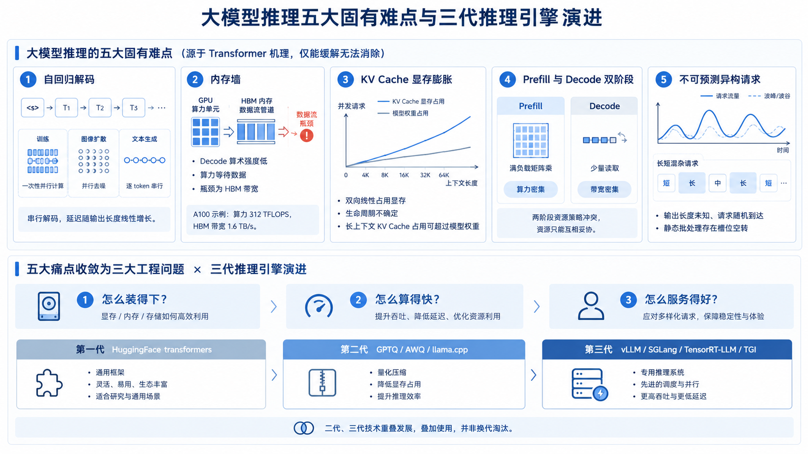
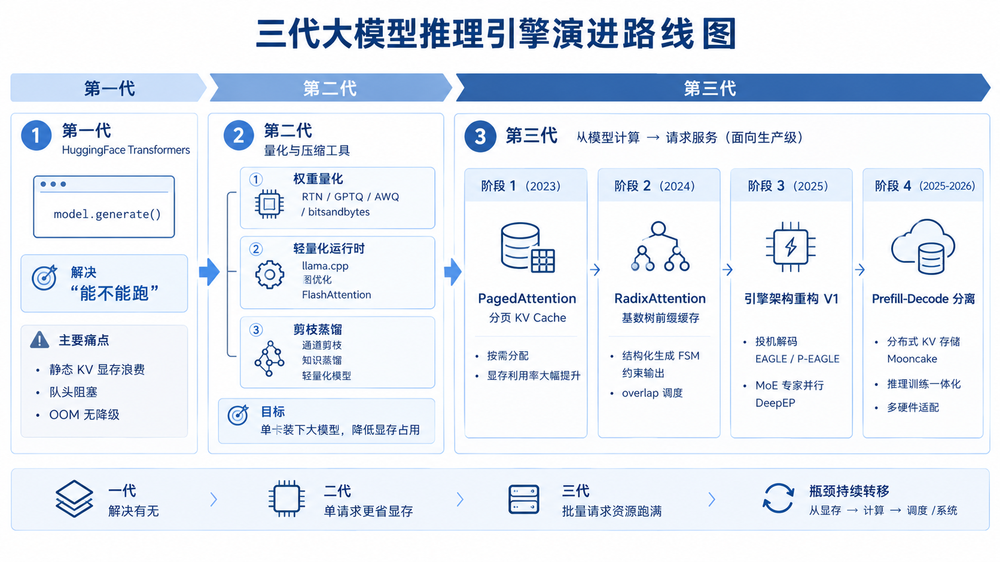
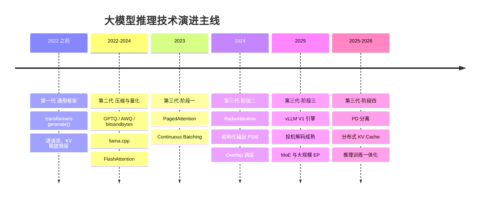

# 第 0 章　为什么需要一座 token 工厂

## 0.1 从大模型到大模型推理

2022 年底 ChatGPT 发布，两个多月用户破亿；随后 Glm、Qwen、DeepSeek 等开放权重模型接连问世，能力直逼闭源。短短三年，大模型成了通用基础设施。

模型遍地都是，新的问题随之而来：模型在哪儿跑？谁来跑？个人开发者很简单——调个云端大模型API。对企业而言，把大模型用进生产，绕不开三道硬约束：

- **数据安全与合规**：客户资料、经营数据、代码不能流出内网，金融、医疗、政务还有监管红线
- **规模化后的成本**：业务量一大，按 token 计费的 API 账单远超自建
- **自主可控**：核心业务不能被第三方的限流、涨价、停服左右

于是私有化部署成为大型企业的共同选择：把开源权重模型下载下来，跑在自己的机房或私有云里。

这些场景你大概率都经历过：调一次对话 API，或本地跑一句 `model.generate()`。它们做的是同一件事——模型已经训练好了，现在把它用起来，这个过程就叫推理（Inference）：给定训练完成的模型和一段输入，让它生成输出。

### 0.1.1 训练一次，推理万亿次

训练是一次性投入：即便对大厂，一个模型从头训一遍也是数月量级。推理是持续支出：每一次提问、每一次 API 调用、Agent 的每一轮工具调用都是一次推理，7×24 小时不间断。所以模型生命周期内的总算力消耗，大头在推理侧，业界估计占比在九成以上。

由此先立一个后面会反复出现的判断：推理成本就是 AI 应用的边际成本。模型再聪明，推理又贵又慢，产品就立不住。

### 0.1.2 难的不是跑一遍，是服务化

单机、单用户、跑通实验，确实就是加载权重、跑一次前向。真正难的是做出服务化的那一刻：

- 不再是一个人在用，而是成千上万个请求同时到达——显存怎么分？谁先谁后？
- 用户在屏幕前实时等着——第一个字几秒内不出来就是超时，字间卡顿肉眼可见
- 每 1000 个 token 都是真金白银——成本压到多少，业务才跑得通？

这些问题没有一个是模型本身的问题，全部是工程化的问题。回答它们的这一层技术叫推理引擎（vLLM、SGLang、TensorRT-LLM……），也就是从「能跑」到「生产级服务」的距离。

## 0.2 大模型推理到底难在哪

下面五个难点由 Transformer 自回归生成的机理决定，与引擎、硬件无关：推理引擎能缓解、转嫁、绕开，但不能消除。

**问题1：自回归解码**

第 N 个 token 必须等前 N−1 个全部算完才能开始，没有并行空间——生成 1000 个 token 就是 1000 次串行的前向传播。训练时一次前向就把整个序列算掉，只有文本生成是一个字一个字往外蹦。延迟与输出长度成正比，想砍只有三条路：一步多 token、多请求一起走、单步更快。

**问题2：内存墙——算力在等数据**

Decode 每生成一个 token，都要把全部权重从 HBM 读一遍，7B 模型 BF16 约 14GB。关键在于算术强度：训练时 batch × seq 很大，读一次权重能做海量计算，瓶颈在算力；Decode 每步只有 1 个新 token 的计算量，算术强度极低，瓶颈在 HBM 带宽而不在 FLOPS。A100 的内存带宽 2.0 TB/s 对 312TFLOPS 的 FP16 算力，这种不匹配就是内存墙（Memory Wall，简称 MW）。

**问题3：KV Cache——一份双重膨胀的显存账单**

为了不每步重算全部历史，Attention 的 K/V 被缓存复用，代价是显存，且沿两个方向同时线性膨胀：上下文每多一个 token 多一份，每个并发请求又要一份。更麻烦的是生命周期不可预知——请求何时结束、会生成多长事前都不知道，划多了浪费，划少了 OOM。长上下文场景下，它会反超模型权重成为显存主体。

**问题4：两个阶段，两种性格**

- Prefill（处理输入 prompt）：一次性并行计算成百上千个 token，矩阵乘饱满，算力密集（compute-bound）
- Decode（逐 token 生成）：每步只读权重、算很少，带宽密集（memory-bandwidth-bound）

两者最优的硬件、并行策略、批大小都不同，硬塞在一组 GPU 上只能互相妥协。

**问题5：请求不可预测——长度未知、到达随机、分布异构**

- 输出长度事前不可知——模型不生成完，你不知道它要停在哪
- 到达是随机的，有突发，有波峰波谷

后果：静态批处理必然低效——一个 batch 里只要有一个长尾请求没结束，其他已完成的槽位就空转，显存和调度都必须动态。



把这五个痛点翻译成工程语言，就是三个问题：**装得下、算得快、服务得好**——三代引擎的分工恰好对应这三问。

## 0.3 第一代：HuggingFace Transformers

这一代的典型写法：

```python
outputs = model.generate(input_ids, max_new_tokens=256)
```

`transformers` 是**训练与研究框架**，`generate()` 是为「单机、单请求、把实验跑通」设计的，不是为「对外提供高并发服务」设计的。它的历史贡献是确立事实标准——权重格式（safetensors）、`config.json`、tokenizer 协议、采样参数语义（temperature / top-p / top-k / repetition penalty）；它还把 KV Cache 变成了默认（`use_cache=True`）。

**服务化场景下的三个致命问题**

1. 显存严重浪费。请求实际生成 200 个 token，却按 2048 的 `max_length` 预留整块连续显存，多出来的既不能给别人用，也算不进批大小。实测 KV Cache 的利用率常常只有 20%–40%。

2. 没有请求级调度。一个 batch 里只要有一个长请求没结束，其他已完成的槽位就空转——典型的队头阻塞。

3. 无并发、无抢占。显存一旦不够，直接 OOM。

模型小、请求少时这些浪费不致命，一旦对外服务立刻崩盘。社区的第一反应不是「写一个服务框架」，而是「让模型小一点」——2022–2023 年最痛的是装不下。

## 0.4 第二代：模型压缩与量化工具

2023 年前后，70B 模型的 BF16 权重超过 140GB，一张 80GB 的 A100/H100 都装不下；消费级的 24GB 卡连 30B 都勉强。第二代的思路很朴素：既然读不下、算不起，就把模型变小。

**路线一：权重量化**

把 FP16 / BF16 权重压到 INT8 / INT4 / FP8，显存占用降到 1/2 – 1/4：

| 方法 | 核心思路 | 特点 |
|---|---|---|
| **RTN** | 直接四舍五入到低精度 | 最简单，4-bit 下精度掉得快，一般只作为基线 |
| **GPTQ**（2022） | 用少量校准数据，按二阶信息（Hessian）逐列量化并补偿误差 | 4-bit 首次真正可用；量化一次，推理长期受益 |
| **AWQ**（2023） | 激活感知：保护约 1% 的「关键权重」不量化 | 精度与硬件友好度平衡得好，工程上使用最广 |
| **SmoothQuant** | 平滑激活动态范围，将量化压力从激活转移至权重，实现 W8A8 | 解决激活直接 INT8 量化精度大幅下降的问题 |
| **bitsandbytes**（NF4 / LLM.int8()） | 4-bit 加载 + 异常值分块处理 | 让单卡微调与 4-bit 推理平民化（QLoRA 的基础） |

还有一条独立支线：KV Cache 量化（FP8 乃至 2-bit），压缩的不是权重，而是痛点三那张账单。

**路线二：轻量化运行时与图 / 内核优化**

- **llama.cpp + GGML/GGUF**：把大模型搬到 CPU、Apple Silicon、消费级显卡上，意义在**普及**——把「能跑」的门槛拉到桌面
- **ONNX Runtime / TensorRT**：图优化、算子融合、常量折叠，把 eager 执行变成静态高效图
- **FlashAttention / FlashInfer**：IO 感知的注意力内核，用分块计算 + 在线 softmax 把注意力的 HBM 读写量降下来。**这是「算得快」的地基——第三代引擎全部站在它上面。**

蒸馏、剪枝、低秩分解收益稳定性都不如量化，本教程不展开。

## 0.5 第三代：专用大模型推理系统——把服务做好（2023–2026 年）

第三代的本质变化不是某一项技术，而是**优化视角的切换**：前两代看的是**模型**（权重多少 GB、前向多少 FLOPS），第三代看的是**服务**（显存、排队、KV 复用、SLO）。**第二代让一个请求跑得更省，第三代让一堆请求跑得更满。**

### 0.5.1 阶段一：显存管理革命与连续批处理（2023 年）

2023 年 vLLM 提出 PagedAttention，借用操作系统虚拟内存的分页思想：把 KV Cache 切成固定大小的块（block，通常 16–32 个 token），逻辑连续的序列可以存在不连续的块里，靠块表（block table）映射，按需分配，相同前缀写时复制共享。这把 KV Cache 的利用率提到 **90% 以上**（实测普遍在 90%–95%），直接换算成**更大的批大小**和**更高的吞吐**。

### 0.5.2 阶段二：跨请求复用与结构化生成（2024 年）

SGLang 用一棵**基数树**（Radix Tree）管理所有请求的 KV Cache：节点是一段 token 前缀，挂 KV 块索引，新请求做最长前缀匹配，命中的直接复用，只 prefill 后缀。收益取决于**请求有多相似**：前缀复用可达数倍提升，生产环境命中率在 **50%–75%**；若 prompt 都独一无二，收益趋近于零——**这是一切前缀缓存技术的前提。**

Agent 应用爆发后，**模型必须吐出能被程序解析的 JSON** 成了硬需求：2024 年成熟的方案是把约束编译成**有限状态机**，解码每一步直接屏蔽非法 token 的 logits，非法输出在物理上不可能产生。此外 **CPU 侧调度开销**靠 **overlap scheduling** 配合 CUDA Graph 解决。

### 0.5.3 阶段三：引擎架构重构与投机解码（2025 年）

vLLM 在 v0.8.0 把 V1 引擎转为默认，架构彻底重写：**多进程架构**（scheduler、EngineCore、tokenizer、detokenizer、API server 分进程，解除 GIL 束缚）、**统一调度**（取消 prefill / decode 的阶段区分）、**Persistent Batch**（输入张量用 NumPy 缓存增量更新）。V1 相对 V0 在 Llama 3.1 8B 和 3.3 70B 上吞吐最高提升约 **1.7 倍**，**没有一项来自新的 AI 算法**——**红利从算法层转移到了系统层。**

**投机解码**攻击 decode 的串行性：用轻量模型（EAGLE / draft model / MTP head / N-gram）猜出候选，主模型一次前向**并行验证**，拒绝的从第一个错误处回退。2026 年起**并行起草**（P-EAGLE、DFlash、DSpark）连「猜」也并行，瓶颈转移到「验证太多会被拒的候选」（DSpark 用置信度头解决），细节见第 7 章 7.3 节。MoE 主流后 TP/PP 切法失效：专家层需要 **Expert Parallel（EP）**，瓶颈变成 All-to-All，大规模 EP（如 DeepEP）成为必备。

### 0.5.4 阶段四：分离式与集群化（2025–2026 年）

Prefill **算力密集**、Decode **带宽密集**，放同一组 GPU 上必然互相干扰：长 prompt 的 prefill 会卡住 decode（TTFT 和 TPOT 打架），而为 decode 配的带宽 prefill 用不上。**PD 分离**把两者拆到不同 GPU 池，各自配比扩缩容，通过高速网络（NVLink / RDMA）传输 KV Cache；配套有 KV 传输层（NIXL、GPUDirect RDMA）、集群级 KV 存储（Mooncake）、radix cache 协同、Dynamo 等编排层集成。

同期，RL 后训练（RLHF / RLVR）规模化让推理引擎承担 rollout，带来权重热更新、数值一致性、显存复用（如 sleep mode）等需求；硬件侧还要覆盖 AMD ROCm、Intel Gaudi/XPU、Google TPU、国产 NPU（昇腾等）。



## 0.6 演进小结：三代主线与瓶颈转移

**三代引擎的分工**

| 代际 | 时期 | 代表 | 优化对象 | 解决 | 不解决 |
|---|---|---|---|---|---|
| **第一代** | 2022 及之前 | HuggingFace `transformers` | 单请求的一次生成 | 把模型跑起来；确立生态标准 | 显存利用率、并发、调度、SLO |
| **第二代** | 2022–2024 | GPTQ / AWQ / bitsandbytes / llama.cpp / FlashAttention | 模型本身体积与访存量 | 装得下、跑得起、成本降下来 | 服务化的一切（调度、并发、SLO） |
| **第三代** | 2023–2026 | vLLM / SGLang / TensorRT-LLM / TGI / LMDeploy | 一批请求在一段时间内的资源分配 | 吞吐、并发、SLO、集群扩展 | 精度代价（交给第二代）、效果本身 |

「第几代」说的是**问题域的划分**：第二、三代几乎同时发展，今天仍在叠加使用。




三条判断：**优化重心在持续上移**（算子 → 显存 → 请求 → 引擎 → 集群）；**收益越来越依赖场景**（第二代几乎对所有人都有效，到阶段四，PD 分离对某些负载是数倍提升、对另一些是负优化，**「抄参数」基本失效**）；**系统工程的权重超过算法**。

## 0.7 什么是「token 自由」

很多人第一反应是「无限制地造 token」，但实际上 token 很难无穷。

| 维度 | 「token 自由」的含义 | 反面（不自由） |
| --- | --- | --- |
| **产能不受单点限制** | 加卡能大致线性地扩产能，不被单机、单卡卡死 | 加了一张卡，吞吐没怎么涨 |
| **成本可测可控** | 每百万 token 的成本算得清、能比较、能优化 | 月底看账单才知道花了多少 |
| **性能可守** | 承诺的 TTFT / P99 在真实负载下守得住 | 压测好看，一上量就崩 |

**这三条就是本书的验收标准。** 从第 0 章到第 14 章，每章都在为其中至少一条服务。

怎么组织？**沿着瓶颈的层级往上走**——两幕：

| 幕 | 章 | 回答 | 你会得到 |
| --- | --- | --- | --- |
| **第一幕　目标** | 0–3 | 我要造什么？为什么值得造？ | 一张工厂全景图 + 一套产能语言 |
| **第二幕　原理与引擎** | 4–14 | 它为什么难？引擎在解决什么？ | 看得懂引擎、会部署、会调 |

再往上的平台（车间）与运营不在本书范围内，第 2 章会交代它们的边界。

每一章都按同一个三问结构展开：**解决了什么瓶颈**（原理层）、**怎么开、开多少**（实操层）、**什么情况下不该开**（工程层）——**知道什么时候不该用，比知道怎么开更有价值**。

## 本章小结

1. **大模型推理有五个机理级痛点**：自回归串行、内存墙、KV Cache 双重膨胀、Prefill/Decode 两阶段异质、请求不可预测——它们由模型机理决定，三代技术能缓解、转嫁、绕开，但无法消除。

2. **五个痛点收敛成三个工程问题**：装得下、算得快、服务得好。第一代 `transformers` 把模型跑起来并确立生态标准；第二代压缩与量化解决「装得下」；第三代专用推理系统解决「服务得好」。

3. **第二代与第三代是叠加关系，不是替代关系。** 量化作用于模型侧（权重占多少字节），引擎作用于系统侧（字节怎么被调度），今天的标准配置是「第三代引擎 + 第二代量化」。

4. **第三代内部仍是一条四阶段的瓶颈转移链**：显存管理（2023）→ 跨请求复用（2024）→ 引擎重构与投机解码（2025）→ 分离式与集群化（2025–2026）。每解决一个瓶颈，就暴露下一个。
