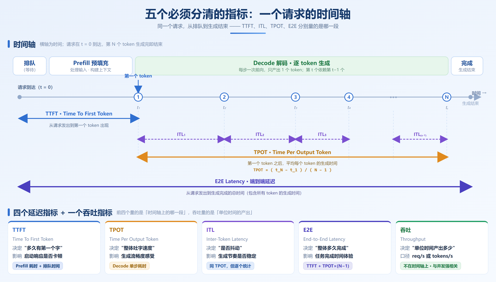
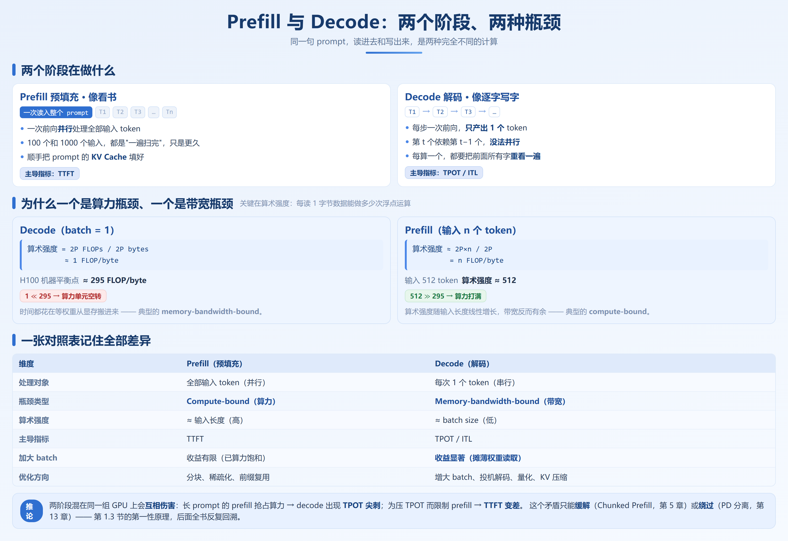
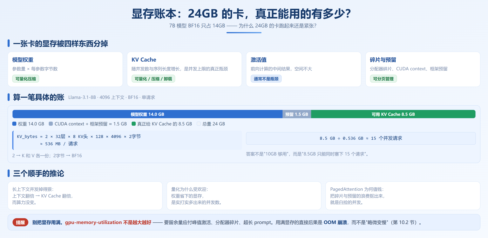

# 第 1 章　算力 ≠ token：从裸卡到可用服务

## 1.1 从 `transformers.generate` 到推理引擎

一个能跑的服务，和一个能用的服务。几乎所有人都从这段代码开始：

```python
model = AutoModelForCausalLM.from_pretrained("Qwen/Qwen3-8B", device_map="cuda")
outputs = model.generate(**tokenizer(prompt, return_tensors="pt").to("cuda"),
                         max_new_tokens=256)
```

本地跑得很顺，包一层 FastAPI 就上线了。然后会遇到三个问题，一个比一个致命。

**问题一：串行处理，GPU 大部分时间在发呆。** `generate()` 一次处理一个请求，真实服务里请求并发而来，只能排队。单个请求也未必吃得满 GPU：decode 每步只生成 1 个 token，算术强度极低（1.3 节），算力单元基本在等数据从显存搬过来。

**问题二：显存按最坏情况预留。** 朴素实现（旧版静态 KV 分配）通常按 max_length 一次性给 KV Cache 预留连续显存：请求实际生成 200 个 token，系统却按 2048 预留，多出来的显存既不能给其他请求用，也提不高批大小。

**问题三：没有调度，就没有 SLO。** SLO（Service Level Objective，服务等级目标）是业务方对服务质量的量化目标，比如 P99 延迟 < 2 秒、TTFT < 500ms、可用性 99.9%。而请求怎么排队、会不会被长请求饿死、显存不够怎么办，全由调度决定；这些机制都没有，系统连「P99 是多少」都答不上来。

有人会说：那我自己攒 batch 不就行了？能解决一部分，但会撞上另一堵墙：短请求必须 padding 到批内最长，算力白花；长请求没结束，同批已完成的请求也释放不了槽位；显存仍按最大预留；批次锁死，新请求进不来。

本质上，批处理解决的是「GPU 利用率」，而推理引擎解决的是「GPU 利用率 + 显存管理 + 请求调度」三件事，手写批处理只做了第一件。

## 1.2 核心指标体系

| 指标       | 全称                    | 定义                   | 主要由什么决定                    |
| -------- | --------------------- | -------------------- | -------------------------- |
| **TTFT** | Time To First Token   | 发出请求到收到第一个 token 的时间 | Prefill 耗时 + 排队时间          |
| **TPOT** | Time Per Output Token | 生成阶段每个输出 token 的平均间隔 | Decode 单步耗时                |
| **ITL**  | Inter-Token Latency   | 相邻两个 token 的实际间隔     | 同 TPOT，逐 token 统计，能看出抖动 |
| **E2E**  | End-to-End Latency    | 从发出请求到收到最后一个 token   | `TTFT + TPOT × 输出 token 数` |
| **吞吐**   | Throughput            | 单位时间完成的请求数或 token 数  | 与并发、批处理策略强相关               |



```
E2E 延迟 = TTFT + TPOT × (输出 token 数 - 1)
```

长输出任务优化 TTFT 没什么用：输出 2000 token 时，E2E 里 TPOT 占绝大部分。反过来，RAG 场景输入长、输出短，TTFT 才是主要矛盾。

吞吐有两种口径：**请求吞吐**（requests/s，在线服务）与 **Token 吞吐**（tokens/s，批处理/离线），后者还要分输入与输出 token——prefill 并行、decode 串行，代价完全不同。

Goodput 才是真正该追的指标。吞吐数的是「做完了多少」，Goodput 数的是「送到顾客手里、且顾客还觉得合格的有多少」。超时的请求对系统算完成，对业务约等于没处理。设 SLO 为 `E2E 延迟 < 2 秒`：

| 并发数 | 吞吐（req/s） | 满足 SLO 的比例 | Goodput   |
| --- | --------- | ---------- | --------- |
| 16  | 8.2       | 100%       | 8.2       |
| 64  | 19.5      | 87%        | 17.0 ← 最高 |
| 128 | 24.1      | 41%        | 9.9       |

**Goodput = 吞吐 × 满足 SLO 的比例**

128 并发时吞吐最高（24.1 req/s），但只有 41% 的请求在 2 秒内返回；按吞吐选最优是 128，按 Goodput 最优是 64——这就是第 0.7 节挑战三说的拐点。很多线上事故的根因就是盯着吞吐把并发推过拐点：监控曲线向上，用户侧却在超时。

## 1.3 Prefill 与 Decode：两个阶段，两种瓶颈



**Prefill（预填充）——像看书。** 拿到完整 prompt 后，模型一口气把**所有**输入 token 并行读进去算完，吐出第一个输出 token；只需一次前向，输入 100 个还是 1000 个 token 都是「一遍扫完」，KV Cache 也顺手填好了。

**Decode（解码）——像逐字写字。** token 一个一个蹦出来：**每算一个，都要把前面所有的字重新看一遍**，每步只有一次前向、只产出 1 个 token，第 t 个依赖第 t-1 个，无法并行。

关键在于**算术强度**（Arithmetic Intensity）——每读取 1 字节数据能做多少次浮点运算。

Decode（batch = 1）生成一个 token：读取全部模型权重（参数量 P，BF16 约 `2P` 字节），计算约 `2P` FLOPs。

```
算术强度 = 2P FLOPs / 2P bytes ≈ 1 FLOP/byte
```

而 H100 的机器平衡点大约是：

```
989 TFLOPS ÷ 3.35 TB/s ≈ 295 FLOP/byte   （以官方规格为准，量级参考）
```

**算术强度 1 远远低于 295。** decode 时 GPU 的算力单元几乎全在空转，时间都花在等权重从 HBM 搬进来。

Prefill（输入 n 个 token）一次前向：读取权重 `2P` 字节（一次读入，服务 n 个 token），计算约 `2P × n` FLOPs。

```
算术强度 ≈ 2P×n / 2P = n FLOP/byte
```

**算术强度随输入长度线性增长。** 输入 512 token 时 ≈ 512，远超 295 的平衡点——**算力打满，带宽反而有余**，典型的 compute-bound。

| 维度           | Prefill           | Decode                     |
| ------------ | ----------------- | -------------------------- |
| 处理对象         | 全部输入 token（并行）    | 每次 1 个 token（串行）           |
| 瓶颈类型         | **Compute-bound** | **Memory-bandwidth-bound** |
| 算术强度         | ≈ 输入长度（高）         | ≈ batch size（低）            |
| 主导指标         | **TTFT**          | **TPOT / ITL**             |
| 加大 batch 的效果 | 收益有限（已算力饱和）       | **收益显著**（摊薄权重读取成本）         |
| 优化方向         | 分块、稀疏化、前缀复用       | 增大 batch、投机解码、量化、KV 压缩     |

Decode 的算术强度 ≈ batch size。batch 从 1 增到 64：权重读取量**不变**，服务的 token 数变成 64 倍，算术强度从 1 升到 64——**一次权重读取，服务了 64 个 token**，这就是 batch 是吞吐第一杠杆的原因。但上限明显：显存（KV Cache 随 batch 增长，1.4 节算账）、延迟（batch 大了单请求等待变长，撞回 Goodput 拐点）、收益递减（算术强度超过 ~295 后算力已饱和，只剩延迟在涨）。

两阶段混在同一组 GPU 上会互相伤害：长 prompt 的 prefill 占用大量算力，正在进行的 decode 被挤到后面 → **TPOT 尖刺**；为控 TPOT 而限制 prefill → **TTFT 变差**；两者最优 batch size 与并行策略不同，只能折中。**这个矛盾没法在单机内彻底解决，只能缓解**（Chunked Prefill，第 5 章）**或绕过**（PD 分离，第 13 章）。

## 1.4 显存账本：显存都去哪了



显存被四样东西分掉：**模型权重**（参数量 × 每参数字节数，可量化）、**KV Cache**（随并发数和序列长度增长，可压缩）、**激活值**（通常不是瓶颈）、**碎片与预留**（分配器碎片、CUDA context、框架预留）。

**「7B 模型 BF16 只要 14GB，为什么 24GB 的卡跑起来还是紧张？」**

24GB 减 14GB，还剩 10GB，听起来宽裕——但这 10GB 不是白给你的：

```
权重：  7B × 2 bytes              = 14.0 GB
CUDA context + 框架预留           ≈ 1.5 GB
─────────────────────────────────────────
真正能用来放 KV Cache 的          ≈ 8.5 GB
```

**真正给 KV Cache 的只有 8.5GB**——那 1.5GB 是 CUDA context、框架那些看不到的开销。以单个请求、4096 个 token 算（Llama-3.1-8B，32 层、8 个 KV head、head_dim 128、BF16）：

```
KV_bytes = 2 × 32 × 8 × 128 × 4096 × 2 ≈ 536 MB / 请求
8.5 GB ÷ 0.536 GB ≈ 15 个请求
```

**一个请求就占 536MB，所以答案不是「10GB 够用」，而是「8.5GB 只能同时塞下 15 个请求」**——batch 的显存上限不是理论上的，是算得出来的。

这也解释了长上下文并发数掉得狠（上下文翻倍，KV Cache 翻倍，算力没变）、量化为什么受欢迎（权重省下的显存就是实打实的并发数）、PagedAttention 为什么值钱（把碎片浪费抠出来就是白捡的并发）。

`gpu-memory-utilization` 不是越大越好，余量要应付峰值激活值（长序列、大 batch 时突增）、分配器碎片、多模态与超长 prompt。**用满显存的直接后果是 OOM 崩溃，而不是「略微变慢」**，第 10.2 节会讲这个值该怎么设。

配套脚本 `src/ch01-foundations/memory_calculator.py` 把上述计算自动化：每 token KV 字节数 = `2 × layers × kv_heads × head_dim × dtype_bytes`，再反推并发上限。

## 1.5 推理引擎生态全景

| 引擎               | 定位与选型提示                                     |
| ---------------- | ------------------------------------------- |
| **vLLM**         | 覆盖最广、生态最成熟（PyTorch Foundation），通用首选    |
| **SGLang**       | LMSYS 出品，RadixAttention 前缀复用、结构化输出、Day-0，适合多轮/RAG/Agent |
| **TensorRT-LLM** | NVIDIA 硬件极限优化，适合纯 NVIDIA 环境、愿付编译成本 |
| **LMDeploy**     | 商汤出品，国产化硬件友好、量化方案丰富                         |
| **TGI**          | 部署简单（HuggingFace），已进维护模式，新项目不建议          |
| **Ollama**       | 极简本地运行，适合本地开发，不用于生产                         |

本项目聚焦 vLLM 和 SGLang：二者覆盖了绝大多数生产场景，是开源推理的事实双雄；代表两条不同的优化路线——vLLM 从显存管理切入（PagedAttention），SGLang 从请求复用切入（RadixAttention）；能力大量重叠，简单说「谁更快」没有意义，**第 14.1 节会做深度对比，给出按场景的选型建议。**

选型不必过度纠结：引擎都提供 OpenAI 兼容 API，**换个 `base_url` 就能切换**；真正要重写的是引擎特有的能力（DSL、Engine API、特定的投机解码配置）。先选定一个跑起来，用真实负载压测，再决定是否切换。

## 本章小结

1. **朴素 `generate()` 上线会崩的三个原因**：串行处理导致 GPU 空转、显存按最坏情况预留、没有调度就没有 SLO。手写批处理只解决了 GPU 利用率。
2. **五个指标的分工**：TTFT 由 prefill 决定，TPOT 由 decode 决定，`E2E ≈ TTFT + TPOT × 输出长度`；RAG 主攻 TTFT，长生成主攻 TPOT。**Goodput = 吞吐 × SLO 达成率**，盯着吞吐调优会把服务推过拐点。
3. **Prefill 与 Decode 是两种计算**：Prefill 并行、compute-bound、算术强度≈输入长度；Decode 串行、memory-bound、算术强度≈batch size。**这个区分是全书的第一性原理。**
4. **加大 batch 是吞吐第一杠杆**，因为它摊薄权重读取成本；但受限于显存（KV Cache 线性增长）和延迟（Goodput 拐点）。
5. **显存四笔账**：权重、KV Cache、激活、碎片预留。8B 模型在 24GB 卡上、4K 上下文，大约只能并发 15 个请求。配套方法论是定 SLO → 建基线 → 单点变量 → 回归验证。
