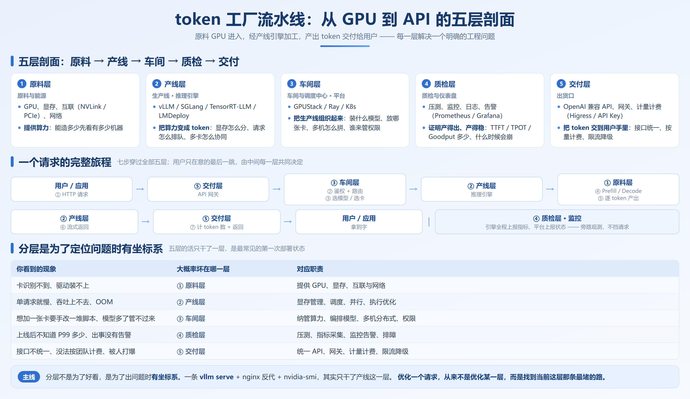
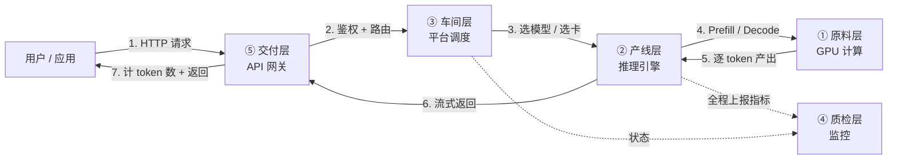
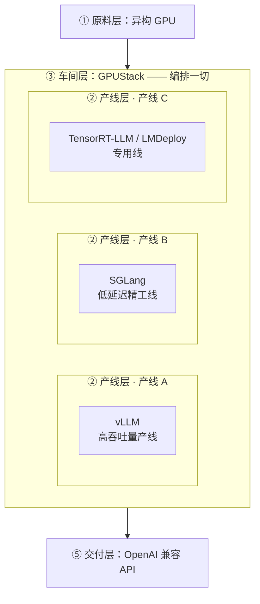
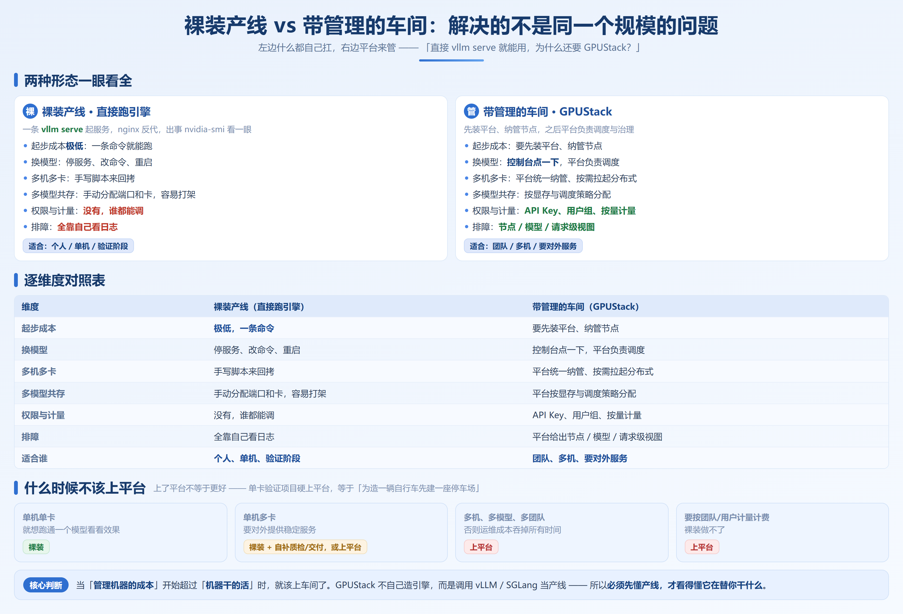

# 第 2 章　token 工厂全景：一条从 GPU 到 API 的流水线

## 2.1 工厂剖面图：原料 → 产线 → 车间 → 质检 → 交付

先给结论：**一座 token 工厂可以切成五层，每一层解决一个明确的工程问题。** 这正是全书主线的第一次完整亮相——从一张卡到一座 token 工厂。



| # | 层 | 工厂里的角色 | 干的活 | 一句话职责 |
| --- | --- | --- | --- | --- |
| ① | **原料层** | 原料与能源 | GPU、显存、互联（NVLink/PCIe）、网络 | **提供算力**：工厂能造多少，先看有多少台机器 |
| ② | **产线层** | 生产线 | 推理引擎（vLLM / SGLang …） | **把算力变成 token**：显存怎么分、请求怎么排队、多卡怎么协同 |
| ③ | **车间层** | 车间与调度中心 | 平台（GPUStack） | **把生产线组织起来**：装什么模型、放哪张卡、多机怎么拼、谁来管权限 |
| ④ | **质检层** | 质检与仪表盘 | 压测、监控、日志、告警 | **证明产得出、产得稳**：TTFT/TPOT 多少、Goodput 多少、什么时候会崩 |
| ⑤ | **交付层** | 出货口 | OpenAI 兼容 API、网关、计量计费 | **把 token 交到用户手里**：接口统一、按量计费、限流降级 |

> 原料是「有多少算力」，产线是「算力怎么变成 token」，车间是「多条产线怎么被统一调度」，质检是「怎么知道造得好不好」，交付是「token 怎么卖出去、算得清账」。

### 2.1.1 为什么是「五层」而不是「一坨」

很多人第一次部署，是把这些东西全糊在一起：一条 `vllm serve` 命令起服务，nginx 做个反代，出事了 `nvidia-smi` 看一眼——**五层的活，其实只干了产线这一层。**

分开看的好处是：出问题时，你能立刻定位到是哪一层坏了。

| 你看到的现象 | 大概率坏在哪一层 |
| --- | --- |
| 卡识别不到、驱动装不上 | ① 原料层 |
| 单请求就慢、吞吐上不去、OOM | ② 产线层 |
| 想加一张卡要手改一堆脚本、模型多了管不过来 | ③ 车间层 |
| 上线后不知道 P99 多少、出事没有告警 | ④ 质检层 |
| 接口不统一、没法按团队计费、被人打爆 | ⑤ 交付层 |

**分层不是为了好看，是为了定位问题时有坐标系。**

---

## 2.2 每一层在解决什么

把五层展开成一张总表。这张表是本章的地图，也是后面各章的地图——每一章基本都在深挖这张表里的一格。

| 层 | 它回答的问题 | 核心职责 | 代表技术 | 缺了它会怎样 |
| --- | --- | --- | --- | --- |
| ① 原料 | 有多少算力？ | 提供 GPU、显存、互联与网络 | NVIDIA / AMD / 昇腾 / 海光 …；NVLink、PCIe、RDMA | 无米下锅 |
| ② 产线 | 单条产线为什么快？ | 显存管理、调度、并行、执行优化 | **vLLM**、**SGLang**、TensorRT-LLM、LMDeploy | 跑得起来、跑不好（第 0 章三个致命问题） |
| ③ 车间 | 多条产线怎么管？ | 纳管算力、编排模型、多机分布式、权限 | **GPUStack**、Ray、K8s | 一台台机器手工运维，规模一上来就散架 |
| ④ 质检 | 到底产得好不好？ | 压测、指标采集、监控告警、排障 | Prometheus / Grafana、压测工具、日志 | 「感觉还行」，直到线上炸了才知道 |
| ⑤ 交付 | 怎么把 token 交出去？ | 统一 API、网关、计量计费、限流降级 | OpenAI 兼容 API、Higress、API Key | 每个应用各接各的，成本说不清、风险兜不住 |

### 2.2.1 一个请求的完整旅程

把五层串起来看，一个用户请求在工厂里的旅程是这样的：



七步里，用户在意的只有「第 7 步拿到字快不快」；但决定这一点的，是中间每一层。**优化一个请求，从来不是优化某一层，而是找到当前这层那条最堵的路。**

## 2.3 为什么是这几件技术：vLLM / SGLang / GPUStack 的生态位

第 1.5 节列过一张推理引擎生态表，这里换个角度——**不问「谁更好」，只问「谁站在工厂的哪个位置」。**



### 2.3.1 vLLM：通用量产线

vLLM 的定位是**「什么模型、什么硬件都能上，还要高吞吐」**。

- **它解决的瓶颈**：显存碎片与批处理效率（PagedAttention、连续批处理，见第 4、5 章）
- **它的强项**：模型/硬件覆盖最广、生态最成熟、社区最大——你是「通用工厂」，选它最不容易踩坑
- **它适合的负载**：模型种类多、硬件种类杂、以吞吐为优先的通用场景

### 2.3.2 SGLang：低延迟精工线

SGLang 的定位是**「请求之间有大量重复时，把重复的部分省掉」**。

- **它解决的瓶颈**：跨请求的重复计算（RadixAttention 前缀复用，见第 4 章）
- **它的强项**：多轮对话 / RAG / Agent 这类**前缀高度相似**的负载，以及结构化输出、前沿特性 Day-0
- **它适合的负载**：低延迟敏感、请求间共享上下文多的场景

> vLLM 与 SGLang **不是竞争关系，而是两条不同工艺的产线**。它们都在补齐对方的能力，简单说「谁更快」没有意义。**第 14 章会给出「什么负载谁占优」的决策树。**

### 2.3.3 GPUStack：统管全厂的车间（本书不展开）

再往上一层是**车间**。工厂里最尴尬的状态，是「每条产线都能跑，但没人知道全厂有多少台机器、装了什么、谁在用」。

GPUStack 就是干这个的：纳管算力、把模型放到合适的卡上、拉起分布式推理、统一 API、给可观测与计量。它有个好记的定位——**不造引擎，只做编排**，调用的还是 vLLM / SGLang 这些产线。所以必须先懂产线，才看得懂它在替你干什么。

这一层本书只交代位置，不展开教程。单机多卡、模型种类不多的团队，裸装引擎通常就够用（判断标准见 2.4 节）。

---

## 2.4 裸装产线 vs 带管理系统的车间

新手最常见的疑问：**「我直接 `vllm serve` 就能用，为什么还要 GPUStack？」**

答案是：**它们解决的不是同一个规模上的问题。** 看这张对比表：



| 维度 | 裸装产线（直接跑引擎） | 带管理的车间（GPUStack） |
| --- | --- | --- |
| 起步成本 | **极低**，一条命令 | 要先装平台、纳管节点 |
| 换模型 | 停服务、改命令、重启 | 控制台点一下，平台负责调度 |
| 多机多卡 | 手写脚本来回拷 | 平台统一纳管、按需拉起分布式 |
| 多模型共存 | 手动分配端口和卡，容易打架 | 平台按显存与调度策略分配 |
| 权限与计量 | 没有，谁都能调 | API Key、用户组、按量计量 |
| 排障 | 全靠自己看日志 | 平台给出节点/模型/请求级视图 |
| 适合谁 | **个人、单机、验证阶段** | **团队、多机、要对外服务** |

### 2.4.1 什么时候不该上平台

**上了平台不等于更好。** 一个单卡的验证项目，硬上 GPUStack 就是「为了造一辆自行车先建一座停车场」。判断标准很简单：

| 你的情况 | 建议 |
| --- | --- |
| 单机单卡、就想跑通一个模型看看效果 | **裸装**，直接跑引擎 |
| 单机多卡、要对外提供稳定服务 | 可以裸装 + 自己补质检/交付层；上平台更省心 |
| 多机、多模型、多团队 | **上平台**，否则运维成本会吞掉你所有时间 |
| 要按团队/用户计量计费 | **上平台**（或自建计量），裸装做不了 |

**核心判断**：当「管理机器的成本」开始超过「机器干的活」时，就该上车间了。

## 2.5 全书路线图

现在你已经拿到了全厂地图。接下来的每一章，都在深挖这张图里的一格：

| 幕 | 章 | 深挖哪一层 |
| --- | --- | --- |
| **第一幕** 目标（0–3） | 第 0 章：为什么需要工厂 | 全局：瓶颈转移史 |
| | 第 1 章：算力 ≠ token | 全局：指标语言与第一性原理 |
| | **第 2 章：工厂全景（本章）** | **全局：五层解剖** |
| | 第 3 章：推理引擎原理与生态 | ② 产线层：引擎是什么 |
| **第二幕** 原理与引擎（4–14） | 第 4–7 章：KV Cache / 调度 / 并行 / 投机解码 | ② 产线层：原理四件套 |
| | 第 8–10 章：vLLM 上手 / 能力 / 调优 | ② 产线层：vLLM 实操 |
| | 第 11–13 章：SGLang 上手 / 能力 / PD 分离 | ② 产线层：SGLang 实操 |
| | 第 14 章：双引擎选型 | ② 产线层：选型决策 |

表里 ③④⑤ 三层留着位置，但本书的深挖到此为止——先看懂产线，才谈得上组织产线。什么时候该往上看，2.4 节给了判断标准。

一句话概括全书的推进逻辑：

```
先建目标（第一幕）→ 再拆产线（第二幕）→ 知道上面还有几层，以及什么时候该上去
```

## 动手实验：给你的部署画一张剖面图

这个实验不需要 GPU，只需要你对自己现在的系统诚实。

照着下表，逐行填「你现在有没有这一层」，并写下最痛的一个问题：

| 层 | 你现在有什么？ | 最痛的一个问题 |
| --- | --- | --- |
| ① 原料 | 例如：单卡 4090 24GB | 卡就一张，模型稍微大点就装不下 |
| ② 产线 | 例如：`vllm serve Qwen3.5-0.8B` | 并发一上来 TPOT 就抖 |
| ③ 车间 | 例如：无，手动 SSH 管理 | 想加卡要重写启动脚本 |
| ④ 质检 | 例如：只有 `nvidia-smi` | 不知道线上 P99 多少 |
| ⑤ 交付 | 例如：vLLM 自带的 `/v1/chat/completions` | 没法按团队算 token 用量 |

填完之后，你会得到一张**属于自己的缺口清单**。接下来读哪一章，就看你哪一行的「最痛」最扎眼——这比按顺序硬读高效得多。

---

## 本章小结

1. **一座 token 工厂分五层**：原料（算力）→ 产线（引擎）→ 车间（平台）→ 质检（可观测）→ 交付（API）。分层不是为了好看，是为了出问题时**有坐标系**。

2. **vLLM / SGLang / GPUStack 站的不是同一层**：前两者是**产线**（解决「单条线上为什么快」），GPUStack 是**车间**（解决「多条产线怎么被统一调度」）。它们不是竞争关系。

3. **「直接跑引擎」和「上平台」解决的是不同规模的问题**：单机验证裸装最快；多机、多模型、多团队、要计量，就该上车间。**当管理机器的成本超过机器干的活时，就该上平台。**

4. **一个请求的完整旅程穿过全部五层**：用户只在意最后一跳快不快，但决定这一跳的，是中间每一层。定位性能问题，就是找出当前最堵的那一层。

5. **这本书只深挖到产线层**：第一幕建目标，第二幕拆产线；车间以上的三层只给位置和判断标准，不展开教程。

> **下一章**：[第 3 章　推理引擎原理与生态：把模型变成 token 的机器](./ch03-推理引擎原理与生态.md)
