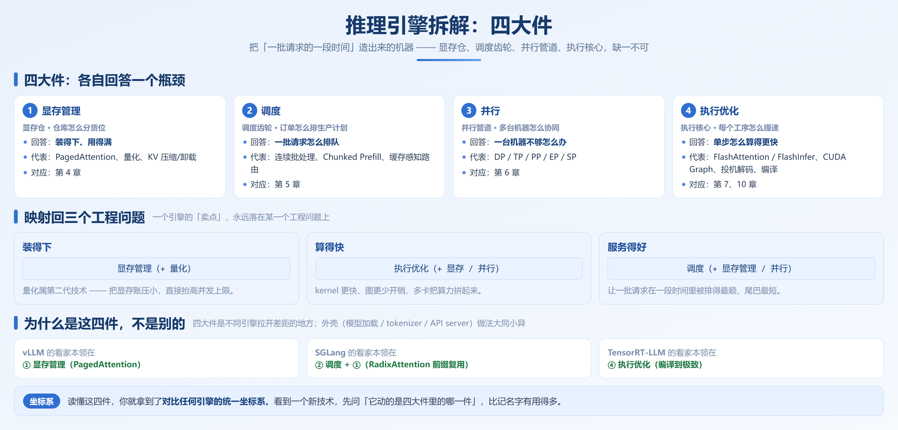
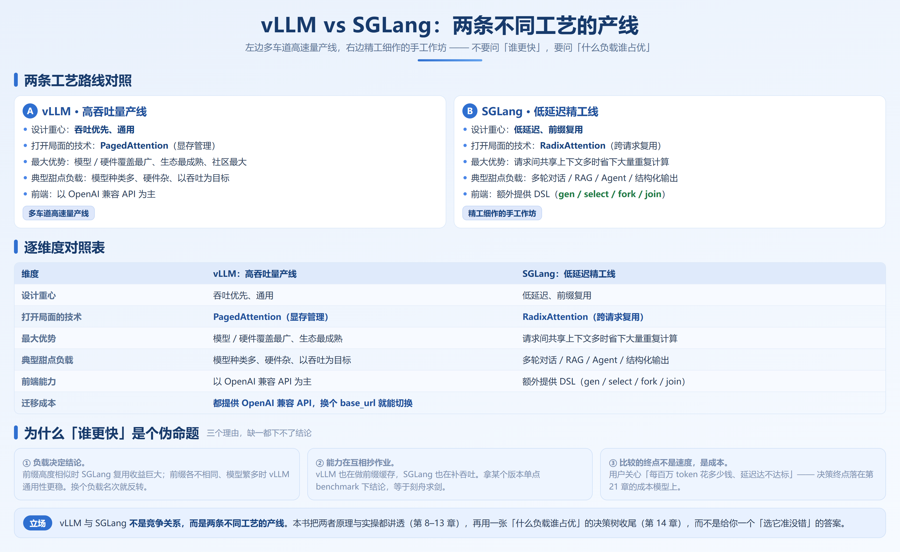

# 第 3 章　推理引擎原理与生态：把模型变成 token 的机器

## 3.1 引擎的四大件：一台机器拆开看

第 0 章说过，第三代推理系统和前两代的根本区别，是**优化视角从「一个模型的一次前向」切到了「一批请求的一段时间」**。一个推理引擎，就是围绕这个新视角造出来的机器。

它由四件东西构成，缺一不可：

| 大件 | 它回答的瓶颈 | 直觉 | 代表技术 | 对应章 |
| --- | --- | --- | --- | --- |
| **① 显存管理** | 装得下、用得满 | 仓库怎么分货位 | PagedAttention、量化、KV 压缩/卸载 | 第 4 章 |
| **② 调度** | 一批请求怎么排队 | 订单怎么排生产计划 | 连续批处理、Chunked Prefill、缓存感知路由 | 第 5 章 |
| **③ 并行** | 一台机器不够怎么办 | 多台机器怎么协同 | DP / TP / PP / EP / SP | 第 6 章 |
| **④ 执行优化** | 单步怎么算得更快 | 每个工序怎么提速 | FlashAttention/FlashInfer、CUDA Graph、投机解码、编译 | 第 4、7、10 章 |

> 这里提到的FlashAttention 出生在第二代（见ch00）,如今已是第三代引擎中的标配，和量化一样，是叠加而不是替代：量化管的是权重占多少字节，而FlashAttention这种内核管这些字节怎么被搬。

### 3.1.1 四大件 vs 三个工程问题

把四大件映射回第 0 章的三个工程问题，会看得更清楚——**一个引擎的「卖点」，永远落在某一个工程问题上**：

| 工程问题 | 主要靠哪几件解决 |
| --- | --- |
| **装得下** | 显存管理（+ 量化，属第二代技术） |
| **算得快** | 执行优化（+ 显存/并行） |
| **服务得好** | 调度（+ 显存管理、并行） |

### 3.1.2 为什么是这四件，不是别的

一个自然的问题：为什么不把「模型加载」「tokenizer」「API server」也算进四大件？

因为那四件是**每一个引擎都必须有、且做法大同小异**的部分——就像「机器要有外壳」。而四大件是**不同引擎拉开差距的地方**：

- vLLM 的看家本领在 **① 显存管理**（PagedAttention）
- SGLang 的看家本领在 **② 调度 + ①**（RadixAttention 前缀复用）
- TensorRT-LLM 的看家本领在 **④ 执行优化**（编译到极致）

**读懂这四件，你就拿到了对比任何引擎的统一坐标系。** 看到一个新技术，先问「它动的是四大件里的哪一件」，比记名字有用得多。

## 3.2 引擎生态全景：按「切入口」分类

市面上引擎不少，但**不用一个个背**。抓住它们各自的「切入口」，就能一眼定性。

| 引擎 | 出身 | 切入口（动的是哪一件） | 解决目标 | 生态位 |
| --- | --- | --- | --- | --- |
| **vLLM** | vLLM 社区（PyTorch Foundation） | 显存管理 + 调度 | 通用高吞吐服务 | 通用首选 |
| **SGLang** | LMSYS | 调度（前缀复用）+ 执行 | 低延迟、重前缀复用 | 精工产线 |
| **TensorRT-LLM** | NVIDIA | 执行优化（编译） | NVIDIA 硬件上的极限延迟 | 纯 NVIDIA、愿付编译成本 |
| **LMDeploy** | 商汤（OpenMMLab） | 显存量化 + 国产化适配 | 国产硬件友好、量化方案丰富 | 国产化部署 |
| **TGI** | HuggingFace | 部署易用 | 部署简单 | 已进入维护模式，新项目不建议 |
| **Ollama / llama.cpp** | Ollama / ggml | 轻量化运行时 | 本地、端侧、CPU 也能跑 | 个人开发、非生产 |

### 3.2.1 一条更有用的分类线：通用型 vs 专用型

抛开具体名字，引擎其实分两类：

- **通用型引擎**（vLLM、SGLang）：追求「模型/硬件覆盖广 + 综合能力均衡」，是大多数生产的默认选择。
- **专用型引擎**（TensorRT-LLM、LMDeploy、Ollama…）：为特定硬件或特定场景做到极致，**换来的代价是覆盖范围变窄**（只管 NVIDIA / 只管某类量化 / 只管本地）。

**选型的第一个判断永远是这条**：你要的是「什么都能干」，还是「某一件干到极致」？

## 3.3 vLLM vs SGLang：两条不同工艺的产线

这是本书的关键对比，也是最多人问的问题。先把立场亮出来：

> **不要问「vLLM 和 SGLang 谁更快」，要问「什么负载谁占优」。**
>
> 它们是两条工艺不同的产线，各自的能力还在互相补齐——今天的对比结论，半年后可能就变了。

| 维度 | vLLM：高吞吐量产线 | SGLang：低延迟精工线 |
| --- | --- | --- |
| **设计重心** | 吞吐优先、通用 | 低延迟、前缀复用 |
| **打开局面的技术** | PagedAttention（显存管理） | RadixAttention（跨请求复用） |
| **最大优势** | 模型/硬件覆盖最广、生态最成熟、社区最大 | 请求间共享上下文多时省下大量重复计算 |
| **典型甜点负载** | 模型种类多、硬件杂、以吞吐为目标 | 多轮对话 / RAG / Agent / 结构化输出 |
| **前端能力** | 以 OpenAI 兼容 API 为主 | 额外提供 DSL（`gen`/`select`/`fork`/`join`） |
| **迁移成本** | 都提供 OpenAI 兼容 API，**换个 `base_url` 就能切换** | 同左 |

### 3.3.1 为什么「谁更快」是个伪命题

三个理由：

1. **负载决定结论。** 前缀高度相似时 SGLang 的复用收益巨大；前缀各不相同、模型种类繁多时 vLLM 的通用性更稳。同一对引擎，换个负载名次就反转。
2. **能力在互相抄作业。** vLLM 也在做前缀缓存，SGLang 也在补吞吐能力。拿某个版本的单点 benchmark 下结论，等于刻舟求剑。
3. **比较的终点不是速度，是成本。** 用户不关心 tokens/s 这个数字，关心的是「每百万 token 花多少钱、延迟达不达标」——**选型的决策终点，永远落在每百万 token 的成本上。**

**所以这本书的做法是**：把两个引擎的原理和实操都讲透（第 8–13 章），再用一张「什么负载谁占优」的决策树收尾（第 14 章），而不是给你一个「选它准没错」的答案。

## 3.4 引擎的「出厂规格」怎么看

买一台机器要看参数，选一个引擎要看「规格」。下面这张清单，是你评估任何引擎的通用模板——**逐项问自己「它支不支持」，就知道能不能用。**

| 规格维度 | 要看什么 | 为什么重要 |
| --- | --- | --- |
| **模型支持** | 支持哪些架构？新模型是否 Day-0 支持？ | 你的模型跑不起来，其他都是零 |
| **硬件支持** | NVIDIA / AMD / 国产卡（昇腾、海光、摩尔线程…） | 决定它能装在你的机器上 |
| **量化支持** | FP8 / INT8 / INT4 / AWQ / GPTQ 等 | 决定「装得下」的边界（第 9 章） |
| **并行能力** | TP / PP / EP / SP 支持度 | 决定多卡、MoE 能不能用（第 6 章） |
| **上下文长度** | 最大支持多少、长上下文是否优化 | 决定长文档 / Agent 场景可行否 |
| **接口兼容** | 是否 OpenAI 兼容、是否有原生 SDK | 决定上层应用接起来费不费劲 |
| **扩展能力** | LoRA、多模态、结构化输出、Embedding | 决定特殊场景能不能做（第 9、12 章） |

### 3.4.1 三个反模式

看规格时最容易踩的三个坑：

1. **只看通稿数字。** 官方发布的 benchmark 用的是特定模型、特定硬件、特定负载——**那是它的最佳工况，不是你的工况**。以官方规格为准，但更要看能不能在你自己的机器上复现。
2. **忽略版本漂移。** 引擎两个月一个版本，昨天不支持的今天可能就支持了，昨天的默认值今天可能变了。**看规格永远要带上版本号。**
3. **把「支持」当「好用」。** 「支持 TP」和「TP 在你这张卡上跑得很顺」是两回事。支持列表只说明**能用**，不说明**值得用**。

## 3.5 为什么这本书只聚焦 vLLM 与 SGLang

三个理由，和体系化的取舍有关：

1. **覆盖了绝大多数生产场景。** 这两家是当前开源推理的事实双雄，全球部署量级最大。
2. **代表了两条不同的优化路线。** vLLM 从**显存管理**切入，SGLang 从**请求复用**切入。把两条路线都讲透，你得到的是**完整的优化思维**，而不是某个工具的使用手册。看懂两条路，再看别的引擎也是同一套坐标系。
3. **它们的能力大量重叠，选型需要判断力。** 正因为难分高下，才更考验「按场景判断」的能力

至于其他引擎（TensorRT-LLM、LMDeploy 等），第 14 章会做横向对比，帮你把坐标系补全。

## 本章小结

1. **推理引擎由四大件构成**：显存管理、调度、并行、执行优化。它们分别对应「仓库怎么分货位、订单怎么排队、多台机器怎么协同、单个工序怎么提速」。

2. **四大件对应三个工程问题**：显存管理管「装得下」，执行优化管「算得快」，调度管「服务得好」。**不同引擎的卖点，永远落在其中某一件上。**

3. **引擎按「切入口」分类**：vLLM 从显存管理切入，SGLang 从请求复用切入，TensorRT-LLM 从编译切入。**看到新技术先问「它动的是哪一件」，比记名字有用。**

4. **vLLM 与 SGLang 是两条工艺不同的产线**，不是竞争关系。不要问「谁更快」，要问「**什么负载谁占优**」——负载、版本、成本，三者缺一都下不了结论。

5. **看引擎规格要用通用清单**：模型 / 硬件 / 量化 / 并行 / 上下文 / 接口 / 扩展。三个反模式是：只看通稿数字、忽略版本漂移、把「支持」当「好用」。

6. **本书聚焦 vLLM 与 SGLang**，因为它们覆盖了绝大多数生产场景、代表了两条不同的优化路线，且能力重叠到需要判断力——而这本书想教的正是判断力。

> **下一章**：[第 4 章　KV Cache 与注意力工程化](./ch04-KV缓存与注意力工程化.md)
