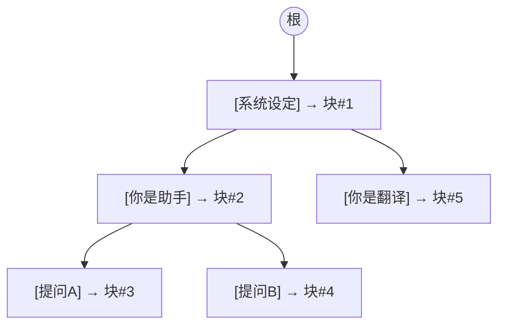

# 第 4 章　KV Cache 与注意力工程化

## 4.1 KV Cache 的数学原理


要理解后面所有的优化，先得把 KV Cache 的账算清楚。这一节的目标只有一个：让你拿到任何一个模型的 config.json，都能手算出它的 KV Cache 占多少显存。

### 4.1.1 自回归解码的重复计算问题

自回归生成的过程是：每生成一个新 token，都要把之前所有 token 的注意力算一遍。朴素实现下，第 `t` 步要计算 attention 时，需要所有前 `t-1` 个 token 的 Key 和 Value。如果每次都重新算，代价是 `O(t²)`——序列越长，浪费越夸张。

KV Cache 的解法很直接：把每一层、每个历史 token 算出来的 K 和 V 存下来，只算新 token 的 Q，然后用新 Q 去和缓存的 K/V 做注意力。这样每步的注意力复杂度从 `O(t²)` 降到 `O(t)`。

具象一点：假设已生成 1000 个 token，第 1001 步要算注意力。朴素实现下，这步要把第 1~1000 个 token 的 K/V **全部重新算一遍**（再加上第 1001 个）；第 1002 步又重算 1~1001……累计计算量是「三角形」`1000+1001+1002+…`，即 `O(t²)`。有了 KV Cache，第 1001 步只算第 1001 个 token 的 Q/K/V，然后用新 Q 去查已有的 1000 份 K/V——单步代价从「和全部历史相关」变成「只和新增的 1 个相关」。

注意这里有个和第 1 章（1.3 节）呼应的关键点：decode 每步生成 1 个 token，都要把整份 KV Cache 从 HBM 读进计算单元一次。这正说明 decode 是 memory-bandwidth-bound——瓶颈不在于「算得多快」，而在于「KV 数据从显存搬到计算单元的带宽够不够」。KV Cache 越大、序列越长，每步要搬的数据越多，decode 越慢。这就是为什么「压缩 KV」（4.2 节）和「把 KV 摆得紧凑」（4.3 节）能直接改善 TPOT，它们减少的不是计算量，而是每步要搬的显存数据量。

但代价是显存：这些 K 和 V 必须一直留在显存里，直到这个请求结束。KV Cache 不是「优化技巧」，它是自回归解码为了换 `O(t)` 而**必须付出的存储成本**。后面所有关于 KV Cache 的工程，本质都是在管理这笔存储债务。

> **解决什么瓶颈**：把 decode 每步注意力从 `O(t²)` 降到 `O(t)`，否则长序列根本跑不动。
> **代价是什么**：KV Cache 必须常驻显存，且随序列长度线性增长——这是后面所有显存管理问题的根源。
> **什么情况下不该用**：几乎没有。这是自回归的基本盘。

### 4.1.2 显存公式

单个请求、序列长度为 `seq_len` 时，KV Cache 占用的显存字节数为：

```
KV_bytes = 2 × layers × kv_heads × head_dim × seq_len × dtype_bytes
```

逐项解释：

| 因子 | 含义 | 来源 |
|---|---|---|
| `2` | K 和 V 各一份 | 注意力的定义 |
| `layers` | 模型层数 | config 的 `num_hidden_layers` |
| `kv_heads` | KV 头数（注意不是 Q 头数） | config 的 `num_key_value_heads` |
| `head_dim` | 每个头的维度 | config 的 `head_dim` |
| `seq_len` | 缓存的 token 数 | 请求实际长度 |
| `dtype_bytes` | 每个参数的字节数 | BF16=2，FP16=2，FP8=1 |

**说明**：公式里用的是 `kv_heads` 而不是 `num_attention_heads`。在 MHA（多头注意力）里两者相等，但在 GQA/MQA 里 `kv_heads` 远小于 Q 头数——这正是 GQA 能省 KV 的原因（4.2 节展开）。很多人手算时直接拿 Q 头数乘，结果翻倍。

### 4.1.3 手算 Qwen3-8B

以本书的演示主力模型 **Qwen3-8B**（config.json 已核实）为例，它的关键参数：

- `num_hidden_layers = 36`
- `num_attention_heads = 32`（Q 头）
- `num_key_value_heads = 8`（KV 头，GQA）
- `head_dim = 128`
- `torch_dtype = bfloat16` → `dtype_bytes = 2`

**每个 token 的 KV Cache**：

```
2 × 36 × 8 × 128 × 2 = 147,456 字节 ≈ 144 KiB / token
```

**单条请求、不同上下文长度下的 KV Cache 总量**（BF16）：

| 上下文 | `seq_len` | 单请求 KV 总量 | 备注 |
|---|---|---|---|
| 短对话 | 4,096 | 2 × 36 × 8 × 128 × 4096 × 2 ≈ 576 MiB | 占 8B 权重（~16 GiB）的约 3.6% |
| 中等 | 32,768 (32K) | ≈ 4.6 GiB | 已经超过单卡可轻松容纳的零头 |
| 长上下文 | 131,072 (128K) | ≈ 18.4 GiB | **反超 16 GiB 的权重本身** |

最后一行是重点：**在 128K 上下文下，单条请求的 KV Cache（18.4 GiB）已经超过了模型权重（16 GiB）。** 这就是第 0 章说的「长上下文下 KV Cache 反超权重成为显存主体」的由来，也是为什么 24GB 卡（4090/L20）在长上下文场景几乎塞不下几条并发——权重占掉 16 GiB，剩下 8 GiB 连一个 128K 请求的 KV 都装不下。

> 注：上面的 16 GiB 权重是按 8B × 2 字节粗算（含非 embedding 参数约 6.95B，实际权重略小于 16 GiB，但量级一致）。精确占用以实际加载为准。这里用整数便于手算和建立直觉。

**反推最大并发**：假设一张 80GB 的 A800/H20，权重占 16 GiB，给 KV Cache 留 60 GiB（其余给激活值和碎片）。在 4K 上下文下，每条请求 KV 约 576 MiB，理论上限约 `60 GiB / 576 MiB ≈ 106` 条并发。到了 32K 上下文，每条 4.6 GiB，上限骤降到约 13 条。**上下文长度每翻 8 倍（4K→32K），同卡并发能力降成约 1/8**——这就是长上下文服务的核心成本结构。

### 4.1.4 手算最大并发：一个可复现的例题

把公式用在一张具体卡上，体会「并发上限是怎么算出来的」。以 **A800/H20 80GB** 跑 **Qwen3-8B** 为例：

- 权重（BF16，约 6.95B 非 embedding 参数 + embedding）：约 **16 GiB**。
- 留给 KV Cache 的预算：假设 `gpu-memory-utilization=0.9`，则引擎可用约 72 GiB，扣权重与激活/碎片后，给 KV 约 **55 GiB**（此为估算，实际以引擎运行时报告为准）。
- 单请求每 token KV = 144 KiB（2.1.3 算过）。

| 上下文长度 | 单请求 KV 总量 | 同卡理论最大并发（55 GiB ÷ 单请求） |
|---|---|---|
| 4,096 (4K) | ≈ 576 MiB | ≈ 55 GiB / 0.56 GiB ≈ **98 条** |
| 32,768 (32K) | ≈ 4.6 GiB | ≈ 55 GiB / 4.6 GiB ≈ **12 条** |
| 131,072 (128K) | ≈ 18.4 GiB | ≈ 55 GiB / 18.4 GiB ≈ **3 条** |

这张表就是第 10 章调 `max-num-seqs`（vLLM，适用于 v0.20.x–v0.21.x）/ `--max-running-requests`（SGLang，适用于 v0.5.18+）的底层依据：**你设的并发上限，永远不能让「并发 × 单请求 KV」超过 KV 预算，否则就是 OOM 或抢占**。意义在于——**同一张卡，4K 上下文能扛约 98 条并发，128K 只能扛约 3 条，差了 30 多倍，而模型一个没换**。所谓「长上下文成本高」，一半都在这个乘数里。

### 4.1.5 本节的工程含义

1. **KV Cache 是线性成本**，不看它你永远算不清「这张卡到底能扛多少并发」。第 10 章调 `max-num-seqs` 时，本质就是在解这道算术题。
2. **GQA 不是锦上添花，是能不能服务的分水岭**。如果 Qwen3-8B 用满血的 MHA（kv_heads=32 而非 8），每 token KV 直接 ×4，128K 单请求 KV 变成 ~73 GiB，单卡彻底无法服务长上下文。
3. **长上下文的第一性敌人是 KV Cache 显存，不是算力**。这也是 4.2 节注意力变体和 4.7 节 KV 量化的共同动机。

## 4.2 注意力变体：KV Cache 压缩的第一性原理


4.1 节我们看到，KV Cache 大小由 `kv_heads × head_dim × layers` 决定（序列长度和 dtype 是外部变量）。要压缩 KV，工程上只有两条路：**减少 KV 头数**（MHA→MQA→GQA），或**对 KV 做低秩压缩**（MLA）。这一节把这几代变体放进同一张账上对比。

### 4.2.1 MHA → MQA → GQA：减少头数

**MHA（Multi-Head Attention，原始多头）**：每个 Q 头配一个独立的 K/V 头，`kv_heads = num_attention_heads`。效果最好，但 KV 最大。

**MQA（Multi-Query Attention）**：所有 Q 头**共享同一份** K/V，`kv_heads = 1`。KV 降到 MHA 的 `1/num_heads`。例如 32 头模型直接降到 1/32。代价是质量下降明显——单个 KV 头成了信息瓶颈，长文本和复杂推理上劣化尤其突出。今天已经很少单独用 MQA，主要作为「省到极致」的历史参照。

**GQA（Grouped-Query Attention）**：折中方案。把 Q 头分成若干组，每组共享一个 K/V 头，比如 32 个 Q 头配 8 个 KV 头（`kv_heads=8`）。KV 降到 MHA 的 1/4，而质量几乎与 MHA 持平——这是当前 8B~70B 稠密模型的事实标准（Qwen3 全系、Llama-3 全系都用 GQA）。

关于 GQA 有两个容易被忽略的工程细节：

- **分组数不是任意的**。Q 头数必须能被 `kv_heads` 整除，否则分组不均。Qwen3-8B 是 32/8=每 4 个 Q 头共享 1 个 KV 头；DeepSeek 的 MoE（如 Qwen3-30B-A3B）用 32 个 Q 头配 4 个 KV 头（压缩到 1/8）。`kv_heads` 越小越省，但太小（趋近 MQA）质量会掉——1/4 到 1/8 是工程上反复验证过的「甜区」。
- **用 Qwen3-8B 数一下**：MHA 形态下 `kv_heads=32`，每 token KV = `2 × 32 × 128 × 2 = 16,384 字节`；GQA 实际 `kv_heads=8`，每 token `2 × 8 × 128 × 2 = 4,096 字节`（即 2.1.3 算的 4 KiB/token 量级的来源）。**GQA 单这一项就把每 token KV 从 16 KiB 压到 4 KiB，4× 的差距**——再叠加 4.7 节的量化，才能把长上下文服务塞进单卡。

> **为什么 GQA 这么香**：它把「KV 头数」从「必须 = Q 头数」这个硬约束里解放出来。Q 头多保证表达能力，KV 头少控制显存，两者解耦。代价极小，所以几乎成为默认选择。

### 4.2.2 MLA（Multi-head Latent Attention，DeepSeek）：低秩压缩

GQA 再怎么压，KV 头还是完整维度 `head_dim` 的向量。DeepSeek 系列（V2/V3/R1）用的 **MLA** 走了一条不同的路：**对 KV 做低秩压缩，缓存的不是完整 K/V，而是一个压缩后的潜变量。**

核心思路（用文字描述矩阵，方便你建立直觉，具体维度以 DeepSeek-V3 技术报告为准）：

- 把原本每个 token 需要缓存的 K 和 V，先通过降维矩阵 `W^{DKV}` 压成一个低维潜变量 `c_KV = W^{DKV} · h`，`c_KV ∈ R^{d_c}`，`d_c` 远小于 `head_dim × kv_heads`。
- 真正做注意力时，再用升维矩阵 `W^{UK}`、`W^{UV}` 把 `c_KV` 还原成这一层需要的 K 和 V（`K = W^{UK} · c_KV`，`V = W^{UV} · c_KV`）。注意 **K 和 V 共享同一个 `c_KV`**——这是 MLA 比「分别压缩 K 和 V」更省的根本原因：缓存一份，重建两份。
- 为了兼容旋转位置编码（RoPE），DeepSeek 把 RoPE 部分「解耦」出来：位置相关的那部分 key 单独缓存一个小向量 `k^R ∈ R^{d_R}`，不参与低秩压缩（因为 RoPE 是加在位置上的，压进低秩潜变量会破坏位置信息）。

一句话概括 MLA 的精妙：**它不在「完整 KV」层面压缩，而是在「生成 KV 之前的中间表示」层面压缩**。缓存的是还没展开成 K/V 的「压缩草稿」，需要时才展开。代价是每次注意力都要多跑一次升维矩阵乘法——但这点计算开销，相对省下的巨量 KV 显存带宽，划算得多。

以 **DeepSeek-V3** 为例（据 DeepSeek-V3 技术报告）：`hidden_size=7168`，`num_attention_heads=128`，`head_dim=128`。

- 若用 MHA，`kv_heads=128`，每 token KV = `2 × 128 × 128 × 2 字节 = 65,536 字节 ≈ 64 KiB`。
- 用 MLA，缓存的是 `c_KV`（维度 `d_c=512`）+ 解耦 RoPE 的 `k^R`（维度 `d_R=64`），共 `512+64=576` 个数，×2 字节 = **1,152 字节 ≈ 1.125 KiB / token**。
- 压缩比 ≈ `65536 / 1152 ≈ 1/57`。

**1/57 是什么概念**：同样是 128K 上下文，MHA 方案单请求 KV 约 8 GiB 量级（按 64 KiB × 131072 ≈ 8 GiB），而 MLA 只有约 147 MiB。DeepSeek-V3 是 671B 总参数（37B 激活）的 MoE，如果没有 MLA，它的 KV Cache 会大到根本无法服务长上下文。MLA 是 DeepSeek 能做到「超大模型 + 长上下文 + 可服务」的工程前提之一。

> **MLA 解决什么瓶颈**：在保持（甚至超过）MHA 质量的前提下，把 KV Cache 压到极致，使超大模型和超长上下文的在线服务成为可能。
> **代价是什么**：必须在**训练阶段**就设计低秩结构，无法事后对现成 MHA 模型零成本套用；推理侧需要专门的 MLA 注意力 kernel（vLLM / SGLang 都为此做了专门后端）。换句话说，MLA 是「模型和推理引擎协同设计」的产物。
> **什么情况下不该用**：如果你用的是现成的 MHA/GQA 稠密模型（如 Qwen3、Llama-3），MLA 与你无关——你只能走 GQA + KV 量化（4.7 节）的路。MLA 是「从训练时就规划好的压缩」。

### 4.2.3 对照表

把四种变体放进同一张账上（以「32 个 Q 头」的 8B 量级模型为基准，MHA 的 KV 记为 1×）：

| 变体 | KV 头数 | 相对 MHA 的 KV 倍数 | 省了什么 | 代价 / 风险 | 典型代表 |
|---|---|---|---|---|---|
| **MHA** | = Q 头（如 32） | 1× | 基准，质量上限 | KV 最大 | 早期模型、部分小模型 |
| **MQA** | 1 | 1/32 | KV 极小 | 质量下降明显，单头成瓶颈 | PaLM（早期） |
| **GQA** | 8（分组） | 1/4 | KV 小且质量近 MHA | 极少见显著劣化 | Qwen3、Llama-3、Gemma |
| **MLA** | 低秩潜变量 | ~1/57（相对 128 头 MHA） | 极致压缩且质量不降 | 需训练期设计 + 专用 kernel | DeepSeek-V2/V3/R1 |

> **作者判断**：GQA 是「当下most 划算的默认值」——它用几乎可忽略的代价换来了 4× 的 KV 节省，所以你会看到 2024 年后的开源主力模型几乎全员 GQA。MLA 是「为超大模型量身定做」的进阶方案，压缩比更狠，但绑定了训练侧设计，**对使用现成稠密模型的读者没有直接操作空间**。不要因为「MLA 压缩比更高」就觉得自己该用它——你用不了，除非你自己在训模型。

### 4.2.4 一个常见误解

有人把「GQA 省 KV」理解成「模型变快了」。不对。GQA 省的是**显存**，不是算力：单步注意力计算量（由 Q 头数、序列长度决定）基本没变。它真正带来的是**更高的并发上限**——同样的卡能塞下更多请求的 KV，从而 batch 更大、吞吐更高。**省显存 → 能攒更大 batch → 吞吐上升**，这条链路才是 GQA 的生产价值。

## 4.3 PagedAttention（vLLM）

4.1 节算清楚了 KV Cache 是笔多大的账。4.2 节讲了怎么从模型结构层面压缩它。但还有一个最朴素的问题没解决：**这些 KV 在显存里怎么摆？** 这一节讲 vLLM 的答案——PagedAttention。

### 4.3.1 朴素管理的浪费

第 0 章 0.3 节提过第一代（HuggingFace `transformers`）朴素推理的做法：按 `max_length` **一次性预留一整块连续显存**。问题有三个：

1. **内部碎片**：实际只生成 200 token，却按 2048 预留，浪费 ~90%。
2. **外部碎片**：不同请求预留不同长度，跑着跑着显存被切得七零八落，明明总量够却分配不出连续块。
3. **无法共享前缀**：两个请求共享同一个 system prompt，KV 算两遍、存两份。

第 0 章给过数字：朴素管理下 KV Cache 利用率常只有 **20%–40%**。用一个具体场景感受碎片有多狠：

> 显存池 10 GiB，块粒度按 `max_length=4096` 预留。来了请求 A：实际生成 180 token，占 4096×每tokenKV。来了请求 B：实际生成 3500 token，也要 4096 的预留槽。A 跑完释放，B 还在跑。此时池里虽有「A 释放的那份 4096 预留」和「剩余零散空间」，但若下一个请求 C 需要 4096 的连续预留，而空闲空间被 B 和碎片切成两半，就**分配不出连续 4096**——明明总空闲够，却 OOM。这就是外部碎片：连续预留的粒度越粗，碎片越严重。

PagedAttention 的解法正是把粒度从「整条序列」降到「16 token 的块」：**块够小，拼接就能凑出任意长度，外部碎片趋近于零；按需分配，内部碎片最多浪费不到一个块（≤15/16 ≈ 94% 利用率）**。这就是为什么利用率能从 20%–40% 跳到 90%–95%——不是某个魔法算法，而是「把分配粒度做小 + 不做整段预留」两个朴素工程的叠加。

### 4.3.2 从操作系统分页借来的思想

PagedAttention 的妙处在于：**它几乎原样抄了操作系统的虚拟内存分页**。

- 把 KV Cache 切成固定大小的**块**（block，vLLM 默认 16 个 token/块；适用于 v0.20.x–v0.21.x，具体块大小可通过引擎参数调整，以官方文档为准）。
- 逻辑上连续的序列，物理上可以散落在任意不连续的块里。
- 用一个**块表**（block table）记录「第 i 个逻辑块 → 第 j 个物理块」的映射。
- **按需分配**：请求每生成满一个块，才去向显存池要下一块，不预留。
- **写时复制（Copy-on-Write, CoW）**：两个请求共享前缀时，物理块只存一份；只有当某个请求要修改（实际是后续要追加新 token，使共享路径分叉）时，才复制出独立块。

一个块表的直观示意：

```
请求 A（逻辑块 0,1,2）           请求 B（逻辑块 0,1,2,3）
逻辑块 0 ──→ 物理块 #5          逻辑块 0 ──→ 物理块 #5   ← 与 A 共享
逻辑块 1 ──→ 物理块 #9          逻辑块 1 ──→ 物理块 #9   ← 与 A 共享
逻辑块 2 ──→ 物理块 #12         逻辑块 2 ──→ 物理块 #12  ← 与 A 共享
                               逻辑块 3 ──→ 物理块 #20   ← B 独有（分叉后）
```

A 和 B 的前三段完全相同，物理上只占 3 块；到第 4 块 B 分叉，才分配新块。这就是 CoW 共享前缀的本质。

### 4.3.3 解决了什么，代价是什么

**解决**：KV Cache 利用率从 20%–40% 提升到 **90%–95%**（据 vLLM 论文与后续实测普遍在此区间）。利用率每提升一点，就能多塞请求，batch 变大，吞吐随之上升。这是第 0 章 0.7.1 节说的「第三代阶段一：显存管理革命」的核心。

**代价**：**一层间接寻址开销**。注意力计算时，GPU 不能像连续内存那样直接寻址 KV，得先查块表拼出逻辑连续的 KV 视图。这要求专门的 PagedAttention kernel（FlashAttention/FlashInfer/vLLM 自带后端等都有对应实现），并且每次注意力都要多一步「按块 gather / 拼接」的索引操作。在绝大多数场景下这层开销远小于它换来的显存收益——但如果你的序列极短、并发极低，分页的复杂度可能「不划算」。

关于 CoW 还有一个工程细节值得点破：**CoW 的共享是「被动」的，不是「自动发现」的**。vLLM 里两个独立进来的请求（哪怕 prompt 完全相同），不会自动合并成共享块；共享只在通过「fork / 同一次请求内的 beam 分支 / 显式前缀缓存命中」等路径产生。换句话说，PagedAttention 解决了「单请求内部怎么摆」，但**请求之间「碰巧相同的前缀」它默认不管**——这正是 RadixAttention 要补的洞（4.4 节），也是为什么 4.5 节要强调两者是上下层而非替代。

> **什么情况下不该用分页 / 该警惕**：极短序列（每个请求只占一两个块）、超小 batch 的离线场景，分页的间接开销占比会上升，且碎片问题本就不严重。但现实是：vLLM 默认就开 PagedAttention，你几乎不需要关——它的收益在除极端情况外的所有在线服务场景都压倒代价。

### 4.3.4 动手：mini PagedAttention 块管理模拟

下面给出一个约 200 行的 Python 模拟器，把「块分配 / 块表 / CoW 共享 / 可视化」跑起来，让你肉眼看到显存池的变化。完整可运行代码在 `src/ch04-kvcache/paged_attention_sim.py`，这里给核心片段：

```python
# paged_attention_sim.py（核心片段，完整版见 src/ch04-kvcache/）
# 验证基线：Python 3.10+，无需 GPU，纯内存模拟
BLOCK_SIZE = 16          # 每个块容纳的 token 数（vLLM 默认 16，可改）
TOTAL_BLOCKS = 64        # 模拟显存池总块数

class PagedKVManager:
    def __init__(self, total_blocks, block_size=BLOCK_SIZE):
        self.block_size = block_size
        self.free_blocks = list(range(total_blocks))  # 空闲物理块列表（栈）
        self.phys_refcount = [0] * total_blocks       # 物理块引用计数（CoW 共享用）
        self.block_tables = {}  # req_id -> [物理块Id,...] 逻辑→物理映射

    def allocate_block(self):
        """按需分配一个物理块，没有就返回 None（模拟 OOM）"""
        if not self.free_blocks:
            return None
        b = self.free_blocks.pop()
        self.phys_refcount[b] = 1
        return b

    def append_token(self, req_id, token_id):
        """向某请求追加一个 token：当前逻辑块满了就分配新块"""
        tbl = self.block_tables[req_id]
        last_block = tbl[-1]
        used_in_block = self._count_in_block(req_id) % self.block_size
        if used_in_block == 0 and len(tbl) > 0:
            # 当前块满，分配新块
            nb = self.allocate_block()
            if nb is None:
                raise RuntimeError("OOM: 显存池耗尽")
            tbl.append(nb)
        # （真实引擎在这里把 KV 写入物理块；模拟器只记账）
        self._inc_count(req_id)

    def fork_shared_prefix(self, parent_id, child_id):
        """CoW：子请求继承父请求的全部物理块，引用计数 +1"""
        self.block_tables[child_id] = list(self.block_tables[parent_id])
        for b in self.block_tables[child_id]:
            self.phys_refcount[b] += 1

    def release(self, req_id):
        """请求结束，释放其块表里的所有物理块（引用减到 0 才真回收）"""
        for b in self.block_tables.pop(req_id):
            self.phys_refcount[b] -= 1
            if self.phys_refcount[b] == 0:
                self.free_blocks.append(b)
```

运行 `python paged_attention_sim.py` 会打印显存池从空到满、CoW 共享、释放回收的全过程。**动手建议**：把 `TOTAL_BLOCKS` 调小（比如 8），再发一批长请求，亲眼看到 OOM 触发——这比任何文字都更能让你理解「为什么并发上限是算出来的」。

## 4.4 RadixAttention（SGLang）

PagedAttention 解决了「单条请求内部 KV 怎么摆」。但它有个盲区：**请求与请求之间的重复，它管不了**。两条请求共享同一个 2000 token 的 system prompt，PagedAttention 仍然各算各的、各存各的（CoW 只在主动 fork 时生效，普通独立请求不会自动共享）。RadixAttention 就是来补这个盲区的。

### 4.4.1 核心数据结构：基数树

SGLang 用一棵**基数树（Radix Tree）**管理所有请求的 KV Cache。树的每条边是一段 token 序列，每个节点挂着这段序列对应的**块索引**（注意：树里存的不是 KV 数据本身，而是「这些 token 对应的物理块在 PagedAttention 池里的位置」）。

新请求进来时，引擎把它的 token 序列在树上做**最长前缀匹配**：命中的部分直接复用已缓存的 KV（跳过 prefill），只有没命中的后缀需要真正计算。

举一个追踪示例（用「词」代指 token 便于阅读）：

```
初始：树为空
请求1: [系统设定][你是助手][提问A]   → 树新增一条链，分配物理块 #1 #2 #3
请求2: [系统设定][你是助手][提问B]   → match 命中 [系统设定][你是助手]，
                                        直接复用物理块 #1 #2，仅 prefill [提问B] 并分配 #4
请求3: [系统设定][你是翻译]           → match 在 [系统设定] 处分叉 →
                                        split 把 [系统设定][你是助手] 拆成
                                        [系统设定] 共享 + [你是助手] 分支，
                                        新插入 [你是翻译] 节点并分配 #5
```

注意树里的每个节点（如 `[系统设定]`）挂的不是 KV 数据，而是「这段 token 对应的物理块号（如 #1）」——**物理块本身由底层的 PagedAttention 池管理**。这就是「树存块索引」的含义，也正是「分页在前、前缀树在后」的铁证。

mermaid 示意（节点标注其指向的物理块）：



节点 `[系统设定]` 与 `[你是助手]` 被请求 1、2 共享；请求 3 到来时只有 `[系统设定]` 能复用，于是从它分叉。每次请求实际 prefill 的，只是从分叉点往后的后缀。

### 4.4.2 四个原语

基数树的维护靠四个原语，理解了它们就理解了前缀缓存的整个生命周期：

1. **match（匹配）**：对入请求 token 序列做最长前缀匹配，返回树上已缓存的节点链。这是命中率的根本来源。
2. **split（分裂）**：当新请求在某个节点**中间**与已有路径分叉时，把那个节点从分叉点切开，分成「共享前缀」+「分叉后缀」两个节点。
3. **insert（插入）**：把 match 没覆盖到的后缀，作为新节点插入树中，并分配对应的 KV 块。
4. **evict（淘汰）**：显存压力大时，按 LRU 淘汰**引用计数为 0** 的节点，释放其物理块。正在被某个活跃请求使用的节点（`lock_ref > 0`）不会被淘汰。

### 4.4.3 LRU + 引用计数锁定

淘汰策略是 **LRU（最近最少使用）**，但有个硬约束：**引用计数锁（`lock_ref`）**。一个节点如果正被某个活跃请求依赖（它是该请求前缀的一部分），`lock_ref > 0`，即便它是 LRU 也不能动。这避免了「正在用的 KV 被误淘汰」的灾难。

> **RadixAttention 解决什么瓶颈**：消除了**跨请求的重复 prefill**——同一份 system prompt、同一批 RAG 文档块、多轮对话里完全相同的历史轮次，只算一次、只存一份。
> **代价是什么**：① 树结构的维护开销（每次请求都要 match/split/insert，CPU 侧成本）；② LRU 淘汰的「命中率波动」——工作集超过缓存容量时会抖动（见 4.6 节陷阱三）；③ 依赖请求之间真的有共享前缀，否则收益为 0。
> **什么情况下不该用 / 收益为 0**：如果你的负载里**每条 prompt 都独一无二**（比如每个用户请求都带不同的随机内容、不同的时间戳），RadixAttention 的命中率趋近 0，它的维护开销纯属浪费。这是一切前缀缓存技术的前提。

### 4.4.4 引用计数与长尾请求的交互

`lock_ref` 机制还有一个对生产很重要的副作用，值得单独点破：**它只保护「正在被活跃请求依赖」的节点，不保护「将来可能被复用」的节点**。一个刚结束的请求，它留下的前缀节点 `lock_ref` 立刻归零，下一秒就可能被 LRU 淘汰——哪怕 5 秒后有一个相同前缀的新请求进来，也命中不了。

这对**长尾请求**尤其致命：长尾请求访问间隔长、且不规律，它依赖的前缀在两次访问之间极易被高频请求挤掉。结果就是长尾请求的命中率远低于头部请求，P99 被拖高。这直接连到 4.6 节陷阱三（淘汰抖动）和 4.7 节（把容量做大 / 量化变相扩容来降低淘汰概率）。**如果你业务里长尾占比高，前缀缓存的「平均命中率」会严重高估长尾的真实命中率**——监控时一定要按请求分位拆开看，别被均值骗了。

### 4.4.5 命中率能到多少

命中率**完全取决于你的负载有多相似**，不存在一个固定数字：

- **高度重复负载**（固定 system prompt、RAG 共享文档块、多轮对话）：缓存命中率可以很高。第 0 章 0.7.2 节提到，生产环境前缀缓存命中率在 **50%–75%** 区间（据公开报告），而在「所有请求共享同一个大 system prompt」的极端场景，可达更高水平（有公开报告观测到 90%+ 的命中）。
- **全随机负载**：命中率 ≈ 0，前缀缓存毫无收益。
- **长尾 / 大工作集**：工作集超过缓存容量时，命中率会随淘汰抖动而显著低于「理想值」。

> **作者判断**：不要听信「开 RadixAttention 吞吐翻几倍」的笼统说法。**它的收益是一个关于负载相似度的函数，不是关于引擎的常数。** 真正该问的是：我的 prompt 里，有多大比例的前缀是跨请求稳定的？这一节后面（2.6）会讲怎么把命中率亲手测出来——测出来之前，任何「应该很快」的假设都是空谈。

### 4.4.6 动手：观测 `cached_tokens`，构造命中/未命中对照

SGLang 提供了 `--enable-cache-report`（默认开启前缀缓存；适用于 v0.5.18+）来观测命中情况。下面给核心片段，完整代码在 `src/ch04-kvcache/cache_hit_experiment.py`：

```python
# cache_hit_experiment.py（核心片段，完整版见 src/ch04-kvcache/）
# 验证基线：SGLang >= v0.5.18，单卡可跑；需先启动 server
# 启动：python -m sglang.launch_server --model-path Qwen/Qwen3-8B \
#        --enable-prefix-caching --enable-cache-report
import openai, time

client = openai.Client(base_url="http://localhost:30000/v1", api_key="EMPTY")
SHARED_SYS = "你是一个严谨的财务分析助手，请基于以下准则回答："  # 稳定的共享前缀

def ask(prompt_suffix, tag):
    resp = client.chat.completions.create(
        model="Qwen3-8B",
        messages=[{"role": "system", "content": SHARED_SYS + prompt_suffix}],
        max_tokens=64,
        extra_body={"return_cached_tokens": True},  # 让响应带回命中信息
    )
    # SGLang 在 usage 中回报 cached_tokens（具体字段名以版本为准）
    usage = resp.usage
    cached = getattr(usage, "cached_tokens", None) or getattr(usage, "prompt_tokens_details", {}).get("cached_tokens", 0)
    print(f"[{tag}] prompt_tokens={usage.prompt_tokens} cached_tokens={cached}")

# 负载 A：共享同一前缀（应命中）
for i in range(5):
    ask(f"问题{i}: 分析一下公司现金流。", "共享前缀")
# 负载 B：每条完全随机（应不命中）
import random, string
for i in range(5):
    noise = "".join(random.choices(string.ascii_letters, k=200))
    ask(noise, "随机前缀")
```

**预期结果**：负载 A 的第二次起 `cached_tokens` 显著大于 0（system prompt 那段被复用），负载 B 的 `cached_tokens` 始终为 0。二者 TTFT 会有明显差距——这就是前缀缓存的真实收益。

**vLLM 侧怎么做**：vLLM 通过 `--enable-prefix-caching`（适用于 v0.20.x–v0.21.x）开启前缀缓存，命中情况通过 Prometheus 指标（如 `vllm:gpu_prefix_cache_queries` / `vllm:gpu_prefix_cache_hits`，指标名以版本为准）观测，新版也支持在响应/日志中查看前缀缓存信息。两边都能干同一件事，差异在默认行为和观测接口（2.5、4.6 节展开）。


## 4.5 正本清源：分页与前缀树不是竞争关系


这一节是本章最重要的观点，也是网上错误文章最集中的地方。我要把一个被讲反了的关系掰回来。

### 4.5.1 一个流传甚广的误解

很多文章把 PagedAttention 和 RadixAttention 写成「两种路线之争」，仿佛「用了 vLLM 就没有前缀缓存，用了 SGLang 就没有分页」。这是**错的**。

事实是：**RadixAttention 是建立在 PagedAttention 之上的**。SGLang 的 KV Cache 底层同样是分页管理的（逻辑块/物理块、块表、CoW 一样不少），只是在这层之上**额外**架了一棵基数树来做跨请求的前缀复用。树里每个节点挂的不是 KV 数据，而是「这段 token 对应的物理块索引」。换句话说：

> **分页管「单条请求内部 KV 怎么存」，前缀树管「请求之间 KV 怎么复用」。它们是上下层，不是替代品。**

### 4.5.2 vLLM 也有前缀缓存，SGLang 也有分页

把这个误解拆穿，只需要两个点：

- **vLLM 也有 prefix caching**：通过 `--enable-prefix-caching` 开启（Automatic Prefix Cache，APC）。它的实现同样是「对请求前缀做哈希/匹配，复用已缓存的 KV 块」——只是默认行为和工程成熟度与 SGLang 不同（见 4.6 节陷阱四）。
- **SGLang 也做分页管理**：它的 Radix Tree 节点指向的正是分页后的物理块。没有分页层，基数树连 KV 物理位置都描述不了。

### 4.5.3 真正的差异在哪里

既然两层技术两边都有，那 vLLM 和 SGLang 在 KV 管理上的**真实差异**是什么？三个维度：

| 维度 | vLLM | SGLang |
|---|---|---|
| **默认策略** | 前缀缓存需显式开启（不同版本默认不同，建议显式设 `--enable-prefix-caching`）；分页默认开 | 前缀缓存**默认开启**（`--enable-prefix-caching` 默认 True，见 11.5 节）；分页默认开 |
| **淘汰算法** | prefix cache 的淘汰策略随版本演进，可通过配置调整；以官方文档为准 | 基数树 LRU + 引用计数锁定（`lock_ref`），树结构天然支持前缀共享与分裂 |
| **工程成熟度 / 生态** | prefix caching 在 V1 引擎中持续打磨，与连续批处理、投机解码深度集成 | RadixAttention 从设计之初就是一等公民，配合前端 DSL 能保证前缀「必然共享」而非「碰运气」 |

> **作者判断**：选 vLLM 还是 SGLang，**不该**用「谁有前缀缓存」来分——两边都有。真正的分野是：
> 1. **默认行为**：SGLang 开箱即复用，vLLM 需要你主动确认开关（且不同版本默认不同，容易踩空）。
> 2. **可预测性**：SGLang 的 DSL（`gen`/`fork`/`select`）能在编程层面**保证**前缀共享；vLLM 依赖 prompt 文本恰好一致才能命中，稍有不慎（见 2.6 陷阱一）就全废。
> 3. **成熟度与场景**：vLLM 生态更广、集成更深；SGLang 在「高复用负载」（Agentic、RAG、多轮）上命中率更稳。
>
> 网上大量「vLLM 没有前缀缓存」「SGLang 不做分页」的说法，请一律当作错误信息。判断一个引擎前缀能力，看的是「默认开没开、淘汰怎么淘汰、命中能不能观测」，而不是「它叫不叫 RadixAttention」。

### 4.5.4 一次请求到达时，两层各自在干什么

把抽象关系落到一个具体请求上，你会更确信它们是上下层：

**在 SGLang（RadixAttention + 分页）里**：
1. 请求 token 序列进来 → 基数树做 `match`，找到最长共享前缀节点，这些节点指向的物理块**直接复用**（跳过对应 prefill）。
2. 未命中的后缀 → 在分页池里 `allocate_block` 分配新物理块，`insert` 进树。
3. decode 阶段，PagedAttention 用块表把分散的物理块拼成逻辑连续的 KV，正常算注意力。
—— 第 1 步是前缀树层，第 2、3 步是分页层，缺一不可。

**在 vLLM（V1 + prefix caching + PagedAttention）里**：
1. 请求进来 → prefix cache 对前缀做哈希/匹配，命中的 KV 块标记为可复用。
2. 未命中部分走正常 prefill，落进 PagedAttention 的物理块。
3. decode 同样靠块表拼 KV。
—— 结构完全一致，差异只在「匹配算法、淘汰策略、默认开关」，不在「有没有某一层」。

所以结论很干净：**两个引擎都是「分页打底 + 前缀复用在上」的两层架构**。把它们描述成「二选一」的文章，要么没读过源码，要么在蹭名词。

## 4.6 前缀缓存的四个实战陷阱

理论讲完，这一节全是生产血泪。前缀缓存「看起来免费」，但踩错一个坑，命中率直接归零，你还会以为引擎不行。

### 4.6.1 陷阱一：时间戳 / request_id 注入 system prompt（最常见，最致命）

**现象**：你兴致冲冲开了前缀缓存，发现 `cached_tokens` 永远是 0。查了半天，最后发现是**在 system prompt 里拼了 `request_id`、时间戳、或者「当前是第 N 次调用」**。

**原理**：前缀缓存要求「从第一个 token 开始，直到分叉点之前的整段序列逐 token 完全一致」。一旦 system prompt 开头就带了每请求不同的内容（时间戳 `2026-09-06 14:32:01`、uuid、客户端 IP），那么**所有请求的前缀从第一 token 起就不一样**，最长公共前缀长度为 0，命中率必然为 0。

**这恰恰是最容易犯的错误**，因为很多人在 system prompt 里塞「对话 ID」「链路追踪 ID」「生成时间」用于日志关联——而这些东西一旦在共享前缀之前（或之内），就把缓存彻底废了。

**解法**：
- 把稳定的、跨请求相同的内容（角色设定、指令、固定的 few-shot 示例）放在 prompt **最前面**，且保证它**完全不变**。
- 把每请求变化的内容（时间戳、request_id、用户专属上下文）放到**最后**，或者放到 user 轮次里——让它们处在「分叉后缀」位置，不污染共享前缀。
- 如果确需带时间，用「相对于请求起始的固定描述」而非真实时钟时间戳；或者接受它破坏缓存，把它移出共享区。

> **反模式**：`system = f"你是助手。本次请求ID={uuid4()}，时间={now()}。" + 固定指令` —— 前缀从第一 token 就变，缓存 100% 失效。正确写法：固定指令在前，变量在后；或变量完全不放 system。

用一个对照直观感受：

```python
# ❌ 错误：变量放在 system 最前面，前缀从第一 token 起就不一致
system_bad = f"请求ID={uuid4()} 时间={datetime.now()} 你是严谨的财务助手，请按准则回答。"

# ✅ 正确：稳定前缀放最前，变量内容后置或放进 user 轮次
system_good = "你是严谨的财务助手，请按准则回答。"   # 完全不变
user_turn   = f"请求ID={uuid4()} 时间={datetime.now()} 请分析某公司现金流。"
```

前者每个请求的 system 都不同 → 最长公共前缀长度为 0 → 命中率 0；后者 system 跨请求完全一致 → 命中率取决于这段 system 被多少请求共享。**把「会变的东西」往 prompt 尾部挪，是前缀缓存收益最大化的第一原则。** 顺便提醒：很多框架在 chat template 里会自动拼 `<timestamp>` 或会话元数据，也要确认它们没有悄悄插进共享前缀之前。

### 4.6.2 陷阱二：多副本轮询把命中率稀释成 1/N

**现象**：单实例测命中率 70%，上了 N 个副本 + 轮询负载均衡，整体命中率掉到约 `1/N`。

**原理**：每个副本维护**自己独立**的 Radix 树 / prefix cache。轮询（round-robin）把请求随机打到任一副本，一个重复前缀只会被它**上次恰好命中过的那个副本**复用。N 个副本时，任意一条重复请求打到「正确的」副本的概率约 `1/N`，整体命中率被稀释成单副本的 `1/N`。

**解法**：**缓存感知路由（cache-aware routing）**。路由层不再无脑轮询，而是对请求前缀做哈希，把「前缀相同」的请求稳定地路由到同一副本（一致性哈希）。SGLang 提供了 **SGLang Router**（适用于 v0.5.18+），vLLM 侧也有配套的路由/调度能力（以官方文档为准）。这是第 5.6 节、第 12.4 节要展开的主题。

**量化一下这个坑有多深**：假设单副本前缀命中率为 `h`（比如 70%），副本数 `N=4`，且每个重复前缀只会被「上次恰好命中它的那个副本」复用。随机轮询下，任意一条重复请求落到「正确副本」的概率是 `1/N`，于是**集群整体命中率 ≈ h / N**。代入：`70% / 4 ≈ 17.5%`——你加了 4 倍机器，命中率反而从 70% 掉到不到 18%，TTFT 不降反升。这不是理论恐吓：很多团队扩副本后「怎么更慢了」，根因就在这。缓存感知路由把落点概率从 `1/N` 拉回接近 1，命中率才恢复。

> **作者判断**：这个陷阱揭示了一个反直觉的事实——**水平扩展反而可能让前缀缓存失效**。很多人「为了扛量加了副本」，结果命中率崩了、TTFT 反而涨。扩展时务必配套缓存感知路由，否则是在用命中率换吞吐，账未必算得过来。

### 4.6.3 陷阱三：淘汰抖动（eviction thrashing）

**现象**：缓存容量偏小、工作集偏大时，命中率剧烈波动，长尾请求尤其惨——它依赖的那段前缀刚被挤掉，下次又得重算。

**原理**：LRU 淘汰的前提是「缓存容量 ≥ 工作集」。一旦工作集（所有活跃前缀的总 KV）超过可用缓存，节点刚插入就可能被下一次淘汰挤走，复用距离大于缓存容量，命中率塌方。长尾请求因为访问间隔长，最容易被 LRU 误杀。

**解法**：
- 扩大 KV Cache 容量（调高显存占用比例 / 降权其他开销），让缓存 ≥ 工作集。
- 对极度关键且稳定的前缀（如核心 system prompt）考虑「钉住」（pinning，部分实现支持，以官方文档为准）。
- 评估是否上 KV 量化（4.7 节）把单位 KV 压小，变相扩大容量。
- 在容量不足的硬约束下，接受部分命中率损失，用监控（第 19 章）盯住 P99。

### 4.6.4 陷阱四：vLLM Automatic Prefix Cache 的开关与默认行为差异

**现象**：在 vLLM 里开了服务，前缀缓存似乎「有时有有时没有」，或者升级版本后行为变了。

**原理**：vLLM 的 prefix caching（Automatic Prefix Cache, APC）的**默认开启状态在不同版本间有变化**，且需要显式参数确认。如果你只是「听说 vLLM 有前缀缓存」就以为默认生效，很可能实际没开，然后白测半天命中率为 0。

**解法**：
- **显式开启**：在 vLLM 启动命令里明确加 `--enable-prefix-caching`（适用于 v0.20.x–v0.21.x；更高版本请核对官方文档确认默认值）。不要依赖「默认应该开了」的假设。
- **确认生效**：通过 Prometheus 指标或日志确认 prefix cache 查询/命中计数在增长，而不是只看 `cached_tokens`（vLLM 的观测接口与 SGLang 不同）。
- **对照 SGLang**：SGLang 的 `--enable-prefix-caching` 默认即为开启（见 11.5 节），所以「开箱即用」的体验差异，正是这两个引擎在前缀缓存上的真实区别之一——而非「有没有」的区别。

> **本节一句话总结**：前缀缓存不是「开了就赢」。变量内容别放前缀、副本要缓存感知路由、容量要cover工作集、vLLM 要显式开——四条全中，命中率才可能到你负载理论上限。

## 4.7 KV Cache 量化与卸载 

4.1 节算出 128K 上下文下单请求 KV 就可能 18 GiB。当 GQA/MLA 的结构性压缩还不够时，还有两条路：**量化**（用更少 bit 表示每个 KV 元素）和**卸载**（把 KV 挪到 CPU 内存 / SSD / 网络远端）。

### 4.7.1 FP8 KV Cache

把 KV 从 BF16/FP16（2 字节）存成 FP8（1 字节，如 E4M3 / E5M2 格式），**KV 显存直接减半**，代价是注意力计算的精度损失。

- **vLLM**：通过 `--kv-cache-dtype fp8_e5m2` 或 `fp8_e4m3`（适用于 v0.20.x–v0.21.x；具体支持格式与默认以官方文档为准）。
- **SGLang**：通过 `--kv-cache-dtype fp8`（适用于 v0.5.18+；字段名与取值以官方文档为准）。

> **代价**：FP8 对注意力的精度敏感，长上下文（注意力分数动态范围大）下可能比短上下文更易出现质量劣化。**什么情况下不该用**：对生成质量极度敏感、且上下文很长、且又不缺显存的场景——此时半点精度都不该省。

### 4.7.2 TurboQuant 2-bit KV Cache

vLLM V1（适用于 v0.21.x+，以官方文档为准）引入了 **TurboQuant**，对 KV Cache 做**每组的 2-bit 量化**（含重建项），把 KV 进一步压到约 1/8（相对 BF16）。这是「显存极度紧张时的最后一招」。

> **代价**：2-bit 是激进压缩，精度损失明显大于 FP8，必须通过业务指标（而非只看吞吐）实测是否可接受。**什么情况下不该用**：质量敏感、或对生成正确性有硬要求的生产链路。把它当作「显存实在塞不下时的逃生舱」，不是默认选项。

### 4.7.3 CPU / SSD 层级卸载

当 GPU 显存放不下全部 KV 时，把不常用的 KV 块卸载（offload）到 CPU 内存甚至 SSD，需要时再搬回 GPU：

- **CPU 卸载**：KV 块存在主机内存，decode 每步按需取回。代价是 PCIe 带宽瓶颈——每步多一次主机↔设备传输，TPOT 上升。
- **SSD / 分布式 KV**：如 **Mooncake** 把 KV 做成集群级共享存储，跨节点复用；**HiSparse** 等思路结合稀疏化减少搬运量。代价是网络/磁盘延迟，只有在「复用距离大、命中收益高」时才划算。

> **解决什么瓶颈**：让「KV 总量 > GPU 显存」的场景仍然可服务，极端长上下文或超大并发不再直接 OOM。
> **代价是什么**：每一层卸载都引入一次数据搬运延迟，直接抬高 TPOT / 降低有效带宽。层级越深（GPU→CPU→SSD→网络），延迟越大。
> **什么情况下不该用**：命中率低、或 decode 延迟敏感的在线交互场景——卸载省下的显存，会被每步搬运的延迟吃掉，甚至得不偿失。**层级卸载的盈亏平衡点，取决于「复用收益」是否大于「搬运成本」**，必须实测，不能想当然。

### 4.7.4 怎么选：量化、卸载还是干脆加大显存

当 KV 成为瓶颈，三条出路（量化 / 卸载 / 加卡）怎么选，给一个判断顺序：

1. **先确认瓶颈真的是 KV，不是别的**。用显存账本和监控确认：KV Cache 占用是否吃满了预算、是否因此限制了并发。如果是权重/激活占大头，量化 KV 没用。
2. **能加显存先加显存**（更大卡 / 多卡 TP 把 KV 摊开）。这是零精度损失的解法，优先级最高——只要成本可接受。
3. **显存加不动再看量化**：FP8 是「几乎无感的第一刀」，优先试；2-bit（TurboQuant）是「显存实在塞不下时的逃生舱」，用前务必拿业务指标实测质量是否可接受。
4. **卸载是最后手段**：仅当「复用距离大、命中收益高、且延迟不敏感（如离线批处理）」时考虑。在线交互、低命中率场景，卸载几乎必亏。
5. **组合使用很常见**：GQA/MLA（结构性压缩，免费） + FP8 KV（第一刀量化） + 必要时 2-bit + 缓存感知路由（保命中率）。它们不互斥，是层层叠加的。

> **作者判断**：绝大多数团队在 KV 上「该做的第一件事」不是量化也不是卸载，而是**把前缀缓存命中率做上去**（2.5/4.6 节）——命中一次就省掉一整段 prefill，这比把 KV 压小一个数量级更划算，且零精度损失。量化与卸载是「命中率已经到顶、显存还是不够」时的下一步，别本末倒置。

## 4.8 前沿：新架构对 KV 管理的冲击（2025–2026）

前面 2.1–2.7 的整条叙事都建立在一个假设上：**模型每层都是标准注意力，KV Cache 由 `kv_heads × head_dim × layers` 决定，且随序列长度线性增长**。这个假设在 2025 年之后开始动摇。Qwen3-Next、Kimi Linear、DeepSeek-V3.2/V4 代表的新一代架构，正在从三个方向同时冲击 KV 管理的地基。这一节帮你建立「新时代的 KV 直觉」，具体引擎配置在 vLLM / SGLang 篇的对应章节跟进。

### 4.8.1 冲击一：混合注意力——KV 不再是「每层都有」

**代表**：Qwen3-Next（Gated DeltaNet 线性注意力 + 1/4 层全注意力交错）、Kimi Linear（KDA，Kimi Delta Attention）。

**思路**：既然 decode 的瓶颈是「每步把整份 KV 搬一遍」（2.1.1 节），那就让**大部分层干脆不用 KV Cache**——换成线性注意力 / Delta Rule 类机制。这类层的「状态」是一个固定大小的矩阵（不随序列长度增长），只有少数保留的全注意力层才维护真正的 KV。

**对 2.1.2 显存公式的冲击**：公式里的 `layers` 不再等于 `num_hidden_layers`，而是「全注意力层数」（比如 1/4）；线性层那一项变成 `固定状态大小 × 线性层数`，与 `seq_len` 无关。结果是：**长上下文下 KV Cache 从「显存主体」退回「零头」**——Kimi Linear 在 1M 上下文下 KV Cache 约减少 75%，解码吞吐提升数倍（据其技术报告）。

**工程上的新麻烦**：状态管理复杂度上升。
- 引擎要同时管理两种状态：线性层的 **conv state + delta rule state**（固定大小、每层必须连续保存）和全注意力层的传统 KV 块。vLLM 为此引入了 **Hybrid KV Cache Manager**，SGLang 也有专门的混合架构支持。
- **前缀缓存（4.4 节）的匹配粒度变了**：线性层状态与「序列前缀」的对应关系不再像 KV 块那样整齐——KDA 类模型的前缀缓存需要按「状态快照」的粒度设计（如 SGLang 的 KDA-aware caching），不能直接套用 Radix Tree 的逐 token 匹配逻辑。
- 一个直觉检验：如果对这类模型沿用 2.1.3 的手算方法，你会严重高估它的显存占用——先看 config 里的 `layer_types`（或线性注意力相关字段），分清哪些层是 full attention，再算账。

### 4.8.2 冲击二：稀疏注意力——KV 可以「选择性读取」

**代表**：DeepSeek-V3.2 的 DSA（DeepSeek Sparse Attention）、 NSA（Native Sparse Attention，DeepSeek 早期提出）。

**思路**：标准注意力里每个新 token 都要「看」全部历史 token（2.1.1 节的 `O(t)` 每步读取）。但实际研究中发现，大部分 query 真正需要的只有少数关键 token。DSA 用一个轻量 **lightning indexer** 给每个 query 选出 top-k（如 2048）个 token，注意力只在这些被选中的 KV 上算——**复杂度从 `O(L²)` 降到 `O(L·k)`，KV 每步的实际读取量大幅下降**。

**关键澄清——稀疏注意力省的和 GQA/量化省的不是同一笔账**：

| 技术 | 省的是什么 | 显存里 KV 还在吗 |
|---|---|---|
| GQA / MLA（4.2 节） | **存储**：每 token 存的 KV 变小 | 变小了，但仍全量存 |
| KV 量化（4.7 节） | **存储**：每个元素的字节变少 | 变小了，但仍全量存 |
| 稀疏注意力（DSA/NSA） | **带宽**：每步注意力只读被选中的 KV | 基本全量存，但每步只读一小部分 |

也就是说，DSA 主要攻击的是 2.1.1 节说的「decode 每步搬运 KV」的带宽账，而非显存容量账（部分实现里被索引淘汰的 KV 也可以不存，从而连容量一起省）。DeepSeek 公布的数据是：DSA 使其 128K 上下文的 API 成本下降约 83%（prefill 与 decode 双侧受益）。

**对前缀缓存的影响**：KV 仍然要被缓存和复用，所以 2.3–4.6 节的分页 + 前缀树叙事依然成立；但注意力 kernel 变成了「索引 + 稀疏 gather」的新形态，引擎需要新的注意力后端与索引缓存管理（SGLang 对 DeepSeek-V3.2 做了 Day-0 支持）。

### 4.8.3 冲击三：多 token 预测（MTP）——「一层特殊头」改写显存账与调度

**代表**：DeepSeek-V3/R1 的 MTP 层、Qwen3-Next 的 MTP head。

**思路**：在主干之外多训一个（或几个链式的）「预测头」，训练时强迫它在每个位置预测「下下个 token」；推理时这些头当作免费的草稿模型，为投机解码（第 7 章）提供候选——**模型自带的 draft，接受率远高于外挂小模型**。

**对 KV 账本的影响**：部署时若开启 MTP 投机解码，**草稿层自己也要一份 KV Cache**（通常只覆盖最近几层 / 几个 token，量小但不是零）。2.1.2 的公式要加上这一项；对链式多头的架构（如 Inkling 的 8 链式 MTP），草稿 KV 与接受率会随链长变化，调度器还要支持「一次前向验证整块候选」的多步联合调度——第 7 章的 EAGLE/MTP 实操会落到这里。

### 4.8.4 给工程师的三条判断

1. **「KV Cache 是显存主体」从铁律变成「全注意力层视角下的局部真理」**。拿到 2025 年后的新模型，第一步看 config 判断架构形态（full / hybrid / sparse / MTP），再用 2.1.2 公式对「全注意力层」算账，别拿老直觉直接套。
2. **本章的工程能力没有贬值，而是换了落点**：分页管理（2.3）依然管「状态怎么摆」；前缀复用（2.4）依然管「跨请求怎么省」，只是匹配对象从「纯 KV 块」扩展到「KV 块 + 线性状态快照」；量化（2.7）对全注意力层的 KV 依然有效。**学的是原则，不是某个架构的参数。**
3. **引擎选型时把「新架构支持度」加进评估表**：同一个混合架构模型，不同引擎、不同版本的支持成熟度差异极大（是否支持混合 KV 管理、MTP 投机、稀疏注意力后端）。上线前先查引擎的模型支持列表和对应 cookbook，再跑 4.6 节的命中实验。

> **本节的边界声明**：以上内容以 2026 年 9 月的公开资料为准（Qwen3-Next、Kimi Linear/K3、DeepSeek-V3.2/V4 等），模型与引擎的具体参数、命名以官方文档为准。这个领域演进很快，本节的目标是给你「判断新架构 KV 成本的框架」，而非一份不会过时的参数表。

## 4.9 本章小结

1. **KV Cache 是自回归为了把注意力从 `O(t²)` 降到 `O(t)` 而必须付出的存储债**，它随序列长度线性增长，长上下文下会反超权重成为显存主体（以 Qwen3-8B 为例，128K 单请求 KV 约 18.4 GiB，超过 16 GiB 权重）。
2. **显存公式是第一性工具**：`2 × layers × kv_heads × head_dim × seq_len × dtype_bytes`，其中 `kv_heads`（不是 Q 头数）和 `dtype` 是压缩的两个主要旋钮。
3. **注意力变体的本质是压缩 KV**：MHA→MQA→GQA 靠减少 KV 头数，MLA 靠低秩压缩（DeepSeek，约 1/57）；GQA 是当前最划算的默认选择，MLA 需训练期协同设计、对现成稠密模型不可直接套用。
4. **PagedAttention 管单请求内部 KV 怎么存**（利用率 20%–40%→90%–95%），代价是一层间接寻址；**RadixAttention 管请求之间 KV 怎么复用**，四原语 match/split/insert/evict + LRU + 引用计数锁定。
5. **分页与前缀树是上下层、互补而非竞争**：RadixAttention 建立在分页之上、树存块索引；vLLM 有 prefix caching，SGLang 也做分页。真正差异在默认策略、淘汰算法、工程成熟度。
6. **前缀缓存有四个实战陷阱**：变量内容污染 system prompt 前缀、多副本轮询稀释命中率到 1/N、淘汰抖动、vLLM APC 需显式开关——任意一个都能让命中率归零。
7. **新架构正在改写 KV 的前提（4.8 节）**：混合注意力（Qwen3-Next/Kimi Linear）让 KV 不再每层都有、不再随序列线性增长；稀疏注意力（DSA/NSA）让 KV「全量存、选择性读」，省的是带宽账；MTP 头为投机解码提供自带草稿但也带来额外 KV 与调度开销。**本章的方法论（先算账、再分页、再复用、再压缩）全部仍然成立，只是算账对象从「统一 KV」变成「分层的多种状态」。**

