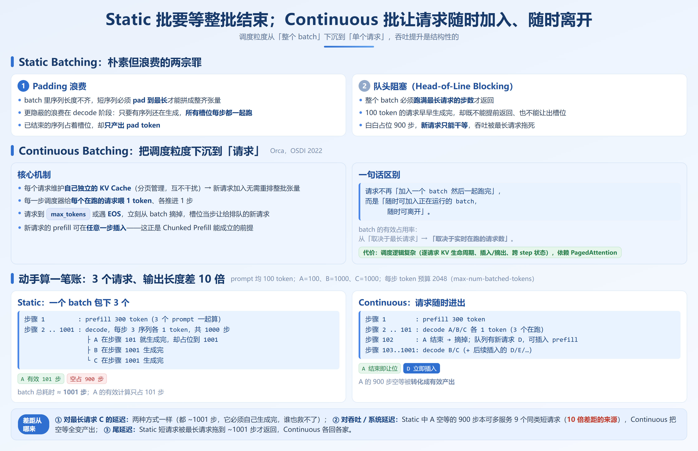
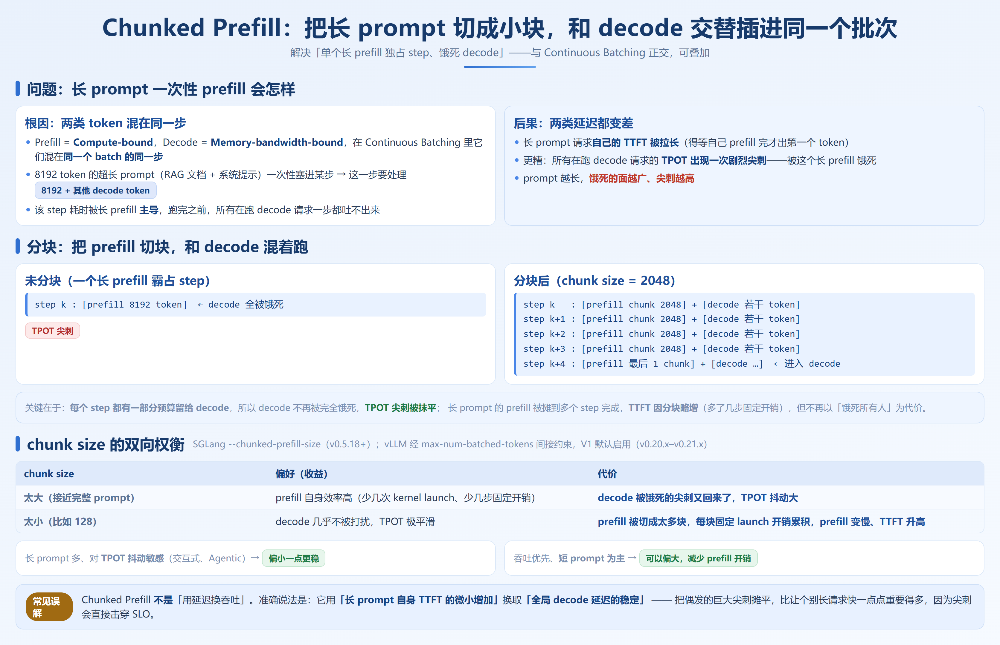

# 第 5 章　调度与批处理

## 5.1 批处理演进：Static → Continuous Batching



### 5.1.1 一个被忽略的事实：GPU 不是被「算满」的，是被「喂满」的

第 1.3 节已经建立过一个第一性原理：**Decode 阶段是 Memory-bandwidth-bound（访存密集），不是 Compute-bound（算力密集）**。换句话说，在 decode 阶段，GPU 的算力大量闲置，瓶颈在「每步都要把权重从 HBM 读一遍」。读一遍权重能产出多少 token，取决于这一批里有多少个序列在同时解码——**batch 里的序列数（batch size）直接决定算术强度，也就直接决定 GPU 有没有被喂饱。**

所以推理引擎优化的第一杠杆，从来不是「把模型算得更快」，而是「把更多请求塞进同一个 batch」。这一节讲的，就是「塞」的方式是怎么进化的。

### 5.1.2 Static Batching：朴素但浪费的两宗罪

最早的批处理就是 Static Batching（也叫 naive batching）：把若干个请求拼成一个固定 batch，一次性送进模型，等到**整个 batch 全部生成完**才把结果返回，再处理下一个 batch。

它有两个本质问题：

**1. Padding 浪费。** 一个 batch 里序列长度不齐，短序列必须 pad 到最长序列的长度才能拼成整齐的张量。pad 出来的位置是纯浪费的计算。更隐蔽的浪费在 decode 阶段：batch 里只要有序列还在生成，所有槽位每步都要一起跑，已经结束的序列占着槽位但只产出 pad token。

**2. 队头阻塞（Head-of-Line Blocking）。** 这是 Static Batching 最致命的缺陷。假设一个 batch 里有 3 个请求，输出长度分别是 100、1000、1000 token，那么整个 batch 必须跑满 1000 步。那个 100 token 就早早生成完的请求，既不能提前返回（在很多朴素实现里整个 batch 一起返回），也不能把槽位让给新请求——它白白占着位置 900 步。新请求只能干等，GPU 的吞吐被最长的那条请求拖死。

> **结论**：Static Batching 的浪费，本质是「调度粒度在 batch 上，而不是在请求上」。一个请求的结束，不能立刻改变这一个 batch 的组成。

### 5.1.3 Continuous Batching：把调度粒度下沉到「请求」

Orca（OSDI 2022）提出的 Continuous Batching（连续批处理），把调度的原子单位从「整个 batch」改成了「单个请求」。核心变化只有一句：

> **请求不再是「加入一个 batch 然后一起跑完」，而是「随时可以加入正在运行的 batch，随时可以离开」。**

具体机制（接合第 4 章的 PagedAttention）：

- 每个请求维护自己独立的 KV Cache（分页管理，互不干扰），所以新请求加入时不需要重排整个 batch 的张量；
- 每一步（每个 decode step），调度器看「当前有哪些请求在跑」，给每个跑着的请求喂 1 个 token，生成 1 步；
- 某个请求生成到 `max_tokens` 或遇到 EOS，**立刻从 batch 里摘掉**，它的槽位这一步就能让给排队里的新请求；
- 新请求的 prefill 也可以在任何一步插入——这正是 Chunked Prefill（5.2 节）能成立的前提。

这样，那个 100 token 的请求一结束，槽位马上腾出来给候补请求，GPU 不再被长请求绑架。吞吐的提升是结构性的：**batch 的有效占用率从「取决于最长请求」变成「取决于实时在跑的请求数」**。

### 5.1.4 动手算一笔账：3 个请求、输出长度差 10 倍

下面用「GPU 时间线」把两种方式的差距可视化。设：3 个请求同时到达，prompt 都是 100 token，输出长度分别为 A=100、B=1000、C=1000（即 A 比其他短 10 倍）。GPU 每步 token 预算设为 2048（对应 vLLM 的 `max-num-batched-tokens`，适用于 vLL.20.x–v0.21.x）。

Static Batching 的时间线（一个 batch 包下 3 个）：

```
步骤 1            : prefill 300 token        （3 个 prompt 一起算）
步骤 2 .. 1001    : decode，每步 3 个序列各 1 token，共 1000 步
                   ├─ A 在步骤 101 就生成完了，但占着槽位到 1001
                   ├─ B 在步骤 1001 生成完
                   └─ C 在步骤 1001 生成完
batch 总耗时 ≈ 1001 步；A 的有效计算只占 101 步，浪费 900 步的槽位
```

Continuous Batching 的时间线：

```
步骤 1      : prefill 300 token
步骤 2 ..101: decode A/B/C 各 1 token（3 个在跑）
步骤 102    : A 结束 → 摘掉；若队列里有新请求 D，这一步 D 的 prefill 可插入
步骤 103..1001: decode B/C（+ 后续插入的 D/E/...）
```

差距从哪来，一句话说清：

- **对单个最长请求（C）的延迟**：两种方式一样，都是 ~1001 步——它必须自己生成完，谁也救不了它。
- **对吞吐和系统延迟**：差距巨大。Static 模式下，A 的 900 步空等期间，GPU 本可以多服务 9 个 A 这样的短请求（10 倍差距的来源）；Continuous 模式把这段空等全部转化成有效产出。
- **对尾延迟（tail latency）**：Static 模式下所有短请求都被最长请求拖到 ~1001 步才返回（若整批返回）；Continuous 模式短请求各回各家。

> **Continuous Batching 解决什么瓶颈**：batch 级调度导致的 padding 浪费与队头阻塞，让 GPU 在 decode 阶段被长请求拖垮。
> **代价是什么**：调度逻辑复杂了——需要逐请求管理 KV Cache 生命周期、处理请求的插入/摘出、跨 step 维护状态。这依赖 PagedAttention 这类分页显存管理才能高效实现（见第 4 章）。
> **什么情况下不该用 / 收益小**：纯离线、请求长度高度一致、且对实现复杂度敏感的脚本场景，Static 的简单性反而划算；但凡线上有「长短请求混合」或「并发」，Continuous 就是必选项，没有理由退回 Static。

本章配套 `src/ch05-scheduling/simulator.py` 把上面这个例子（以及更大的负载）跑出真实对比数据，建议立刻动手。

### 5.1.5 动手实验：用模拟器对比三种批处理

```bash
cd src/ch05-scheduling
python simulator.py            # 默认跑 3 请求示例 + 20 请求混合负载
```

脚本会输出类似下面的对比（数值随负载而变，重点是看差距方向）：

| 策略 | 总耗时(步) | 吞吐(req/s, 归一) | 平均 E2E | 尾延迟(P100) | padding 浪费 |
| --- | --- | --- | --- | --- | --- |
| Static | 高 | 低 | 高 | 最高 | 显著 |
| Continuous | 中 | 高 | 低 | 中 | 无 |
| Continuous+Chunked | 中 | 高 | 低 | 最低 | 无 |

## 5.2 Chunked Prefill 分块预填充



### 5.2.1 长 prompt 一次性 prefill 会怎样

第 1.3 节的分法是：Prefill = Compute-bound，Decode = Memory-bandwidth-bound。在 Continuous Batching 里，这两类 token 其实会**混在同一个 batch 的同一步里**被处理。问题就出在这里：

当一个超长 prompt（比如 8192 token 的 RAG 文档 + 系统提示）进来，如果一次性把它的 prefill 全塞进某一步，这一步要处理的 token 数可能是 `8192 + 其他 decode 请求的若干 token`。这一 step 的耗时会被这个长 prefill 主导——**在它跑完之前，batch 里所有正在 decode 的请求都被卡住，一步都吐不出来。** 在用户视角就是：

- 长 prompt 请求自己的 TTFT 被拉长（它得等自己 prefill 完才出第一个 token）；
- 更糟的是，**所有在跑的 decode 请求的 TPOT 出现一次剧烈尖刺**——它们被这个长 prefill 饿死了。

这就是「prefill 卡顿、decode 被饿死」的来源。prompt 越长，饿死的面越广、尖刺越高。

### 5.2.2 分块之后：把 prefill 切成小块，和 decode 混着跑

Chunked Prefill 的思路很直接：**不一次性 prefill 整个 prompt，而是把它切成固定大小的块（chunk），每个 step 只处理一个或几个 chunk，剩下的 token 预算留给 decode 请求。**

```
未分块（一个长 prefill 霸占 step）：
step k : [prefill 8192 token]  ← decode 全被饿死，TPOT 尖刺

分块后（chunk size = 2048）：
step k   : [prefill chunk 2048] + [decode 若干 token]
step k+1 : [prefill chunk 2048] + [decode 若干 token]
step k+2 : [prefill chunk 2048] + [decode 若干 token]
step k+3 : [prefill chunk 2048] + [decode 若干 token]
step k+4 : [prefill 最后 1 chunk] + [decode 若干 token]  ← 该请求进入 decode 阶段
```

关键在于：**每个 step 都有一部分预算留给 decode**，所以 decode 请求不再被完全饿死，TPOT 尖刺被抹平；同时长 prompt 的 prefill 被摊到多个 step 完成，TTFT 虽然因为分块而略有增加（多了几步固定开销），但不再以「饿死所有人」为代价。

> 这里要和 3.1 的 Continuous Batching 区分开：Continuous 解决的是「请求级生命周期」，Chunked Prefill 解决的是「单个请求的 prefill 也不能独占一步」。两者是正交的改进，可以叠加——也就是 3.1 表格里的「Continuous + Chunked」。

### 5.2.3 chunk size 的双向权衡

chunk size（`--chunked-prefill-size`，适用于 SGLang v0.5.18+；vLLM 侧通过 `max-num-batched-tokens` 间接约束，且 V1 默认启用 chunked prefill，适用于 v0.20.x–v0.21.x）不是越大越好，也不是越小越好：

| chunk size | 偏好 | 代价 |
| --- | --- | --- |
| **太大**（接近完整 prompt） | prefill 自身效率高（少几次 kernel launch、少几步固定开销） | decode 被饿死的尖刺又回来了，TPOT 抖动大 |
| **太小**（比如 128） | decode 几乎不被打扰，TPOT 极平滑 | prefill 被切成太多块，每块的固定 launch 开销累积，prefill 整体变慢、TTFT 升高 |

所以最优值取决于你的负载画像：

- **长 prompt 多、对 TPOT 抖动敏感**（交互式、Agentic）：偏小一点更稳；
- **吞吐优先、短 prompt 为主**：可以偏大，减少 prefill 开销。

> **Chunked Prefill 解决什么瓶颈**：单个长 prefill 独占 GPU step，导致自身 TTFT 暴涨 + 同 batch decode 请求被饿死（TPOT 尖刺）。
> **代价是什么**：prefill 被拆成多步，每步有固定开销，总体 prefill 效率略降；chunk size 成了又一个需要按负载调的参数（这就是本书反复强调的「参数耦合」，第 10 章会系统展开）。
> **什么情况下不该用**：极短 prompt（比如几十 token）场景，prefill 本来就一步搞定，分块没有收益，反而徒增开销——此时关掉或调大 chunk size 更合适。

**一个常见误解**

有人以为 Chunked Prefill 是「用延迟换吞吐」。准确说法是：**它用「长 prompt 自身 TTFT 的微小增加」换来了「全局 decode 延迟的稳定」**。对绝大多数服务而言，把偶发的巨大尖刺摊平，比让个别长请求快一点点重要得多——因为尖刺会直接击穿 SLO（回到第 0.7 节挑战三的 Goodput 逻辑）。


## 5.3 vLLM V1 引擎架构解剖（重点）

本节是本章分量最重的一节。前面两节讲的是「调度在做什么」，这一节讲「vLLM 为了把调度做快，把引擎重写成什么样」。理解这一节，第 10 章 vLLM 调优的很多参数才有落脚点。

### 5.3.1 为什么要有 V1：V0 的架构债

vLLM V0 时代（v0.8.0 之前）的引擎是一个**单进程 + asyncio 协程**的架构：API server、调度器（scheduler）、块管理器（block manager）、模型执行器（worker）基本跑在同一个 Python 进程里，靠 asyncio 切来切去。

这套架构在请求量小、序列短的时候没问题，但当负载变重，三个债就暴露了：

1. **Python GIL 天花板。** 调度、准备 batch 元数据、块管理都是 CPU 密集的 Python 活，而 GIL 让它们无法真正并行，GPU 往往在等 CPU 准备好下一步。请求越多、序列越碎，这个等待越明显。
2. **每步重建输入张量。** 每个 decode step，V0 都从 Python 侧重新组装一遍输入（`input_ids`、`positions`、注意力元数据等），产生大量临时对象，GC 压力和重建开销随 step 数线性累积。
3. **prefill / decode 阶段划分带来的调度僵化。** V0 对 prefill 和 decode 有较强的人为区分，连续批处理与分块预填充的融合不够自然。

这三点都不涉及任何 AI 算法，纯粹是「系统工程债」。V1 就是为还这三笔债而做的架构重写，并在 v0.8.0 成为默认引擎（适用于 v0.20.x–v0.21.x，V1 已是默认）。

### 5.3.2 V1 的多进程架构：把 GIL 拆掉

V1 最直观的变化是**进程解耦**。关键进程及其职责：

```
┌─────────────────────────────────────────────────────────────┐
│  API Server 进程                                             │
│  · 暴露 OpenAI 兼容 HTTP/gRPC 接口                             │
│  · 接收请求、流式返回、限流                                     │
│  · 通过 IPC（ZMQ）把请求交给 EngineCore                       │
└───────────────┬─────────────────────────────────────────────┘
                │  ZMQ / 共享内存
┌───────────────▼──────────────┐    ┌──────────────────────────┐
│  Tokenizer 进程               │    │  Detokenizer 进程         │
│  · 把 prompt 文本切成 token    │    │  · 把输出 token 拼回文本   │
│  · 独立出来，不挡 GPU 进程      │    │  · 独立出来，不挡 GPU 进程  │
└───────────────┬──────────────┘    └───────────┬──────────────┘
                │                                │
┌───────────────▼────────────────────────────────▼─────────────┐
│  EngineCore 进程（引擎核心）                                    │
│  · 持有调度器 Scheduler，跑调度主循环                            │
│  · 决定每一步哪些请求跑、跑哪些 token、prefill 还是 decode        │
│  · 管理 KV Cache、块表、前缀缓存状态                             │
│  · 产出 SchedulerOutput（这一步行什么）发给 GPU 执行器          │
└───────────────┬─────────────────────────────────────────────┘
                │  IPC
┌───────────────▼─────────────────────────────────────────────┐
│  GPU Worker 进程（模型执行器）                                  │
│  · 真正跑模型前向（forward）                                    │
│  · 多卡时每张卡一个 worker，负责 TP/PP 切分                      │
│  · 持有被持久化的输入张量缓冲区（Persistent Batch）              │
└─────────────────────────────────────────────────────────────┘
```

各进程职责一句话：

- **API Server**：只管「接客」和「回话」，不碰 GPU。这样海量并发连接不会拖慢推理。
- **Tokenizer / Detokenizer**：token 化的 CPU 活从 GPU 进程里剥出来，单独进程跑，GPU 进程不再被文本处理阻塞。
- **EngineCore**：引擎的「大脑」，调度主循环在这里。它和 GPU worker 通过 IPC 通信，二者可以真正并行——worker 在算上一步，core 在准备下一步。
- **GPU Worker**：纯算。拿到 EngineCore 给的 `SchedulerOutput` 就前向一遍。

> 注意一个反直觉点：**多进程本身不「加速」GPU 计算**。它的价值在于让「CPU 准备」和「GPU 计算」重叠、让 GIL 不再卡住调度，从而把原本浪费在等待上的时间拿回来。

### 5.3.3 统一调度：取消 prefill / decode 的硬区分

V1 的调度器不再把请求显式标记为「我在 prefill 阶段」或「我在 decode 阶段」然后分开处理。它对待每一个 token 都是统一的：**每个 step，调度器从所有请求里挑出「这一步该算的 token」——可以是某请求 prompt 里还没 prefill 的 token，也可以是某请求要 decode 的下一个 token——凑满 token 预算后一起送进模型。**

这带来的直接好处：

- **Chunked Prefill 变得自然**。因为 prefill token 和 decode token 本来就在同一个池子里按预算分配，长 prompt 自动被切成若干 token 混在 decode 之间，不需要 V0 那种额外的阶段切换逻辑。
- **调度更细、更公平**。最短作业、最长作业、刚插入的请求，都按 token 粒度统一排，没有「先 prefill 完一批再 decode」的隐性排队。

### 5.3.4 Persistent Batch：输入张量不再每步重建

这是 V1 相对 V0 第三笔债的直接修复，也是工程层最容易被忽视、却最实在的一项优化。

V0 每个 decode step 都重新构造一次模型输入（`input_ids`、`positions`、注意力元数据等），产生 Python 对象、触发拷贝和 GC。V1 改成：

- 输入张量（主要是 `np.ndarray` 形式的 `input_ids`、位置等）**预先分配、常驻显存/内存**；
- 每一步只做**增量更新**：新加入的请求 append 几行，结束的请求标记移除，decode 请求把刚生成的 token 写进对应位置；
- 模型执行器拿到的是「同一块被原地改过的缓冲区」，而不是每步新建的张量。

代价是代码复杂度上升（要维护增量更新的正确性、处理空洞与紧凑化），但收益是**每步省掉了输入重建的 Python 开销**——这笔开销在 step 数极多（长 decode、高并发）时累积非常可观。

### 5.3.5 1.7 倍提升的来源：是工程，不是算法

把上面三件事合起来，回到第 0.7.3 节那个数字：官方数据显示 V1 相对 V0 在 Llama 3.1 8B 和 Llama 3.3 70B 上吞吐提升最高约 **1.7 倍**（具体数值随版本与负载而异，以官方文档为准）。

我的判断，也是本章最想让你带走的认知：

> **这 1.7 倍里，没有一项来自新的 AI 算法、新的注意力机制或新的模型结构。它全部来自「把 CPU 开销、GIL 阻塞、数据重建这些非算法的损耗清掉」。**

拆开看来源（按贡献性质，非精确比例，以官方文档为准）：

| 来源 | 属于哪类改进 | 解决了 3.3 哪笔债 |
| --- | --- | --- |
| 多进程解耦，CPU 准备与 GPU 计算重叠 | 系统工程 | GIL 天花板 |
| Persistent Batch，输入增量更新 | 系统工程 | 每步重建输入张量 |
| 统一调度 + 原生 Chunked Prefill | 调度架构 | prefill/decode 阶段僵化 |
| 更优的前缀缓存 / FlashAttention 集成路径 | 系统工程 + 少量算法 | — |

这个信号的意义，和第 0.6 节的三条判断一脉相承：**推理优化的红利，已经从算法层转移到了系统层**。当你在第 10 章调 vLLM 时，会发现很多参数（如 `max-num-batched-tokens`、`max-num-seqs`）的本质，是在帮这个架构把「CPU 准备 / GPU 计算重叠」的管道喂饱——理解 V1 架构，才知道这些参数为什么这样调。

> **V1 解决什么瓶颈**：V0 单进程架构的 GIL 阻塞、每步输入重建开销、prefill/decode 调度僵化，导致高并发下 GPU 喂不饱。
> **代价是什么**：架构复杂度显著上升（多进程 IPC、状态增量维护、更难 debugger）；对小模型、低并发场景，这套复杂度的 overhead 可能抵不过收益，所以 V0 仍保留了很长一段时间。
> **什么情况下不该用 / 注意**：V1 是 v0.20.x–v0.21.x 的默认，通常无需切换；但若你的场景用到 V1 暂未完全支持的某实验特性，或需要极致可观测的旧路径，需核对 release notes 确认特性是否已迁移到 V1。

## 5.4 SGLang 零开销调度器

vLLM 用「多进程解耦 + 持久批」还系统债，SGLang 走的是另一条同样指向「清掉非算法损耗」的路：让 CPU 的调度准备完全藏到 GPU 计算背后，并用 Rust 把前端的 GIL 也干掉。

### 5.4.1 Overlap Scheduling：CPU 准备与 GPU forward 重叠

SGLang 调度器的核心思想是 **overlap scheduling（重叠调度）**：

> **GPU 在跑第 N 个 batch 的 forward 时，CPU 同时准备第 N+1 个 batch。** GPU 的计算时间，正好把 CPU 的调度开销「盖住」。

```
时间 →
GPU : [forward batch N]   [forward batch N+1]   [forward batch N+2]
CPU : [准备 batch N+1]    [准备 batch N+2]      [准备 batch N+3]
        ↑ GPU 算的时候，CPU 不闲着
```

对比 V0 那种「CPU 准备好 → 交给 GPU → GPU 算 → CPU 等结果再准备下一步」的串行链路，overlap scheduling 把 CPU 开销从关键路径上移除了。收益在**小 batch、低延迟、高 QPS** 场景最明显——因为此时每步 GPU 计算时间短，CPU 准备若串行就会占很大比例。

它成立的前提是：CPU 侧的准备（tokenization 之后、构建张量、调度决策）和 GPU 侧的前向**没有数据依赖**——第 N+1 批的输入在 GPU 算出第 N 批之前就能确定（因为调度是基于「已提交请求队列」而非「上一步输出」提前做的）。这正是 SGLang 把调度逻辑做成「预判式」的原因。

### 5.4.2 CUDA Graph Runner：把 decode 循环捕获成图

第 N 步 GPU 要 launch 一堆 kernel（attention、FFN、layernorm…）。逐个 launch 有固定开销。SGLang 的 **CUDA Graph Runner** 把这些 kernel 一次性**捕获成一张 CUDA Graph**，之后每个 decode step 只需「重放」这张图，几乎消除逐 step 的 launch 开销。

- 对 decode 这种「形状固定、每步算一个 token」的循环，CUDA Graph 收益极大；
- 代价是：图要求固定输入形状，所以变长/变 batch 时需要多张图或回退（SGLang 用多 shape 的 graph 池应对，详见第 12 章）；
- 与 overlap scheduling 配合：GPU 重放 graph 的同时，CPU 在准备下一批并决定下一张用哪张图。

> 这一点 vLLM 也支持（`enforce-eager` 的反面即启用 CUDA Graph，适用于 v0.20.x–v0.21.x），两边殊途同归：都在清 decode 的 launch 开销。区别在工程成熟度与默认策略。

### 5.4.3 API Server 的 Rust 化：和 GIL 的关系

SGLang 把 API Server 与 Router 用 **Rust** 重写（即 `sglang-router` / Rust 前端，适用于 SGLang v0.5.18+）。为什么要动前端？

- Python 的 **GIL** 让前端在「高并发连接 + 路由决策 + token 记账」时无法真正并行，CPU 密集的预处理会卡住连接处理；
- 推理引擎的 GPU 进程再快，前端被 GIL 卡住，QPS 也上不去、TTFT 也降不下来；
- Rust 没有 GIL，且内存安全、零成本抽象，适合做高吞吐的前端网关与缓存感知路由（路由见 5.6 节）。

所以 SGLang 的「零开销」是**端到端**的：GPU 侧用 overlap + CUDA Graph 清掉计算管道开销，前端用 Rust 清掉连接与路由开销。

> **SGLang 零开销调度器解决什么瓶颈**：CPU 调度准备串行阻塞 GPU（GIL 下的前端吞吐天花板），以及 decode 的 kernel launch 开销。
> **代价是什么**：Rust 前端与 Python 引擎间的边界要维护，心智负担和贡献门槛上升；CUDA Graph 对变长输入需要图池，shape 覆盖不全时回退会有开销波动。
> **什么情况下不该用 / 注意**：CUDA Graph 在形状剧烈变化（如超长上下文突发）时可能频繁回退；overlay 调度依赖「调度可预判」，对强依赖上一步输出的特殊控制流需确认支持。

### 5.4.4 vLLM 与 SGLang 在调度层的对照

| 维度 | vLLM V1 | SGLang |
| --- | --- | --- |
| 消除 GIL 的方式 | 多进程解耦（Scheduler/Tokenizer/Detokenizer/Worker 分进程） | Rust 重写前端 + Router；引擎侧同样多进程 |
| CPU/GPU 重叠 | EngineCore 与 GPU Worker IPC 并行 | overlap scheduling 显式把下批准备藏到本批 forward |
| decode 去 launch 开销 | 支持 CUDA Graph（`enforce-eager=False`） | CUDA Graph Runner（默认启用） |
| 输入张量管理 | Persistent Batch 增量更新 | 同样在 runner 内维护持久输入 |
| 前缀缓存 | Automatic Prefix Cache（需开启） | RadixAttention（默认开启，见第 2/9 章） |

两边方法不同，目标一致：**把非算法损耗清到接近零**。选型时不必神话某一边——第 14 章会按负载给推荐。

## 5.5 调度策略进阶

### 5.5.1 优先级调度（Priority Scheduling）

基础的 Continuous Batching 是「先到先服务（FIFO）」。优先级调度给请求打优先级，高优先级先被放进 batch、先被 prefill。适用场景：

- 付费用户 vs 免费用户、在线推理 vs 离线批处理混部；
- 但**优先级反转**是经典坑：低优先级长请求一旦占住 KV Cache，高优先级短请求也进不来——需要配合抢占。

### 5.5.2 抢占（Preemption）：KV Cache 不够时怎么办

当 KV Cache 用满、新请求又来了，调度器必须「抢占」某些在跑的请求来腾空间。两种做法：

**1. 重计算（Recomputation）**：把被抢占请求的 KV Cache 释放掉，等轮到它时，用原始 prompt **重新 prefill** 一遍。

- 代价：消耗 GPU 算力（重跑 prefill）；
- 适合：被抢占请求的 prompt 短、重算便宜。

**2. 交换（Swapping）**：把被抢占请求的 KV Cache **搬到 CPU 内存**，等恢复时再搬回 GPU。

- 代价：消耗 PCIe 带宽 + 占用 CPU 内存，搬移本身有延迟；
- 适合：prompt 很长、重算代价高于搬移的场景。

**取舍的核心变量是 prompt 长度**：

- 短 prompt → 重计算便宜（重跑一下很快），优先选重计算；
- 长 prompt → 重计算贵（要重算几千 token），优先选交换，但前提是 CPU 内存够、PCIe 带宽有余。

vLLM 通过 `preemption-mode` 选择 `recompute` 或 `swap`（适用于 v0.20.x–v0.21.x）；SGLang 的抢占同样基于 KV Cache 水位，具体开关以官方文档为准。

### 5.5.3 公平性与吞吐的权衡：长请求 vs 短请求

- **最短作业优先（SJF）**：优先服务短请求，平均延迟和吞吐都好看，但长请求可能**饿死**（永远排不上）；
- **先到先服务（FIFO）**：公平但平均延迟被长尾拉高；
- 工程上常用**加权公平**或**基于 SLO 的配额**折中：给每类负载一个并发/算力配额，既不让长请求饿死，也不让短请求被拖垮。

### 5.5.4 SLO-aware 调度

最贴近生产的做法是 **SLO-aware**：调度时不追求「吞吐最大」，而是追求「在 TTFT / TPOT 的 SLO 约束下，Goodput 最大」（回到第 0.7 节挑战三）。例如：

- 预计某个请求若现在加入会让在跑请求的 TPOT 超标 → 暂缓其 prefill，先保住现有请求的 SLO；
- 对延迟敏感的交互请求，优先塞进尚有 TPOT 余量的 batch。

这类调度是「参数 + 策略」的组合，往往要结合第 19 章的压测与可观测数据来调。

## 5.6 多副本下的缓存感知路由

### 5.6.1 轮询如何摧毁前缀缓存命中率

第 4.6 节埋过一个坑：多副本 + 轮询（round-robin）会把前缀缓存命中率稀释到 1/N。这里展开为什么。

假设你的服务有 N 个副本，所有请求共享同一个长 system prompt（几千 token）。前缀缓存（vLLM 的 Automatic Prefix Cache / SGLang 的 RadixAttention）在每个副本**本地**维护——副本 A 缓存了某前缀，副本 B 并没有。

如果用**轮询**把请求均匀打散到 N 个副本：

```
请求1 (共享前缀P) → 副本A：prefill P，缓存P ✓
请求2 (共享前缀P) → 副本B：没缓存，重算P ✗
请求3 (共享前缀P) → 副本C：没缓存，重算P ✗
...
```

每个副本都只偶尔见到这个前缀，缓存刚建好可能就被 LRU 淘汰，命中率被稀释到约 **1/N**。原本「共享前缀只算一次」的收益，在多副本下几乎归零——**而共享前缀正是很多生产负载（RAG、多轮对话、Agent）的最大省钱点。**

> 这是一个典型的「单副本优化 ✓，多副本反而劣化」的陷阱。根因：路由策略不了解每个副本的缓存状态。

### 5.6.2 缓存感知路由：把相同前缀送到同一副本

解法叫**缓存感知路由（cache-aware routing）**：路由层感知每个副本当前缓存了哪些前缀，把「共享同一前缀」的请求尽量路由到**已经缓存该前缀的副本**。这样前缀只在第一个副本算一次，后续请求全部命中。

```
请求1 (前缀P) → 副本A：prefill P 并缓存
请求2 (前缀P) → 副本A：命中缓存 ✓（路由认识 A 有 P）
请求3 (前缀P) → 副本A：命中缓存 ✓
```

显然，这要求路由层能拿到副本的缓存状态（前缀哈希 / radix 树摘要）并据此决策。

### 5.6.3 vLLM 与 SGLang Router 的实现差异

| 维度 | vLLM | SGLang |
| --- | --- | --- |
| 前缀缓存 | Automatic Prefix Cache（默认开启于 V1，适用于 v0.20.x–v0.21.x） | RadixAttention（默认开启，见第 2/9 章） |
| 多副本路由 | 引擎自身不内置全局路由器；需配合外部网关 / NVIDIA Dynamo / 自研缓存感知 LB（结合 20.3 节） | 官方提供 **SGLang Router**（Rust 实现，v0.5.18+），原生支持缓存感知路由 |
| 缓存状态来源 | 副本暴露前缀哈希或 metrics，由路由层聚合 | Router 与引擎协作获取 radix 树状态做路由决策 |
| DP 场景 | `data-parallel-size` + 路由器协同（以官方文档为准） | `--enable-prefix-caching` 配合 Router，DP 注意力下也能保持命中 |

**作者判断**：

- 如果你用 **SGLang**，直接上官方 Router 几乎是免费的缓存感知路由，RAG / 多轮 / Agent 负载强烈建议开；
- 如果你用 **vLLM**，缓存本身默认就有，但「多副本路由」这一层要自己补（网关或 Dynamo）——这是 vLLM 当前相对需要额外搭积木的地方。第 20.3 节会讲怎么把缓存感知 LB 接到网关。

> **缓存感知路由解决什么瓶颈**：多副本轮询导致前缀缓存命中率稀释到 1/N，共享前缀被反复重算，白白浪费 prefill 算力与 TTFT。
> **代价是什么**：路由层要维护副本缓存状态、增加一点路由决策延迟与复杂度；缓存状态不一致时可能误路由（路由到没缓存的副本）。
> **什么情况下不该用**：请求前缀几乎全不共享（纯随机 prompt）的负载，缓存感知路由没有收益，轮询反而更简单均匀；以及单副本场景不需要路由。

## 5.7 动手实验：压测轮询 vs 缓存感知路由的 TTFT

完整脚本见 `src/ch05-scheduling/router_bench.py`，这里给思路与骨架：

```bash
cd src/ch05-scheduling
# 仿真模式：不依赖 GPU，直接看命中率差异对 TTFT 的影响
python router_bench.py --mode sim --replicas 4 --shared-prefix-ratio 0.8
# 真实模式：对已经起好的 vLLM / SGLang 服务压测（需先起服务）
python router_bench.py --mode live \
    --endpoint http://localhost:8000/v1/chat/completions \
    --replicas 4 --shared-prefix-ratio 0.8 --policy roundrobin
python router_bench.py --mode live ... --policy cache-aware
```

压测设计要点（脚本内有中文注释）：

1. **构造负载**：生成一批请求，其中 `shared-prefix-ratio` 比例的请求共享同一个长 system prompt（模拟 RAG / 多轮），其余为随机 prompt；
2. **两种策略**：`roundrobin` 均匀打散；`cache-aware` 按前缀哈希路由到已缓存副本；
3. **观测指标**：每个请求的 TTFT（首 token 延迟）、整体缓存命中率、平均 TTFT；
4. **预期结论**：共享前缀比例越高、副本数越多，`roundrobin` 的 TTFT 劣化越明显，`cache-aware` 越占优。具体数值以你压出来的为准，不要预设绝对值。

> 注意：`router_bench.py` 的 `--mode live` 需要你先按第 6 / 9 章把服务起好，并自行保证多副本。`--mode sim` 是纯逻辑仿真，单卡即可跑，用于快速建立「命中率→TTFT」的直觉。

## 本章小结

1. **「攒批」是推理优化的第一杠杆**：decode 是访存密集，batch size 直接决定 GPU 有没有被喂饱；调度方式决定了 batch 能塞多满。

2. **Static → Continuous 的本质是调度粒度从 batch 下沉到请求**：消除了 padding 浪费与队头阻塞，长请求不再拖垮短请求，吞吐是结构性提升（3.1 模拟器可量化）。

3. **Chunked Prefill 与 Continuous 正交**：它解决的是「单个长 prefill 独占 step、饿死 decode」的问题；chunk size 太小 prefill 效率低、太大 decode 抖动大，要按负载调（3.2）。

4. **vLLM V1 的 1.7 倍来自工程架构而非新算法**：多进程解耦 GIL、Persistent Batch 增量更新、统一调度 + 原生 Chunked Prefill，三笔系统债一起还（3.3，以官方文档为准）。

5. **SGLang 走 overlap scheduling + CUDA Graph + Rust 前端**的零开销路线：目标与 vLLM 一致——把非算法损耗清到接近零，但实现路径不同（3.4）。

6. **多副本下轮询会稀释前缀缓存命中率到 1/N**：缓存感知路由是 RAG / 多轮 / Agent 负载的必选项；SGLang 有官方 Router，vLLM 需自补路由层（3.6，呼应 2.6）。