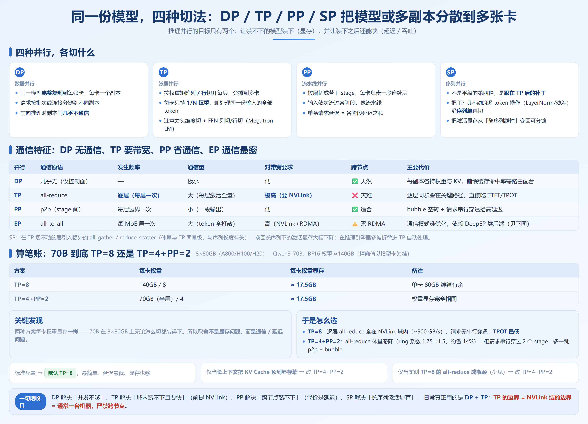

# 第 6 章　并行策略全景

## 6.1 四种基础并行



### 6.1.0 前置判断：先算「装得下吗」这笔账

所有并行选择的第一步，都是回答一个朴素问题：**单卡能不能装下？** 这决定了你根本用不用得上 TP/PP。显存大致由四块组成（第 1.4 节有完整公式，这里给推理视角的速算）：

```
单卡显存 ≈ 权重 + KV Cache + 激活值 + 碎片
```

- **权重**：BF16 下 ≈ 参数量 × 2 字节。7B→14GB，70B→140GB，671B→1342GB。
- **KV Cache**：随序列长度和并发线性增长，长上下文下会反超权重（第 4 章核心结论）。
- **激活值 / 碎片**：随 batch、seq 波动，长序列时被 SP 显著压低。

判断逻辑：

```
单卡权重 ≤ 单卡显存 × gpu-memory-utilization  → 装得下，考虑 DP 提吞吐
单卡权重 > 上限                                  → 装不下，必须 TP（域内）或 PP（跨节点）
模型是 MoE 且专家数庞大                          → 还要上 EP 把专家摊开
```

> 这一步务必先用附录 D 的显存计算器算一遍，再决定并行度——很多人上来就设 TP=8，结果模型明明单卡能装，白白背上 all-reduce 开销。

> **推理场景下的并行，目标只有两个——让装不下的模型装下（显存），并让装下之后还能快（延迟 / 吞吐）。它和训练并行的本质区别是：不需要梯度同步，没有反向传播，通信只发生在前向计算的切分边界上。**

---

### 6.1.1 数据并行 DP（Data Parallel）

**怎么切。** 把同一个模型完整复制到每张卡上，每张卡是一个独立副本（replica），进来的请求按批次或按连接分摊到不同副本。

**什么场景用。** 这是**吞吐优先、延迟宽松**场景的首选：
- 高并发短请求（聊天、分类、抽取），要的是「同时能服务多少请求」，而不是「单条多快」。
- vLLM 的 `--data-parallel-size`（V1 引擎，v0.8+ 提供）/ SGLang 的 `--dp-size` 就是干这个的：起 N 个副本，前端用 Router 做缓存感知负载均衡（见第 3.6 / 12.4 节）。

**什么情况不该用。** 当单卡装不下模型时，DP 根本起不来——它要求每张卡都有完整权重。此时必须上 TP/PP。另外，DP 副本各自持有一份 KV Cache，前缀缓存命中率在轮询路由下会被稀释为 1/N（第 5.6 节已讲），所以**多副本一定要配缓存感知路由**，否则前缀复用收益归零。

> **反模式**：给一个 8B 模型设 TP=8。8B 的 BF16 权重约 16GB，单卡 24GB 绰绰有余。上 TP=8 后，每步前向都要在 8 卡间 all-reduce，通信开销反而拖慢了本可以单卡跑得飞起的模型。这种场景 DP=8（8 个副本）的吞吐远高于 TP=8。

---

### 6.1.2 张量并行 TP（Tensor Parallel）

**怎么切。** 按「权重矩阵的列 / 行」把每一层的参数切开，分摊到多卡（Megatron-LM 的经典切法：注意力头的维度切分 + FFN 的列切 / 行切）。每张卡只持有 1/N 的权重，但处理**同一份**输入的全部 token。

**通信量多大——这是 TP 的命门。** TP 不是只切一次，而是**每一层的前向都要在卡间同步一次激活张量**（all-reduce）。这意味着通信发生的频率极高：一个 70B 模型有 ~80 层，前向就要做 ~80 次 all-reduce。每次 all-reduce 的体量约为「单卡激活张量大小」的量级（对 ring all-reduce，总传输量约 `2·(N-1)/N · T`，T 为待归约张量字节数）。

所以它对**卡间带宽极度敏感**：

| 互联方式 | 典型双向带宽（以官方规格为准） | 相对 NVLink |
| --- | --- | --- |
| NVLink（H100，第 4 代） | 约 900 GB/s | 1×（基准） |
| PCIe 5.0 ×16 | 约 64 GB/s | 约 1/14 |
| PCIe 4.0 ×16 | 约 32 GB/s | 约 1/28 |
| InfiniBand NDR 400Gb/s（跨节点） | 约 50 GB/s | 约 1/18 |
| 100Gb 以太网（跨节点） | 约 12.5 GB/s | 约 1/72 |

> 关键不是「能不能通」，而是「每步都通」时 NVLink 比 PCIe 快一个数量级，比跨节点网络快几十倍。TP 的 all-reduce 是**同步、逐层、不可隐藏**的——它直接叠在关键路径上，吃掉的是 TTFT 和 TPOT。

**什么场景用。** 单卡装不下、且卡间有 NVLink / NVSwitch 高速域时（典型：单机 8 卡 A800/H100，全互连）。70B 在 8×80GB 上 TP=8 是教科书级用法。

**什么情况不该用（红线）。**
- **TP 跨节点是灾难。** 一旦 all-reduce 要走 IB / 以太网，带宽从 900 GB/s 掉到 12.5–50 GB/s，逐层同步的延迟会直接把 TP 优势清零甚至变负。跨节点请改用 PP 或 EP，把通信量从「逐层 all-reduce」降到「层级 p2p / all-to-all」。

> **参数对照（标注版本）**
> - vLLM：`--tensor-parallel-size`（适用 vLLM 全版本）
> - SGLang：`-tp` / `--tp-size`（适用 SGLang v0.5.18+）

---

### 6.1.3 流水线并行 PP（Pipeline Parallel）

**怎么切。** 按**层**把模型切成若干「阶段」（stage），每张卡负责一段连续的层。输入依次流过各阶段，像流水线。

**通信量多大。** 相比 TP，PP 的通信**非常省**：只在 stage 边界做一次点对点（p2p）传输激活，体量就是一层输出的激活张量，且是「一段一次」而非「逐层多次」。这是 PP 相对 TP 的最大优点——通信量小、对带宽不挑，因此**可以跨节点**。

**但代价是 bubble（流水线空泡）。** 因为各阶段串行，第一个微批次要等前面所有阶段都跑完才能回传，中间阶段在「等上游、等下游」的间隙里是空转的。用文字 + ASCII 示意一个 3 阶段、4 微批次的 1F1B 调度：

```
时间 ──────────────────────────────▶
Stage 0:  [F0][F0][F0][F0]
Stage 1:  [ 空 ][F1][F1][F1]
Stage 2:  [ 空 ][ 空 ][F2][F2]
            ↑── bubble（空转区）──↑

F0/F1/F2 = 阶段0/1/2 的计算；空 = GPU 在等上游产出 / 下游接收
```

bubble 比例（GPipe 简化模型）约为 `(num_stages − 1) / (num_stages + num_microbatches − 1)`。阶段越多、微批次越少，空泡越大。对**推理**而言，PP 还引入一个更直接的副作用：**单条请求的延迟 = 各阶段延迟之和**（请求必须串行穿过所有 stage），所以 PP 会抬高 TPOT/TTFT，纯粹是为「装下」而牺牲「快」。

> **参数对照（标注版本）**
> - vLLM：`--pipeline-parallel-size`（适用 vLLM 全版本；V1 引擎下 PP 支持与具体版本相关，以官方文档为准）
> - SGLang：`-pp` / `--pp-size`（适用 SGLang v0.5.18+）

---

### 6.1.4 序列并行 SP（Sequence Parallel）

**怎么切。** SP 不是和 TP/PP 平级的「第四种部署方式」，而是**跟在 TP 后面的补丁**。经典 TP 在 LayerNorm、残差、Dropout 这类逐 token 操作上无法切分（它们依赖完整隐藏维度），于是被**复制**到每张卡——这会带来随序列长度线性增长的激活显存。SP 的做法：把这些「TP 切不动」的操作沿**序列维度**再切一刀，让每张卡只存自己那段 token 的激活，从而把这部分显存从「随序列长度线性」变回「可分摊」。

**什么场景用。** 长上下文（第 4 章讲过 KV Cache 会反超权重成为显存主体，激活显存同理随序列膨胀）。SP 在推理引擎里多数**被折叠进 TP 配置自动处理**——你设了 TP，引擎通常在内部决定是否启用 SP 来压激活显存。工程上你感知到 SP 的场景，主要是「长上下文 + 大 TP 时显存反而够用了」。

> **一句话收口 4.1**：DP 解决「并发不够」、TP 解决「单卡装不下且要快」（前提是 NVLink）、PP 解决「跨节点装不下」（代价是延迟）、SP 解决「长序列激活显存」。推理里真正日常用的是 DP + TP，PP/SP 是「装不下时的扩展手段」。

## 6.2 MoE 模型与专家并行 EP


### 6.2.1 Dense 与 MoE 的本质差异

- **Dense（稠密）**：每一层 FFN 的**全部参数**对**每一个 token** 都参与计算。算力的「利用率」是 100%，但代价是每一步都要把全部 FFN 权重从 HBM 读一遍——这恰好撞上第 0 章说的「内存墙」。
- **MoE**：每层有 N 个「专家」FFN + 一个路由（router）。每个 token 只被路由到 top-k 个专家（通常 k=1 或 2）。以 DeepSeek 系列为例，总参数几百 B，但**每个 token 实际激活的只有几十 B**（具体数值以模型卡为准）。

这意味着 MoE 的两个推理事实：

1. **显存主角从「权重」变成「专家权重集合」**：虽然每 token 只激活 top-k，但**所有专家权重都得常驻显存**（否则路由到谁都得现场加载，不可行）。所以 MoE 的「装不下」问题比同参数 Dense 更尖锐——Dense 70B 要装 70B 权重，MoE 671B 要装 671B 权重。
2. **每 token 的计算量只跟 top-k 专家有关**，但「该把 token 送到哪个专家」这个路由决策，天然要求 token 在专家之间「流动」——这就是 EP 的由来。

### 6.2.2 专家并行 EP（Expert Parallel）

**怎么切。** EP 不再把单个专家切开，而是**把「专家集合」这个整体分摊到多卡**：卡 0 持有专家 {0,1,2}，卡 1 持有 {3,4,5}……每张卡只装一部分专家。一个 token 被 router 判给对方卡上的专家时，就**通过 All-to-All 通信把 token 发过去算，再把结果发回来**。

**为什么大 MoE 必须上 EP——双重论证：**

- **显存维度**：EP=N 时，每卡只需持有 1/N 的专家权重。671B 模型 EP=8，每卡专家权重降到 ~84B（相对）且**没有「死重切片」**；若结合 TP 进一步细分，可压到单卡能装下。纯 TP 做不到这种内存线性下降，因为它要求每卡都带全量专家的切片。
- **算力维度**：TP 下每个 token 仍要「流过」所有专家的切片（因为切片是行/列切分，计算无法跳过未激活专家的逻辑通路开销与激活显存）；EP 下 token 只被送到 top-k 个真正激活的专家所在卡，其余卡的该 token 计算**根本不发生**。对 top-k≪N 的稀疏场景，这是实打实的算力节省。

### 6.2.3 EP 的瓶颈：All-to-All 通信

EP 省了显存和算力，但把代价转移到了通信——而且是比 TP 的 all-reduce 更难伺候的 **All-to-All**：

通信体量（每 MoE 层）粗略为 `2 · (batch·seq) · top_k · hidden · dtype_bytes`——dispatch 把 token 送出去、combine 把结果收回来，各一次。当专家数和卡数都很大时，这是全章通信最重的一类。

> **反模式**：用纯 TP 去跑一个大 MoE，指望它「和 Dense 一样切」。结果是显存压不下来、死重计算多、且 All-to-All 需求被错配成 all-reduce 模式，既装不下也跑不快。MoE 的正确打开方式是 **TP（切注意力等非专家部分）+ EP（切专家）** 的组合，二者正交、可同时设。

### 6.2.4 算笔账：671B MoE 为什么必须 EP（显存维度）

以公开技术报告中的 DeepSeek-V3 量级的 MoE 为例（总参数约 671B，每 token 激活约 37B，具体数值以模型技术报告为准），对比两种切法在「单机 8×80GB」上的可行性：

| 切法 | 每卡需持有的专家权重 | 8 卡总计 | 能否装下 |
| --- | --- | --- | --- |
| 纯 TP=8（专家也被列/行切开，每卡带全量专家切片） | 671B / 8 ≈ 84B 权重（含大量当前 token 用不到的专家） | 671B | 每卡 84B×2字节=168GB ≫ 80GB，**装不下** |
| TP + EP=8（专家整体分摊，每卡只持 1/8 专家） | 671B / 8 ≈ 84B 权重（**且都是会被路由到的专家**） | 671B | 同上量级的权重仍超单卡 |

> 注意：上表说明单看 EP=8 在**单机 8 卡**上仍然装不下 671B——EP 降的是「每卡专家数」而非「总参数量」。671B 这类超大 MoE 必须 **EP 跨多节点**（如 EP=32/64）+ 域内 TP，把专家摊到几十张卡上，每卡才降到可装。这正是 6.3 节大规模 EP 的存在理由。

> **参数对照（标注版本，具体支持与默认值以官方文档为准）**
> - vLLM：`--enable-expert-parallel`（开启 MoE 专家并行，适用 vLLM 0.20+ 的 MoE 路径）、`--expert-tensor-parallel-size`（专家内的 TP 度）；另有 EPLB 相关开关（如 `--enable-eplb`）用于专家负载均衡，版本相关。
> - SGLang：`--expert-parallel-size` / `-ep`（适用 SGLang v0.5.18+，MoE 默认倾向走 EP）；DeepEP 类高性能后端需参照官方文档的对应开关配置。

---

## 6.3 大规模 EP 与 DeepEP ☁️

### 6.3.1 大规模 EP 在优化什么

把 EP 从单机 8 卡推到跨节点几十上百卡时，All-to-All 的痛点被放大：
1. **跨节点带宽远低**（见 4.1.2 表格，IB ~50 GB/s vs NVLink ~900 GB/s），All-to-All 一旦跨节点就贵；
2. **延迟敏感**：每 MoE 层一次 All-to-All，小 token 包多、延迟主导；
3. **计算 / 通信重叠难**：朴素实现里通信和计算串行，GPU 在等数据。

DeepEP（DeepSeek 开源的 MoE 通信库）的思路就是针对这三点：
- **分两条通路**：用 NVLink 域内的高吞吐 kernel 处理节点内 All-to-All，用 RDMA 处理跨节点 All-to-All，分别优化；
- **低延迟 kernel**：面向 decode 阶段的小 batch、高频率 All-to-All，压单跳延迟；
- **计算 / 通信重叠**：通过 group-limited GEMM 等技术，让专家计算和数据收发尽量并行，藏掉一部分通信时间。

> 诚实说明：DeepEP 不是「装个库就快」的开关。它的收益依赖具体硬件拓扑（是否真的有 NVLink 域 + RDMA 网络）、EP/TP 的具体组合、以及专家负载是否均衡。在**不具备相应互联条件的单机 / 普通多卡**上，强行启用相关后端往往没有收益甚至更慢。这是本节最该记住的实操门槛。

> **专家负载均衡（EPLB）提醒**：EP 有个纯 TP 没有的坑——token 路由可能严重不均（某些专家被疯狂命中，某些冷落），导致持热专家的卡成为瓶颈。vLLM 的 EPLB 相关开关（`--enable-eplb`，版本相关、以文档为准）和 SGLang 的对应机制就是做「把热专家复制 / 重排到多卡」的负载均衡。单机 8 卡实验里如果看到某张卡显存或算力明显偏高，先怀疑是不是负载不均。

## 6.4 并行策略决策表 

本章的收尾高潮。先把决策方法讲成一个**可执行流程**，再给一张覆盖典型场景的推荐表。

### 6.4.1 决策方法（四步）

```
第 1 步：单卡装得下吗？
   是 → 直接用 DP 多副本提吞吐，别碰 TP/PP（小模型 TP 是反模式）。
   否 → 进入第 2 步。

第 2 步：卡间有没有 NVLink 高速域？（通常 = 是否在同一台 8 卡机内）
   有 → TP 可在该域内自由设（TP=卡数 或更小）。
   无（要跨节点）→ 严禁 TP 跨节点，改用 PP 跨节点 + 域内 TP。

第 3 步：是不是 MoE？
   是 → TP（切非专家）+ EP（切专家）组合，EP 规模受限于卡数 / 节点数。
   否 → TP +（必要时）PP 组合。

第 4 步：请求特征是什么？
   长上下文 → 保留 NVLink 域内 TP，靠 PP/DP 横扩，配合 KV 量化，SP 帮你压激活显存。
   高并发短请求 → 优先 DP 多副本（无通信）而非大 TP；TP 仅用于「装不下」。
   延迟极敏感 → PP 能少切就少切（PP 抬高 TPOT）。
```

如果你误设 TP=16：all-reduce 每步要走 IB（~50 GB/s）而非 NVLink（~900 GB/s），按 `compute_comm.py` 的量级，单层同步从 ~3.9ms 暴涨到 ~70ms 以上，80 层直接把延迟拖垮。

### 6.4.2 推荐组合表（典型场景）

> 下列「卡」默认指 80GB 级数据中心卡（A800/H100/H20 等），具体能否装下以显存计算器（附录 D）为准。

| 场景 | 推荐组合 | 理由 |
| --- | --- | --- |
| 单机 8 卡跑 7B/8B | **DP=8**（每卡一个副本），TP=1 | 单卡装得下，要的是并发；DP 零通信、吞吐最高 |
| 单机 8 卡跑 70B | **TP=8**（NVLink 域内）或 **TP=4+PP=2** | 70B BF16≈140GB，8×80GB 充裕。TP=8 最简单延迟最低；TP4+PP2 可降 all-reduce 量但多一跳延迟 |
| 单机 8 卡跑小 MoE（如 Qwen3-30B-A3B） | **TP（非专家部分）+ EP=8**，或 EP=4+TP=2 | MoE 必须 EP 才能线性降显存；纯 TP 留死重 |
| 两机 16 卡跑 70B | **域内 TP=8 + 跨节点 PP=2**（或 DP=2×TP=8） | TP 锁在单节点 NVLink 内，跨节点用 PP（p2p 通信小）；**TP=16 跨两节点**会走 IB，带宽差几十倍 |
| 多机跑超大 MoE（如 DeepSeek-V3 671B） | **域内 TP + 跨节点 EP +（必要时）PP**，配 DeepEP 类后端 | 671B 必须 EP 才能装下；EP 跨节点走 RDMA，叠加计算/通信重叠 |
| 长上下文场景 | 保持 NVLink 域内 TP，用 PP/DP 横扩，**KV 量化 + SP** | KV Cache 随序列膨胀成显存主体，SP 压激活、量化压 KV |
| 高并发短请求 | **DP 多副本优先**（小模型 TP=1）；大模型域内 TP 后 DP 副本 | decode 是访存墙，DP 无通信、并发线性扩展 |

## 6.5 动手实验：同一模型不同并行组合的实测对比

**实验一：启动脚本集合（vLLM + SGLang 双引擎）**

```bash
# ===== vLLM：8B 用 DP=8（推荐）vs TP=8（反模式对照）=====
# 推荐：8 个独立副本，无通信，吞吐最高
vllm serve Qwen/Qwen3-8B \
  --tensor-parallel-size 1 \          # TP=1，单卡副本
  --data-parallel-size 8 \            # DP=8：8 个副本（适用 vLLM V1，v0.8+）
  --gpu-memory-utilization 0.90

# 反模式对照：把 8B 强切 TP=8（仅用于对比，预期更慢）
vllm serve Qwen/Qwen3-8B \
  --tensor-parallel-size 8 \          # TP=8 跨 8 卡 all-reduce（适用 vLLM 全版本）
  --gpu-memory-utilization 0.90

# ===== SGLang 对应写法 =====
# 推荐
python -m sglang.launch_server \
  --model-path Qwen/Qwen3-8B \
  -tp 1 \                            # 单卡（-tp 适用 SGLang v0.5.18+）
  --dp-size 8                        # DP=8 副本
# 反模式对照
python -m sglang.launch_server \
  --model-path Qwen/Qwen3-8B \
  -tp 8                              # TP=8 对照
```

70B 的组合（单机 8 卡，NVLink 域内）：

```bash
# vLLM：TP=8（推荐）vs TP=4+PP=2（对照）
vllm serve Qwen/Qwen3-70B \
  --tensor-parallel-size 8 \         # TP=8（适用 vLLM 全版本）
  --gpu-memory-utilization 0.92

vllm serve Qwen/Qwen3-70B \
  --tensor-parallel-size 4 \         # TP=4
  --pipeline-parallel-size 2         # PP=2 跨 4+4（适用 vLLM 全版本）

# SGLang 对应
python -m sglang.launch_server --model-path Qwen/Qwen3-70B -tp 8
python -m sglang.launch_server --model-path Qwen/Qwen3-70B -tp 4 -pp 2
```

MoE（如 Qwen3-30B-A3B）的 EP 组合：

```bash
# vLLM：TP 切非专家 + EP 切专家
vllm serve Qwen/Qwen3-30B-A3B \
  --tensor-parallel-size 1 \
  --enable-expert-parallel \         # 开启 EP（适用 vLLM 0.20+，以官方文档为准）
  --expert-tensor-parallel-size 1

# SGLang：用 -ep 设专家并行
python -m sglang.launch_server \
  --model-path Qwen/Qwen3-30B-A3B \
  -tp 1 -ep 8                        # -ep 设 EP=8（适用 SGLang v0.5.18+，以官方文档为准）
```

**实测对比方法。** 每组起完服务后，用同一份压测脚本（或引擎自带 benchmark）跑同一份负载（固定 input/output 长度、固定并发），记录 TTFT / TPOT / 吞吐，把多组结果并排成表。

> 注意：跨节点脚本（两机 16 卡 / 多机超大 MoE）需要 `export VLLM_HOST_IP`、`--nnodes`、`--node-rank` 等分布式启动参数，且有严格网络要求，务必以官方分布式部署文档为准，本教程不再展开逐条命令。

## 本章小结

1. **推理并行的目标只有两个：装得下（显存）和跑得快（延迟/吞吐）**，没有梯度同步，通信只发生在前向切分边界——这是和训练并行的根本区别。
2. **DP 解决并发、TP 解决「域内装不下且要快」、PP 解决「跨节点装不下」、SP 解决长序列激活显存**。日常最常用的是 DP + TP。
3. **TP 的命门是逐层 all-reduce，对带宽极敏感**：NVLink(~900 GB/s) 比 PCIe(32–64 GB/s) 快一个数量级，比跨节点网络(12.5–50 GB/s) 快几十倍，**TP 的边界就是 NVLink 域的边界，严禁跨节点**。
4. **PP 通信省但引入 bubble 和串行延迟**，只在装不下且不能 TP 跨节点时用，stage 数尽量小（2 最优）；PP 切太小 + microbatch 太小会两头不讨好。
5. **MoE 必须用 EP**：纯 TP 留死重、压不降显存；EP 让每卡只持 1/N 专家、token 只送 top-k 专家，从显存和算力双维度成立，代价是 All-to-All 通信。
