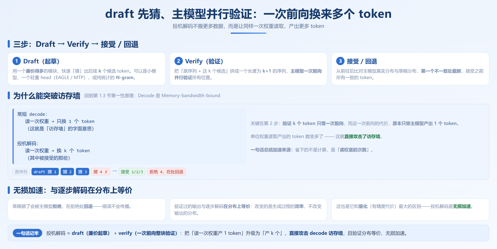
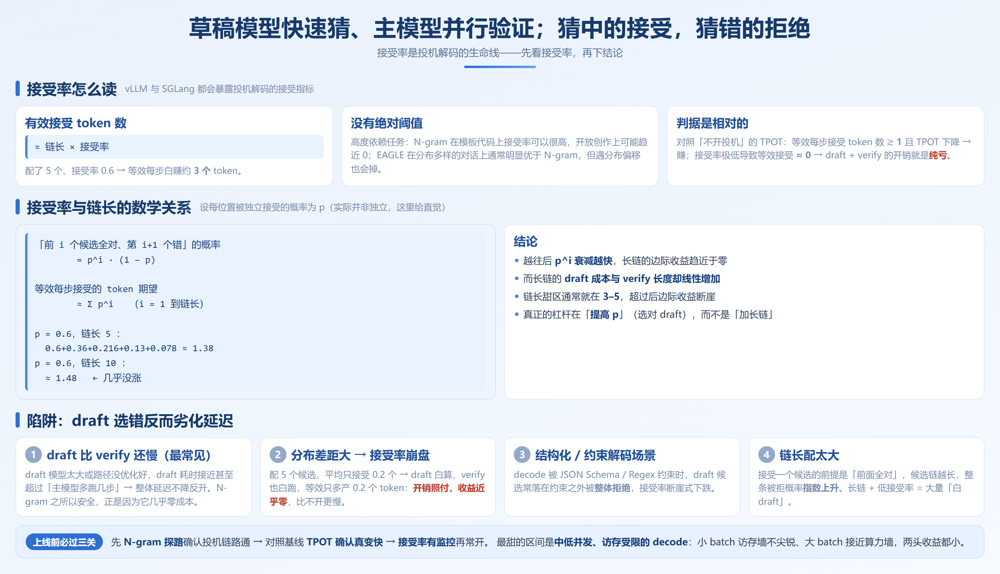

# 第 7 章　投机解码

> 版本基线：本章命令与参数基于 **vLLM v0.20.x–v0.21.x（V1 引擎）** 与 **SGLang v0.5.18+**，验证于 PyTorch 2.11。投机解码的命令行键名在两个引擎的版本间变动都较频繁，动手前请以你所装版本的官方文档为准。

先回答一个问题：**为什么 decode 慢？** 第 0.5 节讲过——decode 是「一步一个 token」的串行过程，每生成一个 token 就要把整个模型权重从显存读一遍，算力在旁边干等数据（访存墙）。投机解码是全书四大主线技术里最「聪明」的一个：它不搬更多的数据，而是让**同样的一次权重读取，产出更多 token**。

打个比方：写论文时你自己一个字一个字敲（自回归解码）；而一个有经验的作者会先**打个草稿**（draft），再**通读校对**（verify）——校对一遍整段草稿，比一个字一个字重写快得多。投机解码就是让 GPU 学会「先打草稿、再校对」。

## 7.1 本章要回答的问题

- 投机解码凭什么能加速？加速的来源是什么、边界在哪？
- N-gram / Draft Model / EAGLE / MTP / DFlash / DSpark 这些方案有什么区别，我该选哪个？
- 什么是「并行起草」？为什么它是 2026 年之后的新默认候选？
- `num_speculative_tokens` 该设多大？接受率多少算好、怎么看？
- 什么情况下开了投机解码反而更慢？

## 7.2 原理：draft + verify，为什么能突破访存墙



回到第 1.3 节的第一性原理：**Decode 是 Memory-bandwidth-bound**。常规 decode 里，读一次权重只换 1 个 token——这就是「访存墙」的字面意思。

投机解码（注意：是「投机」，不是「推测」）分三步：

1. **Draft（起草）**：用一个**廉价得多**的模块，快速「猜」出后续 `k` 个候选 token。这个模块可以是小模型、一个轻量 head（EAGLE / MTP）、或纯统计的 N-gram。
2. **Verify（验证）**：把「原序列 + 这 `k` 个候选」拼成一个长度为 `k+1` 的序列，**主模型一次前向并行验证**所有位置。
3. **接受/回退**：从前往后比对主模型真实分布与草稿分布，第一个不一致处截断，接受之前所有一致的 token。

关键在第 2 步：**验证 `k` 个 token 只需要一次前向，而这一次前向的代价，原本只够主模型产出 1 个 token。** 原本读一次权重只换 1 个 token，现在换了 `k` 个（其中被接受的那些）。单位权重读取产出的 token 数变多了——这就直接攻击了访存墙。

一个重要的性质：**验证过的输出和逐步解码在分布上等价**。草稿错了会被主模型拒绝、在拒绝处回退，所以投机解码是「无损加速」——它改变的是生成过程的效率，不改变输出的分布。这也是它和量化（有精度代价）最大的区别。

一句话总结加速来源：**省下的不是计算，是「读权重的次数」。**

## 7.3 方案全景：六种方案与选型

### 7.3.1 六种方案一张表

| 方案 | draft 来源 | 额外显存/算力 | 接受率特征 | 适用场景 | 主要代价 |
|---|---|---|---|---|---|
| **N-gram** | 请求自身历史的 n 元组统计，无需模型 | 几乎为零 | 模板化/重复文本高，自由生成低 | 代码补全、模板、重复结构输出 | 对开放式生成几乎无效 |
| **Draft Model** | 一个更小的独立模型 | 需额外权重显存 + draft 算力 | 取决于小模型与目标模型分布接近度 | 有现成小模型、分布接近 | draft 太慢或分布偏则劣化 |
| **EAGLE / EAGLE3** | 在目标模型隐藏态上训练一个轻量自回归 head | 较小（head 参数少），需训练好的 draft 权重 | 高（head 显式拟合目标分布） | 通用对话、分布多样的生成 | 需要对应模型的 draft 权重，并非所有模型都有 |
| **MTP**（Multi-Token Prediction） | 模型自身带的「多 token 预测」层（如 DeepSeek） | 极小（复用主模型层） | 高（与主模型同源） | DeepSeek 等原生支持 MTP 的模型 | 仅限模型架构支持 |
| **DFlash** | 独立的**块扩散（block diffusion）**草稿模型，一次前向并行起草整块 token | 小（如 5 层、约 1GB 级草稿权重） | 高且稳（并行起草不随块长衰减，代码等可预测负载收益最大） | 有配套 DFlash 草稿的模型；代码生成、批量抽取 | 需专门训练的 DFlash 草稿权重，与目标模型绑定 |
| **DSpark** | DFlash 骨架 + **顺序修正 + 置信度头**（草稿先自评分，只送高置信候选去验证） | 小（同 DFlash 量级） | 更高（过滤低质量草稿，等效接受数再升，还省验证算力） | 高吞吐 decode、长输出、新架构模型（混合线性注意力等） | 同 DFlash；配置项更多，需确认配套权重 |

### 7.3.2 机制差异（理解它才能选对，而不只是查表）

- **N-gram**：完全不需要模型。它维护请求已生成 token 的 n 元组频率表，直接预测「出现最多的下一个 n 元组」。成本几乎为零，但只能捕捉**字面重复**——代码、模板、固定格式输出里出奇地好用，开放创作里几乎无效。它是「零风险探针」，也是你验证投机链路是否通的入口。
- **Draft Model**：拿一个更小的独立模型当 drafter。它在分布式上更灵活（你可以为特定领域训一个小模型），但代价是**额外权重显存 + draft 自身的算力开销**。风险点全在「分布接近度」：小模型越不像目标模型，接受率越低（见 5.5 陷阱节）。
- **EAGLE / EAGLE3**：不直接生成 token，而是在目标模型的**隐藏态（hidden state）上训练一个轻量自回归 head**，预测「下一个隐藏态」再映射回 token。因为 head 显式拟合了目标模型的分布，接受率通常远高于独立 draft 模型；且 head 参数量极小，draft 开销可忽略。代价是**需要对应模型训练好的 draft 权重**——不是每个模型社区都有，这是它落地的最大门槛。
- **MTP**：Multi-Token Prediction，模型架构层面就带「一次预测多个 token」的层（DeepSeek 系列原生支持）。draft 直接复用主模型的 MTP 层，代价最小、与目标模型同源，接受率最高。限制是**只有架构支持 MTP 的模型才能用**。
- **DFlash**：一个独立的**块扩散（block diffusion）草稿模型**。它不走「逐 token 往后猜」的老路，而是**一次前向把整块（比如 8–16 个）候选 token 并行吐出来**，主模型再一次前向整块验证。因为起草和验证的代价解耦了，草稿模型可以做得比 EAGLE head 更深更 expressive（典型只有 5 层、约 1GB），接受数却不随块长指数衰减。代价：需要社区为你的目标模型专门训过 DFlash 草稿（Qwen3.5、gpt-oss、Kimi 等主流模型已有，见 z-lab 的 HuggingFace 合集）。
- **DSpark**：在 DFlash 骨架上再加两样东西——**顺序修正**（一个极小的卷积层让并行起草的候选彼此连贯，解决「整块一起猜导致的上下文断裂」）和**置信度头**（草稿先给每个候选自评分，**只把高置信的送进主模型验证**）。第三点很关键：并行起草的新瓶颈是「草稿很便宜、验证变贵了」，置信度头直接削减了验证浪费。官方报告在同配置下等效接受数高于 DFlash，验证计算还更省。

一个判断口诀：**有 MTP 用 MTP，有 EAGLE 权重用 EAGLE，有配套 DFlash/DSpark 优先试并行起草，都没有先用 N-gram 探路，别急着训 draft model。**

### 7.3.3 选型决策表（按「你手头有什么」出发）

| 你的条件 | 首选方案 | 理由 |
|---|---|---|
| 没有任何 draft 权重，先快速验证 | **N-gram** | 零成本、零风险，先确认投机解码链路通 |
| 模型是 DeepSeek 且原生 MTP | **MTP** | 复用主模型层，代价最小、接受率最高 |
| 有对应模型的 EAGLE draft 权重 | **EAGLE** | 通用生成接受率高，是多数场景的甜点 |
| 有配套的 DFlash / DSpark 草稿权重 | **DFlash / DSpark** | 并行起草，长块下接受数不塌，是 2026 年后的新默认候选 |
| 有一个分布接近的小模型 | **Draft Model** | 可定制，但要警惕下面说的劣化陷阱 |

> 注意：DFlash / DSpark 并非所有模型都有配套草稿权重，动手前先到 HuggingFace 搜「<模型名>-DFlash / -DSpark」确认。它们在 vLLM（经 Speculators 生态）与 SGLang（原生支持）都已可用。

### 7.3.4 双引擎配置对照

vLLM V1 通过统一的 `--speculative-config`（一个 JSON 块）配置不同方法；SGLang 通过 Spec V2 框架（算法 + 草稿路径分开传参）。

```bash
# ── vLLM（V1 引擎，v0.20.x–v0.21.x；键名与取值以版本文档为准）──

# N-gram：零成本，先试这个最稳
vllm serve Qwen/Qwen3-8B-Instruct \
  --speculative-config '{"method": "ngram", "num_speculative_tokens": 5}' \
  --gpu-memory-utilization 0.90

# EAGLE：需要对应模型的 draft 权重路径
vllm serve Qwen/Qwen3-8B-Instruct \
  --speculative-config '{"method": "eagle", "model": "<eagle-draft-path>", "num_speculative_tokens": 5}' \
  --gpu-memory-utilization 0.90

# MTP（DeepSeek 等原生支持）：model 指向主模型，由引擎加载 mtp 层
vllm serve deepseek-ai/DeepSeek-V3 \
  --speculative-config '{"method": "mtp", "model": "deepseek-ai/DeepSeek-V3", "num_speculative_tokens": 4}' \
  --tensor-parallel-size 8

# DFlash：需要配套的 DFlash 草稿权重（示意，method 名以版本文档为准）
vllm serve Qwen/Qwen3.5-27B \
  --speculative-config '{"method": "dflash", "model": "z-lab/Qwen3.5-27B-DFlash", "num_speculative_tokens": 15}' \
  --gpu-memory-utilization 0.90

# ── SGLang（v0.5.18+，Spec V2）──

# EAGLE 草稿（需对应的 eagle 权重）
python -m sglang.launch_server \
  --model-path Qwen/Qwen3-32B \
  --tp 4 \
  --speculative-algorithm EAGLE \
  --speculative-draft /path/to/eagle-qwen3-32b \
  --speculative-num-steps 4                          # 每次猜几步

# MTP 草稿（DeepSeek 等原生带 MTP head 的模型）
python -m sglang.launch_server \
  --model-path deepseek-ai/DeepSeek-V3 \
  --tp 8 \
  --speculative-algorithm MTP \
  --speculative-num-steps 3

# DFlash 草稿（并行起草，需配套草稿权重；示意键名以官方文档为准）
python -m sglang.launch_server \
  --model-path Qwen/Qwen3.5-35B-A3B \
  --tp 1 \
  --speculative-algorithm DFLASH \
  --speculative-draft-model-path z-lab/Qwen3.5-35B-A3B-DFlash \
  --speculative-num-draft-tokens 16                  # 一次起草一整块
```

> 两个引擎的参数语义差异要注意：vLLM 的 `num_speculative_tokens` 与 SGLang 的 `--speculative-num-steps` 都偏「自回归起草的步数/链长」语义；而 SGLang 的 `--speculative-num-draft-tokens` 是**整块大小**——并行起草的参数语义与自回归起草不同，不是「串行猜几步」。SGLang 把草稿类型、草稿路径、块长分开传参，vLLM 是一个 JSON 块声明——风格差异，能力面高度重叠。

**能力对照表**：

| 维度 | SGLang Spec V2 | vLLM 投机解码 |
|---|---|---|
| 草稿类型 | EAGLE / MTP / N-gram / draft model / DFLASH / DSpark 统一框架 | EAGLE / MTP / N-gram / draft model / DFlash / DSpark（Speculators 生态） |
| 默认路径 | Spec V2 统一入口 | `--speculative-config` 声明式 |
| 配置风格 | 算法 + 草稿路径分开传 | 一个 JSON 配置块 |
| 适用场景 | 与 RadixAttention 叠加（缓存 + 投机双收益）时更顺 | 生态成熟、与 vLLM 服务栈一体 |

**判断（不下「谁更好」）**：两者能用的草稿方法高度重叠（自回归起草与并行起草两侧都齐了），单看投机解码速度没有谁碾压谁。**SGLang 的组合优势**是「前缀缓存 + 投机解码」能同时开，对「共享前缀又长输出」的负载（多轮 Agent、批量抽取）叠加收益明显；vLLM 在「已经是 vLLM 服务、只要加投机」的场景下更省迁移。陷阱两面都一样：草稿选错 → 接受率掉 → 比不开还慢，务必先量接受率。

## 7.4 专题：从「自回归起草」到「并行起草」（DFlash / DSpark） ★★★ ⏭️

五类方案（N-gram / Draft Model / EAGLE / MTP）共享同一个隐藏假设：**草稿是一个一个 token 串行猜出来的**。EAGLE-3 再强，猜 5 个候选也要跑 5 步 draft 前向。这带来两个生产上的老问题：

- **草稿模型不能做大**：起草成本随猜测长度线性涨，模型稍大，「省下的验证时间」就被「draft 的耗时」吃掉了
- **`num_speculative_tokens` 得反复调**：链长是个敏感参数，负载一变就要重新扫描

**并行起草（parallel drafting）把这个假设干掉了**：起草阶段从「循环 k 次」变成「一次前向出整块」，起草耗时与块长解耦。两个直接好处：草稿模型可以更大更准（不再被迫保持极小），块长不再是需要精调的敏感参数。

三种代表方案的递进关系：

| 方案 | 起草方式 | 关键改进 | 一句话总结 |
|---|---|---|---|
| **P-EAGLE** | 并行 + 隐藏态输入 | 把 EAGLE 的隐藏态条件化搬到并行起草 | EAGLE 的并行版 |
| **DFlash** | 并行块扩散 | 隐藏态投影进草稿 KV Cache，整块一次吐出 | 便宜、深、快的专用 drafter |
| **DSpark** | 并行 + 修正 + 置信度 | 顺序修正保持块内连贯；置信度头过滤草稿、削减验证浪费 | DFlash 之上的「质检版」 |

（P-EAGLE / DFlash / DSpark 论文见附录 E；本教程以工程使用为主，训练方法不展开。）

**工程视角的三个判断**：

1. **受益最大的是代码与结构化文本负载**。并行起草的草稿模型对「可预测性高」的文本接受数最高——社区实测里代码场景单步接受 6–7 个 token 并不罕见，自由散文则明显低。选型前先看你的负载形态。
2. **不要拿随机负载下结论**。有人用随机 token 数据集测 DSpark 得出「接受率趋近 1、毫无用处」——随机序列本来就不可预测，任何 drafter 都救不了。这再次印证本章反复出现的观点：**先看接受率，再下结论**。
3. **验证侧的新瓶颈**。起草变得极便宜后，成本重心移向「验证一堆最终会被拒绝的候选」。DSpark 的置信度头就是冲着这个来的——这也是评估并行起草方案时新的观察点：不只看接受率，还要看「送去验证的候选里有多少被白白浪费」。

## 7.5 接受率（acceptance rate）怎么看，多少算好



vLLM 与 SGLang 都会暴露投机解码的接受指标（如每步平均接受的 draft token 数、`num_accepted_tokens / num_drafted_tokens` 之比）。读法：

- **有效接受 token 数** ≈ `链长 × 接受率`。比如配了 5 个、接受率 0.6，等效每步白赚约 3 个 token。
- **没有绝对阈值**。它高度依赖任务：N-gram 在模板代码上接受率可以很高，在开放创作上可能趋近 0；EAGLE 在分布多样的对话上通常明显优于 N-gram，但遇到分布偏移（如突然切换到完全不同的领域）也会掉。
- **判据是相对的**：对照「不开投机解码」的 TPOT，如果开启后等效每步接受 token 数 ≳ 1 且 TPOT 下降，就是赚；如果接受率极低导致等效接受 ≈ 0，那 draft + verify 的开销就是纯亏。

**接受率与链长的数学关系**（理解它才能避免「越大越赚」的误区）。设每位置被独立接受的概率为 `p`（实际并非独立，但这里给直觉），那么一步里「前 `i` 个候选全部正确、第 `i+1` 个错」的概率是 `p^i · (1−p)`。等效每步接受的 token 期望 ≈ `Σ p^i`（从 i=1 到链长）。当 `p=0.6`、链长 5 时，期望 ≈ 0.6+0.36+0.216+0.13+0.078 ≈ 1.38；把链长加到 10，期望 ≈ 1.48——**几乎没涨**。因为越往后，`p^i` 衰减越快，长链的边际收益趋近于零，而长链的 draft 成本与 verify 长度却是线性增加的。这就从数学上解释了：把链长从 5 加到 20，常常只是徒增延迟。**链长的甜区通常就在 3–5，超过后边际收益断崖。** 真正的杠杆在「提高 `p`」（选对 draft），而不是「加长链」。

## 7.6 陷阱：draft 选错反而劣化延迟

这是投机解码「高收益高陷阱」的另一面，必须讲清**什么情况下会劣化**：

1. **draft 比 verify 还慢**（最常见）。投机解码省的是「主模型读权重」的次数，但 draft 本身要花时间。如果 draft 模型太大、或 draft 路径没优化好，draft 的耗时已经接近甚至超过「主模型多跑几步」的耗时，那整体延迟不降反升。N-gram 之所以安全，正是因为它几乎零成本——**先用 N-gram 探路，就是为了避免这个坑。**

2. **draft 与 target 分布差距大 → 接受率崩盘**。你配了 5 个候选，结果平均只接受 0.2 个。这意味着：draft 白算了一遍、verify 也跑了一遍，最后等效只多产出 0.2 个 token。**开销照付，收益近乎零**——比不开更慢。这种情况在「用通用小模型去 draft 一个专业领域大模型」时极易发生。

3. **结构化输出 / 约束解码场景**。当 decode 被 JSON Schema / Regex 约束时（见 9.3 节），投机解码的 draft 候选常常落在约束之外被整体拒绝，接受率断崖式下跌。vLLM 与 xgrammar 的配合有专门路径，但通用投机在这类负载上要特别谨慎，务必实测接受率。

4. **链长配太大**。直觉是「猜越多赚越多」，但接受一个候选的前提是「前面全对」。候选链越长，整条被拒的概率指数上升。长链 + 低接受率 = 大量「白 draft」。**一般从 3–5 起步扫描，不是越大越好。**

5. **小 batch / 低并发时收益小，大 batch 时帮助也小**。小 batch 时主模型本就「吃不饱」，访存墙不尖锐，投机收益有限；大 batch 时 decode 已接近 compute-bound，draft 的边际贡献被摊薄。投机解码最甜的区间，是中低并发、访存受限的 decode 阶段。

**何时根本不该开投机解码（一张禁用清单）**：

1. **结构化 / 约束解码负载**：JSON Schema、Regex 约束下，draft 候选频繁落在约束外被整体拒绝，接受率断崖，开销照付——除非你确认引擎对该路径有特殊支持，否则先不开。
2. **分布高度不可预测的开放生成**：draft 与目标分布差距大，接受率趋近 0。N-gram 在此类负载上几乎必然无效。
3. **已经 compute-bound 的高并发**：大 batch 下 decode 已接近算力墙，投机的边际贡献被摊薄，反而增加 verify 开销。
4. **延迟预算极紧且 batch 极小**：draft 的固定开销（一次轻量前向 + verify）在低延迟场景下可能比「主模型多跑一步」还慢。
5. **没有接受率监控就上线**：开投机却不看接受率，等于闭眼开车。先有监控，再有开关。

满足以上任一条，默认不开投机。

> **反模式小结（本章）**：① 直接上 EAGLE 却没先验证 draft 权重匹配；② 接受率没看就宣布「投机有效」；③ 结构化输出场景无脑开投机；④ 链长设很大以为更赚。

## 7.7 动手实验：EAGLE vs N-gram 实测对比

配套仓库 `src/ch07-speculative/spec_decode_bench.sh` 给出可复现对比：同一模型、同一负载，分别用 N-gram 与 EAGLE 启动，跑同一组 `vllm bench serve`，抓 TPOT P99、吞吐、以及日志里的接受率。

```bash
# spec_decode_bench.sh（节选，详见仓库 README）
# 1) 基线：不开投机
vllm serve Qwen/Qwen3-8B-Instruct --port 8000 --gpu-memory-utilization 0.90 &
run_bench_and_save base.json

# 2) N-gram
vllm serve Qwen/Qwen3-8B-Instruct --port 8001 \
  --speculative-config '{"method":"ngram","num_speculative_tokens":5}' &
run_bench_and_save ngram.json

# 3) EAGLE（需 draft 权重）
vllm serve Qwen/Qwen3-8B-Instruct --port 8002 \
  --speculative-config '{"method":"eagle","model":"<eagle-draft-path>","num_speculative_tokens":5}' &
run_bench_and_save eagle.json
```

**预期判读**（以你自己的实测为准）：在模板化/重复负载上，N-gram 可能已接近 EAGLE；在开放对话上，EAGLE 通常明显领先；若 EAGLE 的 TPOT 反而高于 N-gram 或基线，先查接受率——多半是 draft 权重不匹配或链长过大。

> **什么场景值得用 / 不值得用**
> - 值得：decode 受限的短输入长输出负载（代码生成、长文写作、批量抽取），且已有高质量草稿（EAGLE/MTP/DFlash/DSpark 权重）。
> - 不值得：prefill 受限的长 prompt 短输出（投机帮不上 prefill 的忙）；草稿模型与主模型分布差太远（等效接受数 <1.5 时基本亏）。

## 本章小结

1. **投机解码 = draft（廉价起草）+ verify（一次前向整块验证）**，把「读一次权重产 1 token」升级为「产 k 个」，直接攻击 decode 访存墙；验证分布等价、无损加速。
2. **方案选型按「手头有什么」**：有 MTP 用 MTP，有 EAGLE 权重用 EAGLE，有配套 DFlash/DSpark 优先并行起草，都没有先用 N-gram 探路——N-gram 零成本，永远是第一步。
3. **并行起草（DFlash/DSpark）是起草方式的代际升级**：起草成本与块长解耦，长块下接受数不塌；对代码等可预测负载收益最大；新瓶颈在验证侧，DSpark 置信度头是当前最优解法。
4. **接受率是生命线**：有效接受 token 数 ≈ 链长 × 接受率；链长甜区 3–5，加长链的边际收益指数衰减（p=0.6 时从 5 加到 10 期望只从 1.38 涨到 1.48）；真正的杠杆是提高 p，不是加长链。
5. **投机解码最甜的区间是中低并发、访存受限的 decode**：小 batch 访存墙不尖锐、大 batch 接近算力墙，两头收益都小；结构化输出场景必须先实测接受率。
6. **上线前必过三关**：先 N-gram 探路确认链路通 → 对照基线 TPOT 确认真变快 → 接受率有监控再常开。
