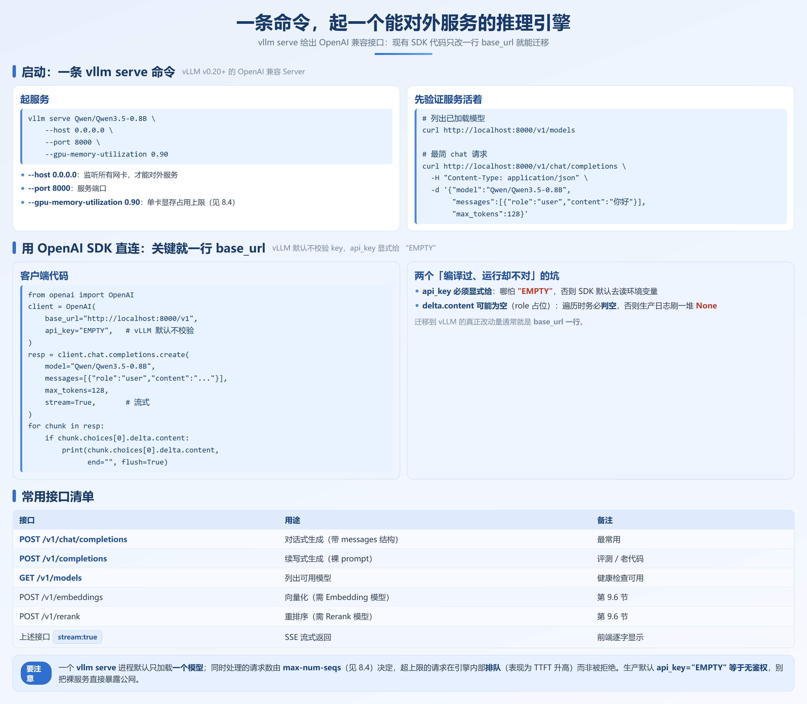
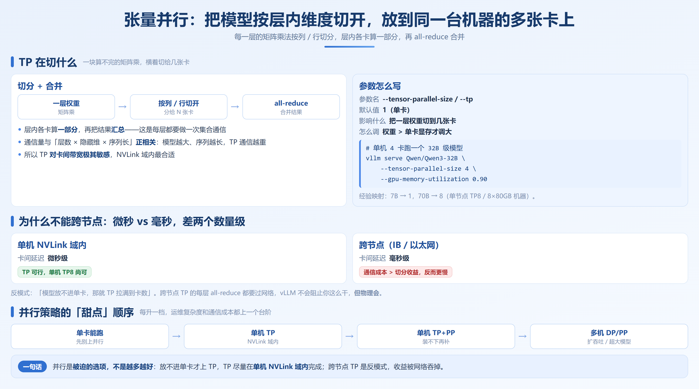

# 第 8 章　vLLM 快速上手与单机多卡部署

## 8.1 环境准备与安装



vLLM 看似一行 `pip install`，坑大多出在「装上了却跑不起来」。本节讲三种安装路径的取舍与版本匹配。

### 8.1.1 三种安装方式怎么选

| 方式 | 适用场景 | 优点 | 代价 |
|---|---|---|---|
| **pip 安装**（官方 wheel） | 有网、环境干净、快速试 | 最快，一条命令 | 对系统 CUDA / 驱动版本敏感 |
| **Docker 镜像**（如 `vllm/vllm-openai`） | 生产、要环境一致 | 免去环境差异，部署即一致 | 需宿主机装好 NVIDIA Container Toolkit |
| **源码编译** | 改引擎、追未发版特性、定制 kernel | 能用上尚未发版的能力 | 编译耗时、依赖复杂，新手慎入 |

> 90% 的读者用 Docker 就能解决「在我机器上能跑」。pip 适合本地开发调试，源码编译只在提 PR 或追刚合入的特性时才需要。

无论哪种方式都装进隔离环境，不要污染系统 Python：

```bash
python -m venv vllm-env && source vllm-env/bin/activate   # 或 conda create -n vllm python=3.11
pip install vllm -i https://pypi.tuna.tsinghua.edu.cn/simple
```

### 8.1.2 CUDA、驱动与 PyTorch 的版本匹配

这是新手第一个大坑，三者**硬绑定**：**驱动**决定你能用的最高 CUDA，**PyTorch wheel** 编译在特定 CUDA 上（如 `cu124`），**vLLM wheel** 又依赖特定 PyTorch，间接锁定 CUDA。

常见失败场景：驱动只支持到 CUDA 12.1，却装了 `cu124` 版 PyTorch，运行时报 `CUDA error: no kernel image available` 或找不到 `libcudart.so`。

**稳妥的做法**：先用 `nvidia-smi` 看右上角「CUDA Version」定上限，再选 wheel；矩阵以官方文档为准（vLLM v0.20+ 通常配 PyTorch 2.11+ 与 CUDA 12.4+）。

```bash
# 先看驱动支持的最高 CUDA 版本
nvidia-smi | head -5      # 关注右上角 "CUDA Version: xx.x"

# 再看已装 PyTorch 实际绑定的 CUDA
python -c "import torch; print(torch.version.cuda, torch.__version__)"
```

> **反模式**：看到报错就无脑升级驱动。生产机的驱动受运维规范约束，升级可能牵连同机其他服务。顺序应是「先看驱动上限 → 选匹配的 wheel」。

**常见安装失败对照**：

| 现象 | 可能原因 | 解法 |
|---|---|---|
| `torch.cuda.is_available()` 返回 False | PyTorch 装成了 CPU 版，或 CUDA 不匹配 | 重装对应 `cu` 版本的 PyTorch |
| `ImportError: libcudart.so.x` 找不到 | 系统 CUDA runtime 与 wheel 不一致 | 装匹配的 CUDA Toolkit 或用 Docker |

### 8.1.3 国内网络：镜像加速与离线安装

境外 HuggingFace 下载慢甚至不通，是第二大坑：pip 换源解决安装阶段，模型权重走 ModelScope（详见 8.5 节）；无外网机器用 `pip download` 打包、内网 `--no-index` 安装。

```bash
pip install vllm -i https://pypi.tuna.tsinghua.edu.cn/simple
```

> 离线包最容易被忽略的是 flash-attn、xformers 这类带编译产物的依赖，目标机架构不一致时装得上也跑不了。离线环境首推 Docker——`docker save` 成 tar 再 `docker load`，连带 CUDA runtime 一起搬。

**升级 vLLM 时**：V1 引擎在 v0.8 后成为默认，老脚本显式关过 V0 参数会失效；参数名也随版本调整，升级后先 `vllm serve --help` 比对。

---

## 8.2 离线推理：LLM 类

「离线推理」指进程内调用 `LLM` 类批量生成，不启 HTTP 服务，适合摘要、标注、评测，是验证模型效果的最快路径。

### 8.2.1 最小可运行示例

```python
# ch06-vllm-quickstart/offline_inference.py  （vLLM v0.20+ 适用）
from vllm import LLM, SamplingParams

# 模型：0.8B 级小模型（显存占用极低，适合先跑通链路）
model = LLM(model="Qwen/Qwen3.5-0.8B", gpu_memory_utilization=0.90)

# 采样参数：温度 0.7，最多生成 256 个 token
sampling_params = SamplingParams(temperature=0.7, top_p=0.9, max_tokens=256)

prompts = [
    "用一句话解释什么是 KV Cache。",
    "如何提高大模型推理的吞吐？",
]

outputs = model.generate(prompts, sampling_params)
for out in outputs:
    print(f"=== Prompt: {out.prompt[:20]}...")
    print(out.outputs[0].text)
```

Qwen3.5-0.8B 的 BF16 权重约 1.7GB，单卡 24GB 余量充足；若报 OOM，加 `--gpu-memory-utilization 0.85`（见 6.4）或换更小模型。`SamplingParams` 另有 `top_k`、`repetition_penalty`（抑制重复，摘要建议 1.05–1.15）、`stop`、`n`；`RequestOutput` 的 `token_ids` 比 `text` 更适合评测。

### 8.2.2 批量推理

`model.generate` 天然接受 list，内部走连续批处理（第 5 章展开原理），不必手搓 batch。但**批大小由引擎按显存动态决定**：传 1000 条 prompt 会排队，你仍拿到 1000 条结果。

> 常见误区是「传了 N 条，单条延迟怎么还这么高」。引擎要攒够并发才一起算，离线场景看总吞吐。

### 8.2.3 流式输出

离线 `LLM` 类默认「算完一起返回」，要逐 token 流式就用 `stream=True`：

```python
# ch06-vllm-quickstart/stream_output.py
from vllm import LLM, SamplingParams

llm = LLM(model="Qwen/Qwen3.5-0.8B")
params = SamplingParams(temperature=0.7, max_tokens=256)

# stream=True 返回生成器，逐 token 产出
for output in llm.generate("讲一个关于缓存的三行小故事。", params, stream=True):
    print(output.outputs[0].text, end="", flush=True)
```

> **注意**：离线流只用于本地看效果，真正的流式服务请走 6.3 的 OpenAI 兼容接口（带 SSE 的 HTTP 流）。

---

## 8.3 OpenAI 兼容 API Server

对外服务就起 HTTP Server。`vllm serve` 给出 OpenAI 兼容接口，现有 SDK 代码**只改 `base_url` 一行就能迁移**。

### 8.3.1 启动与验证

```bash
# 启动一个 OpenAI 兼容服务（vLLM v0.20+）
vllm serve Qwen/Qwen3.5-0.8B \
    --host 0.0.0.0 \
    --port 8000 \
    --gpu-memory-utilization 0.90
```

启动后先验证服务活着：

```bash
# 列出已加载模型
curl http://localhost:8000/v1/models

# 最简 chat 请求
curl http://localhost:8000/v1/chat/completions \
  -H "Content-Type: application/json" \
  -d '{
    "model": "Qwen/Qwen3.5-0.8B",
    "messages": [{"role": "user", "content": "你好"}],
    "max_tokens": 128
  }'
```

### 8.3.2 用 OpenAI SDK 直连

```python
# ch06-vllm-quickstart/openai_client.py
from openai import OpenAI

# 关键就这一行：把 base_url 指向本地 vLLM
client = OpenAI(
    base_url="http://localhost:8000/v1",
    api_key="EMPTY",          # vLLM 默认不校验 key
)

resp = client.chat.completions.create(
    model="Qwen/Qwen3.5-0.8B",
    messages=[{"role": "user", "content": "用一句话解释 PagedAttention。"}],
    max_tokens=128,
    stream=True,             # 流式
)
for chunk in resp:
    if chunk.choices[0].delta.content:
        print(chunk.choices[0].delta.content, end="", flush=True)
```

> 改动量通常就是 `base_url` 一行，但 `api_key` 必须显式给（否则 SDK 去读环境变量），流式的 `delta.content` 也可能为空（role 占位），要判空。

### 8.3.3 服务化必须知道的几件事

**健康检查**：`GET /health` 返回 200 只说明进程存活，不等同「能正常推理」。

**多模型**：一个 `vllm serve` 进程只加载一个模型，多模型用多实例 + 网关。

**并发真相**：同时处理的请求数由 `max-num-seqs` 决定，超限请求在引擎内排队，表现是 TTFT 升高而非被拒绝。

**鉴权**：默认 `api_key="EMPTY"` 等于无鉴权，生产用反向代理加一层。

---

## 8.4 启动参数精解



新手最容易犯两个错：**照抄别人博客的数**，以及**把参数当独立旋钮开**。下面参数均以 vLLM v0.20+ 为准，按**默认值 → 影响什么 → 怎么调 → 调错的后果**展开。

### 8.4.1 显存类

| 参数 | 默认值 | 影响什么 | 怎么调 | 调错的后果 |
|---|---|---|---|---|
| `--gpu-memory-utilization` | `0.90` | 单卡显存占用上限，KV 池由此划分 | 紧张调低（`0.85`），要多 KV 调高（`0.95`） | **太高**（`0.99`）→ 跑着跑着才 OOM；**太低** → 并发上不去 |
| `--swap-space` | `4`（GB） | KV 不够时换出到 **CPU 内存**的空间，是抢占的兜底 | 长上下文、大并发调大（`16`） | **太小** → 请求被拒或反复抢占；**太大** → 走 PCIe 极慢，是保命阀不是性能手段 |
| `--kv-cache-dtype` | `auto`（权重同精度） | KV Cache 存储精度，可设 `fp8_e5m2` / `fp8_e4m3`，用精度换显存 | 显存紧且精度不敏感时设 `fp8_e5m2` | **盲目 FP8** → 输出质量下降；**该省不省** → 并发被压死。见 9.2 节 |

> `gpu-memory-utilization` 不要迷信「越大越好」。0.90 背后留了 10% 给碎片和激活值，设到 0.98 会换来「凌晨三点随机 OOM」；稳定优先时 0.90–0.92 是甜区。

### 8.4.2 并发类

| 参数 | 默认值 | 影响什么 | 怎么调 | 调错的后果 |
|---|---|---|---|---|
| `--max-num-seqs` | `256` | 同一时刻并发处理的请求数上限 | 高并发调大，扛不住调小，受 KV 池硬约束 | **太大** → 撑爆 OOM 或 TPOT 飙升；**太小** → GPU 喂不饱 |
| `--max-num-batched-tokens`（V1 新增关键参数） | `2048`（V1 以文档为准） | 一个调度步里所有请求 input+output token 的总量上限 | 长 prompt 调大（`8192`/`16384`），短请求调小 | **太大** → prefill 变长、decode 被饿；**太小** → TTFT 变高。见 10.3 节 |
| `--max-model-len` | 模型 `max_position_embeddings`（如 32768） | 允许的最大序列长度，KV 池按它预估 | 短文本调小（`4096`），省 KV 给并发 | **太大** → 显存虚占；**太小** → 超长请求被拒，应略大于业务最长请求 |

> **关键耦合提醒**：`max-num-seqs × 平均序列长度 × 每层 KV 大小` 必须塞进「`gpu-memory-utilization` 划出的 KV 池」。三个参数任意一个变大都会挤压另外两个，**要当一组调，而不是三个独立开关**。

### 8.4.3 并行类

| 参数 | 默认值 | 影响什么 | 怎么调 | 调错的后果 |
|---|---|---|---|---|
| `--tensor-parallel-size`（`--tp`） | `1` | 张量并行度：一层权重切到几张卡 | 权重超单卡就调大（70B→8），要求卡间高带宽（NVLink） | **跨节点设 TP** → 通信成本 > 收益；**太大** → 边际递减。见 9.1 节 |
| `--pipeline-parallel-size`（`--pp`） | `1` | 流水并行度：不同层切到不同卡，切段转发 | 层数多、TP 受限时配（如 TP4+PP2） | **切太小**（每层一卡）→ bubble 严重，GPU 空转 |
| `--data-parallel-size`（`--dp`，V1 强化） | `1` | 数据并行：多副本各吃不同请求 | 单副本占满显存、要横向扩吞吐时设 >1 | **配轮询路由** → 前缀缓存命中率稀释为 1/N（见 4.6 节） |

> **反模式**：「模型放不进单卡，那就 TP 拉满到卡数」。TP 的通信是卡间 all-reduce，对带宽极敏感，单机 NVLink 下 TP8 尚可，跨节点通信开销会吃掉大半收益。

### 8.4.4 其他常用参数

| 参数 | 默认值 | 影响什么 | 怎么调 |
|---|---|---|---|
| `--enable-prefix-caching` | V1 下默认开启 | 跨请求前缀 KV 复用（第 4 章） | 共享前缀多就开着 |
| `--enable-chunked-prefill` | 默认开启 | 长 prompt 分块与 decode 混批 | 长 prompt 多时保持开启 |
| `--dtype` | `auto` | 推理精度（BF16 / FP16 / FP32 / half） | 追求吞吐且硬件支持可显式 `half` |
| `--served-model-name` | 模型路径 / 名 | 对外暴露的模型名 | 用与版本解耦的稳定别名 |

### 8.4.5 新手调参顺序建议

先让它能跑，再按业务最长请求定 `--max-model-len`，然后 `--gpu-memory-utilization` 从 0.90 起、稳定优先不超 0.92，最后看并发调 `--max-num-seqs` / `--max-num-batched-tokens`；单卡能跑就别碰 TP/PP。

> 80% 的「吞吐上不去」是 `max-num-seqs` 被 KV 池卡住。先看日志里的 `GPU KV cache size` 利用率，接近 100% 才算瓶颈在并发参数。

---

## 8.5 模型获取与离线部署

### 8.5.1 从 HuggingFace / ModelScope 获取

```bash
# 方式一：HuggingFace（境外，适合有网环境）
# vLLM 启动时若本地无权重会自动下载，或用 huggingface-cli 预拉
huggingface-cli download Qwen/Qwen3.5-0.8B --local-dir ./models/Qwen3.5-0.8B

# 方式二：ModelScope（国内推荐，速度快）
pip install modelscope
modelscope download Qwen/Qwen3.5-0.8B --local_dir ./models/Qwen3.5-0.8B
```

拿到权重后启动指向本地目录即可，**不再走网络**：

```bash
vllm serve ./models/Qwen3.5-0.8B --gpu-memory-utilization 0.90
```

> 境外必须用 HF 时配 `HF_ENDPOINT=https://hf-mirror.com` 这类镜像；下载完先校验完整性。

### 8.5.2 权重目录结构要求

vLLM 兼容 HuggingFace 格式，能被 `LLM(model="<dir>")` 或 `vllm serve <dir>` 加载的目录至少包含：

```
Qwen3.5-0.8B/
├── config.json          # 模型结构定义（必填，引擎读它判断架构/层数/隐藏维）
├── tokenizer.json       # 分词器（必填）
├── tokenizer_config.json
├── model.safetensors    # 权重（或 pytorch_model-*.bin / 分片 *.safetensors）
├── generation_config.json
└── ...
```

> 下到一半断网会留下不完整的 `.safetensors`，vLLM 报「文件损坏 / 校验失败」。判断办法：看 `config.json` 里 `num_hidden_layers` 等字段是否齐全、`.index.json` 声明的分片是否都在；更稳妥的是跑一次 `AutoModel.from_pretrained` 校验。

### 8.5.3 内网离线部署完整流程

1. **联网机下载**：用 ModelScope / HuggingFace 拉权重到本地目录，校验完整性。
2. **打包搬运**：权重目录 `tar` 压缩，连同 Docker 镜像（`docker save vllm/vllm-openai:tag -o vllm.tar`）拷到内网机。
3. **内网加载**：`docker load -i vllm.tar`，然后：

```bash
# 内网离线启动：--model 指向本地目录，--served-model-name 给稳定别名
docker run --gpus all -p 8000:8000 \
  -v $(pwd)/models:/models \
  vllm/vllm-openai:latest \
  --model /models/Qwen3.5-0.8B \
  --gpu-memory-utilization 0.90 \
  --served-model-name qwen35-08b   # 给服务起个稳定名字，避免调用方写死路径
```

4. **验证**：`curl http://<内网IP>:8000/v1/models` 返回模型即成功；调用方用 6.3.2 的 SDK，只换 `base_url`。

> 内网部署最容易被忽略的是「服务名」。设成路径或版本号，模型一升级所有调用方都要改；用**与版本解耦的稳定别名**（如 `qwen35-08b`）。

---

## 本章小结

1. **安装优先选 Docker**：免去「在我机器上能跑」；pip 适合本地开发，源码编译只在改引擎本身时才需要。
2. **版本匹配是硬约束**：驱动 CUDA 上限 → PyTorch wheel 的 CUDA 版本 → vLLM 依赖，报错先 `nvidia-smi` 看上限再选 wheel。
3. **离线推理用 `LLM` 类，对外服务用 `vllm serve`**：后者给 OpenAI 兼容接口，迁移成本仅一行 `base_url`。
4. **启动参数要成组调**：`gpu-memory-utilization` 决定 KV 池，进而约束 `max-num-seqs`；0.90 是留了碎片的甜区。
5. **内网部署要解耦服务名**：用稳定的 `served-model-name` 别名，升级时调用方零改动。
