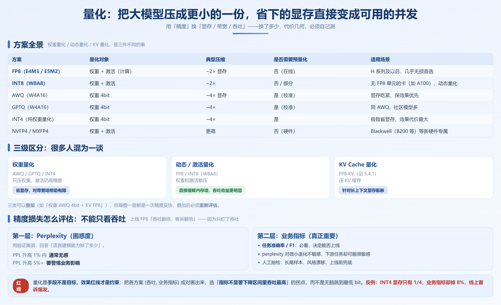
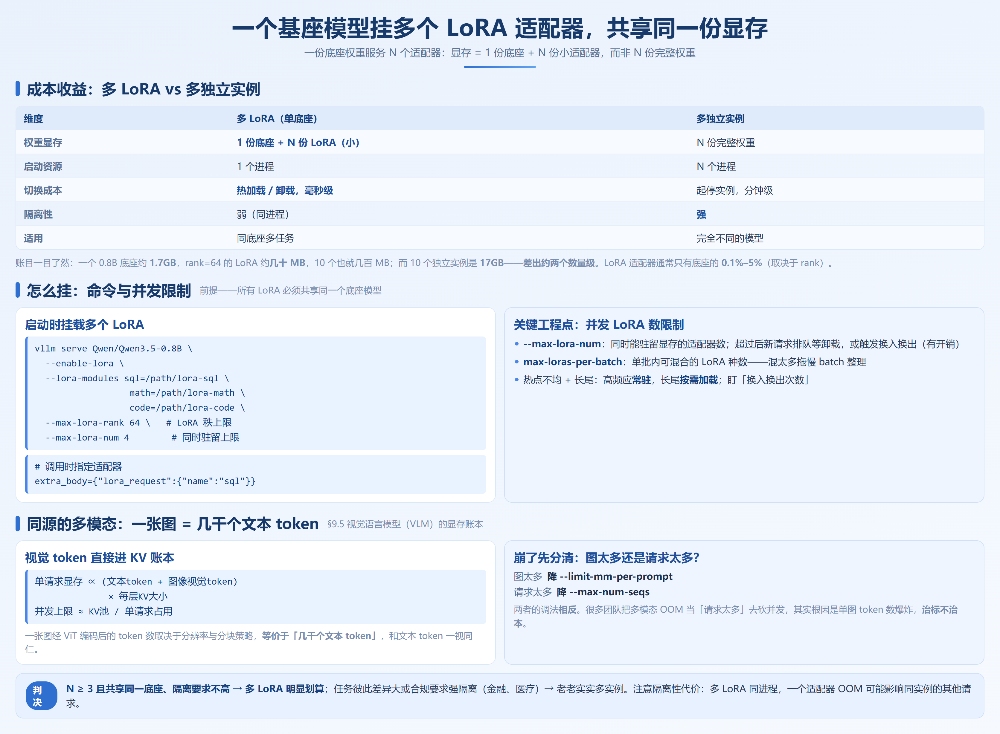

# 第 9 章　vLLM 核心能力

> **本章要回答的问题**
> 1. 单卡放不下大模型时，怎么用多卡、多机把它顶起来？
> 2. 量化方案那么多（FP8 / AWQ / GPTQ / INT8 / INT4…），到底该选哪个？精度损失怎么评估才不踩坑？
> 3. 结构化输出（JSON / 正则 / 语法约束）怎么做才可靠，又能和投机解码共存？
> 4. 一份底座权重能不能同时服务多个 LoRA、多个模态、甚至非生成任务？

难度 ★★☆　|　硬件要求：多卡场景需单机 4–8 卡（A800 / H20 / H800），部分实验可单卡完成　|　⏭️ 9.7 节为进阶，第一遍可跳过

---

第 8 章让你「跑起来」了。这一章回答「除了跑起来还能干什么」——量化瘦身、结构化输出、多 LoRA、多模态、非生成模型，以及 RL 场景的 Sleep Mode。每节我都先给「什么场景下值得用 / 不值得用」的判断，再讲做法和坑。这些能力是生产落地的主力，但每一个都有适用边界，盲目开反受其累。

---

## 9.1 多卡与多机部署

**先给判断**：单卡能放下权重（通常 BF16 下「模型参数 × 2 字节 < 0.9 × 单卡显存」）就别上并行——并行有通信成本，不是免费的。只有「放不下」或「想扩吞吐」才值得。

### 9.1.1 Tensor Parallel 单机多卡实操

模型放不进单卡，第一反应应该是 **TP（张量并行）**，而且尽量在**单机 NVLink 域内**完成。

```bash
# 单机 4 卡跑一个 32B 级模型（若用 8×80GB 机器，70B 也可 TP8 单节点）
vllm serve Qwen/Qwen3-32B \
    --tensor-parallel-size 4 \      # 把一层权重切到 4 张卡
    --gpu-memory-utilization 0.90
```

TP 的本质：每一层的矩阵乘法按列/行切分，层内各卡算一部分再 all-reduce 合并。所以**它要求卡间高带宽**——NVLink 域内延迟是微秒级，跨节点走 IB 是毫秒级，差两个数量级。这也意味着 TP 的通信量和「层数 × 隐藏维 × 序列长」正相关，模型越大、序列越长，TP 通信越重。

> **反模式：TP 跨节点**。把 `--tensor-parallel-size 8` 铺到两台 4 卡机器上，每层 all-reduce 都得过网络，通信开销会吃掉切分收益，结果可能比单节点 TP4 + PP2 还慢。vLLM 不会阻止你这么干，但物理会。

**值得用**：单机多卡、模型 > 单卡显存、卡间有 NVLink。
**不值得用**：跨节点（改用 PP 或 DP）、或模型本来就放得下单卡（纯浪费通信时间）。

### 9.1.2 Pipeline Parallel 与 TP/PP 组合

当模型在单机 8 卡 TP 内仍装不下，或单机卡数有限时，引入 **PP（流水并行）**：把「前若干层」放机器 A、「后若干层」放机器 B，请求像流水线一样穿过。

```bash
# 单机 8 卡都切满时，TP8 + PP2 把 16 卡用上（示意）
vllm serve <70B级模型> \
    --tensor-parallel-size 8 \
    --pipeline-parallel-size 2 \
    --gpu-memory-utilization 0.90
```

PP 的问题是 **bubble（流水线气泡）**：前一段算完才能交下一段，段与段之间有等待空窗。切得太碎（每段层数少），气泡占比就高，GPU 空转多。实践中 TP 优先用满单机，PP 只在「单机 TP 装不下」时作为补充，而不是反过来。

> **作者经验**：并行策略的「甜点」顺序永远是：单卡能跑 → 单机 TP → 单机 TP+PP → 多机 DP/PP。每升一档，运维复杂度和通信成本都上一个台阶。我见过有人一上来就 TP2+PP4 跨两机，结果 bubble 加网络延迟让吞吐比单机 TP8 还低。**并行是被迫的选项，不是越多越好。**

### 9.1.3 多机部署与网络要求

多机有两种典型切法：

- **PP 跨机**：段与段之间是「整段激活值」的传输，量相对小，对网络压力低于 TP。但仍是同步依赖，一段卡住整条流水线等。
- **DP（数据并行）**：同一权重在每台机器起一个副本，各吃不同请求，前端聚合。吞吐线性扩展，但**每个副本都要一份完整权重和一份 KV 池**。

多机启动靠 PyTorch 分布式（环境变量或 `torchrun`）加 vLLM 的多节点参数。核心网络要求是**节点间高速互联（InfiniBand / 200G+ 以太网 + GPUDirect）**。低速网络下，KV 传输和 all-reduce 的代价会直接吞掉并行的收益。

```bash
# 多机示意（以 2 机 × 8 卡、TP8+PP2 为例），需先配好 NCCL 环境变量
# 机 A（head）
vllm serve <70B级模型> --tensor-parallel-size 8 --pipeline-parallel-size 2 \
    --distributed-executor-backend ray \    # 多机编排后端
    --node-rank 0 --nnodes 2 --master-addr <机A_IP> --master-port 29500

# 机 B 同样命令，仅 --node-rank 1
```

> **作者经验**：多机部署真正的工程难点不是命令，而是**网络与 NCCL**。最常见的卡死现象是「进程起得来、但一直不动」，十有八九是 IB 接口没选对、或 `NCCL_SOCKET_IFNAME` 指错了网卡。上线前用 `NCCL_DEBUG=INFO` 跑一次，确认 all-reduce 走的是你期望的高速接口，别等压测时才暴露。另外多机 DP 务必配合缓存感知路由（第 2.6 / 12.4 节），否则前缀缓存命中率被稀释为 1/N。

**值得用**：模型超大（70B+）单节点 TP 装不下、或需要 DP 横向扩吞吐且请求量真的够大。
**不值得用**：中小模型硬上多机——运维复杂度、网络成本和故障面都上来了，收益却未必覆盖。第 13 章会算 PD 分离的账，多机的账同理。

---

## 9.2 量化实战



量化是生产部署里 ROI 最高、也最容易翻车的能力。它用「精度」换「显存 / 带宽 / 吞吐」，但**换了多少、代价几何，必须自己测**。这一节是全章分量最重的部分。

### 9.2.1 方案全景与三级区分

| 方案 | 量化对象 | 典型压缩 | 是否需要预量化 | 适用场景 |
|---|---|---|---|---|
| **FP8**（E4M3 / E5M2） | 权重 + 激活（计算） | ~2× 显存 | 否（在线） | H 系列及以后，几乎无损首选 |
| **INT8（W8A8）** | 权重 + 激活 | ~2× | 否 / 部分 | 无 FP8 单元的卡（如 A100），动态量化 |
| **AWQ**（W4A16） | 权重 4bit | ~4× 显存 | 是（校准） | 显存吃紧、保效果优先 |
| **GPTQ**（W4A16） | 权重 4bit | ~4× | 是（校准） | 同 AWQ，社区模型多 |
| **INT4（纯权重量化）** | 权重 4bit | ~4× | 是 | 极致省显存，效果代价最大 |
| **NVFP4** | 权重 + 激活 | 更高 | 否（硬件） | Blackwell（B200 等）专用 |
| **MXFP4** | 权重 + 激活 | 更高 | 否（硬件） | 支持微缩放格式的硬件 |

> **关键区分**：上面这些方案分三类，很多人混为一谈——

- **权重量化**（AWQ / GPTQ / INT4）：只压权重，激活仍高精度。省的是**显存**（让大模型塞进小卡），对 decode 的带宽墙帮助有限。
- **动态量化 / 激活量化**（FP8 / INT8 W8A8）：权重和激活都压。既省显存又减访存量，直接缓解内存墙，吞吐收益更明显。
- **KV Cache 量化**（FP8 KV，见 5.4.1）：压的是 KV 缓存，针对长上下文场景的显存膨胀。

三类可以**叠加**：例如「权重 AWQ 4bit + KV FP8」同时压显存和长上下文成本。但每叠一层都是一次精度妥协，叠加后必须重新做 7.2.3 的评估。

**值得用**：显存放不下（权重量化）、或带宽墙明显（FP8/INT8 动态）、或长上下文（KV 量化）。
**不值得用**：效果敏感任务上盲目压到 4bit 又没做校准验证；或硬件原生支持 FP8 却去用 INT4 牺牲效果。

### 9.2.2 预量化怎么做（AWQ / GPTQ）

权重量化需要先用校准集「感知」哪些权重重要，再做压缩。vLLM 直接加载社区已量化好的权重（如 Qwen3.5-0.8B 的社区 AWQ 权重）最省事；要自己量化，用对应工具：

```bash
# AWQ：需要一份校准集（小样本代表分布），产出量化权重目录
# 工具：autoawq（pip install autoawq）
python -m awq.entry --model_path Qwen/Qwen3.5-0.8B \
    --w_bit 4 --q_group_size 128 \
    --output_dir ./models/Qwen3.5-0.8B-AWQ

# GPTQ：类似，工具 auto-gptq / mlc-llm 生态
# 产出后 vLLM 用 --quantization awq / gptq 加载
vllm serve ./models/Qwen3.5-0.8B-AWQ --quantization awq
```

> **作者经验**：校准集的质量直接决定 4bit 效果。用和你业务同分布的几百条样本做校准，比用通用 Wiki 文本好得多——这是「通用量化权重在你业务上掉点」的常见根因。如果手上没有现成量化权重，宁可先用 FP8 在线量化（几乎无损），也不要随便拉一个分布不匹配的 4bit 权重上线。

### 9.2.3 在线量化：serve 时量化，免去预量化

这是 vLLM V1 很实用的能力（TurboQuant 思路，适用于 vLLM v0.20+）。不想先离线把模型量化一遍，可以直接在启动时让引擎**边加载边量化**：

```bash
# 在线 FP8 量化：权重以 FP8 加载，免去预量化流程
vllm serve Qwen/Qwen3-32B \
    --quantization fp8        # 在线把权重转 FP8，无需事先准备量化权重

# 更激进：在线压缩到更低比特（实验性，需确认版本支持）
# vllm serve <model> --quantization <turbo_quant_格式>
```

在线量化的好处是**不用维护两份权重**（一份 BF16 原版、一份量化版），部署链路短。代价是启动时多一次转换开销，且支持格式受版本限制——以官方文档为准。

> **作者经验**：在线量化适合「先跑起来看效果」的验证阶段。一旦确定用某个格式生产，我更建议**预量化一份落盘**，好处是启动快、行为可复现、能离线校验精度。在线量化把「转换」和「服务」绑在一起，出问题难定位到底是量化坏了还是服务坏了。

### 9.2.4 精度损失怎么评估（重点）

> **这是全节最重要的提醒：不能只看吞吐。** 量化带来吞吐提升的同时，必然伴随精度变化。很多团队上线 FP8 后「吞吐翻倍、线上客诉翻倍」——因为只盯了吞吐指标。

评估要分两层：

**第一层：perplexity（困惑度）**，用验证集测。它回答「模型本身的语言建模能力掉了多少」。

```python
# ch07-vllm-features/quantization_compare.py  （思路示意，需配合 lm_eval / 自建 ppl 脚本）
# 对同一模型、不同量化格式，在固定验证集上算 PPL
# 对比项：BF16 baseline / FP8 / AWQ / GPTQ
# 判读：PPL 升高 1% 内通常无感；升高 5%+ 要警惕业务影响
```

**第二层：业务指标**，这才是真正重要的。perplexity 对微小退化不敏感，但你的下游任务（分类准确率、抽取 F1、代码编译通过率）可能很敏感。

| 指标 | 说明 | 何时看 |
|---|---|---|
| Perplexity | 通用语言建模质量 | 快速粗筛，量化方案初选 |
| 任务准确率 / F1 | 你业务的真实效果 | **必看**，决定能否上线 |
| 人工抽检 | 长尾样本、风格漂移 | 上线前兜底 |

**值得用基准对比**：用 `src/ch09-vllm-features/quantization_compare.py` 在同一硬件、同一数据集上，把各量化方案的「吞吐」和「业务指标」成对画出来（见 7.2.5），找到**精度可接受下吞吐最高**的那个点。

> **反模式**：只看「官方说 FP8 吞吐翻倍」就全量上线。官方数字是他们硬件、他们模型上的结果。你的模型、你的数据、你的卡，结论未必一致。量化是唯一一个「收益和代价都高度依赖你的具体负载」的优化手段，必须本地实测。

### 9.2.5 吞吐-精度对比曲线的实测方法

思路：横轴是「压缩强度 / 方案」，纵轴双指标——左轴吞吐（token/s），右轴业务指标（如 F1）。每个点采一组。

```bash
# 用官方 benchmark 跑吞吐（以实测为准，数字不要抄本文）
vllm bench serve \
    --model <本地模型路径> \
    --dataset-name random \
    --num-prompts 1000 --request-rate inf
# 对 BF16 / FP8 / AWQ / GPTQ 各跑一遍，记录 token/s

# 业务指标另跑：用你的评测集，逐方案算 F1，填进同一张表
```

把结果画成曲线，**拐点**就是答案：在「业务指标不显著下降」的区间里，选吞吐最高的方案。超过拐点后，再多的吞吐也不如掉下去的效果值钱。

> **作者经验**：我见过最稳的量化决策流程是「先 AWQ/GPTQ 4bit 保效果下限，再叠 FP8 看能否再挤」，而不是直接跳到最低 bit。量化不是越狠越好，是「在效果红线内尽量省」。第 8 章提到的 `kv-cache-dtype` 量化要单独评——它影响的是长上下文下的生成质量，短文本测不出来。另外 NVFP4 / MXFP4 是 Blackwell 等新硬件专属，老卡设了也不会生效，别在 A100 上白费功夫。

### 9.2.6 一个量化决策的真实例子

给你一个可套用的决策链（具体数字以你自己的硬件实测为准，这里是思路框架）：

1. **先测基线**：BF16 原模型在目标卡上能跑、效果满分，记下吞吐 T0 和业务指标 S0。
2. **上 FP8 在线量化**：若硬件支持（H 系列及以后），优先试——通常业务指标几乎不掉，吞吐提升可观。若 S 掉得在 1% 内、T 明显高，直接采用，结束。
3. **FP8 仍放不下 / 还想更省**：上 AWQ 4bit（用同分布校准集）。此时 S 可能掉 2%–5%，要你的业务容忍度判断。若容忍，采用；若不忍，退回 FP8 或换更大显存的卡。
4. **画图定拐点**：把 (T, S) 各方案点画出来，选「S 不破红线里 T 最大」的点。不要无脑选最低 bit。

> **反模式收尾**：有人看到「INT4 显存只有 1/4」就直接上，结果业务指标掉了 8%，线上客诉爆发。省下的显存如果是为了「能跑」，那值得；如果只是为了「更便宜」却牺牲效果，多数业务场景划不来。**量化是手段不是目标，效果红线才是约束。**

---

## 9.3 结构化输出

**先给判断**：只要你的下游是程序（Agent 工具调用、数据抽取、表单填充），结构化输出就是**必选项**，不是可选项——「生成后正则解析」的失败率在生产上不可接受。

vLLM 支持三种约束方式：JSON Schema、正则（Regex）、EBNF 语法。原理是把约束编译成有限状态机（FSM），在解码每一步把非法 token 的 logits 置为 `-inf`，**非法输出在物理上不可能产生**。

### 9.3.1 三种约束与后端

```python
# ch07-vllm-features/structured_output.py  （vLLM v0.20+，OpenAI 兼容接口）
from openai import OpenAI
import json

client = OpenAI(base_url="http://localhost:8000/v1", api_key="EMPTY")

# 方式一：JSON Schema（最常用）
schema = {
    "type": "object",
    "properties": {
        "city": {"type": "string"},
        "temperature": {"type": "number"},
        "unit": {"enum": ["C", "F"]},
    },
    "required": ["city", "temperature", "unit"],
}
resp = client.chat.completions.create(
    model="Qwen/Qwen3.5-0.8B",
    messages=[{"role": "user", "content": "北京现在多少度？用结构化返回。"}],
    max_tokens=256,
    extra_body={"guided_json": schema},   # vLLM 的 JSON 约束入口
)

# 方式二：正则
# extra_body={"guided_regex": r"\\d{4}-\\d{2}-\\d{2}"}

# 方式三：EBNF 语法
# extra_body={"guided_grammar": "<date> ::= <year> '-' <month> '-' <day> ..."}
```

后端方面，vLLM 支持 **xgrammar** 与 **guidance** 两类实现（通过启动参数或调用参数选择）。xgrammar 走压缩 FSM + jump-forward，能把「必然连续的 token 串」一次性吐出，开销更低；guidance 更灵活、生态更老。默认通常走 xgrammar（以版本为准）。两类的选择原则：**默认用 xgrammar，遇到 xgrammar 不支持的复杂约束再退 guidance**。

> **作者经验**：JSON Schema 里尽量给 `enum` 和 `type` 收窄范围，约束越紧，FSM 越早收敛，生成越快、越不容易跑偏。反过来，一个「`properties` 几乎无限制」的 JSON 约束，等于没怎么约束，收益很小却仍要付出 FSM 开销。**结构化输出不是「开了就免费」，约束的构造本身是一门手艺。**

### 9.3.2 常见陷阱与边界

- **不支持的构造**：过于复杂的 JSON Schema（如 `anyOf` 深层嵌套、正则引用）部分后端可能不支持或降级，上线前务必用真实 schema 实测一遍。
- **模型不听从**：极少见，但低能模型可能在约束外「硬塞」解释文字。把 system prompt 写清「只输出 JSON，不要额外说明」能显著降低概率。
- **流式 + 约束**：结构化输出可以流式，但「完整 JSON」要等结束才能解析；前端若想逐字段显示，需要自己做增量解析。

### 9.3.3 与投机解码配合的注意事项

结构化约束和投机解码（第 7 章）会**抢同一个「下一步 token」的决策权**：投机解码用 draft model 猜 token，而 FSM 约束要屏蔽非法 token。如果两者都管解码，需要保证约束优先。vLLM 当前版本对两者的协同有支持，但**实测接受率（acceptance rate）会因约束而下降**——因为合法 token 被约束收窄后，draft 命中的概率变了。

> **作者经验**：结构化输出 + 投机解码一起开时，务必单独测一遍端到端延迟。理论上两者可叠加收益，但约束越紧（如很窄的正则），投机的解码步越短，draft 优势越弱。窄约束场景下，投机解码的收益可能微乎其微，反而增加复杂度。**值得用**：宽 JSON / 长生成配投机；**不值得用**：极窄正则还硬上投机，纯属增加排查成本。

### 9.3.4 Agent 工具调用实测

工具调用（function calling）本质是结构化输出的特例：模型要产出符合函数签名的 JSON。vLLM 配合 OpenAI 的 `tools` 字段可以直出可解析的工具调用。

> **实测建议**：用一组真实的工具 schema（带嵌套对象、枚举、必填字段）跑 100 次，统计「一次成型、无需重试」的比例。这个比率比「能生成 JSON」重要得多——生产上每多一次重试就是一次额外往返延迟。具体比率以你自己的 schema 复杂度和模型实测为准。一个常见的失败模式是：模型把参数填对了，但「函数名」拼错或多了额外字段，调用方解析失败——这类要在 system prompt 和 schema 上同时约束。

### 9.3.5 结构化输出的开销怎么估

约束不是免费的：每一步要把非法 token 的 logits 置 `-inf`，且 FSM 状态要在 CPU 侧维护并和 GPU 解码同步。开销通常表现为「同等并发下吞吐略降」，降幅和约束复杂度正相关——宽 JSON 可能只降几个百分点，极复杂 EBNF 可能降两位数百分比（以你自己的负载实测为准，不要记固定值）。

实测方法：用 `vllm bench serve` 分别跑「无约束」和「有约束（你的真实 schema）」两组，对比 token/s 和 TPOT。如果约束开销超出你的 SLO 预算，考虑：① 收紧 schema 让 FSM 更快收敛；② 降低并发；③ 把约束生成和非约束生成拆到不同实例。

---

## 9.4 多 LoRA 服务



**先给判断**：当「一个底座 + 多个垂直适配器」是你的真实架构（多租户、多任务、个性化），多 LoRA 是**降本利器**——一份底座权重服务 N 个适配器，显存只占一份底座 + N 份小适配器。反之，若各任务模型本就不同，强行合并反而是给自己找麻烦。

### 9.4.1 成本收益分析

| 维度 | 多 LoRA（单底座） | 多独立实例 |
|---|---|---|
| 权重显存 | 1 份底座 + N 份 LoRA（小） | N 份完整权重 |
| 启动资源 | 1 个进程 | N 个进程 |
| 切换成本 | 热加载 / 卸载，毫秒级 | 起停实例，分钟级 |
| 隔离性 | 弱（同进程） | 强 |
| 适用 | 同底座多任务 | 完全不同的模型 |

LoRA 适配器通常只有底座的 0.1%–5% 大小（取决于 rank），所以「一份底座 + 10 个 LoRA」的显存远小于「10 个独立实例」。粗略账：一个 8B 底座约 16GB，rank=64 的 LoRA 约几十 MB，10 个也就几百 MB，而 10 个独立 8B 实例是 160GB——差出两个数量级。

> **前提提醒**：所有 LoRA 必须共享**同一个底座模型**。vLLM 一个实例挂一个底座，不同底座的 LoRA 得起不同实例。如果你的任务是「完全不同的模型」，多 LoRA 帮不上忙，那是多实例或模型路由的事（第 20 章）。

### 9.4.2 热加载 / 卸载与并发限制

```bash
# 启动时挂载多个 LoRA（vLLM v0.20+）
vllm serve Qwen/Qwen3.5-0.8B \
    --enable-lora \
    --lora-modules sql=/path/lora-sql math=/path/lora-math code=/path/lora-code \
    --max-lora-rank 64 \          # LoRA 秩上限，影响显存
    --max-lora-num 4                # 同时驻留的 LoRA 数上限
```

调用时在请求里指定用哪个适配器：

```python
# OpenAI 接口里通过 model 字段或 extra_body 指定 LoRA
client.chat.completions.create(
    model="Qwen/Qwen3.5-0.8B",
    messages=[...],
    extra_body={"lora_request": {"name": "sql"}},   # 指定走 sql 适配器
)
```

**并发 LoRA 数限制**是关键工程点：`--max-lora-num` 限制了同时能驻留显存的适配器数量。超过后，新请求要么排队等一个 LoRA 卸载、要么触发换入换出（有开销）。还有 **`max-loras-per-batch`** 限制单批内可混合的 LoRA 种数——混合太多会拖慢 batch 整理。

> **作者经验**：多 LoRA 最常见的线上问题是「热点不均 + 长尾」。少数 LoRA 被高频调用（该常驻），大量 LoRA 偶尔来一次（不该占显存）。盲目把 `max-lora-num` 开很大，显存被长尾适配器占满，热点反而被挤。建议：高频适配器常驻（在启动 `--lora-modules` 里挂上），长尾走按需加载，并用监控看「LoRA 换入换出次数」——它高说明你的 `max-lora-num` 配小了或负载画像错了。

**值得用**：同底座多任务 / 多租户 / 个性化；适配器小、切换频繁。
**不值得用**：任务间模型本就不同，或隔离性要求强（金融、医疗合规）——这种该用独立实例。

### 9.4.3 一个成本公式与 ROI 判断

给你一个快速算账的方式（数字为示意，比例以实测为准）：

```
单底座实例显存 ≈ 底座权重(如 1.7GB) + 常驻LoRA(N × 数十MB) + KV池
N 个独立实例显存 ≈ N × (底座权重 + KV池)

当 N 较大时，多 LoRA 省下的 = (N-1) × 底座权重，是数量级差异。
```

但 ROI 不是只算显存。还要算：① **隔离性代价**——多 LoRA 同进程，一个适配器 OOM 可能影响同实例其他请求；② **热点换入开销**——长尾 LoRA 频繁换入换出时的延迟尖刺；③ **运维复杂度**——独立实例扩缩更干净，但资源浪费。

经验判决：N ≥ 3 且共享同一底座、隔离要求不高 → 多 LoRA 明显划算；任务彼此差异大或合规要求强隔离 → 老老实实多实例。

---

## 9.5 多模态部署

**先给判断**：视觉语言模型（VLM，如 Qwen-VL 系列）部署的复杂度不在「能不能跑」，而在**预处理与 GPU 解耦**——把图像 resize / 编码放到 CPU 或独立进程，GPU 只管核心推理，否则预处理会拖垮整卡吞吐。

### 9.5.1 部署要点

```bash
# VLM 起服务与文本模型命令基本一致（vLLM v0.20+ 原生支持主流 VLM）
vllm serve Qwen/Qwen3.5-0.8B \
    --limit-mm-per-prompt image=4    # 限制每条请求最多 4 张图，控显存
```

### 9.5.2 预处理与 GPU 解耦的意义

图像输入要经过：解码 → resize → 归一化 → 视觉塔编码（ViT）。其中**解码和 resize 是 CPU 密集、且和 GPU 推理无数据依赖**的。如果让推理进程顺手做这些，GPU 在等 CPU 预处理时空转。

正确做法：图像预处理放在**独立的预处理进程 / 队列**，编码成张量后再喂给推理。vLLM 的服务端已经做了一定程度的管线化，但在高并发下，把图像上传、转码、缓存**前置到网关或独立 worker**，能显著提升单卡有效吞吐。这也让「图像预处理机」和「推理 GPU 机」可以独立扩缩——前者是 CPU 密集，后者是 GPU 密集，混在一起资源账算不清。

### 9.5.3 图像输入的显存与并发计算

一张图经 ViT 编码后的视觉 token 数，取决于图像分辨率和分块策略（如「动态分辨率 / 切片 tiling」）。token 数直接进 KV Cache 账本，和文本 token 一视同仁。所以**「一张图」对显存的消耗，等价于「几千个文本 token」**。

并发估算要按总量：

```
单请求显存占用 ∝ (文本token + 图像视觉token) × 每层KV大小
并发上限 ≈ KV池 / 单请求占用
```

因此调多模态服务时，先问自己「它崩是因为图太多还是请求太多」——两者的调法相反：前者降 `--limit-mm-per-prompt`，后者降 `max-num-seqs`。很多团队把多模态 OOM 当成「请求太多」去砍并发，其实根因是单图 token 数爆炸，砍并发治标不治本。

> **作者经验**：VLM 的「图像 token 数」对成本影响极大，但默认配置往往很宽松（高分辨率、多切片）。上线前用一张典型图实测它的视觉 token 数（引擎日志或 profiling 能看到），再据此配 `--limit-mm-per-prompt` 和并发。盲目高分辨率 = 隐性地把每张图变成几千 token，KV 池瞬间被吃光。

### 9.5.4 一张图的 token 数实测示例

思路（不要记固定数字，每张图不同）：假设某 VLM 把 448×448 图块编码成 256 个视觉 token，一张 1344×768 的图按动态切片分成若干块，总视觉 token 可能落在上千量级。那么「4 张图 + 128 文本 token」的单请求序列长度，实际等价于「上千 + 128」——已经逼近很多纯文本场景的 `max-model-len`。

```python
# 估算法：用引擎返回或 profiling 看每条多模态请求的 prompt token 数
# vLLM 在响应里可带 usage.prompt_tokens，多模态下它已含视觉 token
resp = client.chat.completions.create(
    model="Qwen/Qwen3.5-0.8B",
    messages=[{"role":"user","content":[
        {"type":"text","text":"描述图片"},
        {"type":"image_url","image_url":{"url": f"file://{img}"}}]}],
    max_tokens=64,
)
print(resp.usage.prompt_tokens)   # 这个值直接进 KV 账本，是并发规划的硬输入
```

拿到这个值，再回到 5.4.2 的并发公式去配 `max-num-seqs` 和 `max-model-len`，多模态服务的容量规划就从「拍脑袋」变成「可计算」。

---

## 9.6 Embedding / Rerank / Reward Model

**先给判断**：RAG 系统里这三样是「非生成」刚需，但它们和生成模型是**不同的服务形态**——不要用一个生成 endpoint 硬凑，要各自独立部署。

### 9.6.1 三类模型差异

| 模型类型 | 输出 | 典型用途 | vLLM 部署方式 |
|---|---|---|---|
| **Embedding** | 向量（定长） | 向量库检索、语义召回 | `vllm serve <emb模型>`，走 `/v1/embeddings` |
| **Rerank** | 相关性分数 | 召回后精排 | `vllm serve <rerank模型>`，走 `/v1/rerank` |
| **Reward Model** | 标量奖励 | RLHF 对齐、自我评判 | `vllm serve <reward模型>`，走 `/v1/score`（或 reward 专用接口） |

三类都不是自回归生成——一次前向出结果，没有逐 token 解码，所以**吞吐远高于生成模型**，延迟也低得多。正因为这个差异，把它们和生成模型混在一个实例里会互相抢 KV 池和调度，是明显的反模式。

```python
# Embedding 调用示意（vLLM v0.20+）
from openai import OpenAI
client = OpenAI(base_url="http://localhost:8000/v1", api_key="EMPTY")
emb = client.embeddings.create(model="<emb模型>", input="用户查询文本")
print(len(emb.data[0].embedding))   # 向量维度
```

### 9.6.2 RAG 场景的组合用法

一个标准三件套：

```
用户 query
  → Embedding 模型向量化 → 向量库召回 Top-K 候选（粗排）
  → Rerank 模型对 Top-K 精排 → 取最相关若干喂给生成模型
  → 生成模型产出最终回答
```

Embedding 负责「广撒网召回」，Rerank 负责「精准排序」，生成模型负责「组织答案」。三者独立部署、各自按负载扩缩：Embedding/Rerank 是单步前向，资源需求小，可以起比生成实例更多的副本；生成实例受 KV 池限制，副本数少但单实例贵。

> **作者经验**：RAG 链路里最常被忽视的是 Rerank 的引入时机。很多团队只用 Embedding 召回就直接喂生成，结果召回的 Top-K 里相关文档排在第 8 位，生成模型「看到了但没优先用」。加一层 Rerank 往往比「加大生成模型」带来的回答质量提升更明显，且成本低得多。Reward Model 在 RLHF / 自我批判（如让模型给自己的回答打分）里用，是 RL 训练循环的高频调用方（见 7.7）。

**值得用**：RAG / 检索 / 对齐训练场景，独立部署各司其职。
**不值得用**：为了「少起一个服务」把 Embedding 和生成塞一起——后期扩容时你会后悔。

---

## 9.7 特殊场景能力 ⏭️

本节为进阶内容，第一遍理解主线后可回头再看。

### 9.7.1 Sleep Mode：显存让渡

在 RL 训练循环里，同一台机器既要跑训练又要跑推理 rollout，两者不可能同时占满显存。**Sleep Mode** 让推理引擎在「不服务时」把显存让渡给训练进程，需要服务时再「唤醒」重新分配。这是训练-推理混部的刚需能力（vLLM 通过权重卸载 / 重新映射实现，具体命令以版本为准）。唤醒有开销，所以它是「时间错峰复用」而非「随时切换」。

**值得用**：RL 训练机与推理机复用同一批 GPU、资源时间错峰。
**不值得用**：纯推理服务——唤醒有开销，无谓地开反而拖慢首请求。

### 9.7.2 RL 集成与训练-推理一致性

RLHF / RLVR 把推理引擎变成 rollout 的执行体：训练循环产出新权重 → 推给推理引擎生成样本 → 算 reward → 更新。这里有个隐蔽但致命的要求：**训练框架和推理引擎对同一权重的数值结果必须一致**（否则 reward 信号被引擎差异污染）。这就要求推理引擎能精确复现训练侧的前向计算（包括 attention 实现、归一化顺序等）。

> **作者经验**：训练-推理一致性问题往往以「reward 曲线不收敛但单测都对」的诡异形式出现。排这类问题时，先固定一个 batch 在两边各跑一次前向，逐层 diff 输出——差异通常出在 attention backend 或 dtype 边界。一个实用 checklist：① 两边用同一 attention 实现（如都走 FlashAttention 同版本）；② dtype 一致（BF16 vs FP16 别混）；③ 归一化（RMSNorm）的 eps 与计算顺序一致；④ RoPE 位置编码实现对齐。vLLM 的 V1 引擎和主流训练框架的对齐在持续改进，但跨版本仍要自己验证一次。

---

## 本章小结

1. **并行首选单机 TP**：放不下大模型才上并行，TP 尽量在 NVLink 域内；跨节点 TP 是反模式，收益被网络吞掉。
2. **量化分三类**：权重量化省显存、动态量化（FP8/INT8）压带宽墙、KV 量化压长上下文——按需选，不是越狠越好。
3. **量化必须双指标评估**：perplexity 粗筛 + 业务指标定生死，只看吞吐上线必然翻车。
4. **结构化输出是必选项**：FSM 约束让非法输出物理上不可能产生；与投机解码叠加时要重测接受率和延迟。
5. **多 LoRA 适合同底座多任务**：一份权重服务多适配器，省显存；但要按「热点常驻、长尾按需」管理并发数。
6. **非生成模型要拆开部署**：Embedding / Rerank / Reward 吞吐特征不同，混在生成实例里会互相抢资源。
