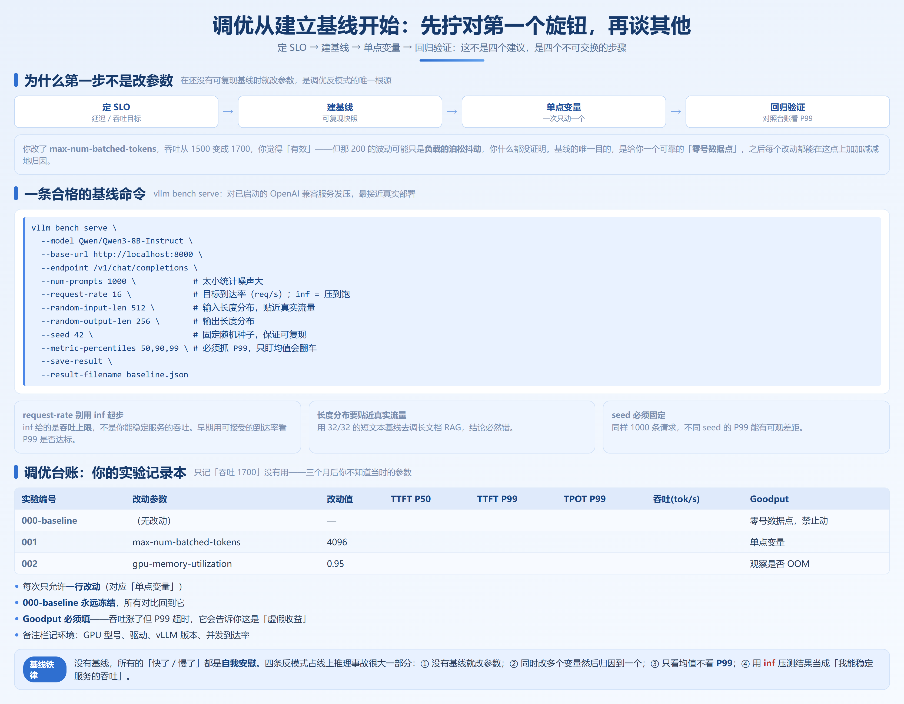
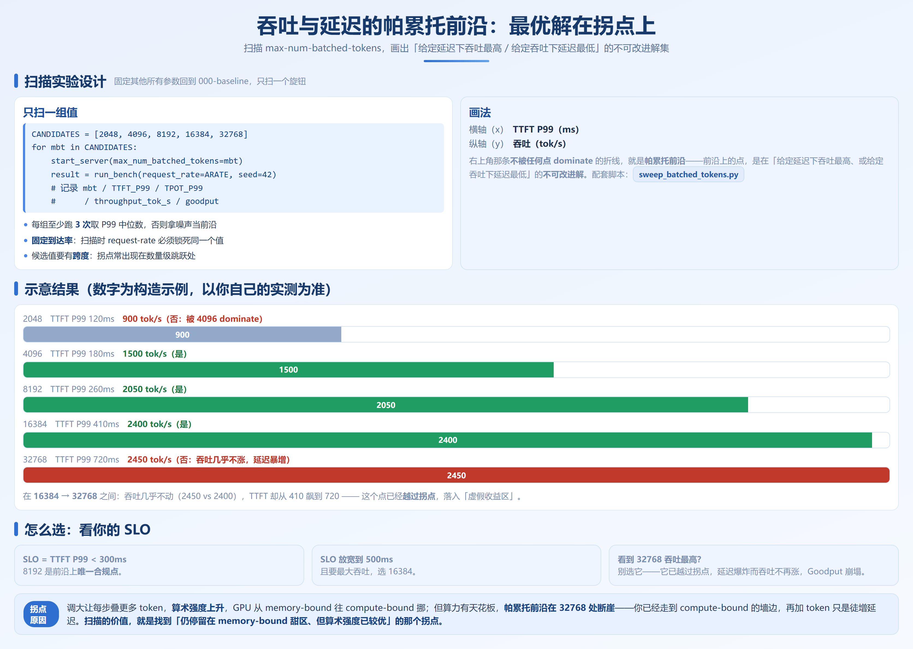

# 第 10 章　vLLM 性能调优

> **本章要回答的问题**
> 1. 同样的硬件，为什么别人能跑出 2 倍吞吐？差距到底是参数还是方法？
> 2. 调优的第一步是改哪个参数，还是先建基线？怎么建一条可复现的基线？
> 3. `gpu-memory-utilization`、`max-num-seqs`、`max-num-batched-tokens` 这几个核心旋钮，分别调了会发生什么、调错会怎样？
> 4. 投机解码已独立成第 7 章；本章 8.4 与 8.5 是另两个最容易被误用的「高收益高陷阱」手段，怎么判断该怎么调？
> 5. 调优有没有一套可复制的方法论主线，而不是技巧堆砌？

难度 ★★★　｜　硬件 🖥️🖥️　｜　本章 10.5 节标 ⏭️，第一遍可跳过

---

## 本章主线：先方法，后参数

第 0 章最后一条判断值得我们在这里复述一次：**工程复杂度本身是一等公民挑战**。一个 vLLM 实例有一百多个参数，其中十来个对性能有决定性影响，而且这些参数之间存在耦合——改一个，另一个的最优值就变了。

所以本章一开始就要先立住一条主线，否则后面的每一个参数讨论都会沦为「参数字典」：

> **调优的正确顺序 = 定 SLO → 建基线 → 单点变量 → 回归验证。**
> 这不是四个建议，而是四个**不可交换的步骤**。跳步就会得到「别人的参数抄来没用」的结果。


四个步骤的体感：

- **定 SLO**：先说清楚「什么算好」。是 P99 TTFT < 1s，还是吞吐 > 2000 tok/s？没有 SLO，所有数字都是空中楼阁。第 1.2 节定义的 Goodput 才是最终判据。
- **建基线**：在改动任何参数之前，先跑出一条可复现的基线（10.1 节）。没有基线，你无法判断「优化」是真实收益还是噪声。
- **单点变量**：一次只改一个参数，其余全部锁死。这是和第 0 章反模式「同时改多个变量」正面相对的纪律。
- **回归验证**：回到台账（10.1 节模板），用 P99 而非均值判断。均值漂亮、P99 崩了，是线上事故的标准开场。

**为什么大多数调优是失败的**。我见过三种反复出现的「伪调优」，它们都跳了上面的某一步：

- *抄作业型*：从某篇博客搬来一套「黄金配置」，不问自己的负载形态。第 0.6 节那句话值得再贴一次——**到了第三代后期的阶段（PD 分离、集群化），抄参数基本失效**，因为收益越来越依赖场景。
- *炼丹型*：凭手感同时改五六个参数，跑出来「好像快了」，却永远说不清是哪个参数贡献的，也无法在版本升级后复现。
- *指标盲人型*：只盯 `tok/s` 一个数，把服务推过 Goodput 拐点还以为在进步，直到线上超时告警才发现自己优化的是错误的目标函数。

本章后面每一节，都是在给这条主线填充「单点变量」的具体对象——先有方法，才有参数。

下面所有小节，都在这条主线上展开。

---

## 10.1 建立调优基线 ★★☆ 🖥️



### 为什么第一步不是改参数

最常见的调优反模式，我见过不下十种变体，但根源只有一个：**在还没有可复现基线的情况下，就开始改参数。**

它的危害不是「浪费时间」，而是更隐蔽的：

- 你改了 `max-num-batched-tokens`，吞吐从 1500 变成 1700，你觉得「有效」。但其实那 200 的波动来自负载的泊松抖动——你什么都没证明。
- 你抄了别人的「黄金配置」，在你的硬件上跑得反而更慢，你以为是自己机器烂，其实是对方的负载是短文本、你的是长文本。

**基线的唯一目的，是给你一个可靠的「零号数据点」。之后每一个改动，都必须能在这个点上加加减减地归因。** 没有它，所有的「快了 / 慢了」都是自我安慰。

### 用官方 benchmark 工具跑基线

vLLM 自带两套压测入口（适用于 v0.20.x–v0.21.x，键名可能随版本微调）：

- `vllm bench serve`：对**已启动的 OpenAI 兼容服务**发压，最接近真实部署。
- `vllm bench generate`：离线 `LLM` 类直跑，排除网络和服务层干扰，适合纯引擎对比。

生产调优一律用 `bench serve`——因为你要优化的是「服务」，不是「引擎裸性能」。

下面这条命令是一条合格的基线起点（注意所有 `--` 下面是给 `vllm bench serve` 的，不是给 `vllm serve` 的）：

```bash
# 假设 vLLM 服务已在 http://localhost:8000 启动（启动命令见 10.2 节）
vllm bench serve \
  --model Qwen/Qwen3-8B-Instruct \
  --base-url http://localhost:8000 \
  --endpoint /v1/chat/completions \
  --num-prompts 1000 \            # 发多少条请求，太小统计噪声大
  --request-rate 16 \             # 目标到达率（req/s）；inf 表示尽力压满
  --shared-conversation-id 0 \    # 多轮对话前缀复用场景，基线一般先关
  --random-input-len 512 \        # 输入长度分布，贴近你真实流量
  --random-output-len 256 \       # 输出长度分布
  --seed 42 \                     # 固定随机种子，保证可复现
  --metric-percentiles 50,90,99 \ # 必须抓 P99，只盯均值会翻车
  --save-result \                 # 把结果落盘
  --result-filename baseline.json # 基线结果文件，进台账
```

几个关键点：

- `--request-rate` 不要用默认的 `inf` 起步。`inf` 是「压到饱」，它给出的是**吞吐上限**，不是你能稳定服务的吞吐。调优早期先用一个**你能接受的到达率**跑（比如线上预估峰值的 80%），看 P99 是否达标。等配置调优后，再逐步抬 `request-rate` 找拐点（拐点概念见第 19 章）。
- `--random-input-len` / `--random-output-len` 必须**贴近你的真实流量形态**。用 32/32 的短文本基线去调长文档 RAG，结论必然错。这也是第 0 章「负载形态变化」挑战的直接推论。
- `--seed` 必须固定。同样 1000 条请求，不同 seed 的 P99 能有可观差距。

**压测工具自身的坑（这些会让你的「基线」本身是假的）**：

- **客户端瓶颈**：压测机 CPU 不够或单进程发不出足够 QPS，`request-rate` 标 16 实际只发出 4，你测的是客户端而不是服务端。判据：看服务端 `gpu_util` 是不是还很闲——闲着却吞吐上不去，八成是客户端先跪了。多进程 / 分布式压测能缓解。
- **连接数上限**：很多压测默认连接数少，高并发下连接复用不过来，请求在客户端排队。确认并发参数与你的 `request-rate` 匹配。
- **预热不足**：vLLM 首次请求要加载、CUDA Graph 要捕获、kernel 要编译，前几条延迟暴高。务必在正式采样前先跑一轮预热，否则 P50/P99 被预热尖峰污染。
- **只跑均值不看分布**：默认给分位数，别只看那个汇总的平均吞吐行。P99 才是 SLO 的判据。

> 一句话：**先确认你测的是服务端，再谈调优服务端。**

### 记录参数快照：比记结果更重要

只记「吞吐 1700」是没有用的，因为三个月后你不知道当时的 `--gpu-memory-utilization` 是多少。完整的基线快照必须包含**环境 + 启动参数 + 结果**三部分。

建议把启动命令原样存成文件，例如 `baseline_serve.sh`：

```bash
# baseline_serve.sh —— 基线服务启动（应用于 vLLM v0.20.x–v0.21.x）
vllm serve Qwen/Qwen3-8B-Instruct \
  --tensor-parallel-size 1 \
  --gpu-memory-utilization 0.90 \   # 基线先用默认 0.90
  --max-model-len 4096 \            # 先用贴近真实流量的上限
  --max-num-seqs 256 \              # V1 默认值随版本变化，以文档为准
  --max-num-batched-tokens 8192 \   # V1 默认值随版本变化，以文档为准
  --enable-prefix-caching \         # 长上下文/多轮场景建议开
  --port 8000
```

**为什么连启动命令都要存？** 因为 vLLM 版本一升级，默认值会变（比如某版本把 `--max-num-batched-tokens` 的默认改了），你三个月前的「黄金配置」可能在新版本上含义已经不同。把命令当数据存，是跨版本对比的命脉。

### 调优台账：你的调优「实验记录本」

这是 10.6 节那张「症状对照表」的源头。没有台账，8.6 的三张表就是空中楼阁。下面是一份**可以直接复制成 CSV** 的台账模板（配套仓库 `src/ch10-vllm-tuning/tuning_log_template.csv` 是同一份，可直接填写）：

| 实验编号 | 日期 | 改动参数 | 改动值 | 目标 SLO | TTFT P50 | TTFT P99 | TPOT P50 | TPOT P99 | 吞吐(req/s) | 吞吐(tok/s) | Goodput | 备注 |
|---|---|---|---|---|---|---|---|---|---|---|---|---|
| 000-baseline | | （无改动） | — | — | | | | | | | | 零号数据点，禁止动 |
| 001 | | `--max-num-batched-tokens` | 4096 | | | | | | | | | 单点变量 |
| 002 | | `--gpu-memory-utilization` | 0.95 | | | | | | | | | 观察是否 OOM |

台账的铁律：

1. **每次只允许一行改动**（对应「单点变量」步骤）。
2. **000-baseline 永远冻结**，所有对比回到它。
3. **Goodput 必须填**。吞吐涨了但 P99 超时，Goodput 会告诉你这是「虚假收益」。Goodput 的定义见第 1.2 节。
4. 备注栏记环境：GPU 型号、驱动、vLLM 版本、并发到达率。

**台账怎么读：一个典型复盘**。假设你在 000-baseline 之后改了 `--max-num-batched-tokens` 从 8192 到 16384，台账记到 001 这一行：吞吐从 1500 升到 2400，你很兴奋。但继续往下填，发现 TTFT P99 从 260ms 涨到 410ms。这时真正的判断才开始——

- 如果你的 SLO 是 TTFT P99 < 300ms，那 001 是**负优化**，必须回退。吞吐涨了但你违约了，Goodput 会告诉你真相。
- 如果你的 SLO 是 TTFT P99 < 500ms，那 001 是**有效优化**，可以固化。

再看一个更隐蔽的情况：你改了 `--gpu-memory-utilization` 从 0.90 到 0.95（002 行），吞吐纹丝不动，TTFT 也几乎不变。很多人会记作「这参数没用」。但正确的读法是：**它在基线负载下没用，是因为当前 KV 池本来就没吃满；它真正的风险在峰值 OOM，要在高负载压测下才暴露**。所以 002 的备注必须写「高负载下复测 OOM」，而不是「无效」。

**这就是台账存在的意义：它把「一次性的观察」变成「可累积的认知」。** 一个月后你忘了 0.95 为什么没敢上，翻开台账，备注栏一句话就唤醒了当时的判断。没有它，所有经验都停留在「我好像试过」。

> **反模式小结（8.1）**：① 没有基线就改参数；② 同时改多个变量然后归因到一个；③ 只看均值不看 P99；④ 用 `inf` 压测结果当成「我能稳定服务的吞吐」。这四条占线上推理事故的很大一部分。

---

## 10.2 显存与并发参数调优 ★★☆ 🖥️🖥️

这一节只讲三个最影响「能不能跑稳、能跑多大」的旋钮：`gpu-memory-utilization`、`max-num-seqs`、`max-model-len`。它们决定的是**服务的容量边界**，不是峰值性能——但容量边界一旦算错，后面所有调优都无从谈起。

### `gpu-memory-utilization`：不是越大越好

这个参数（适用于 v0.20.x–v0.21.x，V1 引擎默认约 `0.90`）告诉 vLLM「最多吃掉整张卡百分之多少的显存用来放权重和 KV Cache」。

**直觉误区**：「既然要榨干硬件，那就设 0.99」。这是新手第一大坑。

为什么不能拉满？因为一张卡的显存用途不是只有「权重 + KV Cache」两项，至少还有这些隐性占用：

- **激活值（activations）**：每次前向的瞬时中间结果，峰值远不是常数，长序列、大 batch 时会突增。
- **CUDA Graph 预留**：开启 CUDA Graph（10.5 节）会预占一块显存作 graph 缓冲。投机解码的草稿模型权重也会额外占显存（见第 7 章）。
- **NCCL / 通信缓冲**：多卡时 TP/PP 的通信要占显存。
- **碎片与抢占 swap**：连续批处理下，极端负载会触发抢占，需要用 `swap-space`（CPU 内存）兜底，但启动期的显存碎片仍需 headroom。
- **驱动与上下文**：CUDA context、cuDNN 工作区等固定开销。

把 `gpu-memory-utilization` 设到 0.95 以上，等于把这些「突发 + 固定」开销的空间压缩到几乎没有。结果不是「多跑了 5% 吞吐」，而是：**在负载峰值的一次激活值尖峰上直接 OOM，服务崩。**

**正确做法**：

- **起步用默认 `0.90`**，长上下文场景可以谨慎提到 `0.92`–`0.93`。
- 多卡 TP 时，每张卡只放 1/N 权重，KV 占比相对变大，可以适度抬高利用率——但每次只抬 0.02 一档，回到台账看是否触发 OOM。
- 如果你发现 KV Cache 容量明显不够（排队严重、`gpu_cache_usage` 指标长期贴近 1.0），**先确认是不是 `max-model-len` 开太大占走了比例**，而不是无脑抬 `gpu-memory-utilization`。

**怎么判断该不该抬（一张执行清单）**：

1. 先看 `gpu_cache_usage` 指标：长期 < 0.7 → KV 池有富余，问题不在容量，去查并发/吞吐参数；长期 ≈ 1.0 且排队 → 才考虑抬利用率或降 `max-model-len`。
2. 抬之前先降 `max-model-len` 试：很多时候「容量不够」是上限开太大虚占的，收紧上限比抬高利用率更安全。
3. 真要抬，每次 +0.02（如 0.90 → 0.92），回到台账跑高负载压测看是否 OOM，不要一步到 0.97。
4. 多卡 TP 场景，单卡权重占比小，KV 占比相对大，可适度比单卡更激进，但仍遵循 +0.02 一档。
5. 出现任何运行期 OOM → 立即回退一档，并把这个值记进台账备注「峰值 OOM，封顶 0.9X」。

> **调了会怎样**：抬高 → KV Cache 池变大 → 能攒更多并发、更少排队。
> **调错会怎样**：抬到 0.95+ → 峰值激活值尖峰触发启动期或运行期 OOM，服务不可用。

### KV Cache 可用量 → 最大并发数：换算关系

这是读者最想要、也最容易被「默认配置」糊弄过去的一个公式。先把第 1.4 / 第 4.1 节的 KV 显存公式搬过来：

```
每个 token 的 KV Cache 字节数 =
    2 × num_layers × num_kv_heads × head_dim × bytes_per_elem
```

- `2`：K 和 V 两份
- `bytes_per_elem`：BF16 = 2 字节；FP8 KV = 1 字节（见 8.2 的 FP8 KV 与第 4.7 节）
- GQA / MQA 模型里 `num_kv_heads` 远小于 `num_attention_heads`，这正是它们省显存的原因

下一步，估算「KV Cache 池能放下多少个 token」：

```
KV 池总字节 ≈ 整卡显存 × gpu_memory_utilization × KV_占比
KV 容量(token 数) ≈ KV 池总字节 / 每个 token 的 KV 字节数
```

其中 `KV_占比` 是「去掉权重、激活、碎片后，真正留给 KV 的比例」。它**不是** `gpu_memory_utilization` 本身——权重已经先吃掉了固定的一块。一个粗略的体感：8B 模型在 24GB 卡上，权重约占 16GB，留给 KV 的其实不到 `24 × 0.9 − 16` 这么乐观（还要减激活与碎片），真实 KV 占比常常只有 20%–35%。**请以你自己的实测为准**，下面只给推算框架，不给装精确数字。

最后一步，从 KV 容量反推最大并发：

```
最大并发数(估算) ≈ KV 容量(token 数) / 平均序列长度
                  = KV 容量 / (平均输入长度 + 平均输出长度)
```

并且这个值**还要被 `max-num-seqs` 截断**——它是硬上限。

**这个公式的实战用法**：当你的 `max-num-seqs` 设得很大但并发就是上不去、请求大量排队时，先看 `gpu_cache_usage` 指标是否长期 ≈ 1.0。如果是，说明瓶颈在 KV 容量（公式分母里的平均序列长度），而不是并发上限——此时该降 `max-model-len`、开 KV 量化（FP8 KV），而不是继续抬 `max-num-seqs`。

**动手算一遍（构造示例，数字为便于说明而假设，请以你自己的实测为准）**。以 Qwen3-8B（32 层、GQA 下 `num_kv_heads` 远小于注意力头数）为例，假设 BF16 下每个 token 的 KV 约 0.5MB（这是构造值，真实值随 head 配置变化）。一张 24GB 卡：

- 权重约占 16GB（BF16 8B ≈ 16GB）。
- `gpu-memory-utilization = 0.90` → 可用 21.6GB，减权重剩约 5.6GB。
- 再减激活值与碎片 headroom（保守按一半算），真正留给 KV 的约 2.8GB。
- KV 容量 ≈ 2.8GB / 0.5MB ≈ 5600 个 token。
- 若平均序列长度 768（输入 512 + 输出 256），理论最大并发 ≈ 5600 / 768 ≈ 7。

算出来只有 7 个并发——这就是「为什么 8B 模型在 24GB 卡上，短文本高并发也要靠 KV 量化或更大显存」。如果开 FP8 KV（KV 字节减半），容量翻倍到约 14 并发；如果把平均序列长度压到 384，并发再翻倍到约 28。一道简单的除法，就能解释你服务「为什么并发死活上不去」。

注意这个推算的**保守性**：它用的是「平均序列长度」。真实流量是长尾分布的，少数长请求会吃掉远多于平均的 KV。这就是为什么前面建议 `max-num-seqs` 只设在理论并发的 70%–90%——给长尾留缓冲，否则就是 8.6 表里那行「TPOT 抖动 / 长请求饿死短请求」。

### `max-num-seqs` 与 OOM 的边界：一个必须澄清的误区

大纲点名要讲「`max-num-seqs` 与 OOM 的边界」。这里有个 widespread 误解要先纠正：

> **`max-num-seqs` 本身几乎不直接导致启动期 OOM。**

原因在 PagedAttention（第 4.3 节）：KV Cache 是**按需、按块**分配的，不是按 `max-num-seqs × max-model-len` 一次性预留。`max-num-seqs` 只是一个**并发软上限**——它限制「同时有多少个请求在飞」，但不预先吃掉这些请求的显存。

真正决定启动期会不会 OOM 的是两个东西：

1. **`gpu-memory-utilization`**：它直接决定 KV 池大小，拉太高就 OOM（见上）。
2. **`max-model-len`**：它决定单次预留的块表上限和位置编码缓冲。开到 128K 而你的卡只有 24GB，权重+位置编码就先把显存吃穿。

那 `max-num-seqs` 调到很大有什么后果？**不是 OOM，是「排队」和「抢占抖动」**：

- 设得过小（如 32）：并发天花板低，请求在外排队，吞吐上不去（见 8.6 症状表「并发上不去」）。
- 设得过大（如 1024）：理论上能接更多并发，但 KV 池有限，当真实在飞序列总 token 数逼近 KV 容量时，vLLM 会触发**抢占（preemption）**——把低优先级序列的 KV 换出/重算，造成 TPOT 抖动和长尾（见 8.6「TPOT 抖动」「长请求饿死短请求」）。

所以 `max-num-seqs` 的正确调法，是**和 KV 容量公式联动**：先用公式算出「KV 容量 / 平均序列长度」得到理论并发，再把 `max-num-seqs` 设在它的 70%–90%，留一点缓冲避免抢占风暴。调到边界后，去台账看 TPOT P99 是否平稳，而不是看它会不会 OOM。

**抢占（preemption）机制：为什么 `max-num-seqs` 过大不直接 OOM 却会抖**。当在飞序列的总 KV 需求逼近 KV 池上限、又有新请求要进来时，vLLM 不会 OOM，而是触发抢占——把某个在飞序列的 KV 让出来给新请求。它有两种代价：

- **重算（recompute）**：把被抢占序列的 KV 丢弃，等轮到它时从头重跑 prefill。代价是整段前缀的计算量，长序列尤其痛。
- **换出（swap）**：把 KV 换到 CPU 内存（`swap-space`），恢复时再换回。代价是 PCIe 传输延迟，且占用本机内存。

无论哪种，被抢占的序列都会经历一次「停顿—恢复」，表现为 TPOT 的尖刺和 P99 拉长。这就是 `max-num-seqs` 设太大的真实代价：**不是崩，是抖**。这也解释了 8.6 症状表里「TPOT 抖动」「长请求饿死短请求」的根因——并发上限越过 KV 容量后，抢占风暴把延迟尾部拉爆。所以「设 70%–90% 留缓冲」本质是在避免抢占，而不是在避免 OOM。

> **反模式小结（8.2）**：① `gpu-memory-utilization` 拉到 0.99 等 OOM；② 并发上不去就无脑加 `max-num-seqs`，结果换来抢占抖动；③ 忘记 `max-model-len` 才是长上下文 OOM 的真凶。

---

## 10.3 `max-num-batched-tokens` 的权衡 ★★★ 🖥️🖥️

这是本章核心之一，也是整个 vLLM 调优里**最值得花时间扫描**的一个参数。

### 它在控制什么

`--max-num-batched-tokens`（适用于 v0.20.x–v0.21.x，V1 默认约 `8192`）限制**一个调度步里，prefill 与 decode 合在一起的 token 总数上限**。它和 `max-num-seqs`（限制「请求数」）是两个正交的旋钮：

- `max-num-seqs`：同时飞几个请求。
- `max-num-batched-tokens`：这一步总共处理多少 token。

Chunked Prefill（见 3.2 / 8.5）的存在，让「一个长 prefill」会被切成多个 chunk 塞进不同步的预算里。所以 `max-num-batched-tokens` 实际上在控制**每一步的「拼接规模」**。

### 吞吐 ↔ TTFT ↔ TPOT 的三角

调大 `max-num-batched-tokens` 会发生什么？我们逐个指标看：

**1. 对吞吐（throughput）**：调大 → 每步塞进更多 token → GPU 算术强度上升 → 更接近 compute-bound、更不浪费带宽 → 吞吐上升。这是主收益。

**2. 对 TTFT（首 token 延迟）**：这是**反直觉**的一点。调大之后，一个新到的请求要等当前步的 token 预算被用掉才能插进去——如果预算里已经塞满了一批长 prefill，新请求的 prefill 只能排队，TTFT 反而升高。换句话说：**大 `max-num-batched-tokens` 有利于吞吐，但会牺牲新请求的排队时效。**

**3. 对 TPOT（token 间延迟）**：调大后，每一步里 decode 的序列更多、chunked prefill 也混在里头，单步计算量变大，单步耗时上升，TPOT 轻微抬升。但相比 TTFT，TPOT 对它的敏感度通常低一些。

三者的关系是一个**不可能三角**的近似：

```
          吞吐 ↑
            / \
           /   \
  TTFT ↓ ——     —— TPOT ↓
   （调小）        （调小）
```

- 想要**高吞吐、能接受较高 TTFT**：调大（如 16384、32768）。
- 想要**低 TTFT、交互式体验**：调小（如 2048、4096）。
- 中间值（默认 8192）是折中，但**折中不等于最优**——最优值完全取决于你的负载。

**从算术强度看，为什么调大能提吞吐**（呼应第 1.3 节「算力瓶颈 vs 带宽瓶颈」）。Decode 每一步，GPU 要做的工作量是「一次权重读取 + 一次小矩阵乘」。算术强度 = 计算量 / 访存量。当 `max-num-batched-tokens` 小、每步只处理少量 token 时，矩阵乘的「计算量」摊到「权重读取」这个固定成本上很薄，算术强度低，GPU 卡在访存墙（memory-bound）。调大之后，同样一次权重读取，上面叠了更多 token 的计算，**算术强度上升**，GPU 从「等数据」往「真在算」挪，吞吐自然涨。这正是 0.7.3 节 V1 引擎那个「1.7 倍来自系统层」的同一类红利——把被浪费的算术强度补回来。

但算术强度不是无上限地涨。当每步 token 太多，`max-num-batched-tokens` 已经把一步塞得极满，单步耗时（延迟）开始线性增长，而吞吐的边际收益递减——因为 GPU 算力本身也有天花板（compute-bound）。**这就是为什么帕累托前沿在 32768 处断崖：你已经从 memory-bound 走到了 compute-bound 的墙边，再加 token 只是徒增延迟，吞吐再也上不去。** 扫描实验的价值，就是帮你找到「还停留在 memory-bound 甜区、但算术强度已较优」的那个拐点。

### 长文本 vs 短文本：最优值差异巨大

这是「抄参数失效」的典型现场：

- **短文本高并发**（chatbot，输入 256、输出 256）：每步 token 预算很快被许多短序列的 decode 填满。此时 `max-num-batched-tokens` 调大收益有限（因为短序列算术强度本来就靠 batch 堆），但调太小会限制并发。经验上偏小的 4096–8192 往往更好，重点应放在 `max-num-seqs`。
- **长文本低并发**（长文档、RAG，输入 8K、输出 2K）：prefill 一个请求就吃掉大量 token 预算。此时把 `max-num-batched-tokens` 调大（如 16384–32768）能让长 prefill 用更少的 chunk 完成，TTFT 反而下降、吞吐上升。调太小则一个长 prefill 被切成太多 chunk，拖慢一切。

**结论先行**：没有「通用最优值」。正确的做法不是猜，是 10.1 节的「单点变量 + 扫描」。

### 动手：参数扫描，画出吞吐-延迟帕累托前沿

下面这套实验，是本章含金量最高的可复现动作——它直接回答「我的负载、我的硬件，最优 `max-num-batched-tokens` 到底是多少」。

**实验设计**

固定所有其他参数（回到 000-baseline），只扫 `max-num-batched-tokens` 一组值，例如 `[2048, 4096, 8192, 16384, 32768]`。每个值跑同一组 `vllm bench serve`，记录 TTFT P99 与吞吐(tok/s)，然后画「吞吐-延迟」点，连成帕累托前沿。

配套仓库 `src/ch10-vllm-tuning/sweep_batched_tokens.py` 做了自动化：它依次改服务启动参数、重启、跑 bench、抓结果、输出 CSV。核心逻辑（节选）如下：

```python
# sweep_batched_tokens.py（节选自 src/ch10-vllm-tuning/，适用于 vLLM v0.20.x–v0.21.x）
# 用法见该目录 README.md；需自行保证显存足够重启服务
CANDIDATES = [2048, 4096, 8192, 16384, 32768]
for mbt in CANDIDATES:
    # 1) 用当前 mbt 重启 vllm serve（脚本内通过子进程调用，参数见文件）
    start_server(max_num_batched_tokens=mbt)
    # 2) 跑同一组固定 seed 的 bench
    result = run_bench(request_rate=ARATE, seed=42)
    # 3) 记录：mbt, TTFT_P99, TPOT_P99, throughput_tok_s, goodput
    log.append({
        "max_num_batched_tokens": mbt,
        "ttft_p99_ms": result.ttft_p99,
        "tpot_p99_ms": result.tpot_p99,
        "throughput_tok_s": result.output_throughput,
        "goodput": result.goodput,
    })
write_csv("sweep_result.csv", log)
```

跑完得到的 `sweep_result.csv`，每行是一个候选值的表现。把它画成图（x 轴 TTFT P99，y 轴吞吐），**右上角那条「不被任何点 dominate」的折线就是帕累托前沿**——前沿上的点，是在「给定延迟下吞吐最高、或给定吞吐下延迟最低」的不可改进解。

下面是一份**示意性**的结果表（数字为构造示例，仅展示形态，**以你自己的实测为准**）：

| `max-num-batched-tokens` | TTFT P99 (ms) | 吞吐 (tok/s) | 是否在前沿 |
|---|---|---|---|
| 2048 | 120 | 900 | 否（被 4096 dominate） |
| 4096 | 180 | 1500 | 是 |
| 8192 | 260 | 2050 | 是 |
| 16384 | 410 | 2400 | 是 |
| 32768 | 720 | 2450 | 否（吞吐几乎不涨，延迟暴增） |

读这张表的方法：

- **从 8192 到 16384**：吞吐还在涨、TTFT 可接受 → 值得往右走。
- **从 16384 到 32768**：吞吐几乎不动（2450 vs 2400），TTFT 从 410 飙到 720 → 这个点已经**越过拐点**，落入「虚假收益区」。第 19 章会讲拐点的正式画法，这里先记住：**帕累托前沿在 32768 处断崖，说明再大就是纯亏。**
- **最终选型**：看你的 SLO。如果 SLO 是 TTFT P99 < 300ms，那 8192 是前沿上唯一合规点；如果 SLO 放宽到 500ms 且要最大吞吐，选 16384。

> **调了会怎样**：调大→吞吐升、TTFT/TPOT 升；调小→TTFT 降、吞吐降。
> **调错会怎样**：调太大越过拐点→延迟爆炸而吞吐不再涨，Goodput 崩塌；调太小→吞吐天花板被锁死。
**扫描实验的实操注意（否则前沿是噪声）**：

- **每组跑多次取中位数**：单次 P99 受泊松抖动影响大，每组至少 3 次，取 P99 中位数进表。一次就定结论，等于拿噪声当前沿。
- **固定到达率**：扫描时 `--request-rate` 必须锁死同一个值，否则吞吐差异来自到达率而非参数。想看拐点，是另开一轮抬到达率的实验，不是混在扫描里。
- **预热与冷启动隔离**：每组重启服务后先预热再采样，否则首组（服务刚起）的延迟会被预热污染，前沿出现假低点。
- **候选值要有跨度**：`[2048, 4096, 8192, 16384, 32768]` 是合理跨度；不要只在 8000–9000 之间密集扫——拐点往往出现在数量级跳跃处。
- **记录到达率与负载形态**：同一组 `max-num-batched-tokens` 在 `--request-rate 16` 和 `inf` 下结论可能相反；把这两个值写进 `sweep_result.csv` 的备注。

> **反模式**：① 永远用默认 8192 不扫；② 扫了只看吞吐不看 TTFT，把 32768 当最优。

## 10.4 Chunked Prefill 与长上下文调优 ★★★ 🖥️🖥️

长上下文（32K、128K 乃至 1M）把前面所有参数的权衡都重新标定了一遍。第 0.7 节挑战二「长上下文的显存与成本」已经点明：KV Cache 显存线性增长、注意力计算量二次增长。这一节讲在 vLLM 里怎么针对它调。

### 长 prompt 场景的调优思路

没有 Chunked Prefill（见 5.2 节）时，一个 32K 的 prefill 会**独占一步**，期间所有 decode 被饿死，TPOT 出现一次长尖刺、TTFT 也因为排队而升高。Chunked Prefill 把长 prefill 切成 chunk，与 decode 混合组批，代价是单步计算量变大、TPOT 轻微抬升——但消除了「长 prefill 卡死全场」。

在长上下文下，几个联动动作：

1. **`max-num-batched-tokens` 要调大**（呼应 8.3）。长 prefill 一个 chunk 就吃几千 token，预算太小会被切成极多 chunk，拖慢一切。长文本场景常常需要 16384–32768 才能流畅。
2. **`max-model-len` 必须按真实上限设，不要拍脑袋设满**。开 128K 而实际流量只有 8K，位置编码缓冲和块表上限白白占显存，挤占 KV 池（见 8.2 公式）。设成「真实 P99 长度 × 1.2」通常足够。
3. **KV Cache 量化**（FP8 KV，`kv-cache-dtype`，精度验证见第 4.7 节）在长上下文下收益最大——它直接把 KV 池占用砍半，同等显存下并发翻倍。代价是精度，需实测业务指标。
4. **抢占代价在长上下文下更痛**。长序列一旦被抢占换出，重算成本是短序列的指数级。所以长上下文场景 `max-num-seqs` 要更保守（见 8.2 的 70%–90% 留缓冲原则），宁可排队也不要触发长序列抢占。

**长上下文的显存账（构造示例，数字为说明假设，请以你自己的实测为准）**。把上面 8.2 的 8B/24GB 例子换成 32K 上下文：平均序列长度从 768 变成 32768，KV 容量仍是约 5600 token——**能同时服务的并发直接从约 7 跌到 0.17**，也就是同一时刻基本只能跑一个请求。这正是长上下文「吞吐断崖」的根源：不是算力不够，是 KV 池被单个长序列吃穿。破解手段对应三条主线：① 开 FP8 KV（容量翻倍）；② 用 GQA/MLA 模型从结构上砍 `num_kv_heads`（见第 4.2 节）；③ 把 `max-model-len` 收紧到真实 P99 而非拍满。三者叠加，长上下文的并发才能从「个位数」回到「可接受」。这也解释了为什么长上下文场景里，KV 量化（`kv-cache-dtype`，见 10.2 节）几乎从「可选项」变成「必选项」。

**Chunked Prefill 的 chunk 大小权衡（呼应第 5.2 节）**。长 prompt 之所以要分块，是为了不让一次超级 prefill 独占 GPU、饿死所有 decode。但 chunk 切多小也有代价：

- chunk 太小 → 一个长 prefill 被切成几十个 chunk，每个 chunk 都要经历「调度 + 前向 + 写 KV」的固定开销，prefill 总时间被这些固定开销拖长，TTFT 反而升高。
- chunk 太大 → 单个 chunk 的计算量压垮一步，decode 序列在这个步里被完全饿死，TPOT 出现尖刺。

理想区间是「刚好让一步里塞进一个 chunk + 若干 decode，且单步耗时控制在 TPOT 预算内」。在 vLLM V1 里，这个粒度由 `max-num-batched-tokens`（10.3 节）与内部 chunk 策略共同决定——你不需要直接设 chunk 大小，但理解它的存在，能解释「为什么我把 `max-num-batched-tokens` 调太大，长请求反而 TTFT 抖动」：因为一步里混了过多 prefill token，decode 被挤到了步尾。长上下文场景往往要把这个值**调到 16384–32768**，正是为了让长 prefill 用更少的 chunk 完成、缩短 TTFT。

### 前缀缓存在长上下文下的价值

`--enable-prefix-caching`（适用于 v0.20.x–v0.21.x）在长上下文 + 多轮/RAG/agentic 负载下价值被放大。一个 8K 的 system prompt 或检索文档，被上百个请求共享时，命中前缀缓存意味着**只有第一个请求付了 prefill 全款，其余请求只付后缀**。这在长上下文下省下的 prefill token 是天文数字级的。

但第 4.6 节讲的四个陷阱在长上下文下更致命：

- **system prompt 里注入时间戳 / request_id** → 每个请求前缀都不同 → 缓存命中率归零。长上下文下这等于把最大的一块优化来源直接关掉。
- **多副本轮询** → 命中率被稀释为 1/N（见 5.6 节缓存感知路由）。

> **反模式小结（8.4）**：① `max-model-len` 拍满 128K 挤占 KV 池；② 长 prompt 却用小 `max-num-batched-tokens` 被切碎；③ system prompt 注入变量导致前缀缓存失效；④ 长序列抢占风暴。

---

## 10.5 编译与 kernel 优化 ★★★ ⏭️

> 本节标 ⏭️，第一遍通读可跳过，不影响主线理解。回归调优或追求极限性能时再读。

### CUDA Graph 捕获的条件与限制

CUDA Graph（通过 `--enforce-eager` 的**反义**来开启；V1 引擎默认尽量捕获）把完整 decode 循环捕获成一张图，**一次提交，几乎消除逐 step 的 kernel launch 开销**。第 0.7.2 节提到过它的收益来源。

条件与限制（适用版本 v0.20.x–v0.21.x）：

- **变长输入会限制捕获**。CUDA Graph 对固定 shape 最友好；动态 batch、动态序列长度需要「多张 graph + padding」来覆盖，捕获耗时与显存占用随之上升。
- **与某些特性的冲突**：极端动态的控制流、部分自定义算子可能不支持 graph，需要 `--enforce-eager` 回退（代价是 launch 开销回来）。
- **显存代价**：每张 graph 预留缓冲，多张 graph 叠加会占显存——这又回到 8.2 的 headroom 问题。

**何时必须 `--enforce-eager` 回退**（记这张清单，省去你排查半小时）：

1. 启动时报 CUDA Graph 捕获失败、或 capture 阶段 OOM——说明某算子/形状不在 graph 支持范围，或显存 headroom 不足（先回到 8.2 降 `gpu-memory-utilization` 试，不行再 eager）。
2. 同一服务在 eager 下正常、开 graph 后输出异常或卡死——典型是自定义/非常规控制流无法被捕获。
3. 负载形状极度动态（如 agentic 场景序列长度跨度极大），graph 命中率低、反而频繁重捕获，此时 eager 的 launch 开销可能小于 graph 重捕获开销。
4. 调试期——关 graph 能让每步行为更直观，便于定位问题；稳定后再开。

**原则**：CUDA Graph 是「默认开启、出事再关」的优化，不要为了它牺牲稳定性。它带来的收益通常是个位数到两位数的延迟下降，远不如 8.3 的 `max-num-batched-tokens` 扫描和第 7 章投机解码的杠杆大。

### `torch.compile` 的收益与编译耗时

V1 引擎通过 `--torch-compile-levels`（或等价编译配置）对部分算子做 `torch.compile` 融合，减少 kernel 数量、提升算术强度。收益通常体现在特定 shape 的算子融合上，但**首次编译有明显耗时**（冷启动变慢，且可能触发显存峰值）。

实战建议：

- 把编译级别当作「上线前定一次、然后冻结」的开关，不要每次重启都重新摸索。
- 编译收益对长序列、特定 batch 形状更明显；短序列小 batch 下收益有限，还要付编译耗时，可能得不偿失。
- 用 `--enforce-eager` 做 A/B：开编译 vs 关编译，回到台账看 P99 与启动耗时，再决定。

### Attention backend 选择（FlashAttention / FlashInfer / MLA 后端）

V1 引擎通过 `--attention-backend`（适用版本 v0.20.x–v0.21.x）选择注意力实现：

| backend | 特点 | 适用 |
|---|---|---|
| **FlashAttention**（`FLASH_ATTN`） | 通用、稳定，大多数模型的默认安全选项 | 默认起步 |
| **FlashInfer**（`FLASHINFER`） | 对变长、分页 KV 的融合更优，长上下文常更好 | 长上下文、高并发变长 |
| **MLA 后端**（`MLA_ATTN` / 相关键） | 针对 DeepSeek MLA 的低秩 KV 做专门路径 | DeepSeek 等 MLA 模型 |

选型同样是「回到台账」：同一负载下换 backend 跑 bench，看 TPOT P99 与吞吐，别凭直觉定。

---

## 10.6 调优方法论总结 ★★☆



这是全章的收尾高潮，也是被引用最多的三张表。目标是：**读者可以把这三张表打印贴在墙上。**

### 表一：参数敏感度排序（优先调哪个）

按「对性能的影响力」从高到低排序。调优时**从上往下**走，先动影响力最大的，因为动一个高的常常就够达标，不必全调。

| 排名 | 参数 | 影响力 | 主要影响 | 调优优先级动作 |
|---|---|---|---|---|
| 1 | `max-num-batched-tokens` | ★★★★★ | 吞吐、TTFT、TPOT 三角 | 先扫描出帕累托前沿（8.3） |
| 2 | `gpu-memory-utilization` | ★★★★ | KV 容量、是否 OOM | 默认 0.90 起，长上下文谨慎抬 |
| 3 | `max-num-seqs` | ★★★★ | 并发上限、抢占抖动 | 与 KV 容量公式联动设 70%–90% |
| 4 | `max-model-len` | ★★★ | 长上下文 OOM、KV 池占比 | 按真实 P99 长度 ×1.2 设 |
| 5 | 投机解码配置 | ★★★★（高陷阱） | decode 吞吐、TPOT | 先 N-gram 探路，再看接受率（第 7 章） |
| 6 | `--enable-prefix-caching` | ★★★（依赖负载） | 长上下文/多轮 prefill 成本 | 多轮/RAG/agentic 必开 |
| 7 | attention backend | ★★（依赖形状） | 长上下文 TPOT | 长上下文试 FlashInfer/MLA |
| 8 | `torch.compile` 级别 | ★★ | 特定 shape 吞吐、启动耗时 | 上线前定一次冻结 |
| 9 | `kv-cache-dtype`（FP8） | ★★★（长上下文） | KV 池占用、精度 | 长上下文首选，需验精度 |

> 读法：别从第 9 项开始调。绝大多数「吞吐翻倍」的收益，来自第 1–3 项；第 5 项是「高风险高回报」，放后面单独验证。

### 表二：场景化推荐配置（四种，附完整启动命令）

下面四套配置基于 vLLM v0.20.x–v0.21.x 写法，**关键参数均带中文注释**。模型以 Qwen3-8B 为例，硬件以单卡 24GB（如 4090/L20）或多卡为基准。**所有数字为示例起点，请以你自己的实测为准。**

**场景 A：短文本高并发（chatbot，输入≈256、输出≈256）**

```bash
vllm serve Qwen/Qwen3-8B-Instruct \
  --tensor-parallel-size 1 \
  --gpu-memory-utilization 0.90 \
  --max-model-len 4096 \          # 短文本，别开大
  --max-num-seqs 512 \            # 高并发，提上来
  --max-num-batched-tokens 4096 \ # 短序列偏小的预算更稳
  --enable-prefix-caching         # 多轮对话开
```

**场景 B：长文本低并发（长文档 / RAG，输入≈8K、输出≈2K）**

```bash
vllm serve Qwen/Qwen3-8B-Instruct \
  --tensor-parallel-size 1 \
  --gpu-memory-utilization 0.92 \  # 长上下文谨慎抬高
  --max-model-len 16384 \         # 按真实上限，勿拍满
  --max-num-seqs 128 \            # 低并发，避免长序列抢占
  --max-num-batched-tokens 16384 \# 长 prefill 需要大预算
  --kv-cache-dtype fp8 \          # 长上下文 KV 量化收益大
  --enable-prefix-caching         # RAG 共享文档必开
```

**场景 C：混合负载（长短不一、到达率波动）**

```bash
vllm serve Qwen/Qwen3-8B-Instruct \
  --tensor-parallel-size 1 \
  --gpu-memory-utilization 0.90 \
  --max-model-len 8192 \          # 折中上限
  --max-num-seqs 256 \            # 折中并发
  --max-num-batched-tokens 8192 \ # 默认折中，先用基线再扫
  --enable-prefix-caching
# 注意：混合负载最该做的是 8.3 的参数扫描，找到你流量分布下的前沿点
```

**场景 D：Agentic（超长上下文、多轮工具调用、大量重复前缀）**

```bash
vllm serve Qwen/Qwen3-8B-Instruct \
  --tensor-parallel-size 1 \
  --gpu-memory-utilization 0.93 \  # 前缀复用高，可略抬
  --max-model-len 32768 \         # agentic 上下文长
  --max-num-seqs 256 \
  --max-num-batched-tokens 16384 \# 长 prefill 预算
  --kv-cache-dtype fp8 \          # 长上下文 KV 量化
  --enable-prefix-caching         # 重复前缀收益最大，必开
  --speculative-config '{"method":"ngram","num_speculative_tokens":5}' # 先 N-gram 探路
# 若有对应 EAGLE draft 权重，可换 EAGLE 并实测接受率
```

**四套配置的共同逻辑（为什么它们是「起点」而非「答案」）**：

- 它们都是**从参数敏感度排序表（表一）自上而下推出来的**：先定 `max-num-batched-tokens` 与 `gpu-memory-utilization` 的基调，再按负载形态决定 `max-num-seqs` / `max-model-len`，最后挂上负载相关的优化（前缀缓存 / KV 量化 / 投机）。
- 它们都**没有写死「最优值」**，因为最优值永远来自你自己的 8.3 扫描。短文本场景的 `max-num-batched-tokens=4096` 是偏保守的起点，长文本 `16384` 也要回到台账确认拐点。
- 复制这四套时，**只复制结构，不复制数字**。把「场景 A 用高 `max-num-seqs` + 小 `max-num-batched-tokens`」这个结构学到，比记住 512 和 4096 两个具体数更有价值。

### 表三：症状 → 可能原因 → 调哪个参数（贴墙版）

| 症状 | 可能原因 | 先查 / 调哪个参数 | 佐证指标 |
|---|---|---|---|
| **吞吐上不去** | 并发天花板低；KV 容量不足导致排队；`max-num-batched-tokens` 太小 | 先看 `max-num-seqs`、再扫 `max-num-batched-tokens`、查 `gpu_cache_usage` | `gpu_cache_usage`≈1.0、请求排队长度高 |
| **TTFT 突然变高** | `max-num-batched-tokens` 过大，新请求排队；长 prefill 未分块；前缀缓存失效 | 调小 `max-num-batched-tokens`；查 `--enable-prefix-caching` 是否命中 | TTFT P99 飙升、prefill 队列堆积 |
| **TPOT 抖动** | 抢占风暴（并发逼近 KV 容量）；chunked prefill 与 decode 争预算 | 降 `max-num-seqs` 到 KV 公式的 70%–90%；调 `max-num-batched-tokens` | TPOT P99 远大于 P50、抢占次数指标升高 |
| **频繁 OOM** | `gpu-memory-utilization` 过高；`max-model-len` 开太大；激活值尖峰 | 降 `gpu-memory-utilization` 到 0.90；检查 `max-model-len` | 启动或峰值期 OOM 日志 |
| **并发上不去** | `max-num-seqs` 设太小；或在外层（网关/客户端）被限流 | 提 `max-num-seqs`；排查网关连接数 | 请求持续排队、在飞序列数触顶 |
| **GPU 利用率忽高忽低** | 负载到达率波动；prefill/decode 阶段交替空转（未分离）；batch 形状剧烈变化 | 稳定到达率压测；考虑 PD 分离（第 13 章）；检查输入长度分布 | `gpu_util` 时间序列锯齿 |
| **长请求饿死短请求** | 无优先级调度，长请求占满 KV 与步预算；SLO 未区分 | 降 `max-num-seqs` 缓冲；启用 SLO-aware 调度思路；拆长短队列 | 短请求 TPOT/TTFT 被长请求带高 |

> 用法：线上出问题，先对症状表定位「可能原因」，**回台账做单点变量验证**，不要一次性改三处。

**用这张表做根因定位的流程**：

1. **对齐症状**：先确认是「吞吐」、「TTFT」还是「TPOT」哪一类异常，别把三者混为一谈——它们对应的旋钮完全不同（对照表一敏感度排序）。
2. **查指标而非猜**：每个症状都对应一个佐证指标（`gpu_cache_usage`、排队长度、抢占次数、GPU 利用率时序）。先拉指标，再决定动哪个参数，避免「感觉是 A 就改 A」。
3. **单点变量验证**：定位到「可能原因」后，只改那一个参数，回到 8.1 台账记一行，对比 000-baseline。确认有效再固化，无效立即回退。
4. **警惕连锁反应**：改 `gpu-memory-utilization` 可能顺带改变 KV 容量，进而影响 `max-num-seqs` 的最优值——这正是第 0 章说的「参数耦合」。每次改动后，把受影响的相邻参数也复测一遍。

这套流程把「线上救火」从玄学变成可审计的步骤，也是 8.6 三张表存在的终极理由。

---

## 本章小结

1. **调优的本质是方法，不是参数**。定 SLO → 建基线 → 单点变量 → 回归验证，这四步不可交换；跳步得到的是噪声而非收益。

2. **`gpu-memory-utilization` 不是越大越好**。0.90 起步，留出激活值尖峰、碎片、CUDA Graph、通信缓冲的 headroom，拉到 0.95+ 往往换来 OOM 而非吞吐。

3. **`max-num-seqs` 不背 OOM 的锅**——真正决定启动期 OOM 的是 `gpu-memory-utilization` 与 `max-model-len`；`max-num-seqs` 调太大换来的是抢占抖动而非崩溃。

4. **`max-num-batched-tokens` 是吞吐-延迟三角的核心旋钮**：调大升吞吐、升 TTFT/TPOT；必须靠参数扫描画帕累托前沿，在拐点前停下。

5. **投机解码是独立一章的主角（第 7 章），本章记住一句话**：它是 decode 吞吐杠杆最大、也最容易用错的优化，调优时把它当成一个「单独验证的实验」，先 N-gram 探路、看接受率，再决定是否常开。

6. **8.6 三张表是可打印的作战地图**：参数敏感度排序决定先调哪个，场景化配置给四种负载起点，症状对照表是线上排障的第一反应。所有「精确数字」都应以你自己的实测为准。
