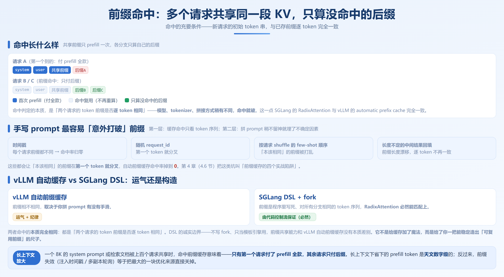
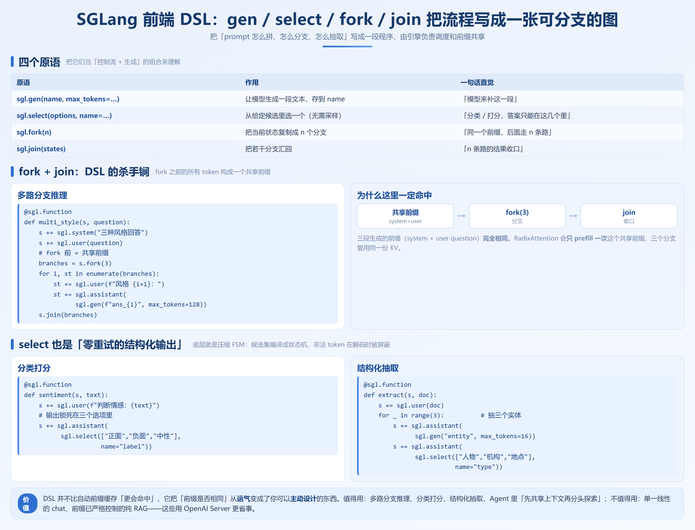

# 第 11 章　SGLang 快速上手与低延迟实战

## 11.1 安装与环境

装法和第 8 章的 vLLM 平行：pip 装、`lmsysorg/sglang` 官方镜像跑；同样依赖 CUDA、Triton 与较新的 PyTorch。

### 11.1.1 pip 安装

推荐官方「带 CUDA 轮子」的命令，避免本机编译 Triton kernel：

```bash
# 干净虚拟环境里执行，Python 3.10+
pip install "sglang[all]>=0.5.18"   # 适用 v0.5.18+，更高版本请以官方文档为准

# 验证安装
python -c "import sglang; print(sglang.__version__)"
```

`[all]` 会顺带装好 `sgl-kernel`、`xgrammar`、`torch` 等依赖；只用 OpenAI 兼容 Server 可只装 `pip install sglang`。

### 11.1.2 Docker 安装（生产首选）

生产环境建议用镜像，避免宿主机 CUDA 驱动与容器内核错配：

```bash
docker run --gpus all --shm-size 32g \
  -p 30000:30000 \
  -v ~/.cache/huggingface:/root/.cache/huggingface \
  lmsysorg/sglang:latest \
  python -m sglang.launch_server \
    --model-path Qwen/Qwen3.5-0.8B \
    --tp 1 --port 30000
```

> 注意：SGLang 镜像里默认已带匹配好的 CUDA / PyTorch / xgrammar，因此 `--gpus all` 之外的宿主机依赖只有 NVIDIA Container Toolkit。这一点与 vLLM 的 `vllm/vllm-openai` 镜像体验一致。

### 11.1.3 与 vLLM 的环境差异（重点）

四点差异：核心依赖上 SGLang 用 `sgl-kernel` + `xgrammar`，与 vLLM 的 `vllm-flash-attn` 不同，同机共存时 Triton 环境可能打架，建议分虚拟环境；结构化生成都是 xgrammar 系（见 9.2）；`mem-fraction-static` 与 `gpu-memory-utilization` **语义不同**（见 9.5）；前缀缓存两边默认都开，但命中粒度与路由语义不同（见 9.1）。

**一条实战提醒**：不要把 SGLang 和 vLLM 装进同一个虚拟环境比对压测，两者对 Triton、flash-attn 的版本诉求不一致，混装后常见「import 某方就 Segmentation fault」，需要时各起 conda / venv。

版本上：**CUDA / 驱动**要 CUDA 12.x 与较新驱动（535+，H 卡 550+），否则卡在 kernel 编译或 `sgl-kernel` 加载；**PyTorch** v0.5.18+ 配套 2.11+，别拿 2.1 老环境硬跑；**模型支持节奏**上 SGLang 以"前沿模型 Day-0 支持"著称（见 9.4），但新模型刚合入时 API 细节可能漂移，生产要锁版本，别用 `:latest` 裸奔。

想试 RadixAttention 前缀缓存、DSL 多分支推理或 Day-0 跑新模型，值得上手；生产强依赖 vLLM 独占能力（特定 LoRA 调度、量化后端）且未验证等价支持时，先并行跑、别急替换。

---

## 11.2 三种使用方式



### 11.2.1 方式一：OpenAI 兼容 Server（迁移成本最低）

`python -m sglang.launch_server` 起的端口和 vLLM 的 `vllm serve` 一样，兼容 `/v1/chat/completions`、`/v1/completions`、`/v1/models`、流式接口。

```bash
# 启动（SGLang v0.5.18+ 同时支持 sglang serve 简写）
python -m sglang.launch_server \
  --model-path Qwen/Qwen3.5-0.8B \
  --tp 1 \
  --port 30000 \
  --host 0.0.0.0
```

**关键判断**：业务已经走 OpenAI SDK 时，切到 SGLang **代码零改动**，只换 `base_url` 和启动命令，迁移成本 = 0。

### 11.2.2 方式二：`sgl.Engine` 进程内引擎（离线批处理 / RL rollout）

不想起 HTTP 服务、只想在进程里灌 prompt 拿结果，就用 `sgl.Engine(model_path=..., tp=1)`，其 `engine.generate([...], sampling_params={"temperature": 0, "max_new_tokens": 256})` 一次性返回，权重随进程加载、省去网络往返。典型场景：离线批处理、评测基准、RL rollout（配权重热更新可跳过重载，见 9.6）、压测前冒烟；要横向扩展、鉴权限流、多业务方共享时该用 11.2.1 的 Server。

### 11.2.3 方式三：前端 DSL（本章特色）

SGLang 独有的是 11.3 节的前端 DSL：把"prompt 怎么拼、怎么分支、怎么抽取"写成程序，由引擎调度并共享前缀；配上 `fork` / `join` 才能表达 vLLM 纯 prompt 拼不出的结构（见 9.3）。

---

## 11.3 SGLang 前端 DSL



### 11.3.1 四个原语

| 原语 | 作用 | 一句话直觉 |
|---|---|---|
| `sgl.gen(name, max_tokens=…)` | 让模型生成一段文本，存到 `name` | "模型来补这一段" |
| `sgl.select(options, name=…)` | 从给定候选里选一个（无需采样） | "分类/打分，答案只能在这几个里" |
| `sgl.fork(n)` | 把当前状态复制成 n 个分支 | "同一个前缀，后面走 n 条路" |
| `sgl.join(states)` | 把若干分支汇回 | "n 条路的结果收口" |

**示例 1：`select` —— 分类打分（候选受约束，天然就是结构化输出）**
```python
@sgl.function
def sentiment(s, text):
    s += sgl.user(f"判断情感倾向：{text}")
    # select 直接把输出锁死在三个选项里，不会吐出别的字
    s += sgl.assistant(sgl.select(["正面", "负面", "中性"], name="label"))
```

`select` 的底层就是 12.2 节的压缩 FSM：候选集编译成状态机，非法 token 在解码时被屏蔽，因此它既是"分类器写法"，也是"零重试的结构化输出"。

**示例 2：`fork` + `join` —— 多路分支推理（DSL 的杀手锏）**

```python
@sgl.function
def multi_style(s, question):
    s += sgl.system("下面请就同一问题给出三种风格的回答。")
    s += sgl.user(question)
    # 关键：fork 之前的所有 token（system + user）构成一个共享前缀
    branches = s.fork(3)
    for i, st in enumerate(branches):
        st += sgl.user(f"风格 {i+1} 的回答：")
        st += sgl.assistant(sgl.gen(f"ans_{i}", max_tokens=128))
    s.join(branches)
```

`fork` 之后的三段生成前缀（system + user question）完全相同，RadixAttention **只 prefill 一次**，三个分支复用同一份 KV。这正是 vLLM 纯靠 prompt 拼不出、靠"运气命中自动前缀缓存"也不稳定的地方（详见 11.3.2）。

### 11.3.2 为什么 DSL 能保证前缀共享（而非依赖运气）

先摆结论：

> **DSL 本身并不比自动前缀缓存"更会命中"。RadixAttention 的命中判定，和 vLLM 的 automatic prefix cache 一样，本质都是"两个请求的 token 前缀是否逐 token 相同"。DSL 真正的价值，是把"前缀是否相同"从运气变成了你可以主动设计的东西。**

**第一层**：命中只看 token 序列，模型、tokenizer、拼接方式稍有不同就破。**第二层**：手写 f-string 里的时间戳、随机 request_id、按请求 shuffle 的 few-shot 顺序、长度不定的中间结果回填，都会让"本该相同"的前缀在第一个 token 就分叉，命中率掉到 0——第 4 章（4.7 节）称之为"前缀缓存的四个实战陷阱"。**第三层**：DSL 把"共享前缀"写成显式结构，RadixAttention 必然能匹配上——vLLM 那边靠运气 + 纪律，这边由代码控制流保证，这不是概率，是构造使然。

**诚实的边界**：不写 `fork`、只把 DSL 当模板引擎用，前缀共享能力和 vLLM 自动前缀缓存没有本质差别——都靠 token 相同。DSL 的红利只在"确实利用它的结构（分支、复用、受约束生成）"时才兑现：它没给缓存加魔法，只是给了你一把能稳定造出"可复用前缀"的尺子。

---

## 11.4 vLLM → SGLang 参数对照

> **重要**：SGLang 的很多参数名/默认值随版本漂移较大。下表以 v0.5.18+ 为基线，**凡标 ⚠ 的参数，语义与 vLLM 不完全等价，迁移时必须重读官方文档**，切勿直接照抄数值。

### 11.4.1 启动参数逐项对照表

| 类别 | vLLM (V1) | SGLang (v0.5.18+) | 备注 |
|---|---|---|---|
| 模型路径 | `--model` | `--model-path` | 名字不同，语义同 |
| 服务地址 | `--host` / `--port` | `--host` / `--port` | 同 |
| 服务模型名 | `--served-model-name` | `--served-model-name` | 同 |
| 张量并行 | `--tensor-parallel-size` | `--tp` | ⚠ 短名，数值语义同 |
| 数据并行 | `--data-parallel-size` | `--dp` | ⚠ 短名；SGLang 还配合 `--enable-dp-attention`（见 9.5） |
| 流水并行 | `--pipeline-parallel-size` | 通常并入 `--tp`/专家并行 | ⚠ SGLang 多卡主要靠 TP + EP，PP 用法较少 |
| 上下文长度 | `--max-model-len` | `--context-length` | ⚠ 名字不同 |
| 最大批 token | `--max-num-batched-tokens` | `--max-total-tokens` | ⚠ 语义相近：KV 池/批内 token 上限 |
| 最大并发序列 | `--max-num-seqs` | `--max-running-requests` | ⚠ 名字不同 |
| 显存占用 | `--gpu-memory-utilization` | `--mem-fraction-static` | ⚠⚠ **语义不同**：见 9.5 |
| KV 数据类型 | `--kv-cache-dtype` | `--kv-cache-dtype` | 同（如 fp8、fp8_e5m2） |
| 权重 dtype | `--dtype` | `--dtype` | 同 |
| 量化 | `--quantization` | `--quantization` | 同；取值集合略有差异 |
| 分块预填充 | `--enable-chunked-prefill` + 间接由 `--max-num-batched-tokens` 控制 | `--chunked-prefill-size` | ⚠ SGLang 直接给 chunk 大小 |
| 前缀缓存 | `--enable-prefix-caching`（V1 默认开） | `--enable-prefix-caching`（默认开）/ `--disable-prefix-caching` | 行为接近，粒度/路由语义不同 |
| 投机解码 | `--speculative-config '{"method":...}'` | `--speculative-algorithm` + `--speculative-draft` | ⚠ 配置结构不同，见 9.3 |
| 结构化输出 | 依赖 xgrammar/guidance 后端 | 原生 xgrammar（默认启用） | 概念通用，见 9.2 |
| 日志/缓存报告 | `--enable-prefix-caching` 配合 metrics | `--enable-cache-report` | ⚠ SGLang 专用缓存命中报告开关 |

### 11.4.2 代码迁移成本小结

- **OpenAI SDK 层：零改动。** 只换 `base_url` 和启动命令（11.2.1），迁移成本 ≈ 改两行配置。
- **Engine / Runtime API 层：需重写。** vLLM 的 `LLM(...)` + `SamplingParams` + `llm.generate(...)` 要改成 `sgl.Engine(...)` + `engine.generate(...)`，采样字段名不同（`max_tokens` vs `max_new_tokens`）；返回 `dict` 而非 `RequestOutput`，字段需核对。
- **DSL 层：SGLang 独占。** vLLM 没有等价物，别为了"用 DSL"而用 DSL。

---

## 11.5 常见启动参数精解

### 11.5.1 `--tp`（Tensor Parallel，张量并行）

默认 `1`（单卡）。权重按层内张量切到 N 卡，装不下就加，`--tp 8` 即 8 卡切一份，要求卡间高带宽（NVLink 最优）。调错：TP 跨节点（4 机各 2 卡做 tp=8）通信拖死吞吐；TP 大于卡数直接报错。

### 11.5.2 `--dp`（Data Parallel，数据并行）

默认 `1`。N 份完整副本各自接请求，吞吐近似线性提升，常配 `--enable-dp-attention`（见 9.5），常见组合 `--tp 4 --dp 2`。调错：`--tp * --dp` 超物理卡数 → OOM；不配 dp-attention 命中率稀释。

### 11.5.3 `--mem-fraction-static`（静态显存占比）⚠

默认 `0.88`（基线 v0.5.18+）。它是"权重 + KV Cache"的静态预留比例，余下给激活值；**语义与 vLLM 的 `gpu-memory-utilization`（HBM 总占用上限）不同**。长上下文上调（0.9），激活值 OOM 时下调（0.8）；照 vLLM 习惯填 `0.95` → decode OOM，太低 → KV 池过小。

### 11.5.4 `--chunked-prefill-size`（分块预填充大小）

默认 `8192`（同上）。一次 prefill 的 token 上限，超出则切块与 decode 混批，决定"长 prompt 会不会卡住 decode"。对 TPOT 抖动敏感 → 调小（4096）；短 prompt 求吞吐 → 调大（16384）。太大 → decode 被饿；太小 → TTFT 变长。

### 11.5.5 `--max-running-requests`（最大并发请求数）

默认 `0`（由显存/KV 容量自动推导）。压吞吐调大，保延迟（防队头阻塞）调小。过大 → 抢占/换出、P99 爆炸；过小 → GPU 喂不饱。

### 11.5.6 `--enable-prefix-caching`（前缀缓存，默认开启）

默认**开启**（`--disable-prefix-caching` 可关），是 SGLang 相对"朴素 vLLM 老版本"最大的红利来源，**通常不用动**；调试用 `--enable-cache-report`（见 9.1）。手滑关掉 → 多轮对话/RAG/共享 system prompt 的重复 prefill 全浪费；prompt 自带随机前缀却开着 → 命中率本就 0，先修 prompt（见 4.7 节）。

这些参数彼此耦合（KV 容量 ↔ 并发 ↔ 延迟），别照抄博客的"最优参数"：先跑基线，再单点变量（方法见第 10.1 节）。

---

## 本章小结

1. **迁移成本分层**：OpenAI SDK 层零改动（只换 `base_url` 和启动命令）；vLLM `LLM` 进程内 API 需重写为 `sgl.Engine`；DSL 按需采用。三种方式——OpenAI 兼容 Server、`sgl.Engine`、前端 DSL——按"愿不愿动代码"选。
2. **DSL 的核心不是魔法**：命中条件与 vLLM 自动前缀缓存相同（token 前缀一致），差异在于把"前缀是否相同"从运气变成可用 `fork` 控制的结构。
3. **参数名大量不同但语义可映射**：`--tensor-parallel-size→--tp`、`--max-num-seqs→--max-running-requests`、`--gpu-memory-utilization→--mem-fraction-static` 等，迁移照 11.4 表逐条核对；后者是静态预留比例而非 HBM 上限，套用 vLLM 数值会 OOM。

