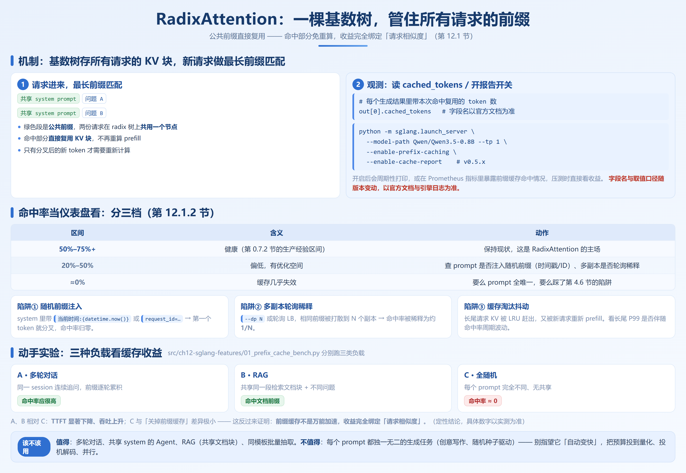
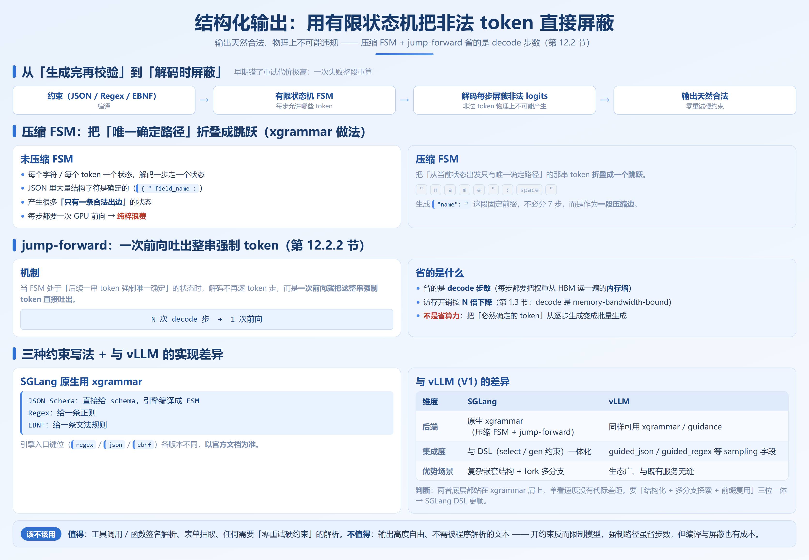

# 第 12 章　SGLang 核心能力

> **本章要回答的问题**
> 1. SGLang 相比 vLLM，真正的优势场景是什么，而不是"谁更快"？
> 2. RadixAttention 的命中率怎么观测、多少算健康、怎么动手验证收益？
> 3. 压缩 FSM 和 jump-forward 凭什么降低结构化输出的解码开销？
> 4. 投机解码（第 7 章）在 SGLang 里怎么配、和 vLLM 差在哪？
> 5. 大模型 / MoE（DeepSeek 系列）和 SGLang Router 怎么落地，RL rollout 为什么偏爱它？

难度 ★★☆　|　硬件要求：🖥️🖥️　|　⏭️ 12.5 节（RL rollout 引擎）为进阶，可暂跳

---

## 12.1 RadixAttention 前缀缓存实战



第 0 章 0.7.2 节已经给了 RadixAttention 的概念：一棵基数树存所有请求的 KV 块，新请求做最长前缀匹配，命中部分直接复用。第 4 章（2.4–4.6 节）从原理层讲了它与 PagedAttention 的关系和"四个实战陷阱"。本节把它落到"怎么观测、怎么诊断、收益到底多大"。

### 12.1.1 命中率怎么观测

SGLang 在返回结构里塞了缓存统计字段，并提供一个专门的报告开关：

**方式一：读返回里的 `cached_tokens`**

每个生成结果里能拿到本次命中复用的 token 数。引擎侧日志也会打印缓存命中占比。

```python
# 配合 --enable-cache-report 启动后，结果里带缓存统计
import sglang as sgl
engine = sgl.Engine(model_path="Qwen/Qwen3.5-0.8B", tp=1,
                    # 注意：缓存报告开关在 launch_server 命令行是 --enable-cache-report
                    )
out = engine.generate([{"role": "user", "content": shared_prefix + "问题A"}],
                       sampling_params={"max_new_tokens": 64})
# out[0] 内部字段含 cached_tokens 等信息（字段名以官方文档为准）
```

**方式二：启动开关 `--enable-cache-report`（v0.5.x）**

```bash
python -m sglang.launch_server \
  --model-path Qwen/Qwen3.5-0.8B --tp 1 \
  --enable-prefix-caching \
  --enable-cache-report        # 在日志/指标中输出缓存命中统计
```

开启后引擎会周期性打印（或在 Prometheus 指标里暴露）前缀缓存命中情况，便于压测时直接看收益。

> 诚实提示：`cached_tokens` 的具体字段名和取值口径随版本变动。请以你所用版本的官方文档与引擎日志为准，上面代码是"观测思路"而非逐字段承诺。

### 12.1.2 命中率健康区间与诊断方法

把命中率当仪表盘看，分三档：

| 区间 | 含义 | 动作 |
|---|---|---|
| **50%–75%+** | 健康（第 0 章 0.7.2 节给的生产经验区间） | 保持现状，这是 RadixAttention 的主场 |
| **20%–50%** | 偏低，有优化空间 | 查 prompt 是否注入了随机前缀（时间戳/ID）、多副本是否轮询稀释 |
| **≈0%** | 缓存几乎失效 | 要么 prompt 全唯一（RAG 文档各异、无共享 system），要么踩了 4.6 节的陷阱 |

**常见诊断清单**（呼应第 4 章 4.6 节）：

1. **随机前缀注入**：system prompt 里带 `当前时间：{datetime.now()}` 或 `request_id=...` → 第一个 token 就分叉，命中率归零。修复：把易变内容放到前缀之后，或干脆剥离。
2. **多副本轮询稀释**：`--dp N` 或前面挂了轮询 LB，相同前缀被打散到 N 个副本，每个副本只看到 1/N 的命中机会 → 命中率被稀释为约 1/N。引出 10.4 的缓存感知路由。
3. **缓存淘汰抖动**：长尾请求 KV 被 LRU 赶出，又被新请求重新 prefill。观察长尾 P99 是否伴随命中率周期波动。

### 12.1.3 动手实验：三种负载对比缓存收益

构造三类负载，直观看 RadixAttention 在哪种场景变现：

```text
负载 A 多轮对话：  同一 session 连续追问，前缀逐轮累积 → 命中率应很高
负载 B RAG：       共享同一段检索文档块 + 不同问题 → 命中文档前缀
负载 C 全随机：    每个请求 prompt 完全不同、无共享 → 命中率≈0
```

实验脚本 `src/ch12-sglang-features/01_prefix_cache_bench.py` 会分别跑三类负载、打印每类的 `cached_tokens` 与 TTFT，预期结论（定性，具体数字以实测为准）：

- A、B 相对 C，TTFT 显著下降（共享前缀免重算），吞吐上升。
- C 与"关掉前缀缓存"差异极小——因为本就没有可复用前缀，**这反过来证明：前缀缓存不是万能加速，它的收益完全绑定"请求相似度"**。

> **什么场景值得用 / 不值得用**
> - 值得：多轮对话、共享 system prompt 的 Agent、RAG（共享文档块）、同模板批量抽取——这些负载天然有可复用前缀。
> - 不值得：每个 prompt 都独一无二的生成任务（如创意写作、随机种子驱动）。这时 RadixAttention 帮不上忙，别指望它"自动变快"，应把优化预算投到别处（量化、投机解码、并行）。

---

## 12.2 结构化输出与压缩 FSM



Agent / 工具调用时代，"模型必须吐出能被程序解析的 JSON"是硬需求。早期"生成完再校验、错了重试"代价极高（一次失败整段重算）。现代做法是把约束编译成**有限状态机（FSM）**，在解码每一步把非法 token 的 logits 屏蔽掉——非法输出在物理上不可能产生。

### 12.2.1 压缩有限状态机原理

未压缩的 FSM：每个字符/每个 token 一个状态，解码一步走一 states。问题是 JSON 里大量"结构字符"是确定的（如 `{`、`"`、`field_name`：），逐 token 走状态机会产生很多"只有一条合法出边"的状态——每步都要一次 GPU 前向，纯粹浪费。

**压缩 FSM（xgrammar 的做法）**：把"从当前状态出发只有唯一确定路径"的那串 token 折叠成一个跳跃。例如生成 `"name": "` 这段固定前缀，不需要分 7 步、每步一次前向，而是作为一段压缩边。

### 12.2.2 jump-forward：一次吐出强制 token 串

压缩 FSM 带来的直接优化叫 **jump-forward（前向跳跃）**：

> 当 FSM 处于"后续一串 token 强制唯一确定"的状态时，解码不再逐 token 走，而是**一次前向就把这整串强制 token 直接吐出**。这样把 N 次 decode 步压成 1 次前向，decode 阶段的访存开销（回到第 1.3 节：decode 是 memory-bandwidth-bound）按 N 倍下降。

要点：jump-forward 省的是**decode 步数**（每步都要把权重从 HBM 读一遍的内存墙），而不是省算力。它把"必然确定的 token"从逐 step 生成变成批量生成，是对 0.7.2 节"结构化生成解码开销下降"的工程落地。

### 12.2.3 JSON / Regex / EBNF 实战

SGLang 原生用 xgrammar 做结构化后端，三种约束写法：

```python
import sglang as sgl

# 1) JSON Schema：直接给 schema，引擎编译成 FSM
@sgl.function
def to_json(s, text):
    s += sgl.user(f"抽取为结构化 JSON：{text}")
    s += sgl.assistant(sgl.gen("out", max_tokens=256,
                               regex=None,  # 占位
                               # 实际用法见下方 structured 接口
                               ))

# 2) 通过 structured 字段（推荐写法）
out = engine.generate(
    [{"role": "user", "content": "抽取姓名与年龄"}],
    sampling_params={
        "structured": {            # SGLang 的结构化输出入口
            "type": "json",
            "schema": {"name": "string", "age": "integer"},
        }
    },
)
```

> 上面的 `structured` 字段名/取值为思路示意，SGLang 各版本用 `regex` / `json` / `ebnf` 等不同键位，请以官方文档为准。Regex / EBNF 同理，给一条文法规则即可。

### 12.2.4 与 vLLM 结构化输出的实现差异（诚实对比）

这里要克制"谁更好"的冲动，给适用场景：

| 维度 | SGLang | vLLM (V1) |
|---|---|---|
| 后端 | 原生 xgrammar（压缩 FSM + jump-forward） | 同样可用 xgrammar / guidance |
| 集成度 | 与 DSL（`select` / `gen` 约束）一体化 | 通过 `guided_json` / `guided_regex` 等 sampling 字段 |
| 优势场景 | 复杂嵌套结构 + 与 fork 多分支结合时表达力强 | 生态广、与 vLLM 既有服务无缝 |
| 局限 | 复杂文法编译偶有不支持的边界，需实测 | 同样受 xgrammar 能力边界约束 |

**判断**：两者底层都站在 xgrammar 肩上，单看"结构化输出速度"没有代际差距。**SGLang 的相对优势在于把结构化约束和 DSL 控制流（fork 多候选、select 分类）揉在一起写**，vLLM 更偏"在 sampling 参数里声明约束"。选型时：已经在 vLLM 上、只是要 JSON 输出 → 不必为了结构化输出迁 SGLang；要"结构化 + 多分支探索 + 前缀复用"三位一体 → SGLang DSL 更顺。

> **什么场景值得用 / 不值得用**
> - 值得：工具调用 / 函数签名解析、表单抽取、任何需要"零重试硬约束"的解析。
> - 不值得：输出高度自由、不需要被程序解析的文本——开结构化约束反而限制模型、还可能拖慢（强制路径虽省步数，但编译与屏蔽也有成本）。

---

## 12.3 大模型与 MoE 部署实战

以 DeepSeek 系列为例，讲 SGLang 在超大模型上的工程处理。这部分硬门槛是 🖥️🖥️，单机多卡起手。

### 12.3.1 MLA / EP / 量化组合

DeepSeek 系列（V2/V3/R1）的三个关键工程点：

- **MLA（Multi-head Latent Attention）**：低秩压缩 KV，把 KV Cache 压到极小（详见第 4 章 4.2 节）。SGLang 对 MLA 有专门后端，KV 显存大幅下降，意味着同样显存能塞更大并发或更长上下文。
- **EP（Expert Parallel）**：MoE 的专家层按专家切到多卡。EP 的瓶颈在 All-to-All 通信（第 6 章 4.2–6.3 节）。SGLang 支持大规模 EP，配合高带宽互联（NVLink / IB）服务超大 MoE。
- **量化组合**：权重 FP8 / 激活量化等。SGLang 对 DeepSeek 的量化部署路径成熟，常见组合是"权重 FP8 + MLA 低秩 KV"，在精度可接受前提下大幅降显存。

```bash
# DeepSeek-V3 多卡部署示意（数值与卡数以你的硬件为准）
python -m sglang.launch_server \
  --model-path deepseek-ai/DeepSeek-V3 \
  --tp 8 \
  --quantization fp8 \
  --enable-prefix-caching
```

> 诚实提示：DeepSeek-V3/R1 是数百 B 参数的 MoE，8 卡不一定放得下（取决于量化与 EP 配置）。具体卡数、EP 度、量化组合请以官方部署示例和你的硬件显存为准，**不要照抄上面的 8 卡**。

### 12.3.2 混合稀疏注意力下的前缀缓存（ShadowRadix 思路）

DeepSeek 等模型不是"全程全注意力"——部分层用 MLA、部分带滑动窗口/稀疏模式。这给前缀缓存出难题：稀疏注意力层本不缓存全部历史，但前缀复用的语义仍成立。

SGLang 的相关思路（社区称 **ShadowRadix** 一类方案）是：在稀疏注意力层也维护一份"影子"前缀树，让可复用前缀在混合注意力结构下仍能被匹配，避免稀疏层的存在把整段缓存收益清零。**具体实现随版本演进，本教程不展开未经验证的细节，落地时以官方文档 / 对应 PR 为准。**

### 12.3.3 前沿模型 Day-0 支持的工程含义

SGLang 以"新模型发布当天就能跑"著称（如 DeepSeek 各代、各类 MLA/MoE 新架构）。工程含义有三：

1. **对新架构的注意力后端跟得快**：MLA、MTP、混合稀疏注意力等新算子往往 SGLang 先合入参考实现。
2. **对选型的影响是双刃**：Day-0 适合"追新模型做验证"，但**新合入的 API 细节可能漂移**，生产锁版本。
3. **不是性能保证**：能跑 ≠ 跑得最优。新模型首发常需几个小版本迭代才把吞吐/显存调到位。

> **什么场景值得用 / 不值得用**
> - 值得：要服务 DeepSeek 级超大 MoE、需要 MLA 低秩 KV 与大规模 EP、需要追新模型 Day-0 验证。
> - 不值得：中小稠密模型（7B–32B）且已在 vLLM 稳定运行——这类 SGLang 没有代际优势，迁移只为"尝鲜"不划算。

---

## 12.4 SGLang Router

第 4 章 4.6 节和第 5 章 5.6 节都点过一个坑：**多副本轮询会把前缀缓存命中率稀释成 1/N**。SGLang Router 就是专门解决它的缓存感知路由层。

### 12.4.1 缓存感知路由的原理

普通 LB（轮询 / 随机）不关心"这个请求的前缀在哪份副本的 radix 树里"。缓存感知路由的做法：

> 路由层维护各副本的前缀树摘要（或哈希），把"前缀最有可能命中"的请求，派到对应的那一份副本。这样相同前缀的请求聚到同一副本，RadixAttention 命中率不被稀释。

代价是路由层要感知缓存状态，引入一点路由决策开销与状态同步。当副本数多、请求相似度高时，收益远大于这点开销。

### 12.4.2 部署示例

```bash
# 先起多个带前缀缓存的 SGLang 实例
for i in 0 1 2; do
  python -m sglang.launch_server --model-path Qwen/Qwen3-32B \
    --tp 4 --port 3000$i --enable-prefix-caching &
done

# 再起 Router，做缓存感知路由（端口/参数以官方文档为准）
python -m sglang_router.launch_router \
  --host 0.0.0.0 --port 40000 \
  --worker http://localhost:30000 http://localhost:30001 http://localhost:30002
```

```python
# 客户端只连 Router，其余和 OpenAI SDK 一致
from openai import OpenAI
client = OpenAI(base_url="http://localhost:40000/v1", api_key="EMPTY")
```

### 12.4.3 DP 注意力与多副本协同

SGLAgn 里还有 `--enable-dp-attention`：在 `--dp N` 多副本下，让各 DP rank 在注意力计算时协同（共享/聚合注意力状态），进一步提升"多副本但像一份模型"的一致性与前缀复用效率。它和 Router 是互补的两层：

- **Router**：跨副本的请求级路由，把相似前缀聚到同副本。
- **DP Attention**：副本内部的注意力协同，减少重复 prefill。

两者配合，是把"前缀缓存收益"在规模化部署下保住的关键。具体开关语义与版本差异较大，落地前以官方文档为准。

> **什么场景值得用 / 不值得用**
> - 值得：多副本（≥3）且请求有明显共享前缀（多轮对话、RAG、批量同模板）——命中率从 1/N 救回。
> - 不值得：单副本、或前缀本就全随机（见 10.1）——路由层白白增加复杂度和延迟，命中率救不回来。

---

## 12.5 作为 RL rollout 引擎 ⏭️ ☁️

标记 ⏭️（进阶）与 ☁️（多机/集群倾向），第一遍可跳。

### 12.5.1 为什么 RL 场景偏爱 SGLang

RLHF / RLVR 的后训练循环里，推理引擎要反复当 rollout 工人：给策略模型采样大量轨迹。它和在线服务有三点不同，恰好命中 SGLang 的设计：

1. **权重频繁更新**：训练每步更新策略权重，rollout 引擎要能热加载，而不是重启进程重读权重。**SGLang 支持权重原地更新（通过 NCCL/权重同步通道），跳过"重新加载"的昂贵环节**——这是它被 RL 框架（如 verl、OpenRLHF）选作 backend 的核心原因。
2. **前缀复用仍有价值**：RL 轨迹常共享 system prompt、共享上下文，RadixAttention 在此同样生效。
3. **sleep mode / 显存让渡**：训练与推理交替时，SGLang 的显存让渡能力让 GPU 在"该训练时"把推理占用的显存交还，提升利用率。

### 12.5.2 权重更新与推理引擎的协同

典型协同形态（定性，具体 API 以 RL 框架与 SGLang 官方文档为准）：

- 训练进程算出新版权重 → 通过同步通道推给 SGLang 推理引擎 → 引擎在不重启的前提下替换权重 → 下一轮 rollout 用新权重采样。
- 关键要求是**数值一致性**：推理引擎的采样/数值路径要和训练侧对齐，否则 rollout 分布偏移会让 RL 收敛出问题。这要求引擎支持可控的采样精度与确定性。

> 诚实边界：SGLang 在 RL rollout 上的优势是"工程协同成熟度"，不是"推理算法更快"。如果你的场景不涉及 RL 后训练，本节与你的生产部署无关，跳过无妨。

---

## 本章小结

1. **SGLang 的优势是场景绑定的，不是全面的"更快"**：前缀缓存（10.1）、结构化+多分支（10.2/9.3）、MoE 部署（10.3）、缓存感知路由（10.4）各自有最适配的负载。
2. **RadixAttention 收益 = 请求相似度**：多轮对话/RAG/同模板批量收益明显，全随机 prompt 命中率≈0、帮不上忙（10.1.3）。
3. **压缩 FSM + jump-forward 省的是 decode 步数**（内存墙），不是算力；与 vLLM 同站 xgrammar，相对优势在和 DSL 控制流融合（10.2）。
4. **投机解码（第 7 章）在 SGLang 走 Spec V2 统一框架**，覆盖自回归起草（EAGLE/MTP/N-gram）与并行起草（DFlash/DSpark）两条路线；组合收益来自"缓存+投机"同开，陷阱是接受率崩则反劣化。
5. **MoE 部署靠 MLA 低秩 KV + EP + 量化**，SGLang 对 DeepSeek 级模型与 Day-0 新架构跟得快，但新合入需锁版本（10.3）。
6. **Router 把多副本命中率从 1/N 救回**，与 DP Attention 互补（10.4）；RL rollout 偏好 SGLang 因权重热更新与显存让渡（10.5）。
