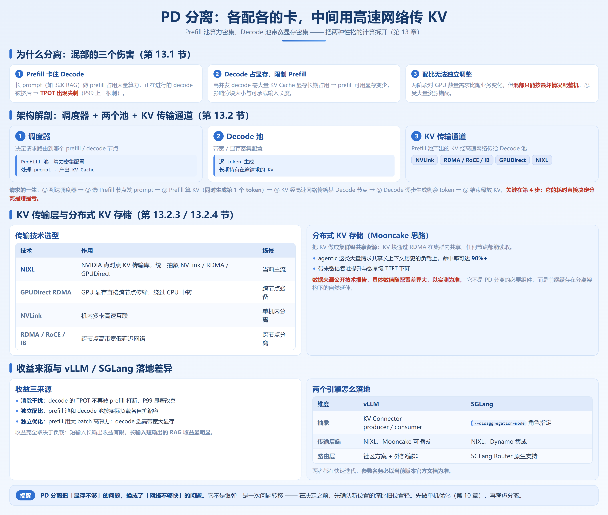
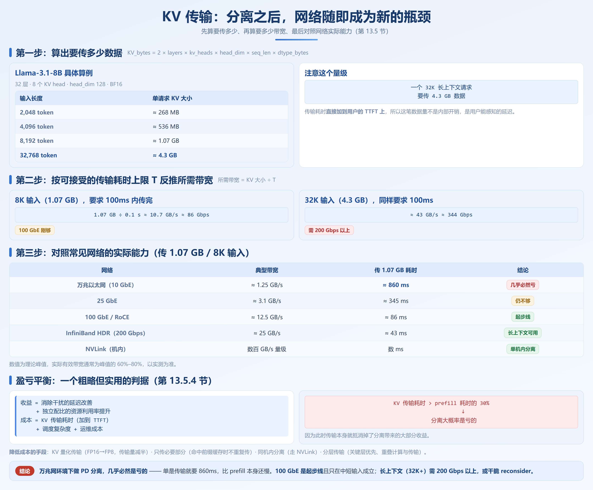

# 第 13 章　PD 分离与大规模部署

## 13.1 为什么需要 PD 分离

第 1.3 节已确立：**Prefill 是 compute-bound，Decode 是 memory-bandwidth-bound**，两者的最优资源配比完全不同，放在同一组 GPU 上有三种具体的伤害。

**伤害一：Prefill 卡住 Decode。** 长 prompt 请求（如 32K token 的 RAG）做 prefill 会占用大量算力，正在进行的 decode 被挤到后面——**TPOT 出现尖刺**。

**伤害二：Decode 占着显存，限制 Prefill。** 为了支撑高并发，decode 长期占用大量 KV Cache 显存，prefill 能用的显存就少了，影响分块大小和可承载的输入长度。

**伤害三：配比无法独立调整。** 这是最根本的问题。典型在线服务输入 2K token、输出 500 token：prefill 一次性处理 2000 token，算力密集；decode 500 步，每步带宽密集。两阶段对 GPU 数量的需求比是某个固定值，但**这个比值会随业务变化**——上了长文档问答，prefill 需求翻倍。**混部架构下，只能按最坏情况配置整机，然后忍受大量资源错配。**

收益正对应这三处：消除干扰（P99 改善）、独立配比（两池各自扩缩容）、独立优化（prefill 用大 batch、高算力，decode 选高带宽、大显存）。但**短输入、长输出场景收益有限，RAG 这类长输入、短输出场景最明显。**

---

## 13.2 PD 分离架构解剖



### 13.2.1 请求的一生

1. 调度器选一个 **Prefill 节点**，把 prompt 发过去
2. Prefill 算出 prompt 的 KV Cache（**同时生成第一个 token**）
3. KV Cache 经高速网络传给某个 **Decode 节点**
4. Decode 接管，生成剩余 token，结束后释放 KV

**关键在第 3 步。** 它直接决定了 PD 分离是赚是亏。

### 13.2.2 KV 传输层

| 技术 | 作用 | 适用场景 |
|---|---|---|
| **NIXL** | NVIDIA 的点对点 KV 传输库，统一抽象 NVLink / RDMA / GPUDirect | 当前主流方案 |
| **GPUDirect RDMA** | GPU 显存直接跨节点传输，绕过 CPU 内存中转 | 跨节点必备 |
| **NVLink** | 机内多卡高速互联 | 单机内分离 |
| **RDMA / RoCE / InfiniBand** | 跨节点高带宽低延迟网络 | 跨节点分离 |

更进一步是**把 KV 做成集群级共享资源**（如 Mooncake），但它**不是 PD 分离的必要组件**，而是前缀缓存的自然延伸——分离后仍要保持跨请求的 KV 复用，否则浪费了第 4 章的红利。

### 13.2.3 分离之后，前缀缓存怎么办

分离后 RadixAttention / prefix cache 的树结构不再局限于单机：prefill 命中缓存后是否还要传 KV、元数据如何同步、淘汰策略如何一致，均需解决。**这也是 PD 分离成熟度高度依赖引擎版本的原因**——早先实现直接放弃跨节点前缀缓存，落地前务必确认版本行为。

---

## 13.3 vLLM 的 PD 分离

vLLM 通过 **KV Connector** 抽象层把 KV Cache 的生产者与消费者解耦：**Producer**（Prefill 实例）、**Consumer**（Decode 实例）、**Connector**（可插拔，如 NIXL、Mooncake）。

**Prefill 实例（生产者）**

```bash
# 适用于 vLLM v0.20.x 典型形态，参数名请以官方文档为准
vllm serve Qwen/Qwen3-8B \
    --tensor-parallel-size 2 \
    --port 8100 \
    --kv-transfer-config '{
        "kv_connector": "NixlConnector",
        "kv_role": "kv_producer",
        "kv_buffer_size": "8GB"
    }'
```

**Decode 实例（消费者）**

```bash
vllm serve Qwen/Qwen3-8B \
    --tensor-parallel-size 2 \
    --port 8200 \
    --kv-transfer-config '{
        "kv_connector": "NixlConnector",
        "kv_role": "kv_consumer",
        "kv_buffer_size": "8GB"
    }'
```

三个已知的工程坑：

- **多副本部署时的配对问题**：多副本并存时，prefill 必须知道该把 KV 发给谁；路由层没做配对与状态跟踪，就会 KV 发错节点、请求挂起。**这是社区反馈最多的问题**——它是正确性问题而非性能问题。
- **buffer size 设置**：`kv_buffer_size` 太小会阻塞传输、请求排队，太大则浪费显存，需按「并发数 × 单请求 KV 大小」估算（参考 13.5 节）。
- **显存预算要重新算**：prefill 只放**瞬时** KV（处理完就传走），decode 要长期持有**所有在途请求**的 KV。**不要用同一份显存配置去套两类节点。**

---

## 13.4 SGLang 的 PD 分离

SGLang 的 PD 分离通过 `--disaggregation-mode` 指定节点角色。

**Prefill 节点**

```bash
python -m sglang.launch_server \
    --model-path Qwen/Qwen3-8B \
    --disaggregation-mode prefill \
    --disaggregation-transfer-backend nixl \
    --port 30000
```

**Decode 节点**

```bash
python -m sglang.launch_server \
    --model-path Qwen/Qwen3-8B \
    --disaggregation-mode decode \
    --disaggregation-transfer-backend nixl \
    --port 30001
```

**路由层**：SGLang Router 支持该模式下的请求编排，也可用 Dynamo 等外部编排层。

| 维度 | vLLM | SGLang |
|---|---|---|
| 抽象方式 | KV Connector（producer/consumer） | `--disaggregation-mode` 角色指定 |
| 前缀缓存协同 | 逐步补齐中，版本依赖强 | RadixAttention 更贴近分离架构 |

**不要过度解读这张表**：两个引擎都在快速迭代，**选型前请查当前版本官方文档和 release notes**；部署后要验证日志角色标识、指标与压测的 TTFT / TPOT 分布（P99）。

---

## 13.5 网络要求与成本账 ⏭️



> 这一节回答一个最关键的问题：**你的网络撑不撑得起 PD 分离？** 算不清这笔账，分离可能让你变慢。

KV Cache 的大小用第 4.1 节的公式：

```
KV_bytes = 2 × layers × kv_heads × head_dim × seq_len × dtype_bytes
```

**算个具体的**（Llama-3.1-8B：32 层、8 个 KV head、head_dim 128、BF16）：

| 输入长度 | 单请求 KV 大小 |
|---|---|
| 2,048 token | ≈ 268 MB |
| 4,096 token | ≈ 536 MB |
| 8,192 token | ≈ 1.07 GB |
| 32,768 token | ≈ 4.3 GB |

**注意量级**——32K 请求要传 4.3 GB。设传输耗时上限为 `T`（会**直接加到 TTFT 上**），则 `所需带宽 = KV 大小 ÷ T`。8K 输入（1.07 GB）要求 100ms 内传完：

```
所需带宽 = 1.07 GB ÷ 0.1 s ≈ 10.7 GB/s ≈ 86 Gbps
```

32K 输入（4.3 GB）同样要求 100ms，则约 43 GB/s ≈ 344 Gbps。对照常见网络（理论峰值，有效带宽通常为 60%–80%）：

| 网络 | 典型带宽 | 传 1.07 GB（8K 输入）耗时 |
|---|---|---|
| 万兆以太网（10 GbE） | ≈ 1.25 GB/s | ≈ 860 ms |
| 100 GbE / RoCE | ≈ 12.5 GB/s | ≈ 86 ms |
| InfiniBand HDR（200 Gbps） | ≈ 25 GB/s | ≈ 43 ms |

**结论直接**：**万兆网环境下做 PD 分离，几乎必然是亏的**——单是传输就要 860ms，比 prefill 本身还慢；**100 GbE 是起步线**，且只在中短输入场景成立；**长上下文场景（32K+）需要 200 Gbps 以上**。

### 13.5.1 盈亏平衡的判断式

把收益（延迟改善 + 利用率提升）与成本（KV 传输耗时、调度复杂度、运维成本）相比，有一个粗略但实用的判据：

> **如果 KV 传输耗时 > 该请求 prefill 耗时的 30%，分离大概率是亏的。**

因为此时传输本身就抵消掉了分离带来的大部分收益。

---

## 13.6 什么时候不该做 PD 分离

这一节可能比前面所有内容都重要。

| 门槛 | 具体判据 |
|---|---|
| **规模门槛** | GPU 总数少于 8–16 卡时，分离带来的配比收益通常抵不过复杂度和传输成本 |
| **网络门槛** | 没有 RDMA / RoCE（100 Gbps 起）时，不要做跨节点分离 |
| **负载门槛** | 输入短、输出长的场景（如纯生成、闲聊），prefill 占比小，收益有限 |
| **团队门槛** | 没有能力排查分布式问题（KV 传错、节点失联、buffer 溢出）时 |
| **稳定性门槛** | 业务还在快速迭代、负载特征每周都变时，配比优势无法稳定发挥 |

逐条自检，**任何一条答「否」都建议先不要上 PD 分离**：GPU 是否 ≥ 8 卡且两阶段需求比明显偏离 1:1、是否有 100 Gbps 以上 RDMA、TPOT 的 P99 是否明显差于 P50、负载是否以长输入为主（输入 ≥ 输出的 2 倍）、KV 传输耗时是否低于 prefill 耗时的 30%、单机优化是否已做到位（第 10 章）。

**最后一条尤其重要。** PD 分离是第三阶段四（0.5.4 节）的优化，如果前缀缓存没开、投机解码没试、参数还是默认值，先做那些——**投入产出比高得多，风险低得多。**

> **PD 分离把「显存不够」的问题，换成了「网络不够快」的问题。**

它不是银弹，是一次**问题转移**。决定之前，先确认新位置的痛比旧位置轻。

---

## 13.7 没有集群怎么学习这一章

这章标了 ☁️，但没集群也并非完全学不了。有一台多卡机器（哪怕只有 2 张卡）就能完整模拟：

```bash
# 卡 0 做 prefill，卡 1 做 decode（SGLang 形态示意，参数以官方文档为准）
CUDA_VISIBLE_DEVICES=0 python -m sglang.launch_server \
    --model-path Qwen/Qwen3-8B --disaggregation-mode prefill --port 30000

CUDA_VISIBLE_DEVICES=1 python -m sglang.launch_server \
    --model-path Qwen/Qwen3-8B --disaggregation-mode decode  --port 30001
```

单卡机器也可以——用更小的模型，prefill 和 decode 各占一部分显存跑在同一张卡上，此时走本机内存拷贝而非 RDMA，**性能数据没有参考价值，但架构行为是真的**。13.5 节的计算也无需硬件：查 config.json 的 layers / kv_heads / head_dim，算出 KV 大小与传输耗时，与 prefill 对比，**能给出 80% 的结论**。

---

## 本章小结

1. **PD 分离的动因是三个伤害**：prefill 打断 decode 造成 TPOT 尖刺、decode 占显存限制 prefill、两阶段配比无法独立调整。

2. **架构三要素**：Prefill 池、Decode 池、KV 传输通道（NIXL / RDMA / GPUDirect）。分布式 KV 存储是前缀缓存的自然延伸，不是必需组件。

3. **vLLM 用 KV Connector（producer / consumer）**，SGLang 用 `--disaggregation-mode` 指定角色，参数名以当前版本官方文档为准。

4. **网络成本账是决策核心**：8K 输入的 KV 约 1 GB，100 Gbps 网络传约 86ms，**万兆网做跨节点分离几乎必然亏本**；传输耗时超过 prefill 耗时的 30% 就不划算。

5. **没集群也能学**：单机多卡可模拟架构行为，13.5 节的计算能给出 80% 的结论。先做透单机优化（第 10 章），再考虑 PD 分离。
