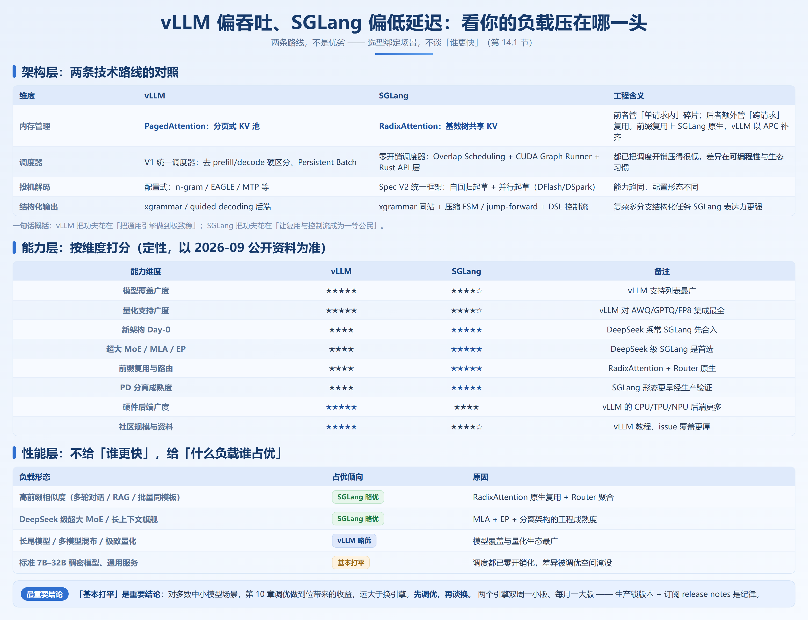
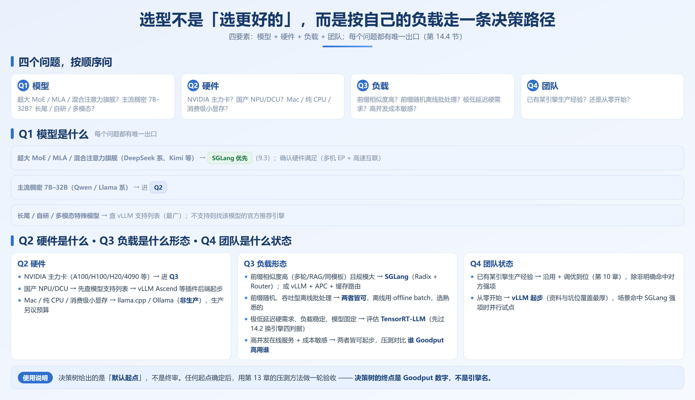

# 第 14 章　双引擎选型与决策

> **本章的立场**：引擎选型没有放之四海皆准的答案。本章不给「谁更快」的空洞结论——性能对比的保质期只有几个月，**决策框架**长得多。数据以候选引擎当前文档复核（截至 2026 年 9 月）。

---

## 14.1 vLLM vs SGLang 深度对比



### 14.1.1 架构层：两条技术路线的对照

| 维度 | vLLM | SGLang |
|---|---|---|
| 内存管理 | PagedAttention：分页 KV 池（OS 页表思路） | RadixAttention：基数树共享 KV（前缀树思路） |
| 调度器 | V1 统一调度器（5.3 节）：无 prefill/decode 硬区分 | 零开销调度器（5.4 节）：Overlap Scheduling + CUDA Graph |
| 投机解码 | 配置式（第 7 章）：n-gram / EAGLE / MTP | Spec V2：自回归 + 并行起草（DFlash/DSpark） |

PagedAttention 管单请求内碎片，RadixAttention 额外管跨请求复用（vLLM 以 APC 补齐）；调度开销都低，差异在**可编程性**与生态习惯。**一句话**：vLLM 求通用引擎的极致稳，SGLang 让复用与控制流成为一等公民。

### 14.1.2 能力层：按维度打分（定性，以 2026-09 公开资料为准）

覆盖与量化广度 vLLM 稍强（★★★★★ vs ★★★★☆）；Day-0、超大 MoE/MLA/EP、前缀复用、PD 分离四项 SGLang 稍强（★★★★★ vs ★★★★，12.3/12.4、第 13 章）。

### 14.1.3 工程层与性能层

**工程层**：两边都是「双周一小版、每月一大版」，生产要**锁版本 + 订阅 release notes**；API/CLI 仍有 breaking change（投机解码、PD 分离、量化），用台账（10.1 节）记参数快照。**会用的引擎 + 做对的调优，常胜过换个「理论上更快」的引擎**。

**性能层**不论「谁更快」，只论「什么负载谁占优」：

| 负载形态 | 占优倾向 | 原因 |
|---|---|---|
| 高前缀相似度（多轮 / RAG / 同模板） | SGLang 略优 | Radix 原生复用 + Router（9.1/9.4） |
| DeepSeek 级超大 MoE / 长上下文旗舰 | SGLang 略优 | MLA + EP + 分离架构成熟度（9.3） |
| 长尾模型 / 多模型混布 / 极致量化 | vLLM 略优 | 模型覆盖与量化生态最广 |
| 标准 7B–32B 稠密、通用服务 | 基本打平 | 调度已零开销，差异被调优淹没 |

**「基本打平」是重要结论**：多数中小模型场景，第 10 章调优到位的收益远大于换引擎。先调优，再谈换。

### 14.1.4 选型决策表

| 你的场景 | 推荐 | 理由 |
|---|---|---|
| 超大 MoE / MLA / 混合注意力新架构 | SGLang | Day-0 与分离成熟度 |
| 多轮对话 / RAG 为主 | SGLang（或 vLLM + 强缓存路由） | 前缀复用是核心收益 |
| 已有 vLLM 生产集群，无 SGLang 强需求 | **不换** | 迁移成本 > 收益 |
| 团队从零，两者皆无经验 | vLLM 起步 | 资料多、坑有人踩过 |
| DSL 式多分支结构化生成 | SGLang | FSM + 控制流融合 |

---

## 14.2 与其他引擎横向对比

| 引擎 | 定位与强项 | 弱项 | 什么时候选它 |
|---|---|---|---|
| **TensorRT-LLM** | NVIDIA 官方，单卡 kernel 级/编译期融合 | 模型支持滞后、构建复杂、绑 NVIDIA 节奏 | 榨极限且有 TRT 经验 |
| **LMDeploy** | 国产友好、TurboMind；InternLM 系适配好、W4A16 | 国际社区与模型覆盖弱 | 国产模型为主、求轻量 |
| **TGI** | 早期服务化标杆，HF 生态集成 | 维护重心转移、创新放缓 | 存量稳定；**新项目不建议首选** |
| **Ollama / llama.cpp** | 本地/边缘：零门槛、跨平台、GGUF | 并发不面向高 QPS | 开发、演示、边缘；**不是**生产集群选项 |

**什么时候该换引擎**（按顺序自检）：① 现引擎**确实**无法满足 SLO（11 章 Goodput 验证过）；② 目标引擎**压测收益 > 30%**（低于此，迁移与回归不划算）；③ 不依赖团队没有的稀缺技能；④ 有 1–2 周回归窗口。四条全过才换——**前面还有调优（第 10 章）、并行策略（第 6 章）、PD 分离（第 13 章）三道更便宜的杠杆。**

---

## 14.3 国产化硬件适配 ⏭️

> 本节是 2026-09 的快照，国产硬件后端迭代极快，数据请以各项目当前文档为准。

| 硬件 | 推理引擎支持现状 | 能力差异要点 | 迁移成本 |
|---|---|---|---|
| **昇腾 NPU**（华为） | vLLM Ascend（官方插件）、MindIE、SGLang 适配 | 主流模型覆盖较全；性能仍逊 CUDA 旗舰卡 | 低–中：几乎零改动，换镜像 + 环境变量；算子差异需回归 |
| **摩尔线程 MUSA** | 官方 fork vLLM | 常用模型可用；新特性跟进滞后 | 中：参数与算子差异逐项验证 |
| **寒武纪** | 思元系列有引擎适配 | 生态封闭，依赖厂商工具链 | 中–高：绑定厂商推理栈 |
| **海光 DCU** | 兼容 ROCm 路线 | 与 AMD 生态同源 | 中：按 ROCm 经验迁移 |

**给选型者的三条判断**：

1. **先确认模型再确认引擎**：「模型能不能跑」比「引擎快不快」更优先，先查后端支持列表。
2. **量化与投机是后进能力**：FP8 KV、投机解码普遍晚于 CUDA 主线，容量规划别按 CUDA 旗舰卡做预算（第 4 章公式仍适用，可用优化变少）。
3. **混合集群是常态**：把「引擎镜像 + 权重缓存」做成与硬件无关的层。

---

## 14.4 选型决策树



四要素：**模型 + 硬件 + 负载 + 团队**，按顺序问，每个问题都有唯一出口：

```
Q1 模型是什么？
├─ 超大 MoE / MLA / 混合注意力旗舰（DeepSeek 系、Kimi）
│    → SGLang（9.3）；确认多机 EP 与互联
├─ 主流稠密 7B–32B（Qwen / Llama）
│    → 进 Q2
└─ 长尾 / 自研 / 多模态特殊模型
     → 查 vLLM 支持列表（最广），否则找官方引擎

Q2 硬件是什么？
├─ NVIDIA 主力卡（A100/H100/H20/4090）
│    → 进 Q3
├─ 国产 NPU/DCU（14.3）
│    → 先查支持列表 → vLLM Ascend 等插件后端
└─ Mac / 纯 CPU / 小显存
     → llama.cpp / Ollama（非生产）

Q3 负载是什么形态？
├─ 前缀相似度高（多轮/RAG/同模板）且规模大
│    → SGLang（Radix + Router）；或 vLLM + APC + 缓存路由
├─ 前缀随机、吞吐型离线批处理
│    → 皆可；offline batch（第 6/9 章），选熟悉的
├─ 极低延迟、负载稳定、模型固定
│    → 评估 TensorRT-LLM（先过 14.2 四判据）
└─ 高并发在线 + 成本敏感
    → 皆可起步；按第 10 章压测，谁 Goodput 高用谁

Q4 团队是什么状态？
├─ 已有某引擎生产经验
│    → 沿用 + 调优（第 10 章），除非 14.1.4 命中对方强项
└─ 从零开始
     → vLLM 起步（资料最厚），命中 SGLang 强项再并行试点
```

**使用说明**：决策树给的是「默认起点」，不是终审；定下后用第 13 章方法验收——**终点是 Goodput 数字，不是引擎名**。

---

## 14.5 技术趋势判断

基于 2025–2026 的公开演进，四条判断（⚠️ 有保质期）：

1. **引擎层趋同，编排层分化**：**PD 分离编排、KV 集群级管理、SLO 驱动路由**（Dynamo、llm-d）成为新竞争层级，比追小版本更值得关注。
2. **模型架构迭代 > 引擎适配**：「发布 → 支持 → 调优」有数周到数月 lag（4.8 节），生产选模型要预留。
3. **推理与训练边界模糊**：RL rollout（12.5 节）、权重热更新、sleep mode 让推理引擎成为训练管线组件。
4. **Agent 负载重写容量假设**：**KV 命中率正从「优化项」变成成本模型的核心变量**。

---

## 本章小结

1. **两条路线**：vLLM 极稳（覆盖广、量化全、资料厚），SGLang 让复用与控制流成为一等公民（Radix 原生、Day-0 快、超大 MoE 成熟）。
2. **中小模型场景基本打平**——第 10 章调优收益远大于换引擎。四判据：Goodput 不达标 + 压测收益 > 30% + 技能可得 + 回归窗口充足。
3. **其他引擎各就各位**：TRT-LLM 取极限，LMDeploy 走国产轻量，TGI 存量维持，Ollama 守边缘；国产硬件先查模型支持列表，预算按可用优化变少来做。
4. **决策树四问**：模型 → 硬件 → 负载 → 团队，终点是 Goodput 数字而非引擎名。

到这里，从算力到 token 的这段路，你已经能自己走了。
