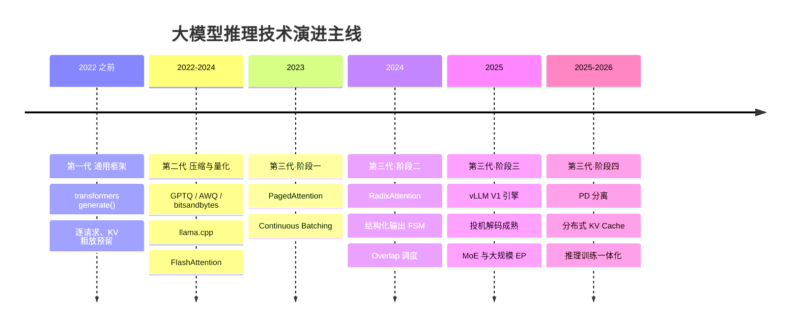
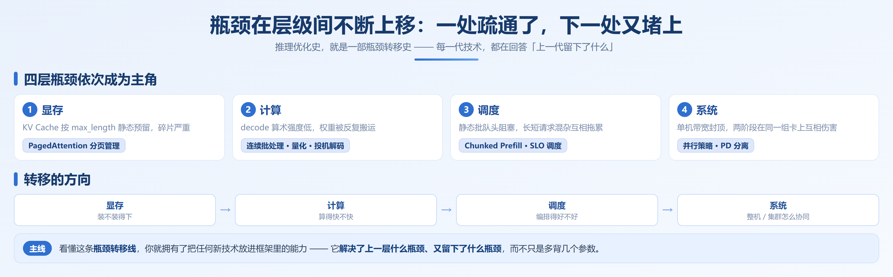

# 第 0 章　为什么需要一座 token 工厂

## 0.1 从大模型到大模型推理

大语言模型的快速发展给整个行业带来了一次罕见的能力跃迁。2022年底ChatGPT发布，两个多月用户破亿，跟机器对话解决问题第一次从演示变成了日常；随后开源社区迅速跟进，Glm、Qwen、DeepSeek 等一批开放权重模型接连问世，能力直逼闭源模型。短短三年，大模型从实验室项目变成了通用基础设施：写代码、做客服、做分析、等等。

模型遍地都是，新的问题随之而来：模型在哪儿跑？谁来跑？

个人开发者很简单——调个云端大模型API。

对于企业而言，把大模型用进生产，企业绕不开三道硬约束：

- **数据安全与合规**：客户资料、经营数据、代码不能流出内网，金融、医疗、政务还有明确的监管红线
- **规模化后的成本**：业务量一大，按 token 计费的 API 账单往往远超自建
- **自主可控**：核心业务不能被第三方的限流、涨价、停服左右

于是私有化部署成为大型企业——尤其是金融、电信、制造、政务——的共同选择：把开源权重模型下载下来，跑在自己的机房或私有云里。

本项目从实际工程问题出发，结合理论分析与实践经验，帮助读者了解大模型推理技术相关内容。

下面这些场景，你大概率都经历过：

- 在 ChatGPT / DeepSeek 的对话框里提问，看着回答一个词一个词地流出来
- 在代码里调用 OpenAI 风格的对话 API，传一个 prompt，收一段回复
- 下载一个开源模型，本地跑一句 `model.generate()`，看它输出什么

它们做的是同一件事，模型已经训练好了，现在把它用起来。这个用的过程，就叫推理（Inference）——给定训练完成的模型和一段输入，让模型生成输出。

### 0.1.1 训练一次，推理万亿次

大模型推理和训练的时间尺度完全不对等：

- 训练是一次性投入：一个模型从头到尾训一遍，即便对大厂，也是数月量级的一次性工程
- 推理是持续支出：模型上线之后，每一次提问、每一次 API 调用、Agent 的每一轮工具调用，都是一次推理，7×24 小时不间断

所以一个模型生命周期内的总算力消耗，大头在推理侧——业界普遍估计这个占比在九成以上（统计口径有差异，但大致意思差不多）。当用户规模到了亿级，持续支出四个字的分量不难想象。

由此先立一个后面会反复出现的判断：推理成本就是 AI 应用的边际成本。模型再聪明，推理又贵又慢，产品就立不住。这也是为什么过去两年，大模型推理技术吸引了大家的关注。

### 0.1.2 难的不是跑一遍，是服务化

刚接触时容易有一个直觉误解：推理嘛，不就是加载权重、跑一次前向？

单机、单用户、跑通实验，确实如此。真正难的是AI大模型做出服务化的那一刻：

- 不再是一个人在用，而是成千上万个请求同时到达——显存怎么分？谁先谁后？
- 用户在屏幕前实时等着——第一个字几秒内不出来就是超时，字与字之间的卡顿肉眼可见
- 每 1000 个 token 都是真金白银——成本压到多少，业务才跑得通？

这些问题没有一个是模型本身的问题，全部是AI工程化的问题。专门回答它们的这一层技术，叫推理引擎（vLLM、SGLang、TensorRT-LLM……）。从「`model.generate()` 能跑」到「生产级推理服务」之间的距离。

## 0.2 大模型推理到底难在哪

在深入讨论具体的推理优化技术之前，我们需要明白大模型推理究竟面临哪些挑战。

下面这五个难点由Transformer自回归生成的机理决定，与用什么引擎、什么硬件无关。大模型推理引擎能做的，是缓解、转嫁、绕开，而不是消除。

**问题1：自回归解码**

所谓自回归，就是拿已经生成的 token 去推下一个 token。第 N 个 token 必须等前 N−1 个全部算完才能开始，一环扣一环，没有任何并行空间。生成 1000 个 token，就是 1000 次串行的前向传播。

同样是让模型产出内容，别的方向都恨不得一次算完，只有文本是挤牙膏：

- 模型训练时：一次前向就把整个序列的所有 token 一起算掉，GPU 吃得饱饱的
- 图像扩散模型：虽然也要迭代几十步，但每一步是整张图并行去噪
- 文本生成：一个字一个字往外蹦，走一步算一步

后果很直接：延迟和输出长度成正比。想砍延迟，只有三条路——一步多 token、多请求一起走、让单步更快。大模型推理加速引擎的加速手段，兜兜转转都落在这三条里。

**问题2：内存墙——算力在等数据**

Decode 阶段每生成一个 token，都要把模型权重从 HBM 读进计算单元一次。以 7B 模型 BF16 权重为例，约 14GB，每步都要读一遍。

关键在于算术强度（每读一个字节能做多少次运算）：

- 训练时 batch × seq 很大，读一次权重可以做海量计算，算术强度高，瓶颈在算力
- Decode 时每步只有 1 个新 token 的计算量，却要读一遍全部权重，算术强度极低*瓶颈在 HBM 带宽而不在 FLOPS

一句话概括：算力在等数据。

现代GPU虽然具备强大的计算能力，但其内存带宽和容量无法与计算能力同步增长。

已NVIDIA A100 GPU 为例，其内存带宽为 2.0 TB/s，以FP16数据精度来计算，其算力可以达到312TFLOPS，这就导致带宽与计算能力出现了不匹配的情况，导致大模型在推理过程中遇到内存墙（Memory Wall，简称MW）。

**问题3：KV Cache——一份双重膨胀的显存账单**

为了避免每步重算全部历史，Attention 的 K/V 被缓存下来复用。代价是显存，而且它沿两个方向同时膨胀：

- 沿上下文长度膨胀：每多一个 token，多一份 K/V（线性）
- 沿并发请求数膨胀：每个请求都要一份独立的 K/V（线性）

更麻烦的是生命周期不可预知：请求什么时候结束、会生成多长，事前都不知道。这让给 KV Cache 划多少显存变成一道没有标准答案的题——划多了浪费，划少了 OOM。

在长上下文场景下，KV Cache 会反超模型权重，成为显存的主体。

**问题4：两个阶段，两种性格**

- Prefill（处理输入 prompt）：一次性并行计算成百上千个 token，矩阵乘饱满，算力密集（compute-bound）
- Decode（逐 token 生成）：每步只读权重、算很少，带宽密集（memory-bandwidth-bound）

两者最优的硬件配置、并行策略、批大小都不一样。硬塞在同一组 GPU 上，只能互相妥协。


**问题5：请求不可预测——长度未知、到达随机、分布异构**

- 输入长度事前可知，但输出长度事前不可知——模型不生成完，你不知道它要停在哪
- 到达是随机的，有突发，有波峰波谷
- 业务是混杂的：agentic 超长输入、RAG 共享文档、批量离线、交互式低延迟，可能同时打在一条服务上

后果：静态批处理必然低效。一个 batch 里只要有一个长尾请求没结束，其他已完成的槽位就空转——显存和调度都必须做成动态的，不能按预留 + 固定批次来设计。


**五个痛点 → 三个工程问题**

把这五个痛点翻译成工程语言，就是任何推理系统都必须回答的三个问题：

| 痛点 | 必须回答的工程问题 |
|---|---|
| 模型规模 + KV Cache 膨胀（痛点三） | 怎么装得下？ |
| 串行解码 + 内存墙（痛点一、二） | 怎么算得快？ |
| 两阶段异质 + 请求不可预测（痛点四、五） | 怎么服务得好？ |

而三代引擎的分工，恰好对应这三问：

| 代际 | 代表 |
|---|---|
| **第一代**：通用框架 | HuggingFace `transformers` |
| **第二代**：压缩与量化 | GPTQ / AWQ / bitsandbytes / llama.cpp |
| **第三代**：专用推理系统 | vLLM / SGLang / TensorRT-LLM / TGI |

注意一点：**第二、三代在时间上是重叠发展的，而且今天仍在叠加使用**，不要理解成「换代淘汰」。


## 0.3 第一代：HuggingFace Transformers

这一代的典型写法，你一定见过：

```python
outputs = model.generate(input_ids, max_new_tokens=256)
```

`transformers` 是一个**训练与研究框架**，`generate()` 是为「单机、单请求、把实验跑通」设计的，从来不是为「对外提供高并发服务」设计的。但它的历史贡献必须先讲清楚，因为今天所有引擎都站在它肩上：

1. **它确立了事实标准。** 权重格式（safetensors）、`config.json`、tokenizer 协议、`generate()` 的采样参数语义（temperature / top-p / top-k / repetition penalty）——后来每一个推理引擎都必须「兼容 transformers」，才能拿到整个开源模型生态。
2. **它把 KV Cache 变成了默认**（`use_cache=True`），并提供了一整套解码策略（greedy / beam search / sampling）。这些语义至今仍是所有推理服务 API 契约的一部分。

所以第一代不是落后两个字能概括的——它解决的是「有没有」的问题。

**服务化场景下的三个致命问题**

1. 显存严重浪费。请求实际生成 200 个 token，却按 2048 的 `max_length` 预留一整块连续显存。多出来的显存既不能被别的请求用，也算不进批大小。当时的实测里，KV Cache 的实际利用率常常只有 20%–40%。

2. 没有请求级调度。一个 batch 里只要有一个长请求没结束，其他已完成的槽位就空转——典型的队头阻塞。

3. 无并发、无抢占。显存一旦不够，直接 OOM，没有优雅的降级路径。


模型规模还小、请求量还低的时候，这些浪费不致命。一旦要对外提供服务，立刻崩盘。

有意思的是，社区被逼出来的第一反应不是「写一个服务框架」，而是「让模型小一点」——因为 2022–2023 年最痛的从来不是吞吐，而是装不下。这就引出了第二代。

## 0.4 第二代：模型压缩与量化工具

2023 年前后，70B 模型的 BF16 权重超过 140GB，一张 80GB 的 A100/H100 都装不下；消费级的 24GB 卡连 30B 都勉强。在谈并发、SLO 之前，先得解决这张卡能不能把它跑起来。

第二代的思路很朴素：既然读不下、算不起，就把模型变小。 三条路线同时推进。

**路线一：权重量化**

把 FP16 / BF16 权重压到 INT8 / INT4 / FP8，显存占用降到 1/2 – 1/4：

| 方法 | 核心思路 | 特点 |
|---|---|---|
| **RTN** | 直接四舍五入到低精度 | 最简单，4-bit 下精度掉得快，一般只作为基线 |
| **GPTQ**（2022） | 用少量校准数据，按二阶信息（Hessian）逐列量化并补偿误差 | 4-bit 首次真正可用；量化一次，推理长期受益 |
| **AWQ**（2023） | 激活感知：保护约 1% 的「关键权重」不量化 | 精度与硬件友好度平衡得好，工程上使用最广 |
| **SmoothQuant** | 平滑激活动态范围，将量化压力从激活转移至权重，实现 W8A8 | 实现 W8A8 权重 + 激活同时量化，解决激活直接 INT8 量化精度大幅下降的问题 |
| **bitsandbytes**（NF4 / LLM.int8()） | 4-bit 加载 + 异常值分块处理 | 让单卡微调与 4-bit 推理平民化（QLoRA 的基础） |

还有一条独立的支线：KV Cache 量化（FP8 乃至 2-bit）。它压缩的不是权重，而是痛点三那张双重膨胀的账单。

**路线二：轻量化运行时与图 / 内核优化**

- **llama.cpp + GGML/GGUF**：把大模型搬到 CPU、Apple Silicon、消费级显卡上。它的意义不在极限性能，而在**普及**——把「能跑」的门槛从数据中心拉到了桌面。
- **ONNX Runtime / TensorRT**：图优化、算子融合、常量折叠，把 PyTorch 的 eager 执行变成静态高效图。
- **FlashAttention / FlashInfer**：IO 感知的注意力内核，通过分块计算 + 在线 softmax 把注意力的 HBM 读写量降下来。**这是「算得快」的地基——第三代引擎全部站在它上面。**

**路线三：其它压缩手段**

蒸馏、结构化剪枝 / 稀疏、低秩分解。它们在特定场景（固定任务、垂直小模型）确实有效，但通用性与收益稳定性都不如量化，本教程不展开。


## 0.5 第三代：专用大模型推理系统——把服务做好（2023–2026 年）

**视角切换：从「一个模型的一次前向」到「一批请求的一段时间」**

第三代的本质变化不是某一项技术，而是**优化视角的切换**：

- 第一代、第二代眼里的对象是**模型**：权重多少 GB、前向多少 FLOPS
- 第三代眼里的对象是**服务**：显存池怎么分、请求怎么排队、KV 怎么复用、SLO 怎么保

一句话概括：**第二代让一个请求跑得更省，第三代让一堆请求跑得更满。**

从 2023 到 2026 年，这一代内部仍然沿着同一条瓶颈转移链往前走，可以清楚地分成四个阶段。

### 0.5.1 阶段一：显存管理革命与连续批处理（2023 年）

**突破口：PagedAttention**

2023 年 vLLM 提出 PagedAttention，直接借用了操作系统的虚拟内存分页思想：

- 把 KV Cache 切成固定大小的块（block，通常 16–32 个 token）
- 逻辑上连续的序列，物理上可以存在不连续的块里
- 通过块表（block table）做逻辑块到物理块的映射
- 按需分配，不用预留
- 相同前缀的块可以写时复制（Copy-on-Write）共享

这一个改动，把 KV Cache 的实际利用率提到了 **90% 以上**（官方论文与后续实测普遍在 90%–95% 区间）。显存利用率的提升直接换算成**更大的批大小**，批大小又直接换算成**更高的吞吐**。

### 0.5.2 阶段二：跨请求复用与结构化生成（2024 年）

**突破口：RadixAttention**

SGLang 用一棵**基数树**（Radix Tree）管理所有请求的 KV Cache：

- 每个节点是一段 token 前缀，挂着对应的 KV 块索引
- 新请求进来先做最长前缀匹配，命中的部分直接复用，只 prefill 没命中的后缀
- 淘汰用 LRU，正在使用的节点用引用计数锁定
- 默认开启，无需配置

这里的收益取决于**你的请求有多相似**。公开报告里，前缀复用场景相对无复用的性能提升可达数倍量级，生产环境的缓存命中率在 **50%–75%** 区间。但如果所有 prompt 都独一无二，收益趋近于零——**这是一切前缀缓存技术的前提，后面第 4 章会专门讲如何验证命中率。**

Agent 应用爆发之后，**模型必须吐出能被程序解析的 JSON**从加分项变成了硬需求。

早期的做法是「生成完再校验，错了重试」，代价极高。2024 年成熟的方案是把约束编译成**有限状态机**，在解码每一步直接把非法 token 的 logits 屏蔽掉——非法输出在物理上根本不可能产生。xgrammar 等引擎进一步做了压缩 FSM 和 jump-forward，把必然连续的 token 串一次性吐出，结构化输出的解码开销大幅下降。

**同期：调度器的 CPU 开销浮出水面**

当 GPU 侧的优化做到一定程度后，**CPU 侧的调度开销**开始变得刺眼：每解码一步，CPU 都要准备 batch 元数据，这段时间 GPU 在空转。

解法是 **overlap scheduling**——把 CPU 的准备工作藏到 GPU forward 的时间窗里；再配合 CUDA Graph 把整个 decode 循环捕获成图，一次提交，几乎消除逐 step 的 launch 开销。

### 0.5.3 阶段三：引擎架构重构与投机解码（2025 年）

**突破口：引擎架构重写**

vLLM 在 v0.8.0 把 V1 引擎转为默认，这是一次彻底的架构重写：

- **多进程架构**：scheduler、EngineCore、tokenizer、detokenizer、API server 分进程，彻底解除 Python GIL 的束缚
- **统一调度**：取消 prefill / decode 的人为阶段区分，token 统一处理
- **Persistent Batch**：输入张量用 NumPy 缓存并增量更新，不再每步从 Python 侧重建

官方数据显示，V1 相对 V0 在 Llama 3.1 8B 和 3.3 70B 上吞吐提升最高约 **1.7 倍**。

有意思的是，**这个 1.7 倍里没有一项来自新的 AI 算法**。它全部来自工程架构——把 CPU 开销、进程阻塞、数据重建这些「非算法」的损耗清掉。这是推理优化进入深水区的标志：**红利从算法层转移到了系统层。**

**突破口：投机解码走向实用**

既然 decode 是「一步一 token」的串行过程，那就想办法**一步多 token**：

1. 用轻量模型（EAGLE / draft model / MTP head / N-gram）快速猜出后续若干个候选 token
2. 主模型一次前向，**并行验证**这些候选
3. 接受的直接用，拒绝的从第一个错误处回退

因为验证是并行的，而 draft 很便宜，整体上就等于用一次前向的代价换到了多个 token。这一步直接**攻击了 decode 的访存墙**——原本读一次权重只产出一个 token，现在能产出好几个。

值得注意的是，这条路线内部也在继续演进：早期方案（EAGLE / MTP）的草稿仍是一个 token 一个 token 串行猜的；2026 年起，**并行起草**（P-EAGLE、DFlash、DSpark）把「猜」也变成了并行——草稿一次前向吐出整块候选，起草成本不再随块长线性增长。瓶颈从「草稿太慢」进一步转移到「验证太多会被拒的候选」（DSpark 用置信度头解决）。这正是本章主线「瓶颈转移」在投机解码内部的又一次上演，细节见第 7 章 7.4 节。

**突破口：MoE 普及带来的专家并行**

DeepSeek 等 MoE 模型成为主流后，传统的 TP/PP 切法不再适用。MoE 的专家层需要 **Expert Parallel（EP）**，而 EP 的核心瓶颈变成了 All-to-All 通信。大规模 EP（如 DeepEP）成为服务超大 MoE 模型的必备能力。

### 0.5.4 阶段四：分离式与集群化（2025–2026 年）

**突破口：Prefill-Decode 分离**

回到全书最重要的一组区分：

- **Prefill**：一次性并行计算大量 token，**算力密集**
- **Decode**：每步只读权重、算很少，**带宽密集**

把这两个阶段放在同一组 GPU 上，必然互相干扰：长 prompt 的 prefill 会卡住正在进行的 decode（TTFT 和 TPOT 直接打架）；而为了 decode 配的显存带宽，prefill 阶段又用不上。

**PD 分离**的做法很直接：**把 prefill 和 decode 拆到不同的 GPU 池，各自按需配比和扩缩容，中间通过高速网络（NVLink / RDMA）传输 KV Cache。**

配套的关键技术：

- **KV 传输层**：NIXL、GPUDirect RDMA 等点对点传输库
- **分布式 KV 存储**：Mooncake 等方案把 KV 块做成集群级共享资源，跨请求、跨节点复用。公开报告在 agentic 负载上给出了相当可观的吞吐提升与 TTFT 下降
- **PD 分离 + 前缀缓存协同**：分离之后仍然要保持 radix / prefix cache 的命中能力
- **与 NVIDIA Dynamo 等编排层集成**

**同期：推理与训练一体化**

RL 后训练（RLHF / RLVR）的规模化，让「推理引擎」开始承担训练循环中的 rollout 职责。这带来一批新需求：权重的快速热更新、训练与推理的数值一致性、显存的让渡与复用（如 sleep mode）。

**同期：硬件版图扩张**

从 NVIDIA 一家独大，到 AMD ROCm、Intel Gaudi/XPU、Google TPU、以及国产 NPU（昇腾等）都需要被支持。引擎层的硬件抽象成为刚需能力。


## 0.6 演进小结：三代主线与瓶颈转移

**三代引擎的分工**

| 代际 | 时期 | 代表 | 优化对象 | 解决 | 不解决 |
|---|---|---|---|---|---|
| **第一代** | 2022 及之前 | HuggingFace `transformers` | 单请求的一次生成 | 把模型跑起来；确立生态标准 | 显存利用率、并发、调度、SLO |
| **第二代** | 2022–2024 | GPTQ / AWQ / bitsandbytes / llama.cpp / FlashAttention | 模型本身体积与访存量 | 装得下、跑得起、成本降下来 | 服务化的一切（调度、并发、SLO） |
| **第三代** | 2023–2026 | vLLM / SGLang / TensorRT-LLM / TGI / LMDeploy | 一批请求在一段时间内的资源分配 | 吞吐、并发、SLO、集群扩展 | 精度代价（交给第二代）、效果本身 |

**注意时间上是重叠的**：第二、三代几乎同时发展，而且今天仍在叠加使用。「第几代」说的是**问题域的划分**，不是「谁淘汰了谁」。

**第三代内部的四个阶段**

| 阶段 | 时期 | 主要瓶颈 | 突破技术 | 暴露的新瓶颈 |
|---|---|---|---|---|
| 阶段一 | 2023 | 显存碎片、批处理队头阻塞 | PagedAttention、Continuous Batching | 请求间重复计算 |
| 阶段二 | 2024 | 跨请求冗余、结构化输出低效、CPU 调度空转 | RadixAttention、压缩 FSM、overlap 调度 | decode 访存墙 |
| 阶段三 | 2025 | decode 串行低效、引擎自身开销、MoE 部署 | V1 引擎重构、投机解码、大规模 EP | 两阶段资源错配 |
| 阶段四 | 2025–2026 | 单机资源错配、规模上限 | PD 分离、分布式 KV、集群编排 | 网络带宽、运维复杂度 |

把三代和阶段叠在一起，就是完整的时间线：





三条从这条线里读出来的判断

1. **优化重心在持续上移。** 从算子 → 显存 → 请求 → 引擎 → 集群，每一层的问题解决了，瓶颈就往上一层跑。
2. **收益越来越依赖场景。** 第二代的优化（让模型变小）几乎对所有人都有效；到了第三代阶段四，PD 分离对某些负载是数倍提升，对另一些是负优化。**「抄参数」在后期技术里基本失效。**
3. **系统工程的权重超过算法。** V1 引擎那 1.7 倍是个信号——纯粹的架构改进，不含任何新算法。

## 0.7 什么是「token 自由」

读者看到这里的时候，可能就简单的理解为“无限制地造 token”，但实际上很难做到token无穷。

| 维度 | 「token 自由」的含义 | 反面（不自由） |
| --- | --- | --- |
| **产能不受单点限制** | 加卡能大致线性地扩产能，不被单机、单卡卡死 | 加了一张卡，吞吐没怎么涨 |
| **成本可测可控** | 每百万 token 的成本算得清、能比较、能优化 | 月底看账单才知道花了多少 |
| **性能可守** | 承诺的 TTFT / P99 在真实负载下守得住 | 压测好看，一上量就崩 |

**这三条，就是本书的验收标准。** 从第 0 章到第 23 章，每一章都在为其中至少一条服务。

那么这本书怎么组织？答案是：**沿着瓶颈的层级，从下往上走**——四幕：

| 幕 | 章 | 回答 | 你会得到 |
| --- | --- | --- | --- |
| **第一幕　目标** | 0–3 | 我要造什么？为什么值得造？ | 一张工厂全景图 + 一套产能语言 |
| **第二幕　原理与引擎** | 4–14 | 它为什么难？引擎在解决什么？ | 看得懂引擎、会部署、会调 |
| **第三幕　工具** | 15–18 | 有没有现成方案把零件串起来？ | 一座能跑起来的 GPUStack 工厂 |
| **第四幕　运营** | 19–23 | 工厂怎么持续产出、怎么算钱？ | 成本模型 + 治理能力 |

每一章都遵循同一个三问结构：

1. **它解决了什么瓶颈？**（原理层）
2. **怎么开、开多少？**（实操层）
3. **什么情况下不该开？**（工程层）

第三个问题尤其重要。**知道一个优化什么时候不该用，比知道怎么开更有价值**——这也是大多数资料缺失的部分。

## 本章小结

1. **大模型推理有五个机理级痛点**：自回归串行、内存墙、KV Cache 双重膨胀、Prefill/Decode 两阶段异质、请求不可预测。它们由模型本身的运作方式决定，三代技术能缓解、转嫁、绕开，但无法消除。

2. **五个痛点收敛成三个工程问题**：装得下、算得快、服务得好。三代引擎的分工恰好对应这三问——第一代 `transformers` 把模型跑起来并确立生态标准；第二代压缩与量化解决「装得下」；第三代专用推理系统解决「服务得好」。

3. **第二代与第三代是叠加关系，不是替代关系。** 量化作用在模型侧（权重占多少字节），引擎作用在系统侧（这些字节怎么被调度）。今天的标准配置是「第三代引擎 + 第二代量化」，两者的参数必须一起决定。

4. **第三代内部仍是一条四阶段的瓶颈转移链**：显存管理（2023）→ 跨请求复用（2024）→ 引擎重构与投机解码（2025）→ 分离式与集群化（2025–2026）。每解决一个瓶颈，就暴露下一个。

