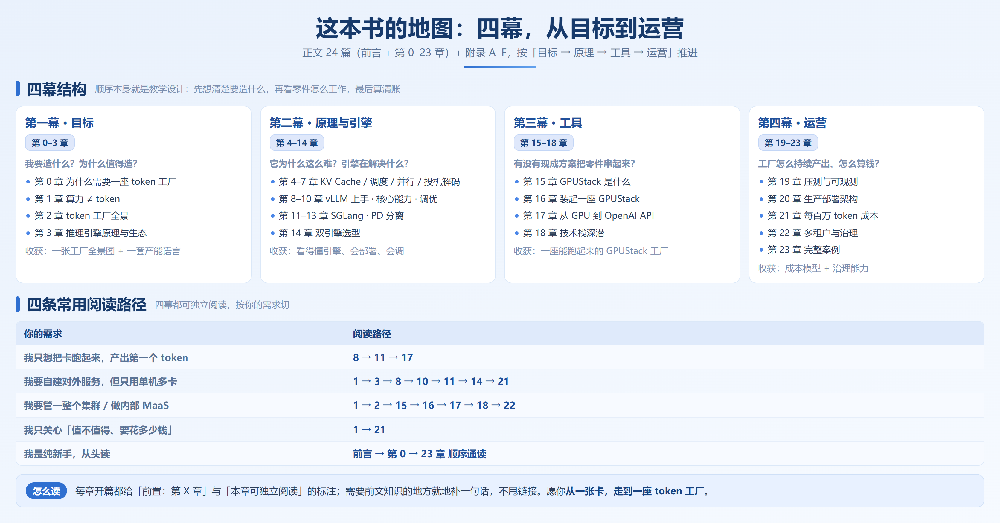

# 前言

先说一个正在无数企业里重复上演的场景。

公司决定把 AI 用进业务——跑内部知识库、接客服、做文档处理。

可两条硬约束横在面前：

**1.敏感数据不能出内网**，客户资料和经营数据一旦外流就是事故；

**2.按 token 计费的云 API，量一大账单就压不住**。

于是私有化部署一定会提上日程，卡买回来了，模型也下载了，`vllm serve` 或 `python -m sglang.launch_server` 一敲，服务跑了，demo 演示很漂亮。

然后呢？接下来全是答不上来的问题：

- 业务量一上来，响应慢到没法用，你分不清是卡在排队，还是卡在调度
- 网上抄来一份「性能拉满」的配置，跑在自己机器上反而更慢

成本与隐私这两股力量，正把越来越多的推理负载从云端赶回企业自己的机房。但卡买回来只是起点——卡躺在机房里，不等于在产 token。 从服务能跑起来到算力真正变成业务需要的产能，中间隔着一整层没人系统讲过的工程问题，而这一层，正随着私有化部署的普及变得绕不过去。

把企业手里的算力卡，变成源源不断、可计量、可交付的 token，算力不是稀缺品，**能用的 token 才是**。

## 为什想写这个项目

在实际的工作中照着文档把 vLLM 跑了起来——这一步不难，复制一条启动命令就行。难的是之后。资料天生有三层断层：

1. **官方文档只讲参数不讲取舍。** 每个开关都写着是什么，却没写该不该开、开多大、开了要付出什么代价。
2. **技术博客只给命令不给原理。** 照抄一套「优化好的配置」，到你的环境里毫无效果——那是针对别人的模型、别人的机器、别人的业务调出来的。
3. **论文只讲创新不讲落地。** 读懂了 PagedAttention 的思路，但「我的场景该不该用」，论文不会告诉你。

笔者是某AI从业者，主要从事企业的AI数智化相关的工作，在实际工作中慢慢积累了一些个人的笔记，同时发现社区并没有一个成体系化的内容，既然没有那就创造一个。

## 这门课不讲什么

在开始了解项目前，先把边界划清楚，帮你判断它适不适合你。以下内容不在范围内：

- **不教模型训练。** 只讲推理。第 12 章会提到训练场景怎么用推理引擎（RL rollout），但那只是「推理引擎的一个用法」。
- **不写 CUDA 代码。** FlashAttention、PagedAttention 的原理会讲透，但不教你写 GPU 程序。
- **不深挖硬件。** 只用到理解问题所需的最低限度——带宽、算力这些词都会先解释，芯片内部结构不展开。
- **不管应用层。** Prompt 怎么写、Agent 怎么搭、RAG 怎么建，都有更合适的资料。这本书管的是它们脚下那一层：推理服务。

一句话：**从「模型能跑起来」到「服务又稳又省、还算得清账」，中间那一层，就是这本书的全部内容。**

## 写给谁

| 你是这样的学习者                   | 建议这么读                              |
| -------------------------- | ---------------------------------- |
| AI Infra 初学者，第一次给自己的卡搭推理服务 | 从第 0 章按 0 → 23 顺序通读，跟着动手实验走        |
| 算法 / 后端工程师，被派去部署推理服务       | 第一幕快速过，重点第二幕（原理与引擎）+ 第三幕（GPUStack） |
| 有卡但闲置的个人 / 小团队             | 第一幕 + 第 21 章，先算清「值不值得」             |
| 企业 IT / 平台团队，要做内部 MaaS     | 重点第三幕 + 第四幕                        |
| 只想要理论 / 只想动手               | 见下面「四条阅读路径」，可任意切入                  |

前置知识：

- 会 Python 的基本语法
- 知道大模型是「一个字一个字往外蹦」的
- 用过命令行（Linux 或 WSL2 都行），知道 Docker 是干什么的；不熟也没关系，第 8、16 章会手把手带你装环境

如果连这些也还欠缺，建议先学 [Happy-LLM](https://github.com/datawhalechina/happy-llm)，再来读这本。

## 难度和硬件标记

每个小节都带标记，你可以按自己的情况跳读：

| 标记                | 意思                       |
| ----------------- | ------------------------ |
| ★☆☆ / ★★☆ / ★★★   | 难度：基础 / 进阶 / 高阶          |
| 🖥️ / 🖥️🖥️ / ☁️ | 硬件要求：一张卡 / 一台多卡机器 / 多台机器 |
| ⏭️                | 可以先跳过，不影响主线              |

## 按需阅读路径

四幕都是可独立阅读的模块。按你的需求切：

| 你的需求                 | 阅读路径                           | 前置 |
| -------------------- | ------------------------------ | -- |
| 我只想把卡跑起来，产出第一个 token | 8 → 11 → 17                    | 无  |
| 我要自建对外服务，但只用单机多卡     | 1 → 3 → 8 → 10 → 11 → 14 → 21  | 无  |
| 我要管一整个集群 / 做内部 MaaS  | 1 → 2 → 15 → 16 → 17 → 18 → 22 | 无  |
| 我只关心「值不值得、要花多少钱」     | 1 → 21                         | 无  |
| 我想系统学推理原理            | 4 → 5 → 6 → 7                  | 无  |
| 我要做引擎选型决策            | 3 → 14 → 21                    | 无  |
| 我是纯新手，从头读            | 前言 → 0 → 23 顺序通读               | 无  |

每章开篇都会给「前置：第 X 章」与「本章可独立阅读」的标注；需要前文知识的地方，就地用一句话补齐，不甩链接。

## 版本基线与配套代码

推理引擎和平台更新很快，参数名、默认值经常变。这本书写作时验证的版本：

| 组件       | 基线版本                             | 备注                                  |
| -------- | -------------------------------- | ----------------------------------- |
| GPUStack | v2.2.x+                          | 第三幕的主线平台                            |
| vLLM     | v0.20.x                          | V1 引擎为默认                            |
| SGLang   | v0.5.18+                         | 含 Spec V2、ShadowRadix、SGLang Router |
| PyTorch  | 2.11+                            | 随引擎安装，一般无需单独装                       |
| 操作系统     | Ubuntu 22.04 + CUDA 12.4+ / 13.0 | Windows 用户建议用 WSL2                  |

**写作约定**：正文里出现任何参数名，都会注明适用版本，提醒「更高版本请核对官方文档」；同一个功能在两个引擎里参数名不一样时，会给出对照表（附录 B）。

配套代码统一放在仓库 `src/` 目录，每章一个文件夹，自带 `README.md` 和一键运行脚本，实验结果输出成表格文件。**这本书的可信度来自可复现，不来自断言**——书里的每个性能结论，你都能用配套脚本在自己的机器上验证。

## 环境准备清单

动手之前，按下表准备。大部分章节一张卡就够；要求多卡的地方都写了替代方案。

| 项目        | 基线配置                                 | 说明                                           |
| --------- | ------------------------------------ | -------------------------------------------- |
| GPU（最低体验） | 单卡 24GB（4090 / L20）                  | 跑通第一个推理服务                                    |
| GPU（基准）   | 单机 4–8 卡（4090×4 / A800 / H20 / H800） | 并行、多卡部署、GPUStack 的甜点区                        |
| GPU（进阶）   | 多机异构 / 云 GPU                         | 标 ☁️，附「没有这个硬件怎么验证」的替代方案                      |
| 操作系统      | Ubuntu 22.04 + CUDA 12.4+ / 13.0     | **GPUStack Worker 仅支持 Linux**；Windows 走 WSL2 |
| 容器        | Docker + NVIDIA Container Toolkit    | 装引擎与平台的首选方式                                  |
| 驱动        | NVIDIA 驱动 550+                       |                                              |
| Python    | 3.10 – 3.12                          |                                              |
| 网络        | 能访问 HuggingFace / ModelScope（或国内镜像）  | 下载模型是动手第一步                                   |

演示模型固定用这几个：

- **Qwen3.5-0.8B**：主力演示模型，大多数章节用它
- **DeepSeek 系列**：讲 MoE、MLA 等场景时用
- **Llama-3.1-8B**：和公开测试结果对照时用

统一模型是为了少让你在「环境为什么跑不起来」上耗时间——**学推理最大的摩擦力从来不是概念，而是环境。**

## 开始之前

最后交代这本书的主线：**推理优化史，就是一部瓶颈转移史。**

第 0 章你会看到，过去几年推理技术的每一次跃迁——分页、前缀复用、投机解码、PD 分离——都是同一个模式：一层瓶颈解决了，瓶颈就转移到下一层。看懂这条主线，你就拥有了把任何新技术放进框架里的能力，而不只是多背几个参数。

从一张卡，到一座 token 工厂

> **下一章**：[第 0 章　为什么需要一座 token 工厂](./ch00-为什么需要token工厂.md)
