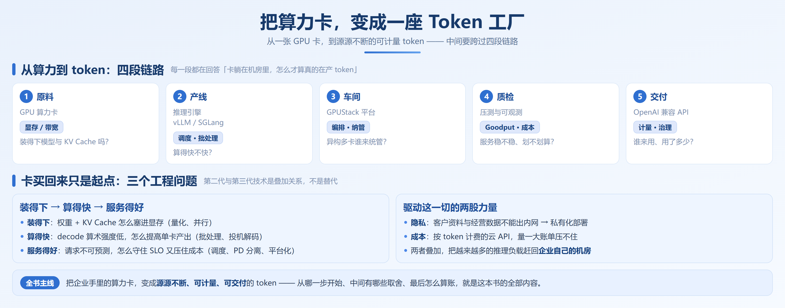

# 前言

先说一个正在无数企业里重复上演的场景。

公司决定把 AI 用进业务——跑内部知识库、接客服、做文档处理。可两条硬约束横在面前：

**1. 敏感数据不能出内网**，客户资料和经营数据一旦外流就是事故；

**2. 按 token 计费的云 API，量一大账单就压不住。**

于是私有化部署提上日程，卡买回来了，模型也下载了，`vllm serve` 或 `python -m sglang.launch_server` 一敲，服务跑了，demo 演示很漂亮。

然后呢？接下来全是答不上来的问题：

- 业务量一上来，响应慢到没法用，你分不清是卡在排队，还是卡在算
- 网上抄来一份「性能拉满」的配置，跑在自己机器上反而更慢

成本与隐私这两股力量，正把越来越多的推理负载从云端赶回企业自己的机房。但卡买回来只是起点——**卡躺在机房里，不等于在产 token。** 从服务能跑起来到算力真正变成业务需要的产能，中间隔着一整层没人系统讲过的工程问题。

把企业手里的算力卡，变成源源不断、可交付的 token：算力不是稀缺品，**能用的 token 才是**。

## 为什么想写这个项目

很多人照着文档把 vLLM 跑了起来——这一步不难，复制一条启动命令就行。难的是之后。资料天生有三层断层：

1. **官方文档只讲参数不讲取舍。** 每个开关都写着是什么，却没写该不该开、开多大、开了要付出什么代价。
2. **技术博客只给命令不给原理。** 照抄一套「优化好的配置」，到你的环境里毫无效果——那是针对别人的模型、别人的机器调出来的。
3. **论文只讲创新不讲落地。** 读懂了 PagedAttention 的思路，但「我的场景该不该用」，论文不会告诉你。

既然社区没有一份成体系的内容，那就写一份。

## 这门课不讲什么

先把边界划清楚，帮你判断它适不适合你：

- **不教模型训练。** 只讲推理。第 12 章会提到训练场景怎么用推理引擎（RL rollout），但那只是「推理引擎的一个用法」。
- **不写 CUDA 代码。** FlashAttention、PagedAttention 的原理会讲透，但不教你写 GPU 程序。
- **不深挖硬件。** 只用到理解问题所需的最低限度——带宽、算力这些词都会先解释，芯片内部结构不展开。
- **不管应用层。** Prompt 怎么写、Agent 怎么搭、RAG 怎么建，都有更合适的资料。这本书管的是它们脚下那一层：推理服务。
- **不教平台与运营。** GPUStack 这类管控平台、压测体系、成本核算、多租户计费，都不在本书里——第 2 章只交代它们在工厂里的位置，不教怎么装、怎么运营。

一句话：**从「模型能跑起来」到「服务又稳又快」，中间那一层，就是这本书的全部内容。**

## 写给谁

| 你是这样的学习者 | 建议这么读 |
| --- | --- |
| AI Infra 初学者，第一次给自己的卡搭推理服务 | 从第 0 章按 0 → 14 顺序通读，跟着动手实验走 |
| 算法 / 后端工程师，被派去部署推理服务 | 第一幕快速过，重点第二幕 |
| 有卡但闲置的个人 / 小团队 | 第一幕 + 第 14 章，先算清「值不值得」 |
| 企业 IT / 平台团队，准备做内部 MaaS | 前两幕全读，作为上平台之前的地基 |
| 只想要理论 / 只想动手 | 见下面「按需阅读路径」，可任意切入 |

前置知识：

- 会 Python 的基本语法
- 知道大模型是「一个字一个字往外蹦」的
- 用过命令行（Linux 或 WSL2 都行），知道 Docker 是干什么的；不熟也没关系，第 8 章会手把手带你装环境

如果连这些也还欠缺，建议先学 [Happy-LLM](https://github.com/datawhalechina/happy-llm)，再来读这本。

## 一条故事线：八周，从一张卡到一条产线

「从一张卡到一座 token 工厂」不是一句口号，它是一条按时间推进的工程线。为了让你提前看清这条路，我们把它钉在一个具体的处境上——人设是虚构的，撞上的墙全部来自真实项目：

> **你是某集团信息中心的一名工程师。** 集团要做 AI 数智化，第一批落地三件事：内部知识库问答、客服辅助、合同与工单的文档处理。两条红线：数据不出内网；按 token 计费的云 API 不给批预算。于是批下来 8 张卡（8×L20 48GB）、一台机器，和一句验收要求——**「两个月内上线，先支撑 200 人日常使用，别让我看到转圈。」**

接下来八周你会依次撞上的墙，就是全书的两幕：

| 幕 | 时间 | 你遇到的事 | 你当时想不通的问题 | 章节 | 走出来时手里有什么 |
| --- | --- | --- | --- | --- | --- |
| **第一幕 目标** | 第 1–2 周 | 照着文档敲下一行 `vllm serve`，服务起来了，demo 很漂亮。200 人一上来，慢到被投诉；想再挂两个模型，直接 OOM | 到底慢在哪？是排队，还是每步算得慢？一台机器由哪些部件组成，我该动哪一个？ | 0–3 | 一张工厂全景图 + 一套引擎解剖图（四大件），一套能说清瓶颈的语言（TTFT / TPOT / Goodput、Prefill vs Decode、显存账本） |
| **第二幕 原理与引擎** | 第 3–8 周 | 多挂一个模型就爆显存；并发一高延迟就崩；70B 单卡装不下；一份长合同把短问答全挤死；decode 一步只出一个词，怎么都快不起来 | 显存怎么分？请求怎么排？一台不够怎么办？能不能一次多算几个 token？ | 4–14 | 会算显存、会批处理、会切并行、会用投机解码；两套引擎都开得起来，知道什么负载该用哪一套 |

第八周周末你能交出的东西，是一句可验证的话：**这 8 张卡，跑哪几个模型、扛得住多少并发、P99 是多少**——而不是「服务能跑，但我不敢压」。

### 为什么必须是这个顺序

因为**每一步的解法，都会制造出下一步的问题**。这正是第 0 章要讲的那条主线：推理优化史，就是一部瓶颈转移史。落到你这个项目上，它长这样：

- 你把显存管好了（分页、前缀复用），能同时装的请求变多了 → 瓶颈立刻转移到**调度**：这么多请求，谁先算？
- 你把调度做好了（连续批处理、Chunked Prefill），单机吞吐顶到天花板 → 瓶颈转移到**并行**：一台机器不够，怎么拼多台？
- 你把并行切好了、多机也跑满了 → 瓶颈转移到**单步延迟**（投机解码）和**负载结构**（PD 分离）——长文和短问答根本不该挤在同一条线上。
- 到这里，单机的账基本算清了，剩下的是一个选择题：**这两套引擎，我的负载该用哪一套？**

所以章节顺序不是按「技术难度」排的，是按**一个项目真实撞墙的先后**排的。跳读省下的是时间，欠下的是因果——后面总有一章，你会突然看不懂「为什么非要这样做」。

### 两个数字，从第 1 章算到第 14 章

故事线要有具体的数字才立得住。全书有两个数，几乎每一章都在重算：

| 数字 | 第一次出现 | 中途怎么变 | 最后一次出现 |
| --- | --- | --- | --- |
| **SLO**（P99 延迟 / TTFT / 可用性） | 第 1 章：先把「快」定义成一个可测的数 | 每一轮优化都在问「达标没有、还剩多少余量」 | 第 14 章：按负载特征选引擎，前提是它守得住你的 SLO |
| **显存预算**（权重 + KV + 碎片） | 第 1 章：一张显存账本 | 第 4 章算 KV，第 6 章除以并行数，第 10 章留出余量 | 第 10 章：`gpu-memory-utilization` 到底该留多少 |

把这两个数算清，第三个数字——每百万 token 多少钱——自然就出来了，它只是「固定成本 ÷ 产能」。产能从哪来，就是这本书要给你的东西。

## 难度与硬件标记

第 10 章这类逐节给结论的调优章，小节标题后会标难度（★☆☆ 基础 / ★★☆ 进阶 / ★★★ 高阶）和硬件要求（🖥️ 一张卡 / 🖥️🖥️ 单机多卡 / ☁️ 多台机器）。标 ⏭️ 的小节第一遍可以跳过，不影响主线。

## 按需阅读路径

上面那条是主线。两幕也都是可独立阅读的模块——想直奔自己需要的那一段，就按下面切：

| 你的需求 | 阅读路径 | 前置 |
| --- | --- | --- |
| 我只想把卡跑起来，产出第一个 token | 8 → 11 | 无 |
| 我要自建对外服务，但只用单机多卡 | 1 → 3 → 8 → 10 → 11 → 14 | 无 |
| 我想系统学推理原理 | 1 → 4 → 5 → 6 → 7 | 无 |
| 我要做引擎选型决策 | 3 → 14（配合 4、5 理解差异来源） | 无 |
| 我只关心「值不值得、要花多少钱」 | 1 → 10 → 14 | 无 |
| 我是纯新手，从头读 | 前言 → 0 → 14 顺序通读 | 无 |

需要前文知识的地方，书里就地用一句话补齐，不甩链接——所以上面这些路径真能跳着读。

## 全书地图

| 幕 | 章 | 讲什么 | 你会得到 |
| --- | --- | --- | --- |
| **第一幕 目标** | 第 0 章 | 推理演化史、三代引擎、瓶颈转移 | 为什么需要一座工厂 |
| | 第 1 章 | TTFT / TPOT / Goodput、Prefill vs Decode、显存账本 | 一套产能语言 + 第一性原理 |
| | 第 2 章 | 工厂五层剖面图、vLLM / SGLang / GPUStack 的生态位 | 一张地图，知道自己在哪一层 |
| | 第 3 章 | 引擎四大件、生态全景、出厂规格怎么看 | 引擎是什么、卖点落在哪 |
| **第二幕 原理与引擎** | 第 4–7 章 | KV Cache、调度与批处理、并行策略、投机解码 | 原理四件套 |
| | 第 8–10 章 | vLLM 上手指南、核心能力、性能调优 | 一条能跑、能调的 vLLM 产线 |
| | 第 11–13 章 | SGLang 上手、核心能力、PD 分离 | 一条低延迟产线 |
| | 第 14 章 | 双引擎横向对比、国产化适配、选型决策树 | 一个说得清理由的选择 |

## 版本基线与配套代码

推理引擎更新很快，参数名、默认值经常变。这本书写作时验证的版本：

| 组件 | 基线版本 | 备注 |
| --- | --- | --- |
| vLLM | v0.20.x | V1 引擎为默认 |
| SGLang | v0.5.18+ | 含 Spec V2、ShadowRadix、SGLang Router |
| PyTorch | 2.11+ | 随引擎安装，一般无需单独装 |
| 操作系统 | Ubuntu 22.04 + CUDA 12.4+ / 13.0 | Windows 用户建议用 WSL2 |

**这一份就是全书统一的版本基线，各章不再重复声明。** 动手前请以自己所装版本的官方文档为准——投机解码、PD 分离、量化这几类参数在版本间改名最频繁。正文只在参数确实随版本变化的地方单独标注一句，同一个功能在两个引擎里参数名不一样时，会给出对照表。

配套代码统一放在仓库 `src/` 目录，每章一个文件夹，自带 `README.md` 和一键运行脚本，实验结果输出成表格文件。**这本书的可信度来自可复现，不来自断言**——书里的每个性能结论，你都能用配套脚本在自己的机器上验证。

## 环境准备清单

动手之前，按下表准备。大部分章节一张卡就够；要求多卡的地方都写了替代方案。

| 项目 | 基线配置 | 说明 |
| --- | --- | --- |
| GPU（最低体验） | 单卡 24GB（4090 / L20） | 跑通第一个推理服务 |
| GPU（基准） | 单机 4–8 卡（4090×4 / A800 / H20 / H800） | 并行、多卡部署的甜点区 |
| GPU（进阶） | 多机异构 / 云 GPU | 标 ☁️，附「没有这个硬件怎么验证」的替代方案 |
| 操作系统 | Ubuntu 22.04 + CUDA 12.4+ / 13.0 | Windows 走 WSL2 |
| 容器 | Docker + NVIDIA Container Toolkit | 装引擎的首选方式 |
| 驱动 | NVIDIA 驱动 550+ | |
| Python | 3.10 – 3.12 | |
| 网络 | 能访问 HuggingFace / ModelScope（或国内镜像） | 下载模型是动手第一步 |

演示模型固定用这几个：

- **Qwen3.5-0.8B**：主力演示模型，大多数章节用它
- **DeepSeek 系列**：讲 MoE、MLA 等场景时用
- **Llama-3.1-8B**：和公开测试结果对照时用

统一模型是为了少让你在「环境为什么跑不起来」上耗时间——**学推理最大的摩擦力从来不是概念，而是环境。**

## 开始之前

最后交代一句话：这本书真正想给你的不是参数表，是**判断力**。参数三个月就变，判断力不会——它只来自你亲手看过一次瓶颈怎么转移：分页解决了显存，瓶颈跑到调度；调度解决了吞吐，瓶颈跑到并行；并行也压满了，瓶颈跑到单步延迟。

第 14 章那道选型题，和你第一周面对的是同一台机器。区别只在于：那时候你知道怎么把它跑起来，现在你知道它为什么这样跑。

从一张卡，到一条能产 token 的产线

> **下一章**：[第 0 章　为什么需要一座 token 工厂](./ch00-为什么需要token工厂.md)
